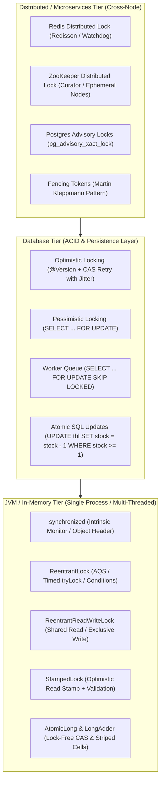
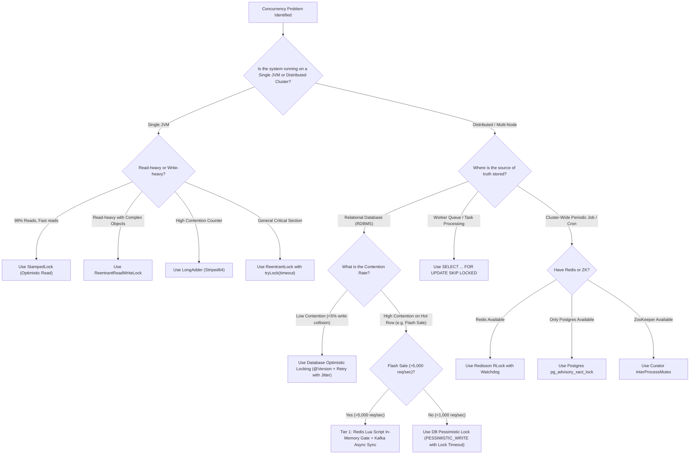

# Locking Architecture & Comprehensive Comparison Matrix

This document provides a holistic architectural blueprint and decision framework for locking across **JVM In-Memory**, **Database (RDBMS)**, and **Distributed (Multi-Node / Microservices)** tiers.

---

## 1. The Locking Hierarchy: High-Level Architecture



---

## 2. Master Comparison Matrix

| Locking Mechanism | Scope | Latency | Max Throughput | Contention Fit | Deadlock Risk | Failure Mode / Caveats | Ideal Production Use Case |
| :--- | :--- | :--- | :--- | :--- | :--- | :--- | :--- |
| **`synchronized`** | Single JVM | ~10-50 ns (Thin) / ~1-5 µs (Fat) | High | Low - Med | Moderate (no timeout) | Uninterruptible; no timeout; locks on `this` risk DOS. | Simple thread-safe single-instance utilities, thread-safe singletons. |
| **`ReentrantLock`** | Single JVM | ~20-60 ns | High | Med - High | Low (with `tryLock`) | Must unlock in `finally`; fair mode reduces throughput by ~5x. | Bounded buffers, thread pool queues, SLA-bounded lock attempts. |
| **`ReentrantReadWriteLock`** | Single JVM | ~50-100 ns | Very High (Reads) | Read-Heavy | Low | Write starvation under sustained high read traffic; direct upgrade deadlocks. | In-memory read-heavy caches (95% reads, 5% writes). |
| **`StampedLock`** | Single JVM | ~5-15 ns (Optimistic) | Ultra-High | Read-Heavy | High (Non-reentrant!) | **NOT reentrant**; no Condition variables; interrupt CPU spin bug. | High-frequency geometric/financial coordinates, low write-rate data points. |
| **`LongAdder` / CAS** | Single JVM | ~2-5 ns | Maximum (10M+ ops/s) | Extreme Contention | Zero (Lock-Free) | Eventual sum convergence; memory footprint (striped cells). | High-traffic metrics counters, rate limiter counters, telemetry counters. |
| **DB Optimistic (`@Version`)** | Single DB Cluster | ~2-15 ms | Med (High if read-heavy) | Low (< 5% collisions) | Zero | **Thundering Herd failure under hot rows** (e.g. 999 retries for 1 win). | User profile updates, CMS article publishing, low-contention orders. |
| **DB Pessimistic (`FOR UPDATE`)** | Single DB Cluster | ~5-30 ms | Low - Med (200-800 TPS/row) | High | High (Requires timeout & order) | Row serialization; connection pool exhaustion; DB thread queuing. | Seat reservations, flight bookings, bank account transfers, strict stock limits. |
| **DB `SKIP LOCKED`** | Single DB Cluster | ~3-10 ms | High | High (Concurrent workers) | Zero | Not suitable when specific row ordering is mandatory. | High-throughput distributed background job / message queues in RDBMS. |
| **Redis Redisson (`RLock`)** | Multi-Node Cluster | ~1-3 ms | High (10k-50k TPS) | High | Low (TTL lease) | Split-Brain during master failover; GC pause lease expiration without fencing. | Distributed cron jobs, distributed idempotency, cluster-wide rate limiting. |
| **ZooKeeper Curator (`Mutex`)** | Multi-Node Cluster | ~5-15 ms | Med (1k-5k TPS) | Med | Low (Session lease) | Heavyweight cluster to maintain; session disconnect drops lock. | Microservice leader election, cluster orchestration, distributed barriers. |
| **Postgres Advisory Lock** | Multi-Node via Postgres | ~2-5 ms | Med - High | Med | Low | Connection drop drops lock; requires PostgreSQL DB. | Distributed single-instance cron execution without Redis/ZooKeeper infra. |

---

## 3. Production Decision Tree: "Where Should I Implement What?"



---

## 4. Deep Architectural Scenarios & Failure Modes

### Scenario A: The Flash Sale Hot-Row Meltdown
- **The Pitfall**: 50,000 users click "Buy Now" for 100 laptops.
  - If using `@Version`: 1 user succeeds, 49,999 throw `OptimisticLockException`. If retried 3 times, **150,000 update statements hammer the DB**, driving CPU to 100% and taking the entire site down.
  - If using `SELECT ... FOR UPDATE`: 50,000 transactions queue on row #42. HikariCP connection pool (default 10 connections) exhausts in 50ms. All other services (user auth, cart) starve for connections and fail with HTTP 504.
- **The Production Fix**:
  1. Pre-warm stock count in Redis (`SET flash:item:42 100`).
  2. Execute an **atomic Lua script** in Redis (`DECRBY` if `GET >= qty`).
  3. All requests exceeding 100 are rejected at Redis in **< 2ms**, completely shielding the database.
  4. Successful 100 orders are published to Kafka for asynchronous order generation.

### Scenario B: The Cross-Account Deadlock
- **The Pitfall**:
  - Thread 1: Transfers $50 from Account #10 to Account #20. (Locks #10, waits for #20).
  - Thread 2: Transfers $30 from Account #20 to Account #10. (Locks #20, waits for #10).
  - Both threads wait indefinitely. RDBMS detects deadlock and forcibly aborts one transaction.
- **The Production Fix**:
  - Enforce **Deterministic Resource Ordering**: Always lock the smaller ID first:
  ```java
  Long first = fromId < toId ? fromId : toId;
  Long second = fromId < toId ? toId : fromId;
  lock(first);
  lock(second);
  ```
  - Eliminates Coffman Condition #4 (Circular Wait).

### Scenario C: The Long GC Pause / Redis Lock Expiration (Martin Kleppmann Dilemma)
- **The Pitfall**:
  1. Node A acquires Redis distributed lock with 10s TTL.
  2. Node A pauses for 15s due to a Full Stop-The-World (STW) JVM Garbage Collection pause or VM freeze.
  3. At 10s, Redis expires the lock. Node B acquires the lock and safely writes to the DB.
  4. Node A wakes up at 15s. Node A has no idea it was asleep. It assumes it still holds the lock and writes its outdated data to the DB, corrupting Node B's update!
- **The Production Fix**:
  - **Fencing Tokens**: Every lock acquisition yields a monotonically incrementing counter (Token $N$).
  - Storage layer enforces: `UPDATE tbl SET data = :data, last_token = :token WHERE id = :id AND :token > last_token`.
  - Node A's stale token (e.g. 33) is rejected by the database because Node B already set `last_token = 34`.
