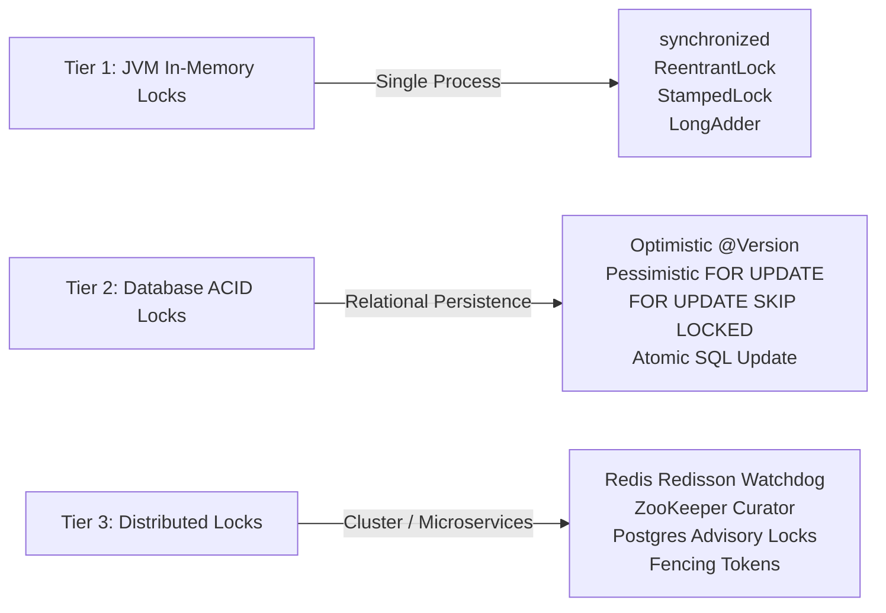

# 🔒 Production-Grade Locking & Concurrency Mastery Guide (SDE-2 Blueprint)

> A battle-tested repository and reference guide covering **In-Memory (JVM)**, **Database (RDBMS)**, and **Distributed (Multi-Node)** locking architectures. Designed specifically for software engineers preparing for **SDE-2 / Senior Backend Engineering** interviews and production system design.

---

## 📚 Table of Contents
- [1. Repository Structure & Code Navigation](#1-repository-structure--code-navigation)
- [2. The Three Tiers of Locking](#2-the-three-tiers-of-locking)
- [3. Code Examples & Where to Implement](#3-code-examples--where-to-implement)
  - [A. JVM In-Memory Tier](#a-jvm-in-memory-tier)
  - [B. Database ACID Tier](#b-database-acid-tier)
  - [C. Distributed Microservices Tier](#c-distributed-microservices-tier)
  - [D. Production Architecture Patterns](#d-production-architecture-patterns)
- [4. Visual Architecture & Decision Trees](#4-visual-architecture--decision-trees)
- [5. SDE-2 Interview Prep Kit](#5-sde-2-interview-prep-kit)
- [6. Running & Testing](#6-running--testing)

---

## 1. Repository Structure & Code Navigation

```
locking-mastery-guide/
├── pom.xml                                           # Maven dependencies (Spring Boot, Redisson, Curator, Retry)
├── README.md                                         # This master blueprint
├── ARCHITECTURE_AND_COMPARISON_MATRIX.md             # Deep trade-off matrix, failure modes & diagrams
├── INTERVIEW_CHEATSHEET.md                           # 35 High-Yield SDE-2 Interview Questions & Answers
└── src
    ├── main/java/com/concurrency/locking/
    │   ├── LockingApplication.java                   # Spring Boot entry point with @EnableRetry
    │   ├── jvm/                                      # JVM In-Memory Locking
    │   │   ├── SynchronizedIntrinsicLockExample.java # Monitor mechanics, Mark Word, inflation, reentrancy
    │   │   ├── ReentrantLockWithTimeoutAndConditions.java # AQS, fair vs unfair, SLAs, bounded buffer
    │   │   ├── ReadWriteLockCacheExample.java        # Read-write lock, lock downgrading, caching
    │   │   ├── StampedLockOptimisticExample.java     # Optimistic read stamps, validation fallback
    │   │   └── LockFreeVsLockStripingExample.java    # Atomic CAS, MESI cache line bouncing, LongAdder
    │   ├── database/                                 # Database Locking & ACID
    │   │   ├── entity/                               # InventoryItem (@Version), BankAccount, JobTask
    │   │   ├── repository/                           # Pessimistic write/read, atomic SQL, SKIP LOCKED
    │   │   └── service/
    │   │       ├── OptimisticInventoryService.java   # @Version with Spring Retry + Exponential Jitter
    │   │       ├── PessimisticInventoryService.java  # PESSIMISTIC_WRITE with lock timeout handling
    │   │       ├── DeadlockFreeTransferService.java  # Deterministic resource ordering (Coffman rules)
    │   │       └── WorkerQueueSkipLockedService.java # Non-blocking job queues via SKIP LOCKED
    │   ├── distributed/                              # Multi-Node Distributed Locking
    │   │   ├── redis/
    │   │   │   ├── CustomLuaRedisLock.java           # Atomic SETNX PX and Lua release script
    │   │   │   ├── RedissonDistributedLockService.java # Watchdog auto-renewal, fair lock, pub/sub
    │   │   │   └── FencingTokenPattern.java          # Martin Kleppmann GC-pause defense with tokens
    │   │   ├── zookeeper/
    │   │   │   └── CuratorZookeeperLockService.java  # Ephemeral sequential znodes & Herd effect avoidance
    │   │   └── db_advisory/
    │   │       └── PostgresAdvisoryLockService.java  # pg_advisory_xact_lock in PostgreSQL shared memory
    │   └── production_patterns/                      # Real-World Scalable Architectures
    │       ├── FlashSaleInventoryManager.java        # 100k TPS Flash Sale in-memory atomic deduction
    │       ├── DistributedJobScheduler.java          # Multi-instance leader election for cron tasks
    │       └── LockRetryWithJitterTemplate.java      # AWS-recommended Full Jitter retry engine
    └── test/java/com/concurrency/locking/            # Integration & Concurrency Test Cases
        ├── jvm/                                      # Concurrency tests for ReentrantLock, StampedLock
        └── database/                                 # Multi-threaded OCC retries & Deadlock tests
```

---

## 2. The Three Tiers of Locking



---

## 3. Code Examples & Where to Implement

### A. JVM In-Memory Tier
- [SynchronizedIntrinsicLockExample.java](file:///d:/projects/prep/concepts/src/main/java/com/concurrency/locking/jvm/SynchronizedIntrinsicLockExample.java)
  - **Where to use:** Single-instance applications, thread-safe memory state where execution window is in nanoseconds.
  - **Under the Hood:** Mark Word inflation (Biased $\rightarrow$ Lightweight thin spin $\rightarrow$ Heavyweight OS mutex monitor).
- [ReentrantLockWithTimeoutAndConditions.java](file:///d:/projects/prep/concepts/src/main/java/com/concurrency/locking/jvm/ReentrantLockWithTimeoutAndConditions.java)
  - **Where to use:** Production services requiring SLA-based lock timeouts (`tryLock`), thread interruptibility, and custom conditions (bounded buffers without thundering herd).
- [ReadWriteLockCacheExample.java](file:///d:/projects/prep/concepts/src/main/java/com/concurrency/locking/jvm/ReadWriteLockCacheExample.java)
  - **Where to use:** In-memory caches with 95%+ read ratio. Demonstrates safe **Lock Downgrading** and why lock upgrading deadlocks.
- [StampedLockOptimisticExample.java](file:///d:/projects/prep/concepts/src/main/java/com/concurrency/locking/jvm/StampedLockOptimisticExample.java)
  - **Where to use:** High-frequency numeric calculations and reads that eliminate write starvation via optimistic validation stamps.
- [LockFreeVsLockStripingExample.java](file:///d:/projects/prep/concepts/src/main/java/com/concurrency/locking/jvm/LockFreeVsLockStripingExample.java)
  - **Where to use:** Ultra-high throughput counters (rate limiters, telemetry). Explains why `AtomicLong` causes CPU cache invalidation (MESI protocol) and how `LongAdder` with `@Contended` avoids False Sharing.

### B. Database ACID Tier
- [OptimisticInventoryService.java](file:///d:/projects/prep/concepts/src/main/java/com/concurrency/locking/database/service/OptimisticInventoryService.java)
  - **Where to use:** Low-contention updates (editing profile, order management). Implemented with `@Version` and Spring Retry with exponential backoff & full jitter.
- [PessimisticInventoryService.java](file:///d:/projects/prep/concepts/src/main/java/com/concurrency/locking/database/service/PessimisticInventoryService.java)
  - **Where to use:** Strict zero-tolerance invariants with short transaction windows (flight booking checkout, seat reservation).
- [DeadlockFreeTransferService.java](file:///d:/projects/prep/concepts/src/main/java/com/concurrency/locking/database/service/DeadlockFreeTransferService.java)
  - **Where to use:** Money transfers and multi-resource updates. Eliminates Coffman's circular wait condition via deterministic primary key sorting.
- [WorkerQueueSkipLockedService.java](file:///d:/projects/prep/concepts/src/main/java/com/concurrency/locking/database/service/WorkerQueueSkipLockedService.java)
  - **Where to use:** Concurrent background worker pools. Uses `SELECT ... FOR UPDATE SKIP LOCKED` for zero-blocking task claims.

### C. Distributed Microservices Tier
- [CustomLuaRedisLock.java](file:///d:/projects/prep/concepts/src/main/java/com/concurrency/locking/distributed/redis/CustomLuaRedisLock.java)
  - **Under the Hood:** Atomic `SET resource_key uuid NX PX 30000` with Lua script validation on release.
- [RedissonDistributedLockService.java](file:///d:/projects/prep/concepts/src/main/java/com/concurrency/locking/distributed/redis/RedissonDistributedLockService.java)
  - **Where to use:** Production microservices cluster. Features the **Watchdog auto-lease renewal** and Pub/Sub notifications.
- [FencingTokenPattern.java](file:///d:/projects/prep/concepts/src/main/java/com/concurrency/locking/distributed/redis/FencingTokenPattern.java)
  - **Where to use:** Mission-critical storage writes defending against Stop-The-World (STW) JVM GC pauses (Martin Kleppmann dilemma).
- [CuratorZookeeperLockService.java](file:///d:/projects/prep/concepts/src/main/java/com/concurrency/locking/distributed/zookeeper/CuratorZookeeperLockService.java)
  - **Where to use:** Strong CP distributed systems, cluster orchestrators. Uses Ephemeral Sequential znodes and predecessor watching to avoid Herd Effects.
- [PostgresAdvisoryLockService.java](file:///d:/projects/prep/concepts/src/main/java/com/concurrency/locking/distributed/db_advisory/PostgresAdvisoryLockService.java)
  - **Where to use:** Microservices backed by PostgreSQL needing distributed locks without managing Redis or ZooKeeper.

### D. Production Architecture Patterns
- [FlashSaleInventoryManager.java](file:///d:/projects/prep/concepts/src/main/java/com/concurrency/locking/production_patterns/FlashSaleInventoryManager.java)
  - **Architecture:** 3-tier high-scale flash sale architecture handling 100,000+ TPS using Redis Lua atomic gating.
- [DistributedJobScheduler.java](file:///d:/projects/prep/concepts/src/main/java/com/concurrency/locking/production_patterns/DistributedJobScheduler.java)
  - **Architecture:** Single-leader cron job execution across Kubernetes replicas with bounded lease safety.
- [LockRetryWithJitterTemplate.java](file:///d:/projects/prep/concepts/src/main/java/com/concurrency/locking/production_patterns/LockRetryWithJitterTemplate.java)
  - **Algorithm:** AWS Full Jitter implementation preventing synchronized retry storms.

---

## 4. Visual Architecture & Decision Trees

For the full decision matrix, latency comparison tables, and failure scenarios, refer to:
👉 [ARCHITECTURE_AND_COMPARISON_MATRIX.md](file:///d:/projects/prep/concepts/ARCHITECTURE_AND_COMPARISON_MATRIX.md)

---

## 5. SDE-2 Interview Prep Kit

For **35 in-depth interview questions** complete with HotSpot JVM internals, ACID isolation gotchas, Redlock critiques, and system design answers, refer to:
👉 [INTERVIEW_CHEATSHEET.md](file:///d:/projects/prep/concepts/INTERVIEW_CHEATSHEET.md)

---

## 6. Running & Testing

The repository includes comprehensive tests demonstrating concurrency invariants:
- [ReentrantLockTest.java](file:///d:/projects/prep/concepts/src/test/java/com/concurrency/locking/jvm/ReentrantLockTest.java) - Multi-threaded producer-consumer bounded buffer.
- [StampedLockTest.java](file:///d:/projects/prep/concepts/src/test/java/com/concurrency/locking/jvm/StampedLockTest.java) - Concurrent writes vs optimistic stamp reads.
- [OptimisticConcurrencyControlTest.java](file:///d:/projects/prep/concepts/src/test/java/com/concurrency/locking/database/OptimisticConcurrencyControlTest.java) - Competing transactions asserting zero lost updates with `@Version`.
- [DeadlockPreventionTest.java](file:///d:/projects/prep/concepts/src/test/java/com/concurrency/locking/database/DeadlockPreventionTest.java) - Concurrent cross-transfers (A $\rightarrow$ B and B $\rightarrow$ A) proving deterministic ordering avoids deadlock.

To run via standard Maven:
```bash
mvn clean test
```
