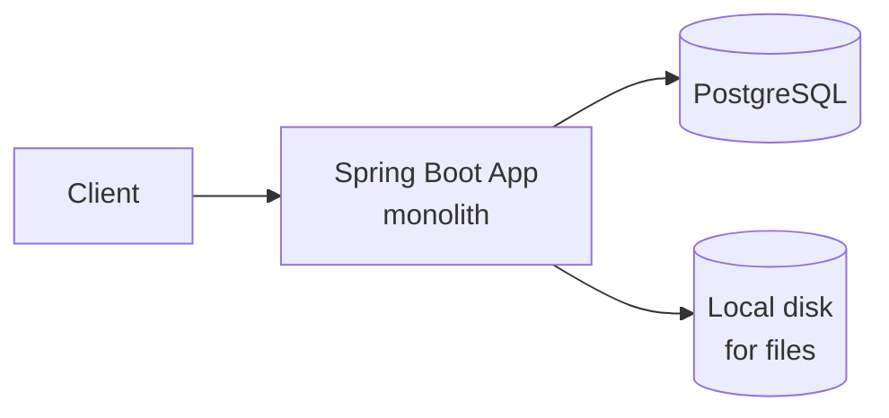
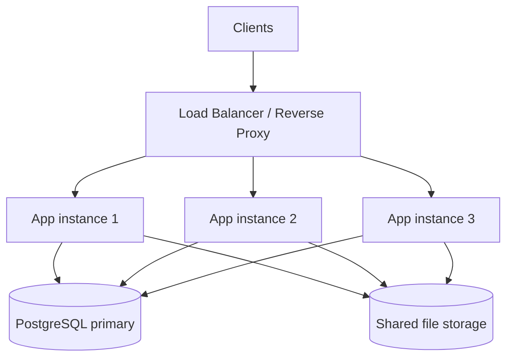
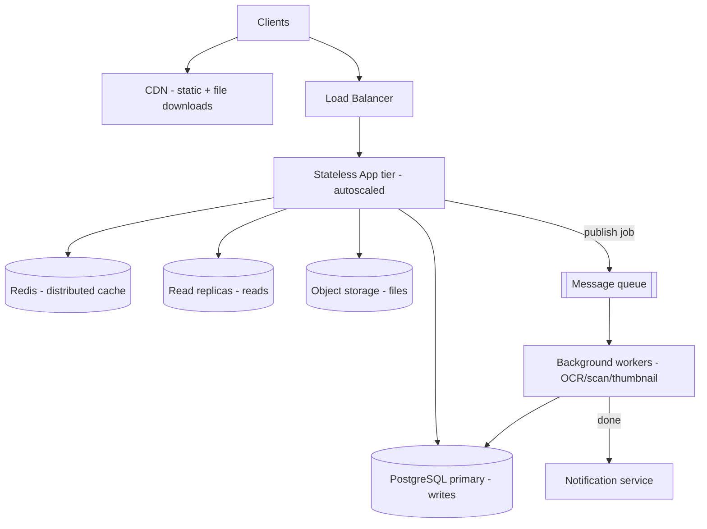
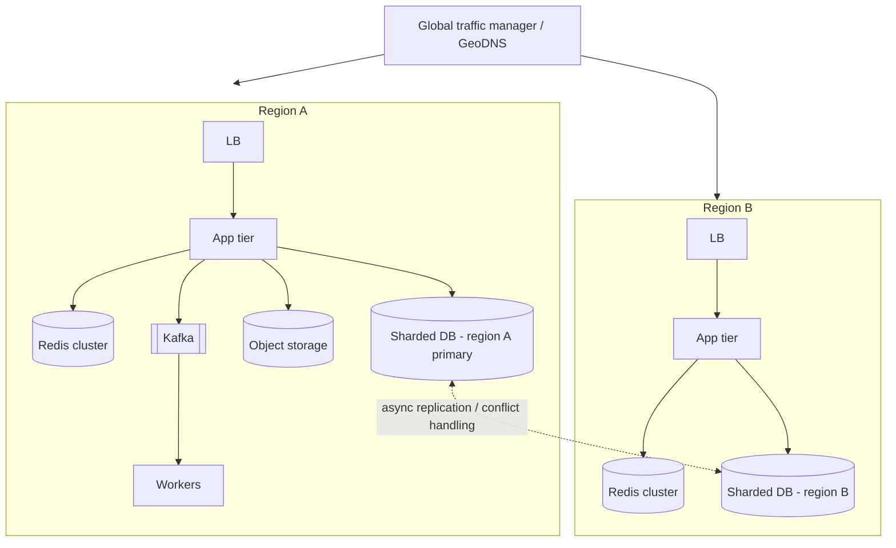

# Architecture Fundamentals & The Scaling Journey (1 user → millions)

> Prerequisites: [latency-throughput-and-capacity](./latency-throughput-and-capacity.md), [back-of-the-envelope-estimation](./back-of-the-envelope-estimation.md)
> Related: [02-compute-and-architecture](../02-compute-and-architecture/horizontal-vs-vertical-scaling.md) · [03-databases](../03-databases-and-data-modeling/replication-and-read-replicas.md) · [04-caching](../04-caching/caching-fundamentals.md) · [05-messaging](../05-messaging-and-event-driven-systems/queues-vs-pub-sub-vs-event-streams.md)

This is the most important single document for building design intuition. We scale **one real system** — the **Document Management System (DMS)** — from one user to millions, and at each stage we identify the first bottleneck, how to diagnose it, how to fix it, and the *new* bottleneck the fix introduces.

The central lesson: **you don't adopt technologies because they're impressive; you adopt them because a measured bottleneck forces you to, and each one has a cost.**

---

## The DMS, briefly

Users upload documents (2 MB avg). Each upload triggers a background job (virus scan + OCR + thumbnail). Documents have revisions. Users read far more than they write (~20:1). Owners get notified when processing finishes. Files must never be lost. See full requirements in [document-management-system](../12-system-design-problems/document-management-system.md).

A crucial distinction we'll keep returning to (per the master prompt): **scaling users ≠ scaling requests ≠ scaling data ≠ scaling connections ≠ scaling throughput ≠ scaling geography.** A system can have millions of users but low RPS (they're mostly idle), or few users but huge data (each uploads TBs). You scale the dimension that's actually under pressure.

---

## Stage 1 — One user, one application

**Workload:** 1 user, a handful of requests. Trivial.

**Architecture:**

**How a request flows:** client sends `POST /documents` → the app's controller validates → service writes a metadata row in a transaction → stores the file → returns 201. A `GET` reads the row and streams the file.

**What's happening internally that still matters later:**
- **Connection pool:** even now, the app holds a small pool of DB connections (e.g., HikariCP, default ~10). Opening a connection per request is expensive (TCP + TLS + auth handshake), so the pool reuses them. This pool becomes a central character in later stages.
- **Transactions:** the metadata write is atomic. One DB means ACID is free and consistency is trivial.
- **Auth:** a simple session or JWT check.

**Why no more infrastructure?** There is no bottleneck. Adding a cache, a queue, or replicas here is pure over-engineering — more things to operate, more failure modes, zero benefit. **This is the default you should defend in interviews until a number forces otherwise.**

**Condition to move on:** more users arrive and you start seeing slow requests.

---

## Stage 2 — Hundreds of users

**Workload:** hundreds of users, maybe 10–50 RPS, some concurrent uploads.

**First bottlenecks appear (and how to diagnose):**
- **Slow queries / N+1:** listing a user's documents fires one query per document for revisions. Diagnose: enable slow-query log; look at the ORM's generated SQL; `EXPLAIN ANALYZE`.
- **Connection-pool contention:** uploads hold connections while streaming a 2 MB file inside a transaction, starving other requests. Diagnose: pool metrics show "waiting for connection."
- **CPU-heavy work on the request thread:** OCR/thumbnailing done inline makes uploads take seconds and ties up request threads. Diagnose: high latency on upload endpoints, thread pool near capacity.

**Fixes (cheap, local — do these before adding infrastructure):**
- Fix N+1 with a join or batch fetch; add indexes on `owner_id`, `created_at`.
- Add **pagination** to list endpoints (don't return 10,000 rows). See [pagination-filtering-and-sorting](../01-networking-and-api-design/pagination-filtering-and-sorting.md).
- Move file streaming *out* of the DB transaction (store file, then commit metadata).
- Add a tiny **local cache** (Caffeine) for hot read-only lookups (e.g., permission templates). See [local-vs-distributed-cache](../04-caching/local-vs-distributed-cache.md).

**Measure before you fix.** The signal here: a strong candidate says "I'd profile first — most 'scaling' problems at this stage are a missing index or an N+1, not a need for new infrastructure."

**New bottleneck introduced:** basically none; these are hygiene. The real limit now is a **single app process** — one crash = full outage, and one machine's CPU/RAM caps you.

**Condition to move on:** single machine saturates, or you need zero-downtime deploys / redundancy.

---

## Stage 3 — Thousands of users

**Workload:** thousands of users, hundreds of RPS, uploads concurrent.

**Architecture:** multiple stateless app instances behind a load balancer.

**What this requires:**
- **Statelessness:** no in-memory session on a specific instance, or users break when the LB routes them elsewhere. Store sessions in a shared store (Redis/DB) or use JWTs. See [stateless-vs-stateful-services](../02-compute-and-architecture/stateless-vs-stateful-services.md).
- **Load balancer + health checks:** the LB routes around unhealthy instances. See [reverse-proxy-and-load-balancers](../02-compute-and-architecture/reverse-proxy-and-load-balancers.md).
- **Shared file storage:** local disk no longer works (which instance has the file?). Move files to shared/object storage now if not already.
- **Centralized logs/metrics:** you can't SSH into "the server" anymore; you need aggregated logs and metrics. See [logs-metrics-and-traces](../09-observability-and-operations/logs-metrics-and-traces.md).
- **Rate limiting** to protect against abusive clients. See [rate-limiting](../01-networking-and-api-design/rate-limiting.md).

**The critical insight (interview gold):** *adding app instances can make the database problem worse.* Three app instances each with a 20-connection pool = up to 60 connections hammering one Postgres. The app tier scales horizontally; the single DB does not. You've moved the bottleneck squarely onto the database. See [database-capacity-and-connection-pools](../11-estimation-and-bottleneck-analysis/database-capacity-and-connection-pools.md).

**New bottlenecks:** database connections and DB read/write load; the single DB is now the ceiling and a single point of failure.

**Condition to move on:** DB CPU/IO high; read latency rising; connection counts near the DB's max.

---

## Stage 4 — Tens of thousands of users

**Workload:** tens of thousands of users, low thousands of RPS, read-heavy (20:1), bursty uploads each spawning CPU-heavy jobs.

**Architecture:** introduce read replicas, a distributed cache, async processing, object storage + CDN.

**Each addition — the bottleneck it solves and the one it introduces:**

| Addition | Solves | Introduces (new bottleneck / cost) |
|---|---|---|
| **Read replicas** | DB read load; offloads the primary | **Replication lag** → stale reads; writes still single-primary; routing logic needed. See [replication-and-read-replicas](../03-databases-and-data-modeling/replication-and-read-replicas.md) |
| **Redis cache (cache-aside)** | Repeated metadata reads hitting the DB | Invalidation complexity; stale data; stampedes; Redis as new dependency. See [cache-aside](../04-caching/cache-aside-read-through-write-through.md) |
| **Async processing + queue** | CPU-heavy OCR blocking request threads | Eventual completion; duplicate processing on retry → need idempotency; queue is new infra. See [queues](../05-messaging-and-event-driven-systems/queues-vs-pub-sub-vs-event-streams.md) |
| **Object storage (S3-like)** | File storage scale + durability | Separate consistency domain (metadata vs file); must handle orphaned files |
| **CDN** | Download bandwidth + global latency | Cache invalidation on file update; cost; signed-URL complexity. See [cdn-and-edge-caching](../10-storage-and-content-delivery/cdn-and-edge-caching.md) |
| **Autoscaling** | Traffic bursts | Cold starts; can amplify DB load if app scales but DB doesn't; needs backpressure |

**The async win, concretely:** upload now = store file to object storage → write metadata → **publish a job** → return 201 immediately. A worker picks up the job and does OCR. The user's upload is fast again; the heavy work is decoupled. But now a worker can crash mid-job, or a retry can double-process — which is exactly why we need **idempotency** (see [idempotency-and-deduplication](../05-messaging-and-event-driven-systems/idempotency-and-deduplication.md)).

**New bottlenecks:** replication lag causing read-your-write issues; cache invalidation correctness; worker throughput vs job arrival rate (consumer lag); object-storage/metadata consistency.

**Condition to move on:** replica lag hurts UX; a single primary can't take the write rate; cache hot keys; queue backlogs grow.

---

## Stage 5 — Hundreds of thousands of users

**Workload:** hundreds of thousands of users, higher write rate, uneven usage (some tenants huge), search becomes important.

**Problems that emerge (and diagnosis):**
- **Hot database partitions / hot keys:** one enterprise tenant with millions of documents dominates. Diagnose: per-tenant query metrics; one shard/key far hotter than others. See [stampedes-hot-keys-and-penetration](../04-caching/stampedes-hot-keys-and-penetration.md) and [partitioning-and-sharding](../03-databases-and-data-modeling/partitioning-and-sharding.md).
- **Cache stampede:** a popular document's cache entry expires; thousands of concurrent reads all miss and hit the DB at once. Fix: request coalescing, TTL jitter, early recompute. See [stampedes](../04-caching/stampedes-hot-keys-and-penetration.md).
- **Queue backlog / consumer lag:** an upload spike outpaces workers; jobs pile up; notifications are delayed by minutes. Diagnose: consumer lag metric rising. Fix: autoscale workers, prioritize, shed/defer low-priority jobs. See [backpressure-and-consumer-lag](../05-messaging-and-event-driven-systems/backpressure-and-consumer-lag.md).
- **Connection exhaustion:** many app instances × pools overwhelm the primary's connection limit. Fix: a connection pooler (PgBouncer-style), lower per-instance pool, read/write split. See [database-capacity-and-connection-pools](../11-estimation-and-bottleneck-analysis/database-capacity-and-connection-pools.md).
- **Search:** `LIKE '%term%'` across millions of rows is dead. Introduce a search engine (Elasticsearch/OpenSearch) fed asynchronously. New problem: search index lag + dual-write consistency → use the outbox/CDC pattern. See [full-text-search-vs-database-search](../10-storage-and-content-delivery/full-text-search-vs-database-search.md) and [transactional-outbox-and-cdc](../05-messaging-and-event-driven-systems/transactional-outbox-and-cdc.md).
- **Duplicate processing & partial failures:** at this volume, retries and crashes are routine, not rare. Idempotency keys and reconciliation jobs become mandatory. See [exactly-once-processing](../06-distributed-systems/exactly-once-processing.md).

**How to decide the *type* of fix** (a key SDE-2 skill):
- Is it a **single slow query**? → algorithmic/index fix (cheapest).
- Is it **read volume**? → caching / replicas.
- Is it **write volume or data size**? → partitioning / sharding (expensive, do last).
- Is it **CPU-heavy work on the request path**? → async + workers.
- Is it **a specific hot entity**? → key-level fixes (coalescing, dedicated capacity, splitting the key).

Match the fix to the bottleneck type; don't reach for sharding when an index would do.

**New bottlenecks:** sharding introduces cross-shard queries and rebalancing; search introduces index consistency; more components = more partial-failure modes and higher operational/cost burden.

**Condition to move on:** single-primary write ceiling reached; multi-region latency/availability requirements; data size beyond one node.

---

## Stage 6 — Millions of users

**Workload:** millions of users, possibly multiple regions, write rate and data size beyond a single node.

**Options that may become necessary (not all at once, not all always):**

- **Database partitioning/sharding** (by `tenant_id` for the DMS — keeps a tenant's data together, avoids cross-shard joins for the common case). See [partitioning-and-sharding](../03-databases-and-data-modeling/partitioning-and-sharding.md).
- **Read/write separation** at scale, possibly CQRS for read-heavy views. See [event-sourcing-and-cqrs](../05-messaging-and-event-driven-systems/event-sourcing-and-cqrs.md).
- **Distributed caching** (Redis Cluster) with consistent hashing.
- **Event-driven architecture** (Kafka) for high-throughput pipelines and decoupling.
- **Selective service decomposition** — split out the parts with different scaling/ownership needs (e.g., the search indexer, the notification service), not a blanket microservices rewrite.
- **Multi-region** for latency and/or availability — only with a stated requirement. Brings replication lag across regions, conflict resolution, regional data residency, and far higher operational cost. See [multi-region-architecture](../06-distributed-systems/multi-region-architecture.md).

**The warning (straight from the master prompt):** *having millions of users does not mean you need every technology.* A read-mostly system with millions of mostly-idle users and modest RPS might still run on a single well-tuned primary + replicas + cache. **MAU does not equal RPS.** Always re-estimate the dimension actually under pressure before adding sharding or multi-region.

**New bottlenecks:** cross-shard queries and distributed transactions; cross-region consistency and replication lag; global traffic routing; cost control; operational complexity (now a platform, not an app).

---

## The evolution comparison table

| Stage | Users | ~Peak RPS | Architecture | First bottleneck | Key addition | New problem introduced |
|---|---|---|---|---|---|---|
| 1 | 1 | <1 | Monolith + 1 DB + local disk | none | — | single point of failure |
| 2 | 100s | 10–50 | Same + indexes/pagination/local cache | slow queries, N+1, pool contention | query/index fixes, async-ify heavy work | still one process |
| 3 | 1,000s | 100s | LB + N stateless apps + 1 DB + shared storage | DB connections & load; single process | horizontal app scaling, statelessness, central logs | DB is the ceiling + SPOF |
| 4 | 10,000s | 1,000s | + replicas + Redis + queue + workers + object store + CDN | DB reads, CPU-heavy jobs on request path | caching, replicas, async workers | replication lag, invalidation, duplicates |
| 5 | 100,000s | 1,000s–10,000s | + search engine + conn pooler + idempotency + reconciliation | hot partitions, stampedes, consumer lag, conn exhaustion, search | key-level fixes, search index, outbox/CDC | index consistency, more failure modes |
| 6 | millions | 10,000s+ | + sharding + distributed cache + Kafka + selective services + (maybe) multi-region | single-primary write ceiling, data size, geo latency | sharding, event-driven, multi-region (if required) | cross-shard/region consistency, cost, ops burden |

---

## Scaling dimensions are independent (make this explicit)

| You're scaling... | Pressure shows up as... | Typical fix |
|---|---|---|
| **Users (MAU)** | nothing by itself — depends on activity | re-estimate RPS first |
| **Requests (RPS)** | app CPU, thread pools | more stateless instances behind LB |
| **Reads** | DB read load, latency | cache + read replicas |
| **Writes** | primary CPU/IO, lock contention | batching, write-optimized store, sharding |
| **Data size** | storage, index size, backup time | archival, partitioning, sharding, object storage |
| **Connections** | DB max_connections, pool waits | connection pooler, lower per-instance pools |
| **Throughput (pipeline)** | consumer lag, queue depth | more workers, partitioning, backpressure |
| **Geography** | cross-region latency, residency | multi-region replication / edge |

If an interviewer says "scale to 10× users," your first move is to ask *which dimension that pressures* and re-estimate — not to immediately shard.

---

## Interview preparation

**Basic**
- Q: Why is Stage 1 a monolith and not microservices? → *A: No bottleneck justifies the complexity; a monolith is simplest and fastest to build and operate.*
- Q: What must be true to add app instances behind an LB? → *A: Statelessness (no local session), shared storage, health checks.*

**Intermediate**
- Q: Why can adding app servers make things worse? → *A: More instances × connection pools overwhelm the single DB; the app tier scales but the DB doesn't, so the bottleneck just moves to (and worsens on) the database.*
- Q: You added read replicas; what breaks? → *A: Replication lag — a user may not see their own just-written data if routed to a lagging replica. Fix with read-your-write routing to the primary for recent writes.*

**SDE-2 / scenario**
- Q: "We have 5M users; should we shard?" → *A: Not necessarily — 5M MAU says nothing about RPS or data size. I'd estimate peak write RPS and dataset size; if a single tuned primary + replicas + cache handles it, sharding would add cross-shard complexity for no benefit. I'd shard only when the write ceiling or data size is actually approached.*
- Q: "Queue backlog is growing. What do you do?" → *A: Diagnose consumer lag; short-term scale out workers and/or shed low-priority jobs; ensure consumers are idempotent so I can safely parallelize; long-term partition the topic and apply backpressure to producers.*

**Common wrong answers**
- Jumping to microservices/Kafka/multi-region at Stage 1–3.
- "Add more servers" as the answer to a DB-bound problem.
- Treating MAU as RPS.

---

## Hands-on exercise

Draw the DMS architecture for Stages 3, 4, and 6 from memory. For each, write: (1) the workload assumption, (2) the first bottleneck, (3) the key addition, (4) the new problem it introduces. Then pick Stage 4 → 5 and explain in 3 sentences how you'd decide whether the next fix is an index, a cache, a replica, or sharding.

---

## Revision summary

**Key takeaways**
- You adopt a technology only when a *measured* bottleneck forces it; each addition has a cost and a new bottleneck.
- The classic trap: scaling the app tier moves/worsens the DB bottleneck.
- Match the fix to the bottleneck type (index vs cache vs replica vs async vs shard).
- MAU ≠ RPS ≠ data size ≠ connections ≠ geography — scale the dimension under pressure.
- Default to the simplest adequate stage; justify every step forward with numbers.

**Must explain without notes:** the 6 stages, the first bottleneck and key addition at each, and why adding app servers worsens the DB.

**Rapid-fire**
1. First addition when the single app process is the limit? → LB + multiple stateless instances.
2. What does a read replica introduce? → Replication lag / stale reads.
3. Why move OCR off the request thread? → It blocks request threads and inflates latency; async decouples it.
4. Does 5M users imply sharding? → No; estimate the pressured dimension first.
5. Cheapest class of fix for a slow endpoint? → An index / query fix.

**Next:** [01-networking-and-api-design/networking-fundamentals](../01-networking-and-api-design/networking-fundamentals.md)
