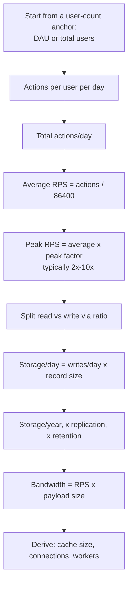

# Back-of-the-Envelope Estimation

> Prerequisites: [latency-throughput-and-capacity](./latency-throughput-and-capacity.md)
> Related: [estimation-cheat-sheet](../11-estimation-and-bottleneck-analysis/estimation-cheat-sheet.md) (20+ drills) · [requirements-and-constraints](./requirements-and-constraints.md)

Estimation is where candidates either build credibility or lose it. The goal is **order-of-magnitude** numbers computed quickly to justify design decisions — not precision. "About 10,000 RPS" is a great answer; "9,473.2 RPS" is a red flag (false precision).

---

## A. Problem and motivation

Why estimate at all? Because numbers decide architecture. "Do I need caching?" depends on read RPS and DB capacity. "Do I need sharding?" depends on data size and write rate. "One region or many?" depends on user geography and latency targets. Without numbers, every design decision is a guess, and you can't defend "I'd add a cache here" against "why?"

What happens if you skip estimation? You either over-engineer (sharding for 100 RPS) or under-engineer (single DB for 100K writes/sec). Both are instant negative signals.

---

## B. The numbers you must have memorized

**Powers of ten / data sizes:**

| Unit | Bytes | Mental anchor |
|---|---|---|
| 1 KB | 10³ | A short JSON record / a paragraph |
| 1 MB | 10⁶ | A small image / a document page scan |
| 1 GB | 10⁹ | ~1000 MB; a short video |
| 1 TB | 10¹² | ~1000 GB |
| 1 PB | 10¹⁵ | ~1000 TB; "big data" territory |

**Time:**
- Seconds in a day ≈ **86,400 ≈ 10⁵** (use `~100,000` for mental math).
- Seconds in a month ≈ **2.6 million ≈ 2.5 × 10⁶**.
- Seconds in a year ≈ **31.5 million ≈ 3 × 10⁷**.

**The single most useful shortcut:**
> **1 million requests/day ≈ 12 RPS** (because 1,000,000 / 86,400 ≈ 11.6).
> So **N million/day ≈ 12 × N RPS** on average.

**Rough field capacities (HEURISTICS — order of magnitude, workload/hardware dependent, always validate):**

| Resource | Rough single-node capacity (heuristic) |
|---|---|
| Well-indexed RDBMS (Postgres/MySQL) simple reads | thousands → low tens of thousands QPS |
| RDBMS writes (durable, single primary) | low thousands/sec before tuning |
| Redis (single node) | ~100K ops/sec |
| Kafka (per broker) | hundreds of MB/sec, high throughput |
| App server (I/O-bound) RPS | hundreds → low thousands per instance |
| Network within DC | ~0.5ms RTT (from latency table) |

Treat these as "is my design in the right ballpark?" checks, never as promises.

---

## C. The estimation routine

Always: **start from one anchor, apply ratios, show every multiplication, state assumptions.**

---

## D. Worked example 1 (the canonical one)

**Given:** 1,000,000 DAU, 20 requests/user/day, peak = 5× average.

1. **Total requests/day** = 1,000,000 × 20 = **20,000,000/day**.
2. **Average RPS** = 20,000,000 / 86,400 ≈ **231 RPS** (or use the shortcut: 20M/day ≈ 12 × 20 = 240 RPS ✓).
3. **Peak RPS** = 231 × 5 ≈ **~1,150 RPS**.

**Implications you state out loud:**
- ~1,150 peak RPS is **modest**. A handful of app instances handle it. No need for anything exotic.
- If read:write is 90:10, that's ~1,035 read RPS and ~115 write RPS at peak. The DB write rate is tiny; reads are the pressure. → **Cache + maybe a read replica, not sharding.**
- This is a great moment to say: "At this scale I would *not* shard or add Kafka; the design stays a stateless app tier + one primary DB + a cache. I'd revisit if DAU grew 50×."

That last sentence is the SDE-2 signal: numbers justify *simplicity*.

---

## E. Worked example 2 — storage growth (DMS)

**Given (from the DMS requirements):** 100K users, upload 5 documents/user/month, average file 2 MB, metadata record ~1 KB, keep everything for 5 years.

1. **Uploads/month** = 100,000 × 5 = **500,000 docs/month**.
2. **File storage/month** = 500,000 × 2 MB = **1,000,000 MB = ~1 TB/month**.
3. **5-year file storage** = 1 TB × 60 months = **~60 TB** of file data.
4. **Metadata storage/5yr** = 500,000 × 60 × 1 KB = 30,000,000 KB ≈ **30 GB** — trivial, fits easily in one RDBMS.
5. **With replication (×3 for durability)**: file data ≈ **180 TB**. Metadata ≈ 90 GB.

**Implications:**
- 180 TB of files does **not** belong in a database. → **object storage (S3-like)**; the DB stores only the ~90 GB of metadata + pointers. This single calculation justifies the "files in object storage, metadata in SQL" architecture.
- 90 GB metadata is comfortably a single Postgres instance for years. → **no sharding needed for metadata**.

---

## F. Worked example 3 — bandwidth and cache

**Given:** redirect service (URL shortener), 1,000 read RPS at peak, each response ~500 bytes, 20% of keys get 80% of traffic.

1. **Egress bandwidth** = 1,000 × 500 B = 500,000 B/s = **~0.5 MB/s** — tiny.
2. **Cache sizing:** suppose 100M short URLs, each cache entry ~100 bytes (code + long URL). Caching *all* = 100M × 100 B = **10 GB** — fits in one Redis node.
3. But by the 80/20 rule, caching the hot 20% (~20M entries = ~2 GB) likely captures ~80%+ of reads. → **Cache the working set, not everything.** This is how you justify cache size instead of guessing.

See [cache-sizing-and-hit-ratio](../11-estimation-and-bottleneck-analysis/cache-sizing-and-hit-ratio.md).

---

## G. Deriving infrastructure from estimates

Once you have RPS and latency, derive the rest:

- **App instances:** `peak RPS / per-instance RPS`. If per instance ≈ 500 RPS and peak = 1,150 → ~3 instances; round up to ~4–5 for headroom and failover.
- **DB connections:** Little's Law. `concurrency = RPS × latency`. 1,000 read RPS × 10ms = 10 in flight to the DB → a pool of ~20–50 per app instance is plenty (don't over-provision; connections are scarce — see [database-capacity-and-connection-pools](../11-estimation-and-bottleneck-analysis/database-capacity-and-connection-pools.md)).
- **Workers:** `queue arrival rate / per-worker processing rate`. 1,000 jobs/sec arriving, each worker does 50/sec → ~20 workers; add headroom for spikes and retries.
- **Queue depth tolerance:** if producers can briefly outpace consumers, how long until the queue fills? See [queue-capacity-and-consumer-throughput](../11-estimation-and-bottleneck-analysis/queue-capacity-and-consumer-throughput.md).

---

## H. Trade-offs: precision vs speed

| Approach | Advantages | Disadvantages | Best use cases | Warning signs |
|---|---|---|---|---|
| Rough (round to powers of 10) | Fast, communicates intent, hard to get badly wrong | Looks imprecise | **Interviews** | Rounding away a factor of 100 |
| Precise (exact arithmetic) | "Accurate" | Slow, false confidence, easy to fumble under pressure | Capacity planning with real data | 9,473.2 RPS in an interview |

Round aggressively. `86,400 → 100,000`. `1,150 → ~1,000`. The design decision ("modest scale, keep it simple") doesn't change, and you move faster.

---

## I. Failure scenarios (of estimation)

1. **Confusing MAU/DAU/RPS/concurrency.** Trigger: using 10M "users" as 10M RPS. Effect: wildly over-engineered design. Detect: your RPS is implausibly huge. Fix: always convert users → actions/day → RPS → peak; keep concurrency separate (Little's Law).
2. **Ignoring peak factor.** Trigger: designing for average RPS. Effect: system falls over at the daily/seasonal peak. Fix: multiply by a peak factor (state it: 2–10×, higher for consumer apps with evening peaks or flash sales).
3. **Forgetting replication/retention multipliers.** Trigger: quoting raw data size. Effect: under-provisioned storage. Fix: ×replication factor and × retention period.

---

## J. SDE-2 vs other levels

SDE-2: compute RPS, storage, and one derived resource (connections or instances), and *use the numbers to justify a simple-vs-complex decision*. You do **not** need detailed cost modeling or multi-region capacity math — that's Staff-level. The key signal is that your numbers *drive* the design.

---

## K. Interview preparation

**Basic**
- Q: 5M requests/day is roughly how many RPS? → *A: ~60 RPS average (12 × 5).*
- Q: Why multiply by a peak factor? → *A: Traffic isn't uniform; you must handle the busiest moment, not the average.*

**Intermediate**
- Q: 2M DAU, 50 actions/day, 4× peak, 95% reads. Peak read RPS? → *A: 100M/day ≈ 1,160 avg RPS; ×4 = ~4,640 peak; ×0.95 ≈ ~4,400 read RPS.*
- Q: 10M photos/day at 1.5MB each, ×3 replication, 2-year retention. Storage? → *A: 15 TB/day → ×3 = 45 TB/day → ×730 days ≈ ~33 PB. Object storage, definitely not a DB.*

**SDE-2 / scenario**
- Q: "You estimated 1,000 peak RPS. Justify not sharding." → *A: Metadata is ~90GB and writes are ~100/sec at peak — a single tuned Postgres handles this for years. Sharding adds cross-shard query and operational cost with no benefit at this scale; I'd shard only when write throughput or data size approaches the single-node limit, which I'd monitor.*

**Common wrong answers**
- Using total users as RPS.
- Designing for average, not peak.
- Precise decimals (false precision).

---

## L. Hands-on exercise

A chat app has 50M DAU, each sends 40 messages/day, each message ~200 bytes stored, kept 1 year, ×3 replication. Compute: (a) messages/day, (b) average write RPS, (c) peak write RPS at 3×, (d) stored message bytes/year with replication. State whether messages fit in a single DB node and what that implies.
*(Answers: (a) 2 × 10⁹/day. (b) 2e9/86400 ≈ ~23,000 write RPS. (c) ~70,000 peak write RPS. (d) 2e9 × 200B × 365 × 3 ≈ ~438 TB/year. Implication: ~70K write RPS and hundreds of TB/year far exceed a single node → sharding by user/conversation + likely a write-optimized store; this is where NoSQL/wide-column is justified. Contrast with the DMS, where numbers justified simplicity.)*

---

## M. Revision summary

**Key takeaways**
- Memorize: 86,400 s/day; 1M/day ≈ 12 RPS; data-size powers of ten.
- Routine: anchor → actions/day → avg RPS → peak RPS → read/write split → storage → bandwidth → derived resources.
- Round aggressively; numbers exist to **justify design choices** (including simplicity).
- Always apply peak factor, replication factor, retention period.

**Must explain without notes:** the 1M/day ≈ 12 RPS shortcut and the full routine; worked example 1 end-to-end.

**Rapid-fire**
1. 1M requests/day ≈ ? RPS → ~12.
2. Seconds/day ≈ ? → ~86,400 (~10⁵).
3. 100M files × 100 B cache entry = ? → 10 GB.
4. What two multipliers inflate storage estimates? → Replication factor, retention period.
5. What should your numbers ultimately justify? → The architecture decision (including keeping it simple).

**Next:** [interview-communication-framework](./interview-communication-framework.md)
