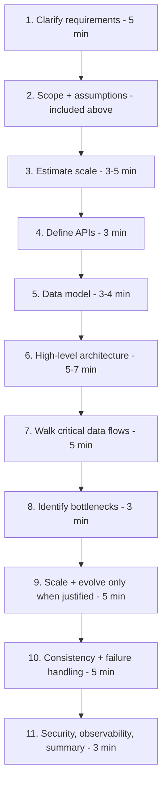

# The Interview Communication Framework

> Prerequisites: [what-is-system-design](./what-is-system-design.md), [requirements-and-constraints](./requirements-and-constraints.md), [back-of-the-envelope-estimation](./back-of-the-envelope-estimation.md)
> Related: [how-to-drive-an-interview](../13-interview-practice/how-to-drive-an-interview.md) · [one-page-system-design-framework](../14-revision/one-page-system-design-framework.md)

Knowledge is necessary but not sufficient. The candidate who *communicates* a simple design clearly beats the one who *knows* a complex design but rambles. This chapter is the repeatable structure you run under time pressure.

---

## A. Problem and motivation

A 45-minute HLD interview is a conversation you must **drive**. If you wait to be asked questions, you look passive and run out of time. The framework gives you a default order so your working memory is free for the actual design, and so the interviewer can follow (and score) your reasoning.

What happens without a framework? You bounce around, forget estimation, never discuss failures, and finish with an undefended pile of boxes. With it, you cover every scored dimension in a natural flow.

---

## B. The 11-step flow and a time budget

For a ~45-minute round (adjust to the interviewer's steering — this is a guide, not a rigid script):

| Phase | Minutes | What you produce |
|---|---|---|
| Clarify + scope + assumptions | ~5 | FRs, NFRs (6 questions), non-goals, confirmed |
| Estimate | ~4 | Peak RPS, storage/year, read:write — with math shown |
| API | ~3 | 3–5 endpoints, methods, key errors |
| Data model | ~4 | Core entities, keys, key indexes |
| Architecture | ~6 | One clear diagram, each component justified |
| Data flow | ~5 | One write + one read, plus a failure path |
| Bottlenecks | ~3 | First bottleneck + how to detect |
| Scale/evolve | ~5 | Replica/cache/queue/shard *when justified* |
| Consistency/failures | ~5 | Timeouts, retries, idempotency, degradation |
| Security/observability + summary | ~3 | Authz boundary, key metrics, crisp recap |

Leave ~2 minutes of buffer. If the interviewer dwells on one area, follow them — they're telling you where the signal is.

---

## C. The core communication habits

These are what separate a 3 from a 4 on the trade-off rubric dimension.

1. **Narrate your reasoning, not just conclusions.** Not "I'll use Postgres." Instead: "The core operations need transactional consistency and the data is relational, so I'll start with Postgres. If read traffic becomes the bottleneck I'll add read replicas, and I'd only consider sharding after measuring the single-node limit." The second version shows judgment and an evolution path.

2. **State the trade-off for every real decision.** "Adding a cache cuts read latency and DB load, but introduces invalidation complexity and a stale-data window — acceptable here because document metadata changes rarely."

3. **Default to simple, justify additions with numbers.** Every component should answer "what breaks if I remove it?"

4. **Think aloud during silence.** "Let me reason about the consistency requirement here..." so the interviewer scores your process.

5. **Treat it as collaborative.** "Does that match your expectation, or would you like me to go deeper on the queue?" invites steering.

---

## D. The strong-statement pattern

The highest-signal sentences follow this template:

> "I would **start with [simple choice]** because [requirement-grounded reason]. I would **add [next step]** when [measurable trigger]. I would **only consider [complex option]** after [specific condition]."

**Example:** "I'd start with a single PostgreSQL primary because the writes are transactional and modest (~100/sec). I'd add read replicas when read load approaches the primary's capacity, which I'd watch via replica lag and CPU. I'd only shard when the dataset or write rate approaches the single-node limit."

Why it's strong: it shows you know Postgres *and* its limits *and* the evolution path *and* how you'd measure the trigger — four signals in one sentence. Compare to the weak "PostgreSQL scales well" (zero signals).

---

## E. Handling the hard moments

| Situation | What to do | Example line |
|---|---|---|
| Interviewer disagrees with a decision | Don't cave or dig in; restate your assumption, ask what changed | "I chose eventual consistency assuming stale reads are OK for the feed. If we need read-your-write, I'd add session-based routing to the primary — is that the requirement?" |
| You don't know a technology | Be honest, reason from principles | "I haven't used Cassandra in production, but it's a wide-column, write-optimized store with tunable consistency — which fits this write-heavy, append-only workload. I'd confirm the data model with its partitioning rules." |
| Requirements are ambiguous | State an assumption and proceed | "I'll assume single-region to start and flag multi-region as an extension." |
| Time running out | Summarize, name what you'd cover next | "I'll stop the deep dive here. The remaining risks are hot partitions and the DLQ strategy — I can go into either." |
| Your design has a bottleneck the interviewer spotted | Acknowledge, fix, state the trade-off | "You're right, the synchronous fan-out won't scale. I'd move it to a queue with workers — adds eventual delivery but removes the latency coupling." |
| 10× traffic pushback | Re-estimate, name the first thing that breaks | "At 10× (~12K RPS) the first bottleneck is DB reads; I'd add caching, then a replica, then evaluate sharding — in that order, each justified by a metric." |
| Stronger consistency demanded | Identify where, pay the cost deliberately | "To make this strongly consistent I'd read from the primary (not replicas) for that path, or use a quorum read, accepting higher latency and lower availability during partitions." |
| A component becomes unavailable | Describe degradation, not just failure | "If Redis is down I'd fall back to the DB with a tighter timeout and a concurrency limiter so the DB isn't stampeded; the system is slower but still serving." |
| Need to revise mid-interview | Do it gracefully, out loud | "Given that new requirement, my earlier choice doesn't hold. Let me revise: ..." |

Revising a design *well* is a positive signal, not a failure — it shows you adapt to changing requirements, which is the whole job.

---

## F. A short worked transcript (how it sounds)

**Interviewer:** "Design a URL shortener."

**You:** "Let me clarify first. Functionally: create a short code for a long URL, redirect on access, maybe custom aliases and analytics. Non-functionally — how many URLs created per day and read:write ratio?"

**Interviewer:** "Say 10 million created per day, very read-heavy."

**You:** "So ~120 writes/sec average, and reads dominate — let's say 100:1, so ~12,000 read RPS at some peak. Storage: 10M/day × 365 × ~5 years × ~100 bytes ≈ under 2 TB — fits one DB. The read path is the pressure, so I'll make redirects cache-first.

APIs: `POST /urls` returns a short code; `GET /{code}` 302-redirects. Data model: table `(short_code PK, long_url, created_at, owner_id)`.

Architecture: clients → CDN/LB → stateless app tier → Redis cache → Postgres. On redirect, check Redis, fall back to Postgres on miss, populate cache. Code generation: I'll use a base62 encoding of a unique counter/ID to avoid collisions rather than random-with-retry.

First bottleneck is read throughput; the cache absorbs it since the mapping is immutable, so invalidation is trivial — a huge win here. If Redis is down, redirects fall back to Postgres with a timeout. Writes are low, so the DB is fine without sharding for years..."

Notice: clarify → estimate → API → model → architecture → data flow → bottleneck → failure → scale, all narrated, all justified. Full version: [url-shortener](../12-system-design-problems/url-shortener.md).

---

## G. Trade-offs: rigid checklist vs adaptive flow

| Approach | Advantages | Disadvantages | Best use cases | Warning signs |
|---|---|---|---|---|
| Rigid checklist | Nothing forgotten | Robotic; ignores interviewer's interest | Nervous beginners | Reciting steps while interviewer wants depth |
| Pure improvisation | Natural | Forgets estimation/failures; runs out of time | Experts only | No structure, no numbers |
| Framework as a *default* you adapt | Covers everything, follows signal | Needs practice | **Recommended** | — |

---

## H. Failure scenarios

1. **Spending 15 minutes on requirements.** Detect: you haven't drawn anything by minute 15. Fix: time-box clarification to ~5 minutes; assume and move.
2. **Never reaching failure handling.** Detect: interview ends at the happy path. Fix: watch the clock; by minute ~30 you should be on bottlenecks/failures. Prevent: use the time budget.
3. **Monologuing without checking in.** Detect: interviewer goes quiet / tries to interject. Fix: pause, ask "want me to go deeper here or move on?"

---

## I. Hands-on exercise

Pick any prompt (e.g., "design a rate limiter"). Set a 45-minute timer. Run the 11 steps aloud (record yourself). Afterward, score with [`INTERVIEW-CHECKLIST.md`](../INTERVIEW-CHECKLIST.md). Note which phase you rushed or skipped — that's your weak dimension to drill.

---

## J. Revision summary

**Key takeaways**
- Drive the interview with the 11-step flow and a rough time budget; adapt to the interviewer's steering.
- Use the strong-statement pattern: start simple → add on measurable trigger → complex only after a condition.
- State a trade-off for every real decision; narrate reasoning; revise gracefully.
- Prepare canned responses for the hard moments (disagreement, 10×, stronger consistency, component down).

**Must explain without notes:** the 11 steps in order; the strong-statement template; how to handle a 10× pushback and a "component is down" pushback.

**Rapid-fire**
1. First phase of the flow? → Clarify requirements.
2. By roughly what minute should you be discussing failures? → ~30.
3. The strong-statement template? → Start with X → add Y on trigger → complex Z only after condition.
4. Interviewer disagrees — what first? → Restate the assumption your choice depends on and ask what changed.
5. Is revising your design mid-interview good or bad? → Good, if done gracefully — it shows adaptability.

**Next:** [architecture-fundamentals](./architecture-fundamentals.md) (the full scaling journey) or begin [01-networking-and-api-design](../01-networking-and-api-design/dns-tcp-tls-http.md).
