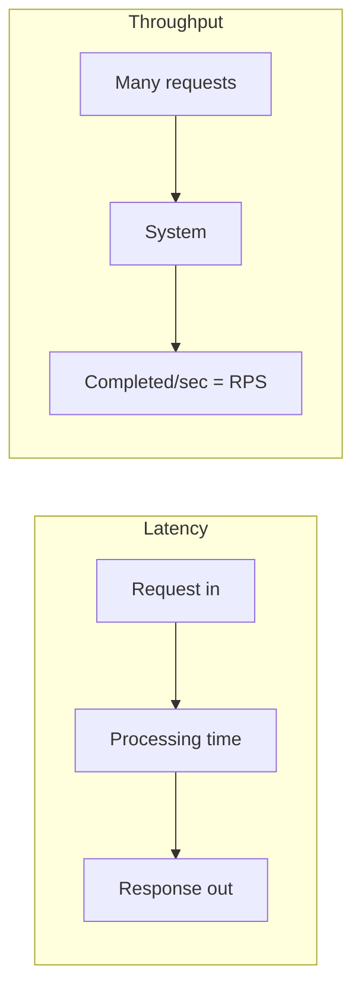
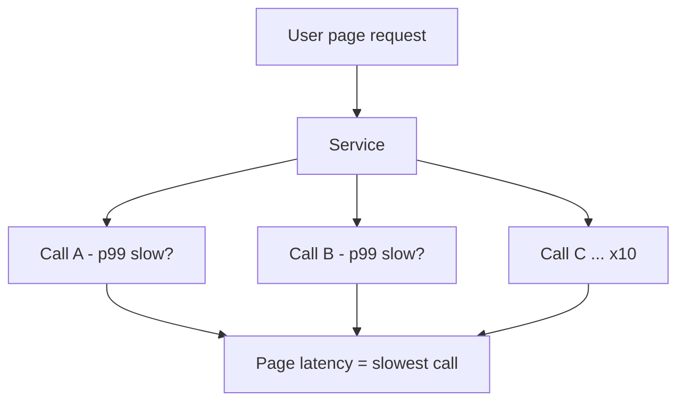

# Latency, Throughput, Availability, and Capacity

> Prerequisites: [requirements-and-constraints](./requirements-and-constraints.md)
> Related: [back-of-the-envelope-estimation](./back-of-the-envelope-estimation.md) · [latency-budgets-and-tail-latency](../11-estimation-and-bottleneck-analysis/latency-budgets-and-tail-latency.md)

This is the vocabulary chapter. You cannot reason about trade-offs without these words meaning something precise. Interviewers notice immediately when a candidate conflates latency with throughput or quotes an average when they should quote p99.

---

## A. Latency vs throughput

**Latency** = how long one operation takes. **Throughput** = how many operations complete per unit time.

They are related but independent. A highway analogy that's technically accurate: latency is how long *your car* takes to cross the bridge; throughput is how many *cars* cross per minute. Adding lanes (parallelism) raises throughput without changing one car's crossing time. Raising the speed limit (faster processing) lowers latency and can raise throughput.

Key consequence: **you can improve throughput by adding servers (horizontal scaling) without improving latency.** A single slow query is still slow no matter how many app servers you add. This is the root of the "adding servers made the DB worse" lesson in the [scaling journey](./architecture-fundamentals.md).

---

## B. Why averages lie: percentiles and tail latency

Report latency as **percentiles**, not averages.

- **p50 (median):** half of requests are faster than this.
- **p95 / p99:** 95% / 99% of requests are faster than this. The slow 1–5%.
- **p999:** the worst 0.1%.

Why it matters: averages hide the tail. Suppose 99 requests take 10ms and 1 takes 2000ms. Average = ~30ms (looks fine). p99 = 2000ms (one in a hundred users waits 2 seconds). At 10,000 RPS, that's **100 slow requests every second** — a lot of unhappy users.

**Tail latency amplification:** a single user request often fans out to many backend calls. If one page needs 10 backend calls and each has a 1% chance of being slow (p99), the probability the *page* hits at least one slow call is `1 - 0.99^10 ≈ 9.6%`. So a p99 backend becomes a ~p90 page. This is why reducing tail latency (not average) is a core scaling concern.

**Interview-ready line:** "I optimize and SLO on p99, not average, because a single page fans out to many calls and tail latency dominates the user-visible experience."

---

## C. Order-of-magnitude latencies (heuristics)

Memorize these approximate numbers — interviewers use them to sanity-check your design. **These are order-of-magnitude heuristics, not exact and hardware-dependent.**

| Operation | Rough latency |
|---|---|
| L1/L2 cache reference | ~1 ns |
| Main memory (RAM) reference | ~100 ns |
| Read 1 MB sequentially from RAM | ~10–100 µs |
| SSD random read | ~100 µs |
| Round trip within a datacenter | ~0.5 ms |
| Read 1 MB from SSD | ~1 ms |
| Disk (HDD) seek | ~10 ms |
| Round trip, same continent (network) | ~10–50 ms |
| Round trip, cross-continent | ~100–150 ms |

**Takeaways you can quote:**
- RAM is ~100× faster than SSD, which is ~100× faster than a disk seek. This is *why* caching in RAM (Redis/Caffeine) is worth the complexity.
- A cross-region round trip (~100ms+) is enormous compared to a datacenter hop (~0.5ms). This is *why* multi-region designs replicate data close to users instead of calling across the ocean per request.
- Speed of light sets a floor: ~100ms cross-continent cannot be optimized away. You can only avoid the round trip (cache/replicate locally).

---

## D. Throughput: RPS, concurrency, and Little's Law

- **RPS (requests/second):** throughput of your API tier.
- **Concurrency:** number of requests in flight at the same instant.

**Little's Law** ties them together: `Concurrency = RPS × Latency`.

Example: 2,000 RPS with 50ms average latency → `2000 × 0.05 = 100` concurrent requests in flight. If each needs a thread and a DB connection, you need ~100 of each (plus headroom). This single formula answers a huge class of interview questions: "how many threads / connections do I need?"

If latency rises to 500ms (DB slow), concurrency jumps to `2000 × 0.5 = 1000` in flight — you blow your thread pool and connection pool, and requests queue. **This is the mechanism behind cascading overload:** slow downstream → more in-flight requests → resource exhaustion → everything slows → more in-flight. Timeouts and circuit breakers exist to break this loop. See [circuit-breakers-and-bulkheads](../06-distributed-systems/circuit-breakers-and-bulkheads.md).

---

## E. Availability — the nines

Availability = fraction of time the system correctly serves requests.

| Nines | Availability | Downtime per year | Downtime per month |
|---|---|---|---|
| Two nines | 99% | ~3.65 days | ~7.2 hours |
| Three nines | 99.9% | ~8.76 hours | ~43 minutes |
| Four nines | 99.99% | ~52.6 minutes | ~4.3 minutes |
| Five nines | 99.999% | ~5.26 minutes | ~26 seconds |

**Components in series multiply failure.** If your request passes through LB (99.99%) → app (99.9%) → DB (99.9%), overall ≈ `0.9999 × 0.999 × 0.999 ≈ 99.79%`. Each dependency *lowers* availability. This is why reducing the number of synchronous dependencies on the critical path improves availability, and why redundancy (parallel copies) is needed to raise it.

**Redundancy adds availability.** Two independent app servers each 99% available give `1 - (0.01 × 0.01) = 99.99%` *if* failures are independent and a load balancer routes around the dead one. (In practice failures correlate — same bug, same AZ outage — so real gains are smaller.)

**Interview nuance:** more nines cost exponentially more (redundancy, multi-AZ, multi-region, on-call). SDE-2 answer: "I'd target the availability the SLA requires, not the maximum — 99.99% needs multi-AZ redundancy and automated failover, which adds cost and operational complexity we must justify."

---

## F. Durability vs availability vs consistency

Candidates mix these up. They are different:

- **Availability:** can I serve the request *right now*? (uptime)
- **Durability:** once I acknowledged your write, will it survive crashes? (no data loss)
- **Consistency:** do all readers see the latest value? (agreement)

A system can be highly durable but unavailable (data safe on disk, but service is down). It can be available but inconsistent (serving stale cached data during a DB outage). You trade these deliberately. Example: a typing indicator wants availability, tolerates data loss (low durability) and staleness (low consistency). A payment ledger wants durability and consistency, and will sacrifice availability (reject the write) rather than lose or double-count money.

---

## G. Failure scenarios

1. **p99 blowout under load.** Trigger: DB connection pool saturates; requests queue. User sees: most requests fine, 1% hang for seconds, then timeouts. Internally: Little's Law — latency up → concurrency up → pool exhausted. Detect: p99 latency and active-connection metrics spike while p50 looks okay. Mitigate: add timeouts, shed load, scale the bottleneck (DB), add caching. Prevent: capacity-plan with Little's Law and set connection-pool limits with headroom.
2. **Availability erosion from dependency sprawl.** Trigger: adding a synchronous call to a 99.9% service on the hot path. Effect: overall availability drops. Detect: error-rate correlates with that dependency. Mitigate: make the call async, add a circuit breaker + fallback. Prevent: minimize synchronous dependencies on the critical path.
3. **"It's fast" claim based on average.** Trigger: dashboards show average latency only. Effect: real users suffer unseen tail latency. Detect: switch dashboards to p95/p99. Mitigate/prevent: always SLO on percentiles.

---

## H. Scaling implications

- **Latency** has a floor set by physics (speed of light, disk seeks); beyond that you avoid work (cache, precompute) rather than speed it up.
- **Throughput** scales horizontally *if the service is stateless and the bottleneck isn't a shared resource* (usually the DB). Adding app servers past the DB's capacity just moves the queue.
- **Availability** scales with redundancy and fewer serial dependencies, at rising cost.

The art is knowing which of the three a given change actually improves. Adding read replicas improves read throughput and (slightly) availability, not single-query latency.

---

## I. Interview preparation

**Basic**
- Q: Latency vs throughput? → *A: Latency = time per operation; throughput = operations per second. Independent; adding servers raises throughput, not single-request latency.*
- Q: Why percentiles over averages? → *A: Averages hide the slow tail; p99 reflects what unlucky users actually experience, and tail latency amplifies across fan-out.*

**Intermediate**
- Q: You have 5,000 RPS at 40ms latency. How many concurrent requests? → *A: Little's Law: 5000 × 0.04 = 200 in flight; size thread/connection pools accordingly with headroom.*
- Q: What's 99.99% availability in downtime? → *A: ~52 minutes/year.*

**SDE-2 / scenario**
- Q: "Your p50 is 20ms but p99 is 1.5s. Where do you look?" → *A: Something intermittent — GC pauses, lock contention, a slow dependency hit by only some requests, cold cache, or connection-pool queuing. Correlate p99 spikes with downstream metrics and traces.*
- Q: "How does adding a 99.9% dependency affect availability?" → *A: It multiplies in series, lowering overall availability; I'd make it async or add a circuit breaker with a fallback.*

**Common wrong answers**
- "Add more servers to reduce latency." (Adds throughput, not latency, if the DB is the bottleneck.)
- Quoting average latency as the SLO.

---

## J. Hands-on exercise

A service does 3,000 RPS. Each request makes 2 DB queries at 5ms each plus 10ms app time = 20ms total. (a) Compute in-flight concurrency. (b) If the DB slows to 50ms per query, recompute concurrency and explain what breaks. (c) State one mitigation for the breakage.
*(Answers: (a) 3000×0.02 = 60 in flight. (b) new latency = 10 + 2×50 = 110ms → 3000×0.11 = 330 in flight → thread/connection pools (sized ~for 60–100) exhaust, requests queue, p99 explodes. (c) timeouts + circuit breaker + fix/scale the DB or add caching.)*

---

## K. Revision summary

**Key takeaways**
- Latency ≠ throughput; servers add throughput, not single-op latency.
- SLO on p99; tail latency amplifies across fan-out.
- Little's Law: `Concurrency = RPS × Latency` sizes pools and explains cascading overload.
- Availability multiplies in series; redundancy adds it; more nines cost exponentially more.
- Durability ≠ availability ≠ consistency.

**Must explain without notes:** Little's Law and the cascading-overload mechanism; percentiles and tail amplification; the nines table.

**Rapid-fire**
1. 4,000 RPS × 25ms = how many in flight? → 100.
2. 99.9% availability downtime/year? → ~8.76 hours.
3. Does adding app servers fix a slow query? → No.
4. Report latency as? → p95/p99, not average.
5. Payment ledger sacrifices which of availability/durability/consistency? → Availability (rejects rather than lose/double money).

**Next:** [back-of-the-envelope-estimation](./back-of-the-envelope-estimation.md)
