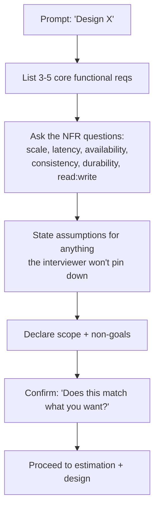

# Requirements, Constraints, Assumptions, and Scope

> Prerequisites: [what-is-system-design](./what-is-system-design.md)
> Related: [interview-communication-framework](./interview-communication-framework.md) · [latency-throughput-and-capacity](./latency-throughput-and-capacity.md)

---

## A. Problem and motivation

A system that solves the wrong problem perfectly is a failure. Every strong design starts by converting a vague prompt into an agreed, bounded specification. In an interview, the prompt is intentionally under-specified ("design a chat app") because clarifying is the skill being tested.

What happens if you skip this? You design a group-chat system when they wanted 1:1; you build for strong consistency when eventual was fine; you add video calling when it was out of scope. You then "defend" a design that answers a question nobody asked. The fix is cheap and takes 5 minutes: separate **functional** from **non-functional** requirements, state **assumptions**, and declare **scope**.

---

## B. The four buckets

### 1. Functional requirements (FRs) — *what the system does*
Features and behaviors. For a notification service: "send email/SMS/push; support templates; let users opt out; retry failed sends."

### 2. Non-functional requirements (NFRs) — *how well it must do it*
The qualities. These drive the architecture far more than FRs do.

| NFR | Question to ask | Example answer that changes the design |
|---|---|---|
| **Scale** | How many users / RPS / data volume? | 50M users → sharding/caching matter |
| **Latency** | p99 target? | p99 < 100ms → caching, no synchronous fan-out |
| **Availability** | How many nines? | 99.99% → redundancy, multi-AZ |
| **Consistency** | Can reads be stale? | "Must read your own write" → routing/affinity |
| **Durability** | Can we ever lose data? | Payments → no loss; typing indicators → fine to lose |
| **Read:write ratio** | Read- or write-heavy? | 100:1 reads → cache + replicas |
| **Security/privacy** | Sensitive data? Multi-tenant? | PII → encryption, isolation |

### 3. Assumptions — *what you'll assume when the interviewer won't commit*
State them explicitly so you can proceed: "I'll assume 10M DAU, 90% reads, and that eventual consistency is acceptable for the feed. Correct me if not."

### 4. Scope (and non-goals) — *what you will not design*
"I'll focus on message delivery and storage; I'll treat auth, billing, and the mobile client as out of scope." This buys time and shows judgment.

---

## C. Internal working — the clarification routine

The confirmation step matters: it turns your assumptions into an agreed contract. If the interviewer corrects you now, it's free; if they correct you after you've drawn everything, you've wasted 20 minutes.

---

## D. Data-flow / example

**Prompt:** "Design a document management system (our running example)."

A strong candidate's first 5 minutes:

- **FRs:** upload a document; store versions (revisions); download; search by metadata; share with permissions; notify owner when a background job (e.g., OCR/virus-scan) completes.
- **NFR questions asked:**
  - "How many users and documents? Enterprise (10K users) or consumer (10M)?" → say they answer **100K users, 50M documents**.
  - "Average document size?" → **2 MB**.
  - "Read:write ratio?" → **~20:1** (people read far more than they upload).
  - "Latency target for metadata reads?" → **p99 < 200ms**; downloads can be slower.
  - "Consistency: must a user immediately see a document they just uploaded?" → **yes (read-your-write)**; but search results can lag a few seconds.
  - "Durability of files?" → **must never lose a file** (legal/compliance).
- **Assumptions:** single region to start; English-only search initially.
- **Scope:** design upload/download/metadata/search/notify. **Non-goals:** real-time collaborative editing, billing, the web UI.
- **Confirm.**

Only *now* do you estimate and design. See the full version in [document-management-system](../12-system-design-problems/document-management-system.md).

---

## E. Trade-offs: how aggressively to clarify

| Approach | Advantages | Disadvantages | Best use cases | Warning signs |
|---|---|---|---|---|
| Ask everything | Thorough | Burns time, annoys interviewer | Genuinely ambiguous prompts | 10 minutes of questions, no design |
| Ask nothing | Fast start | Designs the wrong system | Never | Building features nobody asked for |
| Ask the 5 that change the design, assume the rest | Efficient, shows judgment | Requires knowing which 5 matter | **Default** | — |

The skill is knowing which clarifications *change the architecture*. "What color is the button?" doesn't. "Can reads be stale?" absolutely does.

---

## F. Failure scenarios

1. **Unstated consistency requirement.** Trigger: you assume eventual consistency; interviewer wanted read-your-write. Experienced as: your design shows a user uploading a doc and not seeing it. Detect: the interviewer asks "what does the user see right after upload?" Mitigate: ask about consistency up front. Prevent: make it one of your fixed 6 NFR questions.
2. **Scope creep mid-interview.** Trigger: you keep adding features. Result: you run out of time with nothing finished. Mitigate: park extras ("I'll note real-time editing as a future extension"). Prevent: declare non-goals early.
3. **Scale assumed too high.** Trigger: you assume 1B users unprompted. Result: over-engineered, undefendable design. Mitigate: ask for scale or assume a *modest* number and state it. Prevent: let numbers justify complexity, not the reverse.

---

## G. Scaling implications

Requirements themselves change with scale: at 1K users, "consistency" is trivial (one DB). At 10M users across regions, "read-your-write" becomes a genuine engineering problem (session affinity, read-from-primary-after-write). Capturing the *target* scale early tells you which problems are even in play. This is why estimation (next docs) immediately follows clarification.

---

## H. Interview preparation

**Basic**
- Q: Difference between functional and non-functional requirements? → *A: FRs are what the system does (features); NFRs are how well (latency, availability, consistency, scale). NFRs usually drive the architecture.*

**Intermediate**
- Q: The interviewer won't give you numbers. What do you do? → *A: State explicit assumptions ("I'll assume 10M DAU, 90% reads") and ask them to correct you, then proceed.*

**SDE-2 / scenario**
- Q: "Why did you ask about the read:write ratio?" → *A: It determines whether to invest in caching and read replicas versus write throughput and sharding. A 100:1 read-heavy system is architected very differently from a write-heavy one.*
- Q: "What's a non-goal and why state it?" → *A: An explicit feature I'm excluding to bound scope and manage time; stating it shows judgment and prevents the design from sprawling.*

**Common wrong answers**
- Listing 15 features with no NFRs (shows you don't know what drives architecture).
- "I'll assume Google scale" (unjustified; over-engineers).

---

## I. Hands-on exercise

For "design a ticket booking system," write out all four buckets (FRs, NFRs with the 6 questions, assumptions, scope/non-goals) in under 6 minutes. The one NFR that dominates this design is **consistency under concurrency** (no double-booking a seat). Did you catch it? Compare with [ticket-booking-system](../12-system-design-problems/ticket-booking-system.md).

---

## J. Revision summary

**Key takeaways**
- Four buckets: FRs, NFRs, assumptions, scope/non-goals.
- The six NFR questions that change designs: scale, latency, availability, consistency, durability, read:write ratio.
- Clarify the 5 things that change the architecture; assume and state the rest; confirm.

**Must explain without notes:** the six NFR questions and why each can change the design.

**Rapid-fire**
1. FR or NFR: "p99 under 100ms"? → NFR.
2. Which NFR decides caching vs sharding emphasis? → Read:write ratio.
3. What do you do when the interviewer gives no numbers? → State assumptions, confirm, proceed.
4. Why declare non-goals? → Bound scope, manage time, show judgment.
5. NFR that dominates ticket booking? → Consistency under concurrency.

**Next:** [latency-throughput-and-capacity](./latency-throughput-and-capacity.md)
