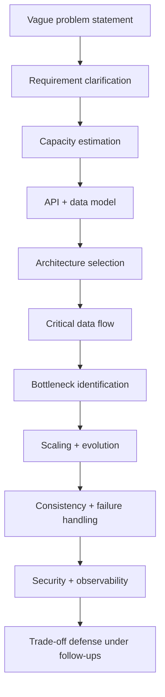

# What System Design Means in an Interview

> Prerequisites: none. This is the entry point.
> Related: [requirements-and-constraints](./requirements-and-constraints.md) · [interview-communication-framework](./interview-communication-framework.md)

---

## A. Problem and motivation

You know how to build a feature: take a ticket, write a Spring Boot controller, a service, a repository, a migration, ship it. That is **implementation**. System design is the layer above: deciding *what components exist, how they talk, where data lives, and what happens when things fail* — before any code.

An HLD interview is not testing whether you can code. It is testing whether, given a vague product ("design a notification service"), you can:

1. Turn ambiguity into a bounded, agreed problem.
2. Size it with numbers.
3. Propose an architecture that is **as simple as the requirements allow**.
4. Know where it breaks and how it evolves.
5. Defend your choices when challenged.

What happens if you treat it as a coding problem? You start drawing boxes immediately, miss the real requirements, over-engineer (Kafka + microservices + multi-region for a system that serves 100 requests/second), and cannot answer "why not something simpler?" That is the single most common SDE-2 failure.

---

## B. HLD vs LLD

| | High-Level Design (HLD) | Low-Level Design (LLD) |
|---|---|---|
| Question answered | *What are the components and how do they interact?* | *How is one component built internally?* |
| Artifacts | Architecture diagram, data flow, API list, data model sketch, capacity estimate | Class diagrams, interfaces, design patterns, method signatures |
| Example output | "API gateway → stateless app tier → PostgreSQL primary + 2 read replicas → Redis cache → Kafka → notification workers" | "A `RetryPolicy` interface with `ExponentialBackoff` and `FixedBackoff` implementations, injected into `NotificationSender`" |
| Interview round | "System design" / "architecture" round | "OOD" / "machine coding" round |
| Scale focus | RPS, storage, bottlenecks, failure modes | Correctness, extensibility, SOLID, patterns |

Both matter, but **this repository is about HLD**. In HLD you will *sketch* a data model and *name* a pattern (optimistic locking, circuit breaker), but you will not write a full class hierarchy. Knowing the boundary keeps you from burning interview time in the wrong layer.

---

## C. Mental model

Think of HLD as **urban planning**, not **house building**. A city planner decides where roads, water, power, and zoning go, and how the city grows from a town to a metropolis without tearing everything down. They do not pour concrete. You are the planner: you decide tiers, data stores, async boundaries, and growth path. The "concrete" (classes, SQL) is LLD.

The technical reality behind the analogy: an HLD is a set of **components** (processes/services), **connectors** (network calls, queues, replication), **data stores** (DBs, caches, object storage), and **the contracts and failure semantics** between them.

---

## D. What the interviewer is actually evaluating

An interviewer scores signal across these axes (this maps to the rubric in [`INTERVIEW-CHECKLIST.md`](../INTERVIEW-CHECKLIST.md)):

Crucially, they watch **how you think and communicate**, not just the final diagram. Two candidates can draw the same picture; the one who said "I'll start with a single Postgres and add replicas only when reads become the bottleneck — here's how I'd measure that" scores far higher than the one who drew five databases with no justification.

---

## E. Example — same prompt, three answers

**Prompt:** "Design a service to shorten URLs."

- **SDE-1 answer:** "A table `(short_code, long_url)`, generate a random code, store it, redirect on lookup." Correct core, but no clarification, no scale, no failure handling.
- **SDE-2 answer (target):** Clarifies read:write ratio and whether codes can be custom; estimates writes/day and storage/year; designs the redirect read path to be cache-heavy; picks a key-generation strategy that avoids collisions under concurrency; discusses what happens when the DB is down; mentions analytics as async.
- **Staff answer:** All of the above plus multi-region redirect latency, abuse/spam, data retention policy, and a migration path if the ID scheme must change.

You are aiming for the middle column. See the full worked design in [`url-shortener`](../12-system-design-problems/url-shortener.md).

---

## F. Trade-offs: how much to design

| Approach | Advantages | Disadvantages | Best use cases | Warning signs |
|---|---|---|---|---|
| Minimal (just enough to meet stated reqs) | Fast, defensible, shows judgment | May look "too simple" if you don't mention evolution | Default for SDE-2 | You never mention how it scales |
| Comprehensive (every component up front) | Looks thorough | Over-engineering; can't justify; runs out of time | Rarely — only truly large systems | Kafka/microservices/multi-region with no numbers to justify |
| Iterative (simple first, evolve on signal) | Matches real engineering; strong signal | Requires you to drive the conversation | **Recommended** | — |

The iterative approach is the winning strategy: start simple, then say "the first bottleneck will be X; when we hit it I'd add Y." See [architecture-fundamentals](./architecture-fundamentals.md) for the full scaling journey.

---

## G. Failure scenarios (of the *interview*, not the system)

1. **Jumping to architecture.** Trigger: anxiety, wanting to look fast. Internally: you commit to a design before knowing the requirements. Detect: you're drawing boxes in the first 2 minutes. Mitigate: force yourself to spend 5 minutes clarifying. Prevent: internalize the framework in [interview-communication-framework](./interview-communication-framework.md).
2. **Over-engineering.** Trigger: wanting to show off tech knowledge. User (interviewer) experience: thinks you can't gauge complexity. Mitigate: for each component, ask aloud "what breaks if I remove this?" Prevent: default to simplest; justify every addition with a number.
3. **Silence while thinking.** Trigger: hard follow-up. The interviewer can't score what they can't hear. Mitigate: narrate ("Let me think about the consistency requirement here..."). Prevent: practice talking through designs aloud.

---

## H. Scaling implications (of your preparation)

Early on, focus on **vocabulary and estimation** — you can't reason about trade-offs without them. Mid-prep, focus on **data stores and failure modes** — that's where most SDE-2 depth lives. Late prep, focus on **communication and follow-up defense** — that's what converts knowledge into offers.

---

## I. SDE-2 vs other levels (what to actually prepare)

- **Don't** memorize exotic papers or design planet-scale systems for every prompt.
- **Do** be rock-solid on: requirements, estimation, SQL vs NoSQL, indexing, replication, caching + invalidation, queues + idempotency, timeouts/retries, and the ability to say "I'd keep it simple until metric X crosses threshold Y."

---

## J. Interview preparation

**Basic**
- Q: What's the difference between HLD and LLD? → *A: HLD defines components, interactions, data stores, and failure semantics; LLD defines the internal class/structure of a single component.*
- Q: What's the first thing you do in an HLD interview? → *A: Clarify functional and non-functional requirements and set scope — never start drawing immediately.*

**Intermediate**
- Q: Why not design for millions of users from the start? → *A: Because complexity has cost (operational, latency, failure surface). You design for stated scale and show the evolution path, so the design stays defensible and simple.*

**SDE-2 / scenario**
- Q: "Your design has 6 components. Which would you remove first and why?" → *A: Walk through each component's reason to exist; remove the one whose absence only matters above a scale we haven't justified (often the message queue or a second datastore).*

**Common wrong answers**
- "I'd use microservices for separation of concerns." (Wrong without scale/team justification — a modular monolith is usually the right SDE-2 default.)
- "Add Kafka to decouple." (Only if you can state the async requirement it satisfies.)

---

## K. Hands-on exercise

Take the prompt "Design a service that lets users upload documents and get notified when processing finishes." Write (a) three clarifying questions, (b) one sentence stating the simplest architecture, and (c) one sentence on the first thing that would break at scale. Keep it under 10 lines. Compare with the [DMS design](../12-system-design-problems/document-management-system.md) after.

---

## L. Revision summary

**Key takeaways**
- HLD = components + connectors + data stores + failure semantics. LLD = inside one component.
- The interview scores your *reasoning and communication*, not just the diagram.
- Default to the simplest design that meets requirements; justify every addition.

**Must explain without notes:** HLD vs LLD; what an interviewer evaluates; why "simplest adequate" beats "comprehensive."

**Rapid-fire**
1. HLD or LLD: "design the retry policy class hierarchy"? → LLD.
2. First action in an HLD interview? → Clarify requirements.
3. One-line reason not to start with microservices? → Unjustified complexity cost; evolve on signal.
4. What's the strongest kind of statement to make? → "I'd do X now; metric Y would trigger me to add Z."
5. Name three evaluation axes. → Requirements, estimation, trade-off defense (any from the list).

**Next:** [requirements-and-constraints](./requirements-and-constraints.md)
