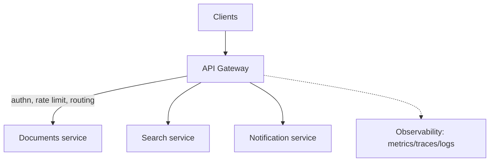

# API Gateway and Load Balancing

> Prerequisites: [networking-fundamentals](./networking-fundamentals.md), [dns-tcp-tls-http](./dns-tcp-tls-http.md)
> Related: [02-compute-and-architecture/reverse-proxy-and-load-balancers](../02-compute-and-architecture/reverse-proxy-and-load-balancers.md) · [rate-limiting](./rate-limiting.md)

Load balancers and gateways are the first components you draw in almost every design. Interviewers want you to know the difference, what each operates on (L4 vs L7), and why both exist.

---

## A. Problem and motivation

Once you have more than one app instance (Stage 3 of the [scaling journey](../00-foundations/architecture-fundamentals.md)), something must distribute traffic across them, route around dead ones, and present a single entry point. That's the load balancer. Separately, cross-cutting concerns (auth, rate limiting, routing to the right service) shouldn't be re-implemented in every service — that's the API gateway. Candidates often conflate the two or can't say what layer a balancer works at.

---

## B. Load balancer: L4 vs L7

| | L4 load balancer | L7 load balancer |
|---|---|---|
| Operates on | TCP/UDP (IP + port) | HTTP (path, host, headers, cookies) |
| Can route by URL path? | ❌ | ✅ (`/images/*` → image service) |
| Can terminate TLS? | ❌ (passthrough) | ✅ |
| Overhead | Lower (no parsing) | Higher (parses HTTP) |
| Use when | Raw throughput, non-HTTP, TLS passthrough | HTTP routing, TLS offload, header-based rules |

**Interview-ready:** "An L4 balancer forwards connections by IP/port with minimal overhead; an L7 balancer understands HTTP, so it can route by path/host, terminate TLS, and do sticky sessions or header-based routing. I'd use L7 for typical web APIs needing path routing and TLS offload."

### Load balancing algorithms
- **Round robin** — even rotation; simplest.
- **Least connections** — send to the instance with fewest active connections; better when request durations vary.
- **Weighted** — bigger instances get more traffic.
- **Consistent hashing / IP hash** — same client → same instance (sticky), used for cache locality or stateful affinity; minimizes remapping when instances change. See [GLOSSARY: consistent hashing](../GLOSSARY.md).

### Health checks
The LB periodically probes instances (`GET /health`) and removes unhealthy ones from rotation. This is the *fine-grained, fast* failover that DNS can't do (DNS failover is bounded by TTL). Distinguish **liveness** (is the process up?) from **readiness** (is it ready to serve? e.g., warmed up, DB connected). See [redundancy-and-failover](../07-reliability-and-resilience/redundancy-and-failover.md).

---

## C. API gateway: the single front door

A gateway sits in front of services and centralizes cross-cutting concerns:

Responsibilities: TLS termination, authentication (token validation), rate limiting, request routing/aggregation, request/response transformation, and centralized logging/metrics. It lets services stay focused on business logic.

**Gateway vs load balancer:** an L7 load balancer *distributes* traffic across identical instances; an API gateway *routes and governs* traffic across *different* services and applies policy. They overlap (an L7 LB does some gateway jobs) and are often layered: `DNS → L7 LB → API gateway → services`, or a single managed component doing both.

---

## D. Example — DMS front door

`DNS (GeoDNS to nearest region) → L7 load balancer (TLS termination, health checks, routes /api/* ) → API gateway (validate JWT, rate limit per API key, route /documents to documents service, /search to search service) → stateless app instances`.

Why both: the LB spreads load across the documents service's 5 instances and removes a crashed one in seconds; the gateway means auth and rate limiting aren't duplicated in every service.

---

## E. Trade-offs

| Component | Advantages | Disadvantages | Best use | Warning signs |
|---|---|---|---|---|
| L4 LB | Fast, protocol-agnostic | No HTTP routing | TLS passthrough, non-HTTP | Needing path-based routing |
| L7 LB | Path/host routing, TLS offload | More overhead/cost | Web APIs | Ultra-low-latency raw TCP |
| API gateway | Centralizes auth/rate-limit/routing | Single choke point; added latency; can become a monolith of config | Multi-service systems | One service, or gateway doing business logic |

**Over-engineering warning:** a single service with one instance does **not** need a gateway. Introduce it when you have multiple services or real cross-cutting needs. (Classic premature-complexity trap — see [common-design-mistakes](../13-interview-practice/common-design-mistakes.md).)

---

## F. Failure scenarios

1. **Gateway/LB is a single point of failure.** Trigger: the one LB dies. Users: total outage. Mitigate: redundant LBs (active-active) + DNS or anycast in front; health-checked. Prevent: never a single LB in a serious design.
2. **Unhealthy instance kept in rotation.** Trigger: liveness passes but readiness fails (DB disconnected). Users: errors from that instance. Detect: elevated 5xx from one target. Mitigate: readiness checks that fail fast; LB ejects it.
3. **Gateway becomes a bottleneck/choke point.** Trigger: all traffic + heavy transformation through one tier. Detect: gateway CPU/latency. Mitigate: scale the gateway tier horizontally; push some logic to services/edge.

---

## G. Scaling implications

The LB tier itself must be redundant and scalable (managed LBs handle this). The gateway can become a bottleneck if it does heavy work — keep it thin (routing + policy, not business logic). Sticky sessions via consistent hashing help cache locality but hurt even load distribution and complicate scaling (a dropped instance reshuffles its clients) — prefer stateless + shared cache instead where possible.

---

## H. Interview preparation

**Basic**
- Q: L4 vs L7 load balancer? → *A: L4 routes by IP/port (fast, no HTTP awareness); L7 routes by path/host/header and can terminate TLS.*
- Q: What does a health check do? → *A: Lets the LB detect and eject unhealthy instances for fast failover.*

**Intermediate**
- Q: LB vs API gateway? → *A: LB distributes load across identical instances; gateway routes across different services and centralizes auth/rate-limiting/transformation. Often layered.*
- Q: Liveness vs readiness? → *A: Liveness = process alive (restart if not); readiness = able to serve now (eject from LB until ready).*

**SDE-2 / scenario**
- Q: "Do you need an API gateway for a single service?" → *A: No — that's premature. I'd add one when there are multiple services or shared cross-cutting concerns (auth, rate limiting, routing).*
- Q: "How do you avoid the LB being a SPOF?" → *A: Redundant LBs (active-active), fronted by DNS/anycast, with health checks; managed LBs provide this.*

**Common wrong answers:** "L4 routes by URL"; a single LB with no redundancy; gateway doing business logic; sticky sessions as a default.

---

## I. Hands-on exercise

Draw the front-door chain for a system with three services (documents, search, notifications). Decide: L4 or L7 at the edge? Where does TLS terminate? Where do rate limiting and auth happen? Justify each placement.

---

## J. Revision summary

**Key takeaways**
- L4 = IP/port routing; L7 = HTTP-aware routing + TLS termination.
- LB distributes across identical instances; gateway governs/routes across services.
- Health checks (liveness vs readiness) give fast, fine-grained failover (vs coarse DNS).
- Keep the gateway thin; make LBs redundant; add a gateway only when justified.

**Must explain without notes:** L4 vs L7; LB vs gateway; liveness vs readiness.

**Rapid-fire**
1. Which balancer can route by path? → L7.
2. Who ejects a crashed instance fast? → LB via health checks.
3. Gateway's job in one phrase? → Centralized routing + policy across services.
4. Readiness check failing means? → Eject from LB until ready (don't kill).
5. Single service — gateway needed? → No, premature.

**Next:** [rate-limiting](./rate-limiting.md)
