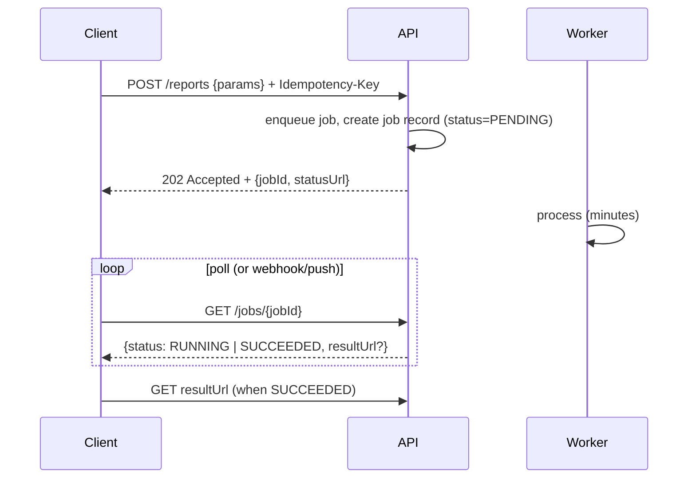

# Async-Request and Bulk / Batch APIs

> Prerequisites: [rest-and-api-design](./rest-and-api-design.md), [02-compute-and-architecture/synchronous-vs-asynchronous-processing](../02-compute-and-architecture/synchronous-vs-asynchronous-processing.md)
> Related: [webhooks-and-callbacks](./webhooks-and-callbacks.md) · [05-messaging/idempotency-and-deduplication](../05-messaging-and-event-driven-systems/idempotency-and-deduplication.md)

Two very common API shapes that the basic REST chapter doesn't fully cover: **long-running async requests** (you can't make the client wait) and **bulk/batch operations** (where partial failure is the hard part). Both show up constantly and match your async background.

---

## A. Problem and motivation

Not every request fits request→response-in-200ms. Some work is **long-running** (generate a report, transcode a video, run a bulk import) — the client can't hold a connection for minutes. Some requests act on **many items at once** (create 10,000 records, update 500 documents) — and the hard question becomes "what if item 4,237 fails?" The naive answers (block the client; treat a bulk op as all-or-nothing or ignore partial failure) break at scale. These two patterns are standard and interviewers expect you to know them.

---

## B. The async-request (long-running operation) pattern

Don't make the client wait for slow work. Accept it, return a handle, process in the background, let the client learn the result.



- **202 Accepted** (not 200) signals "accepted, not done" — return a **job id** and a **status URL** (or a `Location` header).
- **Status endpoint** `GET /jobs/{id}` → `PENDING | RUNNING | SUCCEEDED | FAILED` (+ progress %, result link, error). This is the **polling** model.
- **Push alternatives to polling:** a **webhook** when done (see [webhooks-and-callbacks](./webhooks-and-callbacks.md)), or a WebSocket/SSE for live progress — avoids wasteful polling but adds a callback mechanism.
- **Idempotency key** on the submit so a retried submission doesn't create two jobs (see [idempotency-and-deduplication](../05-messaging-and-event-driven-systems/idempotency-and-deduplication.md)).
- The worker is async (queue + workers — see [synchronous-vs-asynchronous-processing](../02-compute-and-architecture/synchronous-vs-asynchronous-processing.md)); the result (if large) goes to object storage and the status returns a (pre-signed) link, not the payload inline.

**This is exactly the DMS upload flow** (`201/202` + status + async processing) generalized to any long-running operation.

---

## C. The bulk / batch API pattern — partial failure is the point

A bulk endpoint acts on many items. The central design question: **all-or-nothing vs best-effort with per-item results?**

| Model | Behavior | When |
|---|---|---|
| **All-or-nothing (transactional)** | Entire batch succeeds or none does (one transaction) | Small batches, strong consistency needed |
| **Best-effort (per-item status)** | Each item succeeds/fails independently; return per-item results | Large batches, independent items (the common choice) |

**Best-effort response shape (the key detail):** return a per-item status so the client knows exactly what failed and can retry *only* those:
```http
POST /documents/bulk
{ "items": [ {clientId:"a",...}, {clientId:"b",...}, {clientId:"c",...} ] }

207 Multi-Status
{ "results": [
    { "clientId":"a", "status":201, "id":"doc_1" },
    { "clientId":"b", "status":422, "error":"invalid name" },   // failed, others still applied
    { "clientId":"c", "status":201, "id":"doc_2" }
] }
```
- Each item carries a **client-supplied id** so the client can correlate results and retry only the failures.
- `207 Multi-Status` (or `200` with per-item statuses) communicates partial success — don't return a single `200`/`500` that hides which items failed.
- **Idempotency per item** (not just per batch) so retrying the failed subset doesn't duplicate the ones that already succeeded.

**Very large bulk / async bulk:** for huge batches, combine both patterns — accept the batch (202 + jobId), process asynchronously, and expose results via the status endpoint / a downloadable results file (paginated if huge). Bulk imports of millions of rows are an async job, not a synchronous request.

---

## D. Bulk reads and pagination of results

Bulk *reads* ("export all my documents") are also long-running at scale → async job that produces a file in object storage, returned via a link; or a streaming/cursor-paginated endpoint (see [pagination-filtering-and-sorting](./pagination-filtering-and-sorting.md)) rather than one giant response. Never return millions of rows in a single synchronous response (OOM/timeout).

---

## E. Example — DMS bulk import + report generation

- **Bulk document import (10K docs):** `POST /documents/bulk-import` → `202 {jobId}`; an async worker processes items idempotently (per-item client id + idempotency), writing per-item results; `GET /jobs/{id}` returns progress + a results file (which items succeeded/failed). The client retries only failures.
- **Report generation (minutes):** `POST /reports` → `202 {jobId, statusUrl}`; worker generates the report to object storage; status flips to SUCCEEDED with a pre-signed download URL; optionally a webhook fires on completion. This is your JobFinder "email report" and the DMS processing flow generalized.

---

## F. Trade-offs

| Decision | Chosen | Alternative | Why |
|---|---|---|---|
| Long-running op | 202 + job id + status endpoint | Block the client | Can't hold a connection for minutes; async decouples + retries |
| Result delivery | Polling vs webhook/SSE | Inline in response | Polling is simple; webhook/push avoids waste but adds a callback |
| Bulk semantics | Best-effort + per-item status (207) | All-or-nothing | Large batches of independent items; let clients retry only failures |
| Idempotency | Per item (and per submit) | Per batch only | Retrying failures must not duplicate the already-succeeded items |
| Huge bulk | Async job + results file | One giant sync request | Avoid OOM/timeout; stream/paginate |

---

## G. Failure scenarios

1. **Client times out on a long sync request.** Trigger: a minutes-long op held synchronously. Fix: 202 + status endpoint; the work continues regardless of the client connection.
2. **Bulk op partially fails but returns 200/500.** Trigger: all-or-nothing semantics or hidden partial failure. Client can't tell what failed. Fix: 207 + per-item status with client ids.
3. **Client retries a bulk op and duplicates the succeeded items.** Trigger: per-batch-only idempotency. Fix: per-item idempotency keys so only failures re-apply.
4. **Polling storm.** Trigger: many clients polling a status endpoint tightly. Fix: `Retry-After` guidance, backoff, or push (webhook/SSE) instead of polling.
5. **Giant bulk read OOMs the server.** Fix: async export to object storage / cursor pagination, not one response.

---

## H. Interview preparation

**Basic**
- Q: How do you design an API for a long-running operation? → *A: Return 202 Accepted with a job id + status URL; process asynchronously (queue + workers); the client polls GET /jobs/{id} or gets a webhook; large results go to object storage via a link.*

**Intermediate**
- Q: How do you handle partial failure in a bulk API? → *A: Best-effort with per-item results (207 Multi-Status): each item has a client id and its own status/error, so the client retries only the failures. Per-item idempotency prevents duplicating the already-succeeded items.*
- Q: Polling vs webhook for async results? → *A: Polling (GET status) is simple but wasteful and higher-latency; a webhook/SSE pushes the result (efficient, real-time) but you own callback reliability. Offer polling + optional webhook.*

**SDE-2 / scenario**
- Q: "Design a bulk import of 1M records." → *A: Async job: 202 + jobId; worker processes items idempotently (per-item client id), records per-item results; status endpoint reports progress + a results file listing successes/failures. Not a synchronous request (would time out / OOM).*
- Q: "A report takes 3 minutes to generate — how does the API work?" → *A: 202 + jobId + statusUrl; async worker writes the report to object storage; status flips to SUCCEEDED with a pre-signed download link; optionally a webhook on completion. The client never holds a 3-minute connection.*

**Common wrong answers:** blocking the client on long work; bulk ops returning a single 200/500 that hides partial failure; per-batch-only idempotency (duplicates on retry); returning millions of rows synchronously; tight polling with no backoff.

---

## I. Hands-on exercise

Design the API for "upload a CSV of 50,000 users and create accounts." Specify: the submit (202 + jobId + idempotency), async processing with per-item idempotency, the status endpoint shape (progress + per-item results), how the client retries only failures, and how a webhook could replace polling. Compare with [synchronous-vs-asynchronous-processing](../02-compute-and-architecture/synchronous-vs-asynchronous-processing.md) and [webhooks-and-callbacks](./webhooks-and-callbacks.md).

---

## J. Revision summary

**Key takeaways**
- Long-running op: 202 Accepted + job id + status endpoint; process async; result via polling or webhook/push; large results in object storage; idempotent submit.
- Bulk op: prefer best-effort + per-item status (207) with client ids over hidden all-or-nothing; **per-item idempotency** so retrying failures doesn't duplicate successes.
- Huge bulk / exports: async job + results file / cursor pagination — never one giant synchronous response.
- Offer push (webhook/SSE) to avoid polling storms; give Retry-After for polling.

**Rapid-fire**
1. Status code for an accepted long-running request? → 202.
2. Status code conveying bulk partial success? → 207 Multi-Status.
3. Idempotency granularity for bulk? → Per item (so retries don't duplicate successes).
4. Avoid polling waste by? → Webhook / SSE push.
5. 1M-row bulk import — sync or async? → Async job + results file.

**Next:** [webhooks-and-callbacks](./webhooks-and-callbacks.md)
