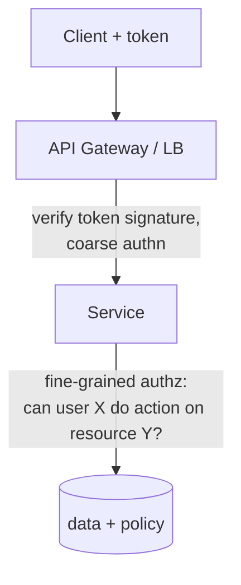

# Authentication and Authorization (API layer)

> Prerequisites: [dns-tcp-tls-http](./dns-tcp-tls-http.md)
> Related: [08-security/jwt-sessions-and-oauth2](../08-security/jwt-sessions-and-oauth2.md) · [08-security/authentication-authorization-and-rbac](../08-security/authentication-authorization-and-rbac.md)

This chapter covers authn/authz as it appears in HLD at the API boundary. The deeper security treatment (token internals, OAuth flows, key management) lives in [08-security](../08-security/). Here: the vocabulary and the design decisions.

---

## A. Problem and motivation

Two distinct questions every request must answer: **who are you (authentication)** and **what are you allowed to do (authorization)**. Confusing them, or putting the check in the wrong place, leads to the most common and most dangerous bugs — broken access control. In a multi-tenant DMS, a missing authorization check lets one company read another's documents.

---

## B. Authentication vs authorization

| | Authentication (AuthN) | Authorization (AuthZ) |
|---|---|---|
| Question | Who are you? | What can you do? |
| Mechanism | Credentials → token/session | Policy check on identity + resource |
| HTTP failure | 401 Unauthorized | 403 Forbidden |
| Example | "This is user u_42, verified" | "u_42 may read doc_123? Yes/No" |

Mnemonic: **AuthN = identity, AuthZ = permission.** 401 means "I don't know who you are"; 403 means "I know who you are, and you can't."

---

## C. Sessions vs tokens (stateful vs stateless)

| | Server sessions | JWT (stateless token) |
|---|---|---|
| State | Session stored server-side (DB/Redis) | Claims signed inside the token; nothing stored |
| Scaling | Needs shared session store | Any instance validates via signature — fits stateless tier |
| Revocation | Easy (delete session) | **Hard** — valid until expiry unless you add a blocklist/short TTL |
| Size | Small cookie id | Larger token sent each request |

**The core trade-off:** JWTs are stateless (great for horizontal scaling, no session lookup) but **hard to revoke** — a stolen or deprecated token works until it expires. Mitigations: short access-token TTL + refresh tokens, or a revocation list for critical cases. Sessions revoke instantly but require a shared store lookup on every request. See [jwt-sessions-and-oauth2](../08-security/jwt-sessions-and-oauth2.md).

---

## D. Where the check happens (HLD placement)

- **Coarse authn at the gateway:** validate the token's signature/expiry, reject anonymous traffic early. See [api-gateway-and-load-balancing](./api-gateway-and-load-balancing.md).
- **Fine-grained authz in the service:** only the service knows that `doc_123` belongs to tenant T and user u_42 has `READER` on it. **Never** rely on the gateway alone for resource-level authorization — it doesn't have the data.

**Interview-ready line:** "I'd do authentication (token validation) at the gateway and resource-level authorization inside the service, because only the service has the ownership/permission data to decide."

---

## E. Authorization models

| Model | Idea | Fits |
|---|---|---|
| **RBAC** (role-based) | Users get roles; roles grant permissions | Most enterprise apps (DMS: OWNER/EDITOR/VIEWER) |
| **ABAC** (attribute-based) | Policy over attributes (dept, time, resource tags) | Fine-grained/contextual rules |
| **ReBAC** (relationship-based) | Permissions via relationships (e.g., "editor of folder → editor of its docs") | Hierarchical sharing (Google Docs-style) |

For most SDE-2 designs, **RBAC** is the right default; mention ABAC/ReBAC when the sharing model is relationship-heavy. See [authentication-authorization-and-rbac](../08-security/authentication-authorization-and-rbac.md).

---

## F. Example — DMS authorization

A share grants `(user, document, role)`. Reading `GET /documents/{id}` checks: token valid (authn) → does this user have *at least VIEWER* on this document *within their tenant* (authz)? The tenant check is critical: in multi-tenant systems, **every query must be scoped by tenant_id** to prevent cross-tenant leakage. See [multi-tenant-isolation](../08-security/multi-tenant-isolation.md).

---

## G. Trade-offs

| Choice | Advantages | Disadvantages | Best use | Warning signs |
|---|---|---|---|---|
| JWT (stateless) | No session lookup, scales | Hard to revoke, bigger tokens | Horizontally-scaled APIs | Long-lived tokens, no revocation plan |
| Sessions | Instant revocation, small | Shared store lookup per request | Apps needing tight control | Sticky sessions to one instance |
| RBAC | Simple, auditable | Coarse for complex sharing | Enterprise | Modeling relationships as roles |

---

## H. Failure scenarios

1. **Broken object-level authorization (IDOR).** Trigger: service checks authn but not that the user owns `doc_123`. User: can read others' docs by changing the ID. Detect: access-pattern anomalies; pen test. Mitigate/prevent: enforce resource-level authz on every endpoint; scope by tenant_id in the query itself.
2. **Un-revocable stolen JWT.** Trigger: token leaks; valid until expiry. Mitigate: short TTL + refresh; emergency blocklist. Prevent: short-lived access tokens by default.
3. **Authz in the gateway only.** Trigger: gateway allows `/documents/*`, service trusts it. User: cross-tenant access. Fix: service must re-check at resource granularity.

---

## I. Scaling implications

Stateless tokens are what make the stateless app tier (and thus horizontal scaling) clean — no per-request session store hit. The cost is revocation complexity, handled with short TTLs. Authorization data (roles, shares) is read on nearly every request, so it's a prime caching target — but cache invalidation on permission changes must be prompt (a revoked share should take effect quickly). See [cache-invalidation-and-consistency](../04-caching/cache-invalidation-and-consistency.md).

---

## J. Interview preparation

**Basic**
- Q: AuthN vs AuthZ? → *A: AuthN = who you are (401 on failure); AuthZ = what you're allowed to do (403).*
- Q: 401 vs 403? → *A: 401 unauthenticated; 403 authenticated but forbidden.*

**Intermediate**
- Q: JWT vs session trade-off? → *A: JWT is stateless and scales but is hard to revoke; sessions revoke instantly but need a shared store lookup. Mitigate JWT with short TTL + refresh.*
- Q: Where do authn and authz belong? → *A: Authn (token validation) at the gateway; resource-level authz in the service that owns the data.*

**SDE-2 / scenario**
- Q: "How do you stop tenant A reading tenant B's documents?" → *A: Enforce tenant scoping in every query (`WHERE tenant_id = :t`) plus resource-level authz, not just at the gateway; consider row-level security and per-tenant isolation.*
- Q: "A token was stolen — how fast can you cut it off?" → *A: With plain JWT, only at expiry; so I keep access tokens short-lived and support a revocation list / rotate signing keys for emergencies.*

**Common wrong answers:** checking authz only at the gateway; long-lived JWTs with no revocation; forgetting tenant scoping.

---

## K. Hands-on exercise

For the DMS, write the exact authn + authz check sequence for `DELETE /documents/{id}` in a multi-tenant setup. Include: token validation, tenant scoping, role requirement, and the status codes for (a) no token, (b) wrong tenant, (c) insufficient role.

---

## L. Revision summary

**Key takeaways**
- AuthN (identity, 401) vs AuthZ (permission, 403).
- JWT = stateless/scales/hard-to-revoke; sessions = revocable/needs shared store.
- Authn at gateway, resource-level authz in the service.
- RBAC is the default; scope every multi-tenant query by tenant_id.

**Must explain without notes:** authn vs authz with status codes; JWT vs session trade-off; where each check belongs.

**Rapid-fire**
1. 403 means? → Authenticated but forbidden.
2. Hardest thing about JWTs? → Revocation.
3. Where does resource-level authz belong? → In the owning service.
4. Default authz model for enterprise? → RBAC.
5. Prevent cross-tenant leaks? → Tenant scoping in every query + resource authz.

**Next:** [api-gateway-and-load-balancing](./api-gateway-and-load-balancing.md)
