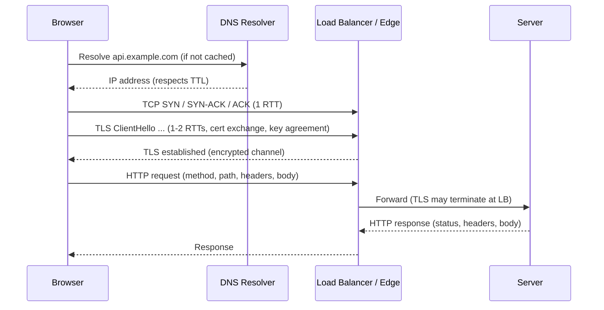

# DNS, TCP, TLS, HTTP — The Request Lifecycle

> Prerequisites: [networking-fundamentals](./networking-fundamentals.md)
> Related: [http1-http2-http3](./http1-http2-http3.md) · [api-gateway-and-load-balancing](./api-gateway-and-load-balancing.md)

"What happens when you type a URL and press Enter?" is a classic warm-up. More importantly, each step here is a place latency hides and failures occur. This chapter walks the full lifecycle at HLD depth.

---

## A. Problem and motivation

Your architecture diagram starts with "Client → System." Between those two words lies DNS resolution, a TCP handshake, a TLS handshake, and HTTP semantics — each with its own latency and failure modes. Interviewers probe this to see whether you understand the system boundary, where TLS terminates, why a CDN helps, and how DNS enables failover and global routing.

---

## B. The lifecycle end to end

---

## C. DNS — turning names into addresses

**What it does:** maps `api.example.com` → an IP. Hierarchical and cached at many levels (browser, OS, resolver, authoritative).

**Why it matters for HLD:**
- **TTL** controls how long a mapping is cached. Low TTL = faster failover (clients re-resolve to a healthy IP quickly) but more DNS traffic. High TTL = less traffic but slow failover. *Interview point:* lower TTLs before a planned failover/migration.
- **GeoDNS / latency-based routing** returns the IP of the nearest/healthiest region — the first building block of multi-region and CDN routing. See [multi-region-architecture](../06-distributed-systems/multi-region-architecture.md).
- **DNS as a failover mechanism:** health-checked DNS removes a dead region from rotation. Caveat: client-side caching means failover isn't instant (bounded by TTL).

**Failure mode:** a long TTL during an outage keeps sending users to a dead IP. This is why DNS is a *coarse* failover tool, usually paired with a load balancer for fine-grained, instant failover inside a region.

---

## D. TCP — the reliable channel

Covered in [networking-fundamentals](./networking-fundamentals.md): a 3-way handshake (SYN/SYN-ACK/ACK) establishes an ordered, reliable byte stream. Costs ~1 RTT before data. Connections are pooled/kept alive to avoid repeating this.

Key HLD consequence: **the handshake RTT is why co-location and keep-alive matter**, and why serverless cold starts (new connections every time) can hurt latency.

---

## E. TLS — encryption and where it terminates

**What it does:** authenticates the server (via certificate) and establishes an encrypted channel. Costs ~1–2 RTTs on top of TCP (fewer with TLS 1.3 and session resumption).

**The HLD decision — where TLS terminates:**

| Termination point | Meaning | Trade-off |
|---|---|---|
| **At the load balancer / edge** (TLS termination) | LB decrypts; traffic to app servers is plaintext (or re-encrypted internally) | Offloads crypto from app; LB can inspect/route on HTTP (L7); common default |
| **End-to-end to the app** (TLS passthrough) | LB forwards encrypted bytes (L4) | App does crypto; LB can't inspect content; needed for strict end-to-end encryption |

*Interview point:* "I'd terminate TLS at the L7 load balancer so it can route on path and offload crypto, and use mutual TLS or re-encryption inside the trust boundary if the data is sensitive." This connects to [encryption-and-data-protection](../08-security/encryption-and-data-protection.md).

---

## F. HTTP — the application semantics

**Request:** method + path + headers + optional body. **Response:** status code + headers + body.

**Methods and their properties (interviewers test this):**

| Method | Safe (no side effect) | Idempotent (repeat = same effect) | Typical use |
|---|---|---|---|
| GET | ✅ | ✅ | Read |
| HEAD | ✅ | ✅ | Metadata only |
| PUT | ❌ | ✅ | Replace resource |
| DELETE | ❌ | ✅ | Remove resource |
| POST | ❌ | ❌ | Create / non-idempotent action |
| PATCH | ❌ | ❌ (usually) | Partial update |

**Why idempotency of methods matters:** a client can safely retry a GET/PUT/DELETE after a timeout, but **not** a POST — a retried POST may create a duplicate (two documents, two charges). This is the root motivation for **idempotency keys** on POST operations. See [idempotency-and-deduplication](../05-messaging-and-event-driven-systems/idempotency-and-deduplication.md).

**Status codes you should use precisely:** `200/201/204` success; `301/302` redirects; `400` bad request; `401` unauthenticated; `403` unauthorized; `404` not found; `409` conflict (e.g., version mismatch / duplicate); `422` validation; `429` rate limited; `500` server error; `503` unavailable (shed load). Using `409` and `429` correctly is a quiet signal of maturity.

---

## G. Example — DMS upload, lifecycle-aware

`POST /documents` from a browser: DNS resolves the API host (cached) → TCP+TLS to the edge/LB (kept alive from a prior request, so no new handshake) → LB terminates TLS, routes `/documents` to the app tier (L7 path routing) → app stores file + metadata → returns `201 Created` with a `Location` header. If the client times out and retries the POST, we rely on an **idempotency key** (see data flow in [document-management-system](../12-system-design-problems/document-management-system.md)) to avoid a duplicate document.

---

## H. Trade-offs

| Decision | Advantages | Disadvantages | Best use | Warning signs |
|---|---|---|---|---|
| Low DNS TTL | Fast failover | More DNS queries | Before migrations/failover | Set-and-forget high TTL during an outage |
| TLS at LB | Offloads crypto, enables L7 routing | Internal hop plaintext unless re-encrypted | Most systems | Sensitive data unencrypted internally |
| POST for everything | Simple | Loses idempotency/caching semantics | Never as a habit | Using POST for reads/updates |

---

## I. Failure scenarios

1. **Stale DNS during failover.** Trigger: TTL 1h, region dies. Users: errors for up to an hour. Detect: regional error spike persisting past the failover. Mitigate: lower TTL proactively; use LB-level failover for speed. Prevent: health-checked DNS + short TTLs on failover-critical records.
2. **Retried POST creates duplicates.** Trigger: client timeout → retry on a non-idempotent POST. User: two documents/charges. Detect: duplicate records with near-identical timestamps. Mitigate/prevent: idempotency keys; return the original result on replay.
3. **TLS handshake storms on cold scale-up.** Trigger: autoscaler adds instances; floods of new TLS handshakes. Detect: CPU spike + latency on new instances. Mitigate: TLS session resumption, offload to LB, pre-warm.

---

## J. Interview preparation

**Basic**
- Q: What happens when you type a URL and hit Enter? → *A: DNS resolve → TCP handshake → TLS handshake → HTTP request → server/LB processes → response; CDN/edge may short-circuit for cached content.*
- Q: Which HTTP methods are idempotent? → *A: GET, HEAD, PUT, DELETE; POST and PATCH generally are not.*

**Intermediate**
- Q: Why can't you safely retry a POST? → *A: It's not idempotent; a retry may duplicate the side effect. Use an idempotency key so the server deduplicates.*
- Q: Where should TLS terminate? → *A: Usually at the L7 LB for routing + crypto offload; re-encrypt or mTLS internally for sensitive data.*

**SDE-2 / scenario**
- Q: "A region failed but users still hit it for 30 minutes." → *A: DNS TTL too high; clients cached the dead IP. Short-term flush/lower TTL; long-term use health-checked, low-TTL DNS plus LB failover for sub-second rerouting.*
- Q: "Which status code for a duplicate submission you detected?" → *A: 409 Conflict (or 200 with the original result if replaying an idempotency key).*

**Common wrong answers:** treating DNS failover as instant; using 200 for everything; retrying POSTs without idempotency.

---

## K. Hands-on exercise

Write the exact sequence of status codes your DMS API returns for: (a) successful upload, (b) upload with a stale version (optimistic-lock conflict), (c) unauthenticated request, (d) rate-limited client, (e) duplicate submission with the same idempotency key. Justify each.

---

## L. Revision summary

**Key takeaways**
- Lifecycle: DNS → TCP → TLS → HTTP; each adds latency and failure modes.
- DNS TTL trades failover speed vs query volume; DNS is coarse failover, LB is fine failover.
- TLS termination point is an HLD decision (routing + offload vs end-to-end encryption).
- GET/PUT/DELETE idempotent; POST not → idempotency keys for safe retries.
- Use 409 and 429 precisely.

**Must explain without notes:** the full lifecycle; why POST retries are unsafe; TLS termination trade-off.

**Rapid-fire**
1. Is PUT idempotent? → Yes.
2. What controls DNS failover speed? → TTL (plus client caching).
3. Status code for rate-limited? → 429.
4. Where does TLS commonly terminate? → At the L7 load balancer.
5. Why idempotency keys on POST? → POST isn't idempotent; keys dedupe retries.

**Next:** [http1-http2-http3](./http1-http2-http3.md)
