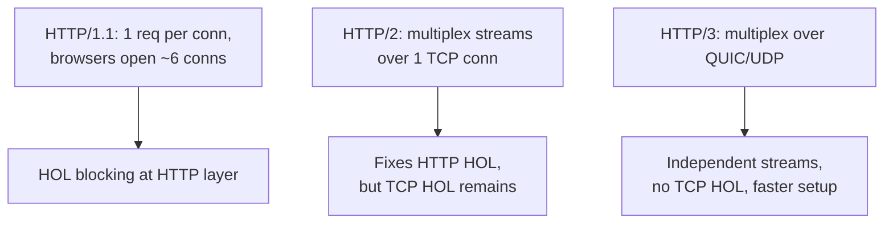

# HTTP/1.1 vs HTTP/2 vs HTTP/3

> Prerequisites: [dns-tcp-tls-http](./dns-tcp-tls-http.md)
> Related: [rest-and-api-design](./rest-and-api-design.md) · [cdn-and-edge-caching](../10-storage-and-content-delivery/cdn-and-edge-caching.md)

At SDE-2 you rarely *choose* an HTTP version (the platform/LB decides), but interviewers ask it to check whether you understand head-of-line blocking, multiplexing, and why these exist. Keep this knowledge at the "reason about it" level.

---

## A. Problem and motivation

HTTP/1.1 was designed for a web of a few requests per page. Modern pages/APIs make dozens to hundreds of calls. The evolution of HTTP is a series of fixes for **connection and head-of-line (HOL) blocking** problems that cause latency as request counts grow.

---

## B. The three versions

| | HTTP/1.1 | HTTP/2 | HTTP/3 |
|---|---|---|---|
| Transport | TCP | TCP | **QUIC over UDP** |
| Concurrency | One request at a time per connection (pipelining broken in practice) | **Multiplexing**: many streams over one TCP connection | Multiplexing over QUIC |
| HOL blocking | At the HTTP layer (must wait or open many connections) | Fixed at HTTP layer, **but TCP-level HOL remains** (one lost packet stalls all streams) | **Fixed** — independent streams; a lost packet stalls only its stream |
| Header overhead | Plaintext, repeated | HPACK compression | QPACK compression |
| Connection setup | TCP+TLS (2–3 RTTs) | TCP+TLS | QUIC combines transport+TLS (often 1 RTT, 0-RTT resume) |
| Server push | No | Yes (largely deprecated) | No |

**The core story:**
- **HTTP/1.1:** to get concurrency, browsers open ~6 parallel TCP connections per host — expensive and limited. HOL blocking at the HTTP layer.
- **HTTP/2:** multiplexes many logical streams over *one* TCP connection, with header compression. Big win. But because it's on TCP, a single lost packet blocks *all* streams until retransmitted (**TCP head-of-line blocking**).
- **HTTP/3:** moves to **QUIC** (over UDP), where streams are independent, so packet loss on one stream doesn't stall others. Also faster connection setup (transport + crypto in one handshake). Best on lossy/mobile networks.

---

## C. Internal working — multiplexing and HOL blocking

**Head-of-line blocking:** a queue where the item at the front blocks everything behind it. In HTTP/1.1, a slow response blocks the connection. HTTP/2 solves this *at the application layer* by interleaving stream frames — but all streams still share one TCP byte stream, so if a TCP segment is lost, TCP won't deliver *any* later bytes (even for unrelated streams) until it's retransmitted. HTTP/3's QUIC gives each stream its own delivery, eliminating cross-stream blocking.

---

## D. Example

For the DMS web app: a dashboard loads document metadata + thumbnails + user info in ~30 requests. On HTTP/1.1 the browser juggles 6 connections and serializes the rest. On HTTP/2 all 30 share one connection and interleave — faster, especially on higher-latency links. On a flaky mobile connection, HTTP/3 avoids one dropped packet stalling the whole dashboard load.

---

## E. Trade-offs

| Version | Advantages | Disadvantages | Best use | Warning signs |
|---|---|---|---|---|
| HTTP/1.1 | Universal, simple, debuggable | Connection-limited, HOL blocking | Internal simple services, legacy | Many parallel connections, slow pages |
| HTTP/2 | Multiplexing, header compression | TCP HOL blocking remains; complexity | Default for public web/APIs | Lossy networks |
| HTTP/3 | No cross-stream HOL, fast setup, mobile-friendly | Newer, UDP sometimes blocked, ops maturity | Mobile/lossy/global edge | Networks blocking UDP |

---

## F. Failure scenarios

1. **HTTP/1.1 connection starvation.** Trigger: a page needs 50 assets. Users: slow loads. Detect: waterfall shows queued requests. Mitigate: HTTP/2, bundling, CDN. 
2. **TCP HOL under packet loss (HTTP/2).** Trigger: mobile loss. Users: whole page stalls on one lost packet. Mitigate: HTTP/3/QUIC where available.
3. **UDP blocked (HTTP/3).** Trigger: corporate firewall drops UDP. Effect: client falls back to HTTP/2 (graceful). Detect: no HTTP/3 negotiated. Mitigate: ensure fallback works.

---

## G. Scaling implications

At the edge/CDN layer, HTTP/2 and HTTP/3 reduce connection overhead and tail latency for global users; this is mostly handled by your CDN/LB, not your app code. Your app typically speaks HTTP/1.1 or HTTP/2 to the LB, which upgrades to the client's best version. gRPC (common for internal service-to-service) runs on HTTP/2 for its multiplexing.

---

## H. Interview preparation

**Basic**
- Q: Main HTTP/2 improvement? → *A: Multiplexing many streams over one connection + header compression.*

**Intermediate**
- Q: If HTTP/2 fixed HOL, why HTTP/3? → *A: HTTP/2 fixed HOL only at the application layer; TCP-level HOL remains (one lost packet stalls all streams). HTTP/3/QUIC makes streams independent and speeds up setup.*

**SDE-2 / scenario**
- Q: "Does your service need HTTP/3?" → *A: Usually the CDN/LB handles version negotiation; I'd enable HTTP/3 at the edge for mobile/global users to cut tail latency, but it rarely changes my application design.*

**Common wrong answers:** "HTTP/2 eliminates all HOL blocking" (it leaves TCP HOL).

---

## I. Hands-on exercise

Explain in 3 sentences why gRPC chose HTTP/2 as its transport, referencing multiplexing and streaming. Then state one case where HTTP/3 would meaningfully help your users.

---

## J. Revision summary

**Key takeaways**
- 1.1 → 2 → 3 is a progression of fixes for connection limits and HOL blocking.
- HTTP/2 multiplexes over one TCP conn but suffers TCP HOL.
- HTTP/3/QUIC (UDP) removes cross-stream HOL and speeds setup; best on lossy/mobile.
- Version choice is usually an edge/LB concern, not an app-design one.

**Rapid-fire**
1. HTTP/2 transport? → TCP. HTTP/3? → QUIC/UDP.
2. What HOL does HTTP/2 *not* fix? → TCP-level.
3. gRPC runs on? → HTTP/2.
4. Why many connections in HTTP/1.1? → One in-flight request per connection.
5. HTTP/3 shines on? → Lossy/mobile networks.

**Next:** [rest-and-api-design](./rest-and-api-design.md)
