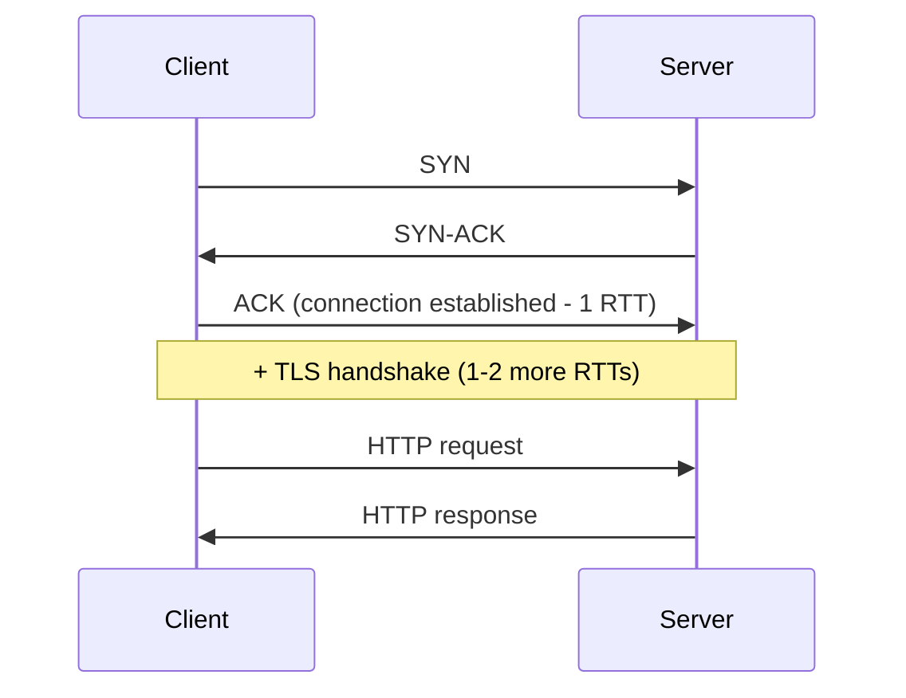
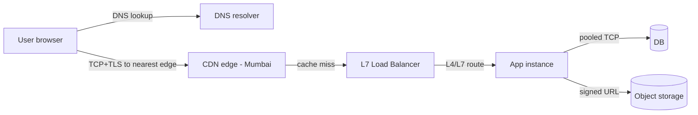

# Networking Fundamentals for System Design

> Prerequisites: [00-foundations/latency-throughput-and-capacity](../00-foundations/latency-throughput-and-capacity.md)
> Related: [dns-tcp-tls-http](./dns-tcp-tls-http.md) · [api-gateway-and-load-balancing](./api-gateway-and-load-balancing.md)

You don't need to be a network engineer for SDE-2 HLD. You need enough of the model to reason about *where latency comes from*, *what a load balancer operates on*, and *why a cross-region call is expensive*. This chapter gives you exactly that layer of understanding and no more.

---

## A. Problem and motivation

Every box-to-box arrow in your architecture diagram is a network call, and network calls are the slowest, least reliable part of a distributed system. If you can't reason about what happens on that arrow — how long it takes, how it can fail, what layer a component operates at — you can't reason about latency budgets, load balancing, or failure handling. Candidates who skip this say things like "the load balancer inspects the URL" (an L7 behavior) when they meant an L4 balancer, and can't explain it.

---

## B. Mental model — the layers that matter

The full OSI model has 7 layers; for HLD you care about four ideas:

| Layer (practical) | Unit | Examples | Who operates here |
|---|---|---|---|
| **Application (L7)** | message/request | HTTP, gRPC, DNS, WebSocket | API gateways, L7 load balancers, your app |
| **Transport (L4)** | segment | TCP, UDP | L4 load balancers, firewalls |
| **Network (L3)** | packet | IP | routers |
| **Link (L2)** | frame | Ethernet | switches |

The two you must internalize: **L4 (transport — TCP/UDP, addresses + ports, no idea what's inside)** and **L7 (application — HTTP, understands paths, headers, cookies)**. This single distinction decides what a load balancer can route on. See [api-gateway-and-load-balancing](./api-gateway-and-load-balancing.md).

---

## C. TCP vs UDP (the only transport choice you'll discuss)

| | TCP | UDP |
|---|---|---|
| Connection | Yes (3-way handshake) | No (fire and forget) |
| Reliability | Ordered, retransmitted, no loss | Best-effort; may lose/reorder |
| Overhead | Higher (ACKs, handshake, teardown) | Lower |
| Use for | HTTP, DB connections, most APIs | DNS (small queries), video/voice, metrics, QUIC/HTTP3 base |

**Interview-ready reasoning:** "I'd use TCP for the API because I need reliable, ordered delivery; I'd consider UDP only for latency-critical, loss-tolerant data like live media or high-volume metrics where retransmission would hurt more than loss."

---

## D. The cost of a connection (why pooling exists)

Opening a TCP connection isn't free:

A new TCP+TLS connection costs **~2–3 round trips** before any data flows. Within a datacenter (~0.5ms RTT) that's ~1–1.5ms of pure setup; across continents (~100ms RTT) it's **200–300ms** before your first byte. This is why:
- **Connection pooling** (DB pools, HTTP keep-alive) reuses connections instead of paying setup repeatedly. See [database-capacity-and-connection-pools](../11-estimation-and-bottleneck-analysis/database-capacity-and-connection-pools.md).
- **HTTP/2 and HTTP/3** multiplex many requests over one connection. See [http1-http2-http3](./http1-http2-http3.md).
- **Keeping chatty services close** (same region/AZ) matters enormously.

---

## E. Example — tracing a DMS request's network hops

A user in Mumbai downloads a document from a service hosted in one region:

Where latency comes from: DNS (cached mostly), TLS setup (amortized by keep-alive), the app→DB hop (pooled, ~1ms in-region), and the file transfer (dominated by payload size and the user↔edge distance, which the CDN minimizes). If this were cross-region, each hop could add 100ms+ — the reason we push content to the edge.

---

## F. Trade-offs

| Decision | Advantages | Disadvantages | Best use | Warning signs |
|---|---|---|---|---|
| Keep-alive / pooling | Avoids repeated handshakes | Idle connections consume resources | Almost always | Pool exhaustion under load |
| Same-region placement | Low RTT | Less geo-redundancy | Chatty services | Cross-region per-request calls |
| UDP for media/metrics | Low latency/overhead | No reliability | Loss-tolerant data | Using it for transactional data |

---

## G. Failure scenarios

1. **Connection pool exhaustion.** Trigger: downstream slows, connections held longer (Little's Law). Users see: timeouts/hangs. Detect: pool "wait" metric, active-connection count. Mitigate: timeouts so connections release; circuit breaker. Prevent: size pools from `RPS × latency` with headroom.
2. **Cross-region chatter.** Trigger: a service calls a dependency across an ocean per request. Users see: 200ms+ added latency. Detect: traces show a cross-region hop. Mitigate/prevent: co-locate, cache, or replicate data regionally.
3. **DNS misconfiguration/propagation.** Trigger: TTL too long during a failover; clients keep hitting a dead IP. Detect: errors from a region after a change. Mitigate: lower TTLs before planned changes; health-checked DNS. See [dns-tcp-tls-http](./dns-tcp-tls-http.md).

---

## H. Scaling implications

As you scale, the network becomes the dominant cost and failure surface: more services = more hops = more tail-latency amplification (see [latency chapter](../00-foundations/latency-throughput-and-capacity.md)). This is an argument *against* premature microservices (each split adds a network boundary) and *for* keeping chatty components co-located.

---

## I. Interview preparation

**Basic**
- Q: TCP vs UDP? → *A: TCP is reliable/ordered/connection-based; UDP is best-effort/connectionless/low-overhead. TCP for APIs, UDP for loss-tolerant media/metrics.*
- Q: Why pool connections? → *A: TCP+TLS setup costs 2–3 RTTs; pooling amortizes it across requests.*

**Intermediate**
- Q: What does an L4 vs L7 load balancer see? → *A: L4 sees IP+port (routes by connection); L7 sees HTTP (routes by path/host/header, can terminate TLS).*

**SDE-2 / scenario**
- Q: "Your p99 jumped after a deploy that added a dependency call." → *A: Likely a new network hop, possibly cross-region or without connection reuse. Check traces for the new span's latency and whether it's reusing connections; co-locate or make it async.*

**Common wrong answers:** "L4 balancer routes by URL" (that's L7); ignoring handshake cost when discussing microservice chatter.

---

## J. Hands-on exercise

For the DMS, list every network hop in an *upload* request and label each as same-AZ, cross-AZ, or cross-region in your assumed deployment. Identify the single hop that dominates latency and one way to reduce it.

---

## K. Revision summary

**Key takeaways**
- L4 = transport (IP+port); L7 = application (HTTP-aware). This decides routing capability.
- TCP reliable/ordered; UDP best-effort/low-overhead.
- A connection costs 2–3 RTTs → pool and keep-alive; cross-region hops are ~100ms+.
- More services = more hops = more tail-latency amplification.

**Rapid-fire**
1. Which layer sees the URL path? → L7.
2. Why does pooling help? → Avoids repeated handshake RTTs.
3. UDP use case? → Loss-tolerant media/metrics/DNS.
4. Cross-continent RTT order of magnitude? → ~100ms.
5. Network argument against microservices? → Each split adds a hop and tail amplification.

**Next:** [dns-tcp-tls-http](./dns-tcp-tls-http.md)
