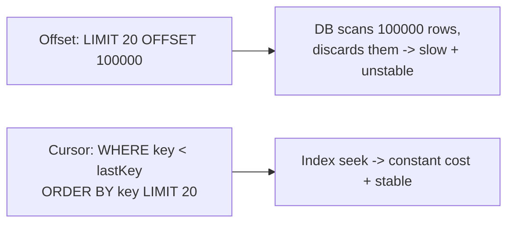

# Pagination, Filtering, and Sorting

> Prerequisites: [rest-and-api-design](./rest-and-api-design.md)
> Related: [indexing-and-query-optimization](../03-databases-and-data-modeling/indexing-and-query-optimization.md)

Pagination looks trivial but it's a frequent SDE-2 trap. "Offset pagination" quietly dies at scale, and the fix (cursor pagination) is a signal that you've operated real data. This chapter makes the difference crisp.

---

## A. Problem and motivation

A list endpoint that returns *everything* is a time bomb: at 2M documents, `GET /documents` would OOM the app, hammer the DB, and time out. You must return pages. But *how* you page determines whether page 10,000 is fast or catastrophic.

---

## B. Offset vs cursor (keyset) pagination

### Offset pagination
`GET /documents?limit=20&offset=10000` → SQL `... LIMIT 20 OFFSET 10000`.

The database must **scan and discard** the first 10,000 rows to return 20. Cost grows linearly with offset — page 1 is instant, page 10,000 is slow. Also unstable: if rows are inserted/deleted between pages, items get skipped or duplicated.

### Cursor (keyset) pagination
Return an opaque **cursor** pointing to the last item; the next page uses a `WHERE` on an indexed, ordered key:
`GET /documents?limit=20&cursor=<encodes created_at+id of last row>`
→ SQL `WHERE (created_at, id) < (:ts, :id) ORDER BY created_at DESC, id DESC LIMIT 20`.

With an index on `(created_at, id)`, the DB **seeks** directly — page 10,000 costs the same as page 1. Stable under inserts/deletes.



---

## C. Trade-offs

| | Offset | Cursor (keyset) |
|---|---|---|
| Page cost | Grows with offset (bad deep) | Constant |
| Jump to arbitrary page | Easy (`page=500`) | Hard (sequential only) |
| Stability under writes | Skips/dupes | Stable |
| UX fit | Numbered page UIs, small datasets | Infinite scroll, feeds, large datasets |
| Complexity | Trivial | Needs stable sort key + cursor encoding |

**Interview-ready:** "I'd use cursor pagination for large or write-heavy datasets and feeds because its cost is constant and it's stable under concurrent writes; I'd only use offset for small datasets or admin UIs needing jump-to-page."

---

## D. Filtering and sorting (the index connection)

Every filter/sort field a client can use must be backed by an index, or you get full table scans. `GET /documents?status=PROCESSING&sort=-createdAt` needs an index that supports both the predicate and the order (e.g., composite `(status, created_at)`). Allowing arbitrary filter combinations on unindexed columns is a scaling landmine — restrict to supported, indexed fields. See [indexing-and-query-optimization](../03-databases-and-data-modeling/indexing-and-query-optimization.md).

**Compound sort stability:** always include a unique tiebreaker (like `id`) in the sort so the order is deterministic — otherwise rows with equal sort values can shuffle between pages, breaking cursors.

---

## E. Example — DMS document list

```http
GET /documents?owner=u_42&status=READY&limit=20&cursor=eyJ0cyI6...
200 OK
{ "items": [ ... 20 docs ... ],
  "nextCursor": "eyJ0cyI6MTY5...",
  "hasMore": true }
```
Index backing it: `(owner_id, status, created_at, id)`. The cursor encodes `(created_at, id)` of the last returned row. No `offset`, no total count (counting 2M rows per request is itself expensive — return `hasMore` instead of a precise total, or compute totals approximately/asynchronously).

---

## F. Failure scenarios

1. **Deep-offset timeout.** Trigger: user/scraper requests `offset=500000`. Users: slow/failed page. Detect: slow queries with large offsets. Mitigate: switch to cursor; cap max offset. 
2. **Duplicated/skipped items.** Trigger: offset pagination over a list being written to. Fix: cursor pagination with a stable sort key.
3. **Expensive total counts.** Trigger: UI shows "Page 1 of 100,000" requiring `COUNT(*)` on a huge filtered set. Fix: drop exact totals; use `hasMore` or approximate counts.

---

## G. Scaling implications

Offset pagination is fine until the table is large or write-heavy — then it degrades silently (works in dev, dies in prod). Cursor pagination keeps list latency flat as data grows, which is exactly what feeds and large catalogs need. This is the mechanism behind "infinite scroll" everywhere.

---

## H. Interview preparation

**Basic**
- Q: Why not return the whole collection? → *A: OOM/timeout at scale; always paginate with a default and max limit.*

**Intermediate**
- Q: Offset vs cursor pagination? → *A: Offset scans+discards rows (cost grows with depth, unstable under writes); cursor seeks via an indexed key (constant cost, stable). Use cursor for large/write-heavy data and feeds.*

**SDE-2 / scenario**
- Q: "Page 1 is fast, page 5,000 times out. Why?" → *A: Offset pagination forces the DB to scan and discard 100k rows. I'd move to keyset pagination on an indexed `(sort_key, id)` and cap max offset.*
- Q: "Your list sometimes skips items." → *A: Offset instability under concurrent inserts/deletes; cursor pagination with a stable, unique sort key fixes it.*

**Common wrong answers:** offset pagination for feeds; filtering/sorting on unindexed columns; exact total counts on huge sets per request.

---

## I. Hands-on exercise

Design cursor pagination for a chat message history (`GET /conversations/{id}/messages`). Specify the sort key, the index, the cursor contents, and why offset would be wrong here. (Hint: messages are append-heavy and users scroll back infinitely.)

---

## J. Revision summary

**Key takeaways**
- Always paginate; set default + max limits.
- Offset = scan+discard (slow deep, unstable). Cursor/keyset = index seek (constant, stable).
- Back every filter/sort field with an index; include a unique tiebreaker in the sort.
- Avoid exact total counts on large sets per request.

**Rapid-fire**
1. Which pagination is constant-cost at any depth? → Cursor/keyset.
2. Why does offset get slow? → DB scans and discards offset rows.
3. What makes a cursor stable? → A unique, indexed sort key (with tiebreaker).
4. Best pagination for a feed? → Cursor.
5. Problem with exact totals? → Expensive `COUNT(*)` on big filtered sets.

**Next:** [authentication-and-authorization](./authentication-and-authorization.md)
