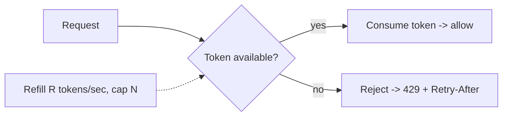
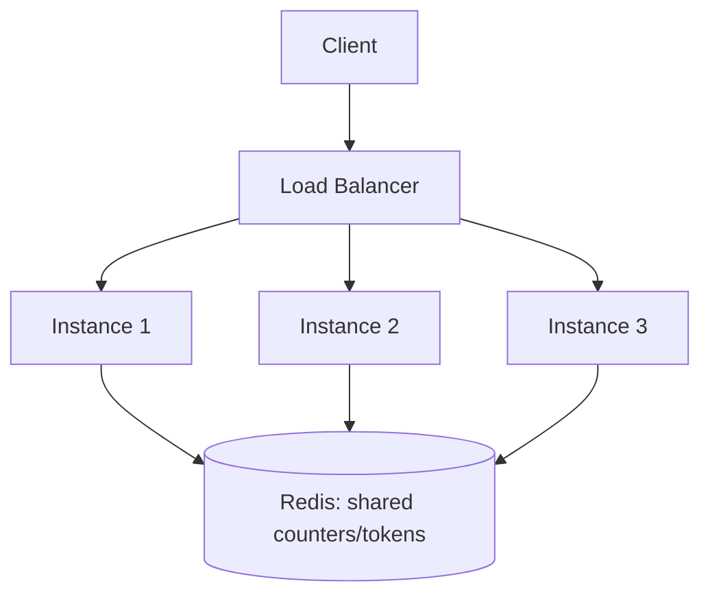

# Rate Limiting

> Prerequisites: [api-gateway-and-load-balancing](./api-gateway-and-load-balancing.md)
> Related: [12-system-design-problems/rate-limiter](../12-system-design-problems/rate-limiter.md) · [redis-design-and-failure-modes](../04-caching/redis-design-and-failure-modes.md)

Rate limiting is both a standalone design problem and a component in almost every system (abuse prevention, fairness, cost control). You must know the algorithms, their trade-offs, and how to make a limiter work across many servers.

---

## A. Problem and motivation

Without limits, a single buggy or malicious client can exhaust your capacity — a retry storm, a scraper, or a DoS. Rate limiting protects the system, enforces fair use across tenants, and controls cost (e.g., expensive downstream API calls). What happens if you don't have it: one client's traffic spike degrades everyone (the "noisy neighbor"), and retry storms turn a blip into an outage.

---

## B. The four core algorithms

| Algorithm | How it works | Pros | Cons |
|---|---|---|---|
| **Token bucket** | Bucket holds N tokens, refills at rate R; each request takes a token; empty → reject | Allows bursts up to N; smooth average; simple | Must store tokens + last-refill time |
| **Leaky bucket** | Requests enter a fixed-size queue drained at constant rate | Smooths output to a steady rate | Delays (queues) rather than rejects; less bursty |
| **Fixed window** | Count requests per fixed interval (e.g., per minute); reset at boundary | Trivial | **Boundary burst**: 2× limit across a window edge |
| **Sliding window log** | Store timestamps, count those within the trailing window | Accurate | Memory-heavy (stores every timestamp) |
| **Sliding window counter** | Weighted blend of current + previous fixed window | Good accuracy, cheap | Approximate |

**Token bucket is the common default** — it allows controlled bursts (good UX) while bounding the average rate.

### The fixed-window boundary problem (favorite follow-up)
Limit = 100/min. A client sends 100 at 00:59 and 100 at 01:01 — both windows "legal," but that's 200 requests in ~2 seconds. Sliding window (log or counter) fixes this by considering the trailing period, not calendar buckets.

---

## C. Distributed rate limiting (the real challenge)

A single server can track counts in memory. But with N app instances behind a load balancer, each instance seeing only its share, local counters let a client do N× the limit. You need **shared state**.

**Redis** is the standard store: atomic `INCR`/Lua scripts implement token or sliding-window counters shared across instances. Make the check-and-decrement **atomic** (a Lua script or `INCR` with expiry) to avoid races where two instances both think a token is available. See [redis-design-and-failure-modes](../04-caching/redis-design-and-failure-modes.md).

**Cost trade-off:** every rate-limited request now makes a Redis round trip (~sub-ms in-region). To reduce it, some systems use a hybrid: a local token bucket per instance sized to its fair share, reconciled with Redis periodically — approximate but cheaper.

---

## D. Where to enforce and what to return

- **Where:** at the API gateway/edge (reject early, before wasting app capacity) and/or in the service for business-specific limits (per-tenant quotas).
- **Response:** `429 Too Many Requests` with a `Retry-After` header and ideally `X-RateLimit-Remaining`/`X-RateLimit-Reset` so well-behaved clients back off. See [retries-backoff-and-jitter](../05-messaging-and-event-driven-systems/retries-backoff-and-jitter.md).
- **Key dimension:** limit per user, per API key, per IP, or per tenant — choose based on the abuse you're preventing (per-IP for anonymous DoS; per-API-key for fair use).

---

## E. Example — DMS

Limit uploads to 60/min per user (token bucket, burst 10) and global search to 600/min per tenant. Enforced at the gateway via Redis counters. A client exceeding it gets `429 Retry-After: 30`. Internal retries from workers use their own, higher limits. This prevents one tenant's bulk-upload script from starving others.

---

## F. Trade-offs

| Algorithm/Approach | Advantages | Disadvantages | Best use | Warning signs |
|---|---|---|---|---|
| Token bucket | Allows bursts, simple, standard | Needs per-key state | General API limiting | — |
| Fixed window | Cheapest | Boundary burst (2×) | Rough limits | Precise limits needed |
| Sliding window | Accurate | More memory/compute | Strict fairness | High-cardinality keys (memory) |
| Local counters | No Redis hop | Inaccurate across instances | Soft limits | Hard global caps |
| Redis-backed | Accurate global limit | Redis dependency + latency | Hard distributed limits | Redis down handling missing |

---

## G. Failure scenarios

1. **Redis (limiter store) down.** Trigger: Redis outage. Decision: **fail open** (allow traffic, risk overload) or **fail closed** (reject, protect backend)? Usually fail *open* for availability with a local fallback cap, *closed* for abuse-critical paths. State the choice explicitly — interviewers probe this. Detect: limiter errors. Mitigate: local fallback bucket; Redis HA.
2. **Boundary burst.** Trigger: fixed window at the edge. Fix: sliding window counter.
3. **Hot limiter key.** Trigger: one huge tenant's key gets all the limiter traffic. Fix: shard the key, or local pre-check + periodic reconcile. See [hot keys](../04-caching/stampedes-hot-keys-and-penetration.md).

---

## H. Scaling implications

Local limiting scales freely but is inaccurate; global (Redis) limiting is accurate but adds a dependency and a per-request hop that can itself become a hot key at extreme scale. The hybrid (local bucket + periodic reconcile) is how very high-RPS systems keep limiting cheap. The limiter must never become the system's bottleneck or SPOF — hence the explicit fail-open/closed decision.

---

## I. Interview preparation

**Basic**
- Q: Name rate-limiting algorithms. → *A: Token bucket, leaky bucket, fixed window, sliding window (log/counter).*
- Q: What status code for rate limiting? → *A: 429, with Retry-After.*

**Intermediate**
- Q: Why does fixed window allow 2× bursts? → *A: Two full windows' worth of requests can land on either side of the boundary; sliding window fixes it.*
- Q: How do you rate-limit across many servers? → *A: Shared store (Redis) with atomic counters/tokens, since per-instance counts allow N× the limit.*

**SDE-2 / scenario**
- Q: "Your Redis limiter is down — allow or block?" → *A: Depends on the path: fail open with a local fallback cap for user-facing availability; fail closed for abuse-critical endpoints. I'd make this an explicit, configured decision.*
- Q: "Token bucket vs leaky bucket for an API?" → *A: Token bucket — it permits short bursts (better UX) while bounding the average, whereas leaky bucket forces a steady rate and queues/delays.*

**Common wrong answers:** per-instance counters for a global limit; fixed window where precise limits matter; no plan for the limiter store being down.

---

## J. Hands-on exercise

Design a distributed rate limiter for 50 app instances enforcing 1,000 req/min per API key. Choose the algorithm, the store, how you make the check atomic, what you return on limit, and your Redis-down policy. Compare with the full [rate-limiter design](../12-system-design-problems/rate-limiter.md).

---

## K. Revision summary

**Key takeaways**
- Token bucket = default (bursts + bounded average); fixed window has the 2× boundary flaw; sliding window is accurate but heavier.
- Distributed limiting needs shared atomic state (Redis), else per-instance counters allow N× the limit.
- Return 429 + Retry-After; enforce at gateway and/or service; key by user/IP/tenant/API key.
- Decide fail-open vs fail-closed when the limiter store is down.

**Must explain without notes:** token vs fixed-window, the boundary burst, distributed limiting with Redis, fail-open/closed.

**Rapid-fire**
1. Default algorithm? → Token bucket.
2. Fixed-window flaw? → 2× burst at the boundary.
3. Why Redis for distributed limiting? → Shared atomic counters across instances.
4. Status code? → 429.
5. Redis limiter down — the key decision? → Fail open vs fail closed.

**Next:** [webhooks-and-callbacks](./webhooks-and-callbacks.md)
