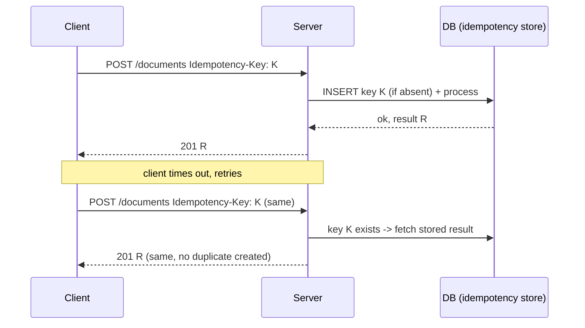

# REST and API Design

> Prerequisites: [dns-tcp-tls-http](./dns-tcp-tls-http.md)
> Related: [pagination-filtering-and-sorting](./pagination-filtering-and-sorting.md) · [authentication-and-authorization](./authentication-and-authorization.md) · [idempotency-and-deduplication](../05-messaging-and-event-driven-systems/idempotency-and-deduplication.md)

In almost every HLD interview you'll define 3–5 APIs. Clean, consistent, idempotent APIs are quick signal that you've built real systems. This chapter covers REST plus the API concerns that actually come up: idempotency, versioning, errors, and REST vs gRPC vs GraphQL.

---

## A. Problem and motivation

An API is the contract between your system and its clients. A bad contract leaks implementation details, breaks on retries, can't evolve without breaking clients, and makes the data model impossible to infer. Interviewers use your API to judge whether you understand resources, HTTP semantics, and failure handling — in 3 minutes.

---

## B. REST principles that matter in interviews

REST models the system as **resources** (nouns) manipulated via HTTP methods (verbs). You don't need to recite Fielding's dissertation; you need:

- **Resources are nouns, hierarchical:** `/documents/{id}/revisions/{revId}`, not `/getDocumentRevision`.
- **HTTP methods carry the verb:** `GET` read, `POST` create, `PUT` replace, `PATCH` partial update, `DELETE` remove. Respect their [idempotency properties](./dns-tcp-tls-http.md).
- **Statelessness:** each request carries everything needed (auth token, params); the server keeps no per-client session on a specific instance. This is what lets you scale horizontally. See [stateless-vs-stateful-services](../02-compute-and-architecture/stateless-vs-stateful-services.md).
- **Proper status codes:** 2xx success, 4xx client error, 5xx server error (from the [HTTP chapter](./dns-tcp-tls-http.md)).
- **Consistent, predictable shapes:** same error envelope everywhere; consistent field naming and pagination.

---

## C. Designing the DMS API (worked)

```
POST   /documents                      # create (upload metadata + get upload URL)
GET    /documents/{id}                 # fetch one
GET    /documents?owner=&cursor=&limit=# list (paginated, filtered)
PATCH  /documents/{id}                 # rename, change tags
DELETE /documents/{id}                 # soft-delete
POST   /documents/{id}/revisions       # add a new revision
GET    /documents/{id}/revisions       # list revisions
```

**Example create request/response:**
```http
POST /documents
Authorization: Bearer <jwt>
Idempotency-Key: 7b3f...-a21
Content-Type: application/json

{ "name": "contract.pdf", "sizeBytes": 2097152, "contentType": "application/pdf" }
```
```http
201 Created
Location: /documents/doc_123
{ "id": "doc_123", "status": "PROCESSING",
  "uploadUrl": "https://objstore/...signed...",
  "createdAt": "2026-10-15T10:00:00Z" }
```

Notice: the server returns a **pre-signed upload URL** so the large file goes straight to object storage, not through the app (saves bandwidth and app memory). The `Idempotency-Key` makes the create safely retryable.

**Error envelope (consistent everywhere):**
```json
{ "error": { "code": "VERSION_CONFLICT",
             "message": "Document was modified by another request",
             "requestId": "req_abc" } }
```
Returning a `requestId` ties the client error to your logs/traces — an observability win. See [logs-metrics-and-traces](../09-observability-and-operations/logs-metrics-and-traces.md).

---

## D. Idempotency in APIs (the detail that separates seniors)

`POST /documents` is not idempotent — a timeout+retry could create two documents. Fix with an **idempotency key**: the client sends a unique `Idempotency-Key`; the server records it with the result; a repeat with the same key returns the *original* result instead of acting again.



Full treatment: [idempotency-and-deduplication](../05-messaging-and-event-driven-systems/idempotency-and-deduplication.md).

---

## E. Versioning and evolution

APIs must change without breaking existing clients.

| Strategy | Example | Notes |
|---|---|---|
| URI versioning | `/v1/documents` | Explicit, cache-friendly, most common |
| Header versioning | `Accept: application/vnd.app.v2+json` | Cleaner URLs, less visible |
| No breaking changes | add fields, never remove/rename | The real goal — additive changes don't need a version bump |

**Rule:** adding optional fields is backward-compatible; removing/renaming/changing types is breaking. Prefer additive evolution; bump the major version only for truly breaking changes.

---

## F. REST vs gRPC vs GraphQL

| | REST/JSON | gRPC (Protobuf/HTTP2) | GraphQL |
|---|---|---|---|
| Best for | Public APIs, broad client support | Internal service-to-service, low latency, streaming | Clients needing flexible, aggregated data |
| Payload | JSON (verbose, human-readable) | Binary (compact, fast) | JSON, client-specified shape |
| Contract | OpenAPI (optional) | Strong (.proto) | Strong (schema) |
| Streaming | Limited | Native bidirectional | Subscriptions |
| Downsides | Over/under-fetching | Not browser-native, less human-readable | Server complexity, caching harder, N+1 risk |

**Interview-ready:** "External API → REST for ubiquity. Internal high-throughput service calls → gRPC for compact binary + multiplexing. A mobile client that aggregates many resources per screen → GraphQL to avoid chatty REST, accepting more server-side complexity and harder caching."

---

## G. Trade-offs (REST design choices)

| Choice | Advantages | Disadvantages | Best use | Warning signs |
|---|---|---|---|---|
| Pre-signed upload URLs | Offloads bandwidth from app | More moving parts; URL expiry | Large file uploads | Streaming big files through the app |
| Idempotency keys | Safe retries | Storage + lookup per write | Any non-idempotent create/charge | Duplicate records on retry |
| URI versioning | Explicit, cacheable | URL churn on major bumps | Public APIs | Breaking changes without a version |

---

## H. Failure scenarios

1. **Retry duplicates a resource.** Trigger: no idempotency on POST. Fix: idempotency key returning the original result.
2. **Breaking change takes down clients.** Trigger: renaming a field. Detect: client error spike post-deploy. Mitigate/prevent: additive-only changes; version major breaks; contract tests.
3. **Unbounded list response.** Trigger: `GET /documents` returns all 2M rows. Effect: OOM, timeouts. Fix: mandatory pagination with sane default/max limits. See [pagination](./pagination-filtering-and-sorting.md).

---

## I. Scaling implications

Stateless REST scales horizontally trivially. The scaling risks are chatty clients (fixed by batching/GraphQL/gRPC), unbounded responses (pagination), and large payloads on the app path (pre-signed URLs / streaming). API design decisions made early (idempotency, pagination, versioning) are expensive to retrofit at scale.

---

## J. Interview preparation

**Basic**
- Q: Why statelessness in REST? → *A: Any instance can serve any request → trivial horizontal scaling and failover; session state lives in a shared store or token.*
- Q: PUT vs PATCH vs POST? → *A: PUT replaces (idempotent), PATCH partially updates, POST creates/acts (not idempotent).*

**Intermediate**
- Q: How do you make a payment/create API safe to retry? → *A: Idempotency key: store key+result; replay returns the original result instead of re-acting.*
- Q: How do you evolve an API without breaking clients? → *A: Additive changes (new optional fields); version only true breaking changes; use contract tests.*

**SDE-2 / scenario**
- Q: "REST or gRPC between your services?" → *A: gRPC internally for low-latency, strongly-typed, multiplexed/streaming calls; REST at the edge for broad client compatibility.*
- Q: "A 2MB file upload — through the app or not?" → *A: Return a pre-signed URL so the client uploads directly to object storage; the app only records metadata, saving bandwidth and memory.*

**Common wrong answers:** verbs in URLs (`/createDocument`); POST without idempotency; returning entire collections unpaginated.

---

## K. Hands-on exercise

Design the full REST API for a URL shortener: create, redirect, get stats, delete. Specify methods, paths, status codes, which endpoint needs an idempotency key, and which needs pagination. Compare to [url-shortener](../12-system-design-problems/url-shortener.md).

---

## L. Revision summary

**Key takeaways**
- Resources as nouns; verbs via HTTP methods; respect idempotency properties.
- Statelessness enables horizontal scaling.
- Idempotency keys make non-idempotent creates safe to retry.
- Evolve additively; version only breaking changes.
- REST (edge) vs gRPC (internal) vs GraphQL (flexible aggregation) by requirement.

**Must explain without notes:** idempotency key flow; REST vs gRPC vs GraphQL decision; additive evolution.

**Rapid-fire**
1. Idempotent: PUT or POST? → PUT.
2. How to safely retry a create? → Idempotency key.
3. Internal low-latency service calls → ? → gRPC.
4. Backward-compatible change? → Add optional field.
5. Large upload path? → Pre-signed URL to object storage.

**Next:** [pagination-filtering-and-sorting](./pagination-filtering-and-sorting.md)
