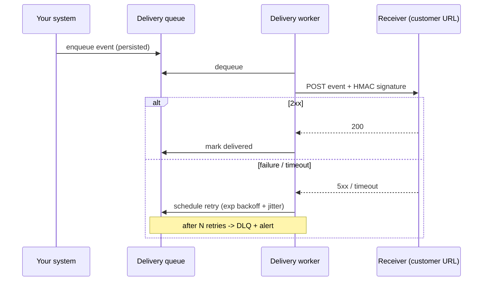

# Webhooks and Callbacks

> Prerequisites: [rest-and-api-design](./rest-and-api-design.md), [rate-limiting](./rate-limiting.md)
> Related: [retries-backoff-and-jitter](../05-messaging-and-event-driven-systems/retries-backoff-and-jitter.md) · [idempotency-and-deduplication](../05-messaging-and-event-driven-systems/idempotency-and-deduplication.md) · [12-system-design-problems/notification-service](../12-system-design-problems/notification-service.md)

Webhooks turn up in payments (Stripe), VCS (GitHub), and any "notify me when X happens" integration. They're a mini distributed-systems problem — delivery, retries, idempotency, security — packed into one feature.

---

## A. Problem and motivation

How does your system tell *another* system that an event happened (payment succeeded, document finished processing)? Two models:

- **Polling:** the client repeatedly asks "any news?" Wasteful (most polls return nothing), adds latency (bounded by poll interval), and scales badly (N clients × frequent polls).
- **Webhooks (server push):** when the event happens, *you* make an HTTP `POST` to a URL the client registered. Efficient, near-real-time. But now *you* own delivery reliability to an endpoint you don't control.

This is the classic "don't call us, we'll call you." The hard part is that the receiver may be slow, down, or flaky — and you still must deliver reliably.

---

## B. Internal working — a reliable webhook delivery pipeline

Key properties:
- **Durable queue:** events are persisted so a receiver outage doesn't lose them. See [queues](../05-messaging-and-event-driven-systems/queues-vs-pub-sub-vs-event-streams.md).
- **Retries with exponential backoff + jitter:** a down receiver shouldn't be hammered; backoff spreads retries. See [retries-backoff-and-jitter](../05-messaging-and-event-driven-systems/retries-backoff-and-jitter.md).
- **At-least-once delivery:** you'll sometimes deliver twice (retry after the receiver processed but before acking) → **receivers must be idempotent** (dedupe on event ID). You document this contract.
- **Dead-letter queue:** after N failed retries, park the event and alert, so one broken receiver doesn't block others. See [dead-letter-queues](../05-messaging-and-event-driven-systems/dead-letter-queues.md).

---

## C. Security — webhooks are inbound HTTP to the receiver

The receiver must verify the webhook is genuinely from you:
- **HMAC signature:** sign the payload with a shared secret; receiver recomputes and compares. Prevents spoofing.
- **Timestamp + replay protection:** include a timestamp in the signed payload; reject old ones to prevent replay.
- **HTTPS only.**
On *your* side, sending webhooks to user-supplied URLs is an **SSRF risk** (a user could point a webhook at your internal network). Validate/allowlist destinations and block internal IP ranges. See [security-threat-modeling](../08-security/security-threat-modeling.md).

---

## D. Example — DMS "processing complete" webhook

A tenant registers `https://tenant.example.com/hooks/dms`. When OCR finishes, the DMS enqueues a `document.processed` event, a worker POSTs it with an `X-DMS-Signature` HMAC header and an `event_id`. If the tenant's endpoint is down, the worker retries with backoff for up to 24 hours, then DLQs and surfaces it in the tenant's dashboard for manual replay. The tenant dedupes on `event_id` (because they may receive it twice).

---

## E. Trade-offs: webhooks vs polling vs streaming

| Approach | Advantages | Disadvantages | Best use | Warning signs |
|---|---|---|---|---|
| **Webhooks** | Real-time, efficient | You own delivery reliability; receiver must be reachable + idempotent; security burden | Event notifications to external systems | Receiver often unreachable |
| **Polling** | Simple, receiver-controlled, no inbound endpoint needed | Wasteful, latency = poll interval, scales poorly | Simple/low-volume; firewalled receivers | High-frequency needs |
| **Streaming (SSE/WebSocket)** | Continuous real-time | Persistent connections, stateful, harder to scale | Live UI updates (chat, dashboards) | Server-to-server batch events |

Many providers offer **both** webhooks and a polling/list API as a fallback, so a receiver that missed deliveries can reconcile.

---

## F. Failure scenarios

1. **Receiver down for hours.** Trigger: customer outage. Your side: retries with backoff; events persist. Users: delayed but not lost. Detect: rising retry/DLQ counts for that endpoint. Mitigate: cap retries → DLQ + manual replay + a list API to reconcile.
2. **Duplicate delivery.** Trigger: retry after receiver processed but before you got the 200. Receiver: processes twice unless idempotent. Fix: send a stable `event_id`; document "dedupe on event_id."
3. **Slow receiver blocks the pipeline.** Trigger: one receiver takes 30s/request. Effect: workers tied up, other webhooks delayed. Fix: per-receiver concurrency limits/isolation (bulkhead), aggressive timeouts. See [circuit-breakers-and-bulkheads](../06-distributed-systems/circuit-breakers-and-bulkheads.md).
4. **SSRF via user-supplied URL.** Trigger: user registers `http://169.254.../` or internal host. Fix: allowlist, block private IP ranges, resolve-and-validate.

---

## G. Scaling implications

Webhook delivery is a fan-out, at-least-once async pipeline — essentially the [notification service](../12-system-design-problems/notification-service.md) pattern. At scale you partition by receiver, isolate slow/failing receivers so they don't block others (bulkheads), autoscale delivery workers against queue depth, and provide a reconciliation/list API. Ordering across events to one receiver may matter — use a per-receiver partition if so.

---

## H. Interview preparation

**Basic**
- Q: Webhook vs polling? → *A: Webhook is server-push (real-time, efficient) but you own delivery reliability; polling is client-pull (simple but wasteful and higher latency).*

**Intermediate**
- Q: How do you make webhook delivery reliable? → *A: Durable queue, retries with exponential backoff + jitter, DLQ after N tries, and a reconciliation/list API; receivers must be idempotent because delivery is at-least-once.*
- Q: How does a receiver trust a webhook? → *A: HMAC signature over the payload with a shared secret, plus timestamp/replay protection and HTTPS.*

**SDE-2 / scenario**
- Q: "A customer's endpoint is down for 6 hours." → *A: Events persist in the queue; retry with backoff up to a max window, then DLQ + alert + dashboard for manual replay; a list API lets them reconcile missed events. I isolate their deliveries so other customers aren't affected.*
- Q: "How do you prevent a webhook feature from being an SSRF vector?" → *A: Validate and allowlist destination URLs, block private/internal IP ranges, and resolve-then-check at send time.*

**Common wrong answers:** fire-and-forget without retries/persistence; no idempotency contract; sending to arbitrary user URLs without SSRF protection; blocking the pipeline on one slow receiver.

---

## I. Hands-on exercise

Design the webhook delivery subsystem for a payment provider: events `payment.succeeded`, `payment.failed`. Specify the queue, retry schedule, signature scheme, DLQ policy, and the idempotency contract you'd document for receivers. How do you prevent one slow merchant from delaying all others?

---

## J. Revision summary

**Key takeaways**
- Webhooks = server push; you own delivery reliability to an endpoint you don't control.
- Reliable delivery = durable queue + backoff retries + DLQ + reconciliation API; at-least-once → receivers dedupe on event_id.
- Secure with HMAC signatures + replay protection; protect your side from SSRF.
- Isolate slow/failing receivers (bulkheads) so they don't block others.

**Must explain without notes:** the reliable delivery pipeline; why receivers must be idempotent; HMAC verification; SSRF risk.

**Rapid-fire**
1. Webhook delivery guarantee? → At-least-once (so dedupe needed).
2. How does a receiver verify authenticity? → HMAC signature (+ replay protection).
3. After N failed retries? → DLQ + alert + manual replay.
4. Risk of user-supplied webhook URLs? → SSRF.
5. One slow receiver blocking others — fix? → Per-receiver isolation/bulkhead + timeouts.

**Section complete.** Next section: [02-compute-and-architecture](../02-compute-and-architecture/monolith-vs-modular-monolith-vs-microservices.md)
