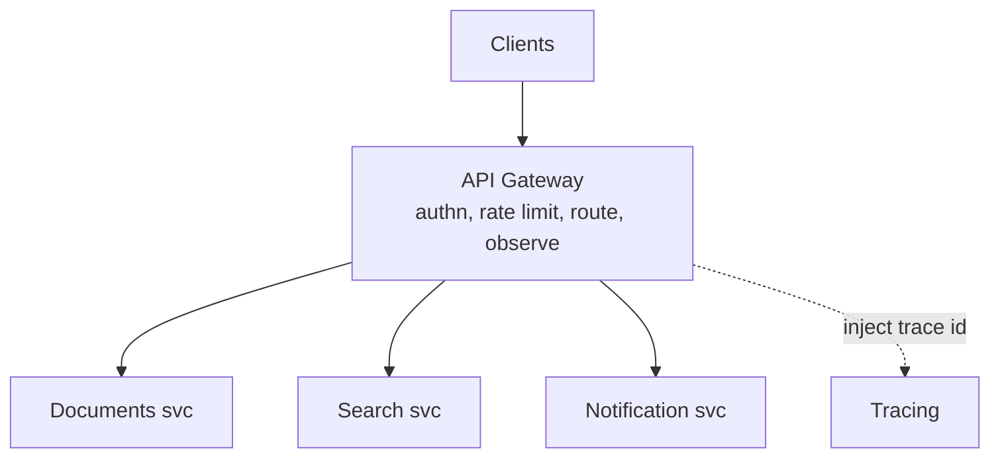

# API Gateway (Compute-Tier View)

> Prerequisites: [01-networking-and-api-design/api-gateway-and-load-balancing](../01-networking-and-api-design/api-gateway-and-load-balancing.md)
> Related: [service-discovery](./service-discovery.md) · [rate-limiting](../01-networking-and-api-design/rate-limiting.md)

The API gateway was introduced at the networking layer. This chapter focuses on its role as a compute-tier component in a multi-service architecture, the patterns it enables, and when it becomes an anti-pattern.

> For the core gateway-vs-load-balancer distinction, see the [networking chapter](../01-networking-and-api-design/api-gateway-and-load-balancing.md). This page assumes that and goes deeper on patterns.

---

## A. Problem and motivation

In a multi-service system, every service would otherwise re-implement authentication, rate limiting, routing, request logging, and TLS. That's duplication and inconsistency. The gateway centralizes these cross-cutting concerns at a single entry point, so services focus on business logic. It also decouples clients from the internal service topology — clients call one stable endpoint, not N services.

---

## B. Responsibilities

- **Routing** to the right backend service (via [service discovery](./service-discovery.md)).
- **Authentication** (validate tokens) — see [auth](../01-networking-and-api-design/authentication-and-authorization.md).
- **Rate limiting / throttling** — see [rate-limiting](../01-networking-and-api-design/rate-limiting.md).
- **TLS termination.**
- **Request/response transformation** (protocol translation, e.g., REST→gRPC internally).
- **Aggregation** (optionally compose several backend calls into one response).
- **Observability** (central access logs, metrics, trace injection).

---

## C. Patterns

- **Backend-for-Frontend (BFF):** a gateway per client type (web, mobile, partner API), each tailoring/aggregating responses for that client. Avoids one gateway trying to serve all clients and reduces chatty mobile calls. Trade-off: more gateways to maintain.
- **Edge aggregation:** the gateway composes multiple service calls into one client response (reduces client round trips). Trade-off: couples the gateway to service shapes; keep it thin or it becomes a mini-monolith.
- **Protocol translation:** clients speak REST/JSON; the gateway translates to internal gRPC. See [rest-and-api-design](../01-networking-and-api-design/rest-and-api-design.md).

---

## D. Example — DMS gateway

Web and mobile clients hit the DMS gateway. It validates the JWT once, applies per-tenant rate limits, injects a trace ID, and routes `/documents`, `/search`, `/notifications` to the respective services discovered via DNS. For the mobile dashboard, a BFF aggregates "recent documents + unread notifications + storage usage" into one response so the phone makes one call instead of three.

---

## E. Trade-offs

| Aspect | Advantages | Disadvantages | Best use | Warning signs |
|---|---|---|---|---|
| Centralized cross-cutting concerns | No duplication, consistent policy | Gateway is a choke point; adds a hop | Multi-service systems | One service (premature) |
| BFF | Tailored, less chatty per client | More gateways to maintain | Divergent client needs | Over-fragmentation |
| Aggregation | Fewer client round trips | Couples gateway to services; can bloat | Mobile, high-latency clients | Business logic creeping into the gateway |

**Anti-pattern:** the gateway accumulates business logic and becomes a monolith everyone must change — the opposite of its purpose. Keep it thin: routing + policy + light aggregation only.

---

## F. Failure scenarios

1. **Gateway as SPOF / bottleneck.** Trigger: all traffic through one gateway tier doing heavy work. Users: total outage or latency. Fix: scale the gateway horizontally (it should be stateless), keep it thin. Prevent: redundancy + minimal per-request work.
2. **Gateway outage = total outage.** Mitigate: multiple gateway instances behind an LB; health checks; graceful degradation (serve cached auth decisions briefly).
3. **Fat gateway coupling.** Trigger: business logic in the gateway. Effect: every service change touches the gateway. Fix: move logic back into services; keep the gateway for cross-cutting concerns only.

---

## G. Scaling implications

The gateway must be stateless and horizontally scalable like any app tier (sessions/tokens stateless — see [stateless-vs-stateful-services](./stateless-vs-stateful-services.md)). Because it's on every request's path, its latency and availability directly bound the whole system's — so keep it lean and redundant. For a monolith or single service, skip it entirely (premature complexity).

---

## H. Interview preparation

**Basic**
- Q: What does an API gateway centralize? → *A: Authn, rate limiting, routing, TLS termination, transformation, and observability for a multi-service system.*

**Intermediate**
- Q: What's a BFF? → *A: Backend-for-Frontend — a gateway tailored per client type that aggregates/shapes responses for that client, reducing chatty calls.*
- Q: When is a gateway premature? → *A: For a single service or monolith — it just adds a hop and a choke point with no cross-cutting concerns to centralize.*

**SDE-2 / scenario**
- Q: "Your gateway became a bottleneck." → *A: It's doing too much per request or isn't scaled. I'd keep it stateless and thin (routing + policy), scale it horizontally, and move any business logic back into services.*
- Q: "Mobile makes 5 calls per screen; how to help?" → *A: A BFF/edge aggregation that composes those into one response, reducing round trips on high-latency mobile links.*

**Common wrong answers:** gateway for a single service; business logic in the gateway; a single non-redundant gateway.

---

## I. Hands-on exercise

Decide whether the DMS needs a gateway at Stage 3 (one modular monolith) vs Stage 6 (multiple services). Justify each. For Stage 6, list exactly which responsibilities you'd put in the gateway and which you'd keep in services, and why.

---

## J. Revision summary

**Key takeaways**
- Gateway centralizes cross-cutting concerns across multiple services; decouples clients from internal topology.
- Patterns: BFF (per-client), edge aggregation, protocol translation.
- Keep it thin, stateless, redundant; it bounds whole-system latency/availability.
- Skip it for a monolith/single service; never let it absorb business logic.

**Rapid-fire**
1. Gateway's core job? → Centralized routing + policy across services.
2. BFF? → Per-client-type gateway that aggregates/shapes responses.
3. Gateway for a single service? → Premature.
4. Why keep the gateway thin? → It's on every request's path (latency/availability + SPOF risk).
5. Fat-gateway anti-pattern? → Business logic accreting into the gateway.

**Next:** [synchronous-vs-asynchronous-processing](./synchronous-vs-asynchronous-processing.md)
