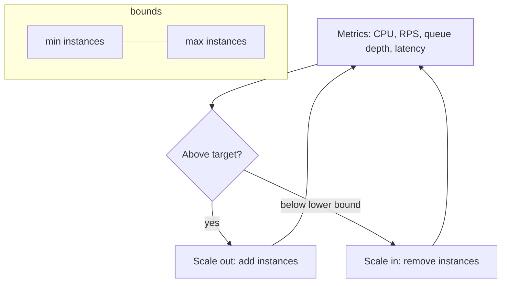

# Autoscaling and Capacity Planning

> Prerequisites: [horizontal-vs-vertical-scaling](./horizontal-vs-vertical-scaling.md), [00-foundations/back-of-the-envelope-estimation](../00-foundations/back-of-the-envelope-estimation.md)
> Related: [backpressure-and-consumer-lag](../05-messaging-and-event-driven-systems/backpressure-and-consumer-lag.md) · [database-capacity-and-connection-pools](../11-estimation-and-bottleneck-analysis/database-capacity-and-connection-pools.md)

Autoscaling automates "add machines when busy, remove when idle." It sounds like a cure-all, but it has a dangerous failure mode: scaling a stateless tier into a fixed stateful bottleneck. Capacity planning is the estimation that tells you what to provision and when autoscaling will and won't help.

---

## A. Problem and motivation

Traffic isn't constant — daily peaks, weekly cycles, flash sales, viral spikes. Provisioning for peak wastes money off-peak; provisioning for average fails at peak. Autoscaling adjusts capacity to load automatically. But naive autoscaling can amplify failures (scaling the app tier floods the DB) or react too slowly (cold starts during a spike). You need to know *what* to scale on, *how fast*, and *what won't scale*.

---

## B. How autoscaling works

- **Scale on the right metric:** CPU is common but can mislead (I/O-bound services aren't CPU-bound). Often better: **RPS per instance**, **p99 latency**, or **queue depth** (for workers). Scaling workers on *consumer lag/queue depth* is a classic correct pattern.
- **Min/max bounds:** min for baseline availability, max to cap cost and protect downstreams.
- **Cooldowns:** prevent thrashing (rapid scale in/out). React fast to scale-out, slower to scale-in.

---

## C. The dangerous interaction: scaling into a bottleneck

This is the key SDE-2 insight. Autoscaling the stateless app tier is great *until* the shared stateful dependency (DB, downstream API) is the real constraint. Then scaling out:
- opens more DB connections → connection exhaustion;
- sends more load to an already-saturated DB → it gets *slower*, raising latency, which (if you scale on latency) triggers *more* scaling → a feedback loop that worsens the outage.

**Mitigations:** cap max instances based on DB capacity; use a connection pooler; apply **backpressure** (shed/queue load) instead of blindly scaling; scale the actual bottleneck (DB replicas/cache). *Interview line:* "I'd cap app autoscaling at what the database can serve, and address DB load with caching and replicas rather than letting the app tier scale into the DB."

---

## D. Capacity planning (the estimation side)

From [estimation](../00-foundations/back-of-the-envelope-estimation.md):
- **Instances needed** = `peak RPS / per-instance RPS`, with headroom for failover (N+1 or N+2) and scale-out lag.
- **Headroom for spikes and cold starts:** autoscaling isn't instant (boot + warm-up + health checks take seconds to minutes). Keep enough baseline to absorb a spike while new instances come up; pre-scale for known events (sales, launches).
- **Downstream limits:** every tier the request touches (DB connections, cache, external API quotas) is a cap. The system's capacity is the *minimum* across tiers, not the app tier alone.
- **Load testing** validates the plan under realistic traffic (see [capacity-planning-and-load-testing](../09-observability-and-operations/capacity-planning-and-load-testing.md)).

---

## E. Example — DMS

The DMS app tier autoscales on p99 latency + RPS/instance, min 3 (for AZ redundancy), max 20 (capped by DB connection capacity via a pooler). The OCR workers autoscale on **queue depth** — a backlog means add workers, an empty queue means scale to the minimum. For a known bulk-import event (a big tenant onboarding), the team pre-scales rather than relying on reactive autoscaling, because scale-out lag would cause a backlog spike. The DB does *not* autoscale the same way — read replicas are added deliberately, and sharding is a planned change.

---

## F. Trade-offs

| Approach | Advantages | Disadvantages | Best use | Warning signs |
|---|---|---|---|---|
| Reactive autoscaling (CPU/RPS/latency) | Hands-off, cost-efficient | Lag; can scale into a bottleneck; metric choice matters | Stateless tiers, variable load | Scaling on CPU for I/O-bound work |
| Queue-depth autoscaling (workers) | Matches throughput to backlog | Needs idempotent consumers | Async workers | Non-idempotent consumers |
| Scheduled/predictive pre-scaling | Ready for known spikes | Requires forecasting | Flash sales, launches | Relying only on reactive scaling for known events |
| Over-provisioning (static) | Simple, no lag | Wastes money off-peak | Steady predictable load | Paying for idle at scale |

---

## G. Failure scenarios

1. **Autoscaling feedback loop into the DB.** Trigger: DB slow → app latency up → autoscaler adds instances → more DB load → slower → more scaling. Users: worsening outage. Detect: app count climbing while DB saturated. Fix: cap max instances at DB capacity; backpressure; fix the DB (cache/replicas). Prevent: scale on a metric reflecting *healthy* throughput and cap by downstream limits.
2. **Scale-out too slow for a spike.** Trigger: flash sale; new instances take 2 min to boot. Users: errors during the gap. Fix: pre-scale for known events; keep headroom; faster-booting images. 
3. **Scale-in during a lull drops in-flight work.** Trigger: aggressive scale-in kills a worker mid-job. Fix: graceful shutdown/draining + idempotency so the job is retried safely. See [graceful-shutdown-and-draining](../07-reliability-and-resilience/graceful-shutdown-and-draining.md).

---

## H. Scaling implications

Autoscaling makes the *stateless* tiers elastic and cost-efficient but shifts risk onto the *stateful* dependencies, which can't absorb unbounded growth. The whole system's capacity is bounded by its least-scalable tier (usually the DB). This is why capacity planning focuses on the bottleneck tier and why autoscaling bounds must respect it. Workers scaling on queue depth is the cleanest autoscaling pattern because the queue is an explicit buffer and the metric directly reflects backlog.

---

## I. Interview preparation

**Basic**
- Q: What metric should workers autoscale on? → *A: Queue depth / consumer lag — it directly reflects backlog.*
- Q: Why set a max instance count? → *A: To cap cost and protect downstream dependencies (DB connections) from being overwhelmed.*

**Intermediate**
- Q: Why can autoscaling make an outage worse? → *A: If the DB is the real bottleneck, adding app instances floods it with connections/load, slowing it further and (if scaling on latency) triggering more scaling — a feedback loop.*
- Q: Why isn't CPU always the right scaling metric? → *A: I/O-bound services wait on the DB/network, not CPU; scale on RPS/latency/queue depth instead.*

**SDE-2 / scenario**
- Q: "A flash sale is coming. Autoscaling or pre-scaling?" → *A: Pre-scale (scheduled/predictive) because reactive autoscaling lags behind a sudden spike; keep headroom and ensure the DB can take it.*
- Q: "Autoscaler keeps adding servers but latency gets worse." → *A: The bottleneck is downstream (likely the DB). Cap app instances at DB capacity, add caching/replicas, and apply backpressure instead of scaling the app further.*

**Common wrong answers:** autoscaling as a cure-all; scaling on CPU for I/O-bound work; no max bound; ignoring scale-out lag for known spikes.

---

## J. Hands-on exercise

Plan capacity for the DMS at peak 2,000 RPS with per-instance capacity ~400 RPS, DB supporting ~300 total connections, and 30-second instance boot time. Compute: min/max app instances (with failover headroom), the connection-pool size per instance so you don't exceed the DB, and whether a sudden 3× spike is safe under reactive autoscaling or needs pre-scaling.

---

## K. Revision summary

**Key takeaways**
- Autoscale stateless tiers on the right metric (RPS/latency; queue depth for workers), with min/max bounds and cooldowns.
- The danger: scaling the app tier into a fixed stateful bottleneck (DB) — cap by downstream capacity, use backpressure, scale the real bottleneck.
- Autoscaling lags; pre-scale for known spikes and keep headroom.
- System capacity = minimum across tiers; capacity-plan the bottleneck tier and load-test.

**Must explain without notes:** the autoscaling-into-the-DB feedback loop; queue-depth scaling for workers; why to cap max instances.

**Rapid-fire**
1. Best autoscaling metric for async workers? → Queue depth/lag.
2. Why cap max instances? → Protect the DB + cost.
3. Why CPU can be the wrong metric? → I/O-bound services aren't CPU-bound.
4. Known flash sale — what do you do? → Pre-scale.
5. System capacity equals? → The minimum across all tiers (the bottleneck).

**Section complete.** Next section: [03-databases-and-data-modeling](../03-databases-and-data-modeling/relational-vs-nosql.md)
