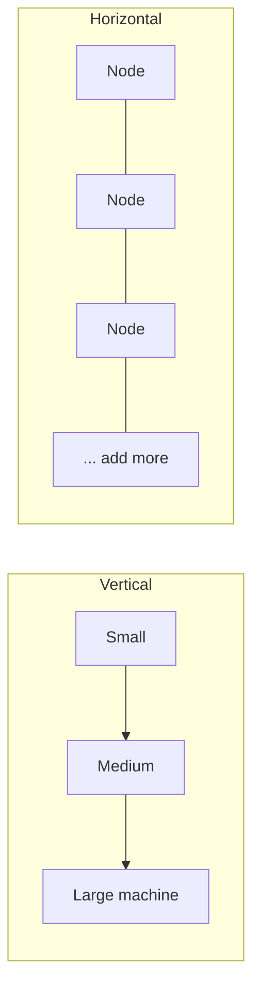

# Horizontal vs Vertical Scaling

> Prerequisites: [00-foundations/latency-throughput-and-capacity](../00-foundations/latency-throughput-and-capacity.md)
> Related: [stateless-vs-stateful-services](./stateless-vs-stateful-services.md) · [autoscaling-and-capacity-planning](./autoscaling-and-capacity-planning.md)

A short but foundational distinction. The key insight interviewers want: horizontal scaling is the durable answer, but it only works for stateless tiers — and it doesn't fix a shared bottleneck like the database.

---

## A. Problem and motivation

When load exceeds capacity, you add capacity. Two ways: a bigger machine (vertical) or more machines (horizontal). Each has hard limits and hidden conditions. The classic trap, repeated throughout this repo: scaling the app tier horizontally while the database stays single — you move the bottleneck to the DB and sometimes make it worse (more connections).

---

## B. The two axes

| | Vertical (scale up) | Horizontal (scale out) |
|---|---|---|
| Mechanism | Bigger CPU/RAM/disk on one machine | More machines behind a balancer |
| Ceiling | Hard — biggest machine available | Effectively unbounded (add nodes) |
| Downtime | Often requires restart/migration | None (add/remove live) |
| Failure | Single point of failure | Redundant by design |
| Cost curve | Expensive at the high end (premium for big machines) | Linear-ish with commodity machines |
| Requirement | None (same app) | **Statelessness** (or shared state) |
| Complexity | Low | Load balancing, coordination, data distribution |

---

## C. When each applies

- **Vertical** is the quick fix: no architectural change, immediate relief. Great for the **database** early on (a bigger DB machine buys time before you need replicas/sharding) and for workloads that are hard to distribute. Limited by the biggest machine and by being a single point of failure.
- **Horizontal** is the durable fix for the **stateless app tier**: add instances behind a load balancer, get both throughput and redundancy. This is the Stage-3 move in the [scaling journey](../00-foundations/architecture-fundamentals.md). But it requires statelessness (next chapter) and does nothing for a shared bottleneck.

**Interview-ready:** "I'd scale the stateless app tier horizontally for throughput and redundancy. For the database I'd vertically scale first (simplest), then add read replicas, and shard only when the single primary's write ceiling is reached — because horizontal scaling of a stateful store is far harder."

---

## D. The critical caveat (say this in interviews)

Horizontal scaling of the app tier **does not** scale the database. Three app instances each with a 20-connection pool hammer one DB with 60 connections. You've scaled throughput capacity on the app side and *increased pressure* on the DB. Horizontal scaling helps only where the bottleneck is the thing you're replicating. If the bottleneck is a shared, stateful resource (the DB), you must scale *that* (vertical → replicas → sharding). See [database-capacity-and-connection-pools](../11-estimation-and-bottleneck-analysis/database-capacity-and-connection-pools.md).

---

## E. Example — DMS at Stage 3→4

Stage 3: upload RPS rises; app CPU is the bottleneck → add app instances (horizontal). Immediately, DB connections and read load climb → the bottleneck moved. Stage 4 responses: vertical-scale the DB (quick), add read replicas (offload reads), add a cache (cut read volume). Only much later, when writes/data outgrow one primary, do you shard. Each step matches the fix to the bottleneck type.

---

## F. Trade-offs

| Approach | Advantages | Disadvantages | Best use | Warning signs |
|---|---|---|---|---|
| Vertical | Simple, no app changes | Ceiling, SPOF, pricey at top end | DB early, hard-to-distribute work | Already on the biggest box |
| Horizontal | Unbounded, redundant | Needs statelessness, coordination | Stateless app tier | Scaling app while DB is the bottleneck |

---

## G. Failure scenarios

1. **Scaled app, DB melts.** Trigger: autoscaler adds app instances during a spike; DB connections exceed its limit. Users: DB errors, timeouts everywhere. Detect: DB connection count maxed while app CPU fine. Mitigate: connection pooler, cap per-instance pools, add replicas/cache. Prevent: autoscale policies that consider DB capacity; backpressure.
2. **Vertical ceiling hit.** Trigger: on the biggest machine, still overloaded. Mitigate: now you *must* go horizontal (app) or shard (DB). Prevent: plan the horizontal path before the ceiling.
3. **Stateful app can't scale out.** Trigger: in-memory session on specific instances. Users: logged out when routed elsewhere. Fix: externalize state (next chapter).

---

## H. Scaling implications

Vertical buys time; horizontal is the long-term strategy for stateless tiers. The hardest scaling is always the **stateful** layer (databases, caches with data), which is why most of the database section is about replicas, partitioning, and sharding — the "horizontal scaling of state" problem. Recognizing which layer is the bottleneck, and that only matching-type scaling helps, is the core skill.

---

## I. Interview preparation

**Basic**
- Q: Horizontal vs vertical scaling? → *A: Horizontal = more machines (unbounded, redundant, needs statelessness); vertical = bigger machine (simple, but ceiling + SPOF).*

**Intermediate**
- Q: Why can't you just horizontally scale to solve any load? → *A: Horizontal scaling only helps the layer you replicate; a shared stateful bottleneck like the DB needs its own scaling (vertical → replicas → sharding), and more app instances can even worsen DB pressure.*

**SDE-2 / scenario**
- Q: "Traffic 5×'d, you added servers, now it's slower. Why?" → *A: The bottleneck was the DB, not the app. More app instances multiplied DB connections and load. I'd add a connection pooler + cache + read replicas and stop scaling the app.*
- Q: "How do you scale the database horizontally?" → *A: Reads via replicas; writes/data via sharding — both harder than app scaling because the DB is stateful. I'd exhaust vertical + replicas + caching first.*

**Common wrong answers:** "just add servers" to a DB-bound problem; treating DB horizontal scaling as trivial.

---

## J. Hands-on exercise

A service is at 80% CPU on its single app node with the DB at 30%. Then it's at 30% app CPU across 4 nodes but the DB is at 95%. Explain what happened at each step and the correct next action for each state.

---

## K. Revision summary

**Key takeaways**
- Horizontal (more machines, needs statelessness, unbounded, redundant) vs vertical (bigger machine, simple, ceiling, SPOF).
- Horizontal scaling only helps the replicated layer; it doesn't fix a shared DB bottleneck and can worsen it.
- Scale stateless app tier horizontally; scale the DB vertically → replicas → sharding.

**Rapid-fire**
1. Which scaling needs statelessness? → Horizontal.
2. Which has a hard ceiling + SPOF? → Vertical.
3. Does adding app servers scale the DB? → No.
4. First DB scaling step (simplest)? → Vertical, then read replicas.
5. Hardest layer to scale? → Stateful (databases/caches).

**Next:** [stateless-vs-stateful-services](./stateless-vs-stateful-services.md)
