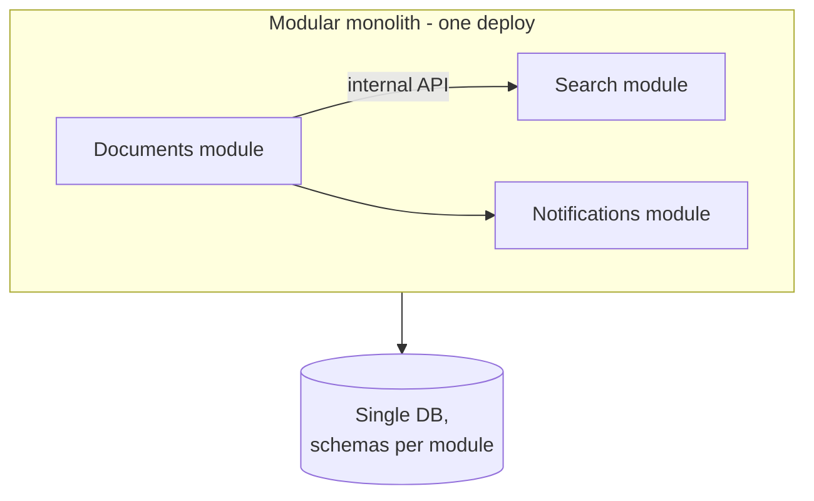

# Monolith vs Modular Monolith vs Microservices

> Prerequisites: [00-foundations/architecture-fundamentals](../00-foundations/architecture-fundamentals.md)
> Related: [service-discovery](./service-discovery.md) · [synchronous-vs-asynchronous-processing](./synchronous-vs-asynchronous-processing.md) · [common-design-mistakes](../13-interview-practice/common-design-mistakes.md)

This is one of the most over-answered questions in interviews. The weak answer is "microservices for scalability." The strong SDE-2 answer is "a modular monolith by default; decompose selectively when a measured organizational or scaling pressure justifies it."

---

## A. Problem and motivation

As a system and team grow, a single codebase can become hard to change, deploy, and scale. Microservices promise independent deployment, scaling, and team ownership. But they also introduce network calls, distributed-transaction problems, operational overhead, and debugging complexity. Choosing wrong in either direction is expensive: premature microservices sink startups in ops complexity; an unmodularized monolith becomes a big ball of mud. The skill is matching the architecture to the *actual* pressures.

---

## B. The three options

| | Monolith | Modular monolith | Microservices |
|---|---|---|---|
| Deploy unit | One app | One app | Many services |
| Internal boundaries | Weak/ad hoc | **Strong modules, enforced** | Network + separate deploy |
| Communication | In-process calls | In-process calls | Network (REST/gRPC/queue) |
| Data | One DB | One DB (modules own schemas) | DB-per-service (ideally) |
| Scaling | Whole app together | Whole app together | Per-service |
| Transactions | Local ACID (easy) | Local ACID (easy) | **Distributed (sagas, hard)** |
| Team fit | Small team | Small-medium team | Many teams, independent ownership |
| Ops complexity | Low | Low | **High** (service discovery, tracing, deploys) |

The **modular monolith** is the underrated middle: one deployable, but with strict internal module boundaries (clear APIs between modules, no reaching into another module's tables). You get simplicity *and* the option to extract a module into a service later with minimal rework.

---

## C. What microservices actually buy you (and cost)

**Buy:** independent deployment (team A ships without team B), independent scaling (scale only the hot service), fault isolation (one service's crash is contained), technology heterogeneity, clear team ownership.

**Cost:**
- **Network everywhere:** in-process calls become network calls — latency, partial failure, retries, timeouts. See [partial-failures-and-timeouts](../06-distributed-systems/partial-failures-and-timeouts.md).
- **Distributed transactions:** a business operation spanning services can't use one DB transaction → sagas and eventual consistency. See [saga-pattern](../05-messaging-and-event-driven-systems/saga-pattern.md).
- **Operational burden:** service discovery, distributed tracing, per-service CI/CD, versioned contracts, more things to monitor. See [09-observability](../09-observability-and-operations/distributed-tracing.md).
- **Debugging:** a request spans many services; you need tracing to follow it.

**The decisive factor is usually organizational, not technical.** Conway's Law: systems mirror team communication structures. Microservices pay off when you have multiple teams that need to deploy independently. One team with one deployable rarely benefits.

---

## D. Example — DMS decomposition decision

At Stages 1–4 of the [scaling journey](../00-foundations/architecture-fundamentals.md), the DMS is a modular monolith: Documents, Search, Notifications modules in one app, one DB. This is correct — simple to build, deploy, and reason about.

**When to extract a service (Stage 5–6):**
- The **search indexer** has a totally different scaling profile and tech (Elasticsearch) → extract it.
- The **notification service** fans out independently, needs its own queue/workers, and other systems want to use it → extract it.
- The **OCR/processing workers** are CPU-heavy and scale on queue depth → already decoupled as workers.

Notice: you extract the pieces with *different scaling or ownership needs*, not everything. The core CRUD stays monolithic. This is **selective decomposition**, the SDE-2-correct approach.

---

## E. Trade-offs

| Approach | Advantages | Disadvantages | Best use | Warning signs you chose wrong |
|---|---|---|---|---|
| Monolith | Simplest, local transactions, easy debugging | Can rot without discipline; scales as a unit | Early stage, small team | Deploys scare everyone; one module's load forces scaling all |
| Modular monolith | Simple + clean boundaries + easy to split later | Still one deploy/scale unit | **Default for most SDE-2 systems** | Modules secretly share tables (lost modularity) |
| Microservices | Independent deploy/scale/ownership, fault isolation | Network, distributed txns, heavy ops | Many teams, divergent scaling | Distributed monolith: services that must deploy together |

**The "distributed monolith" anti-pattern:** microservices so coupled they must be deployed together — you paid all the costs of microservices and got none of the benefits. A frequent real-world failure.

---

## F. Failure scenarios

1. **Premature microservices.** Trigger: starting with 10 services and 2 engineers. Result: drowning in ops; features slow. Detect: more time on infra than features. Mitigate: collapse back to a modular monolith. Prevent: start monolithic, extract on measured need.
2. **Distributed transaction surprise.** Trigger: splitting an operation that needed atomicity across two services. Result: partial failures, inconsistent state. Mitigate: saga + compensation, or keep those entities in one service. Prevent: don't split along a transactional boundary.
3. **Big ball of mud.** Trigger: monolith with no module discipline. Result: every change risks everything. Mitigate: introduce and enforce module boundaries (modular monolith). Prevent: boundaries from day one.

---

## G. Scaling implications

Scaling is per-service in microservices (efficient) vs whole-app in a monolith (you scale everything to scale one hot path — wasteful but simple). Crucially, **microservices don't make the database scale** — if all services hit one shared DB, you've just added network hops to the same bottleneck. True independence requires DB-per-service, which reintroduces distributed-data problems. This is why "microservices for scalability" is often wrong: the DB is usually the real bottleneck, and caching/replicas/sharding address it without decomposition.

---

## H. Interview preparation

**Basic**
- Q: Monolith vs microservices in one line each? → *A: Monolith = one deployable, local transactions, simple; microservices = independent deploy/scale/ownership at the cost of network calls, distributed transactions, and ops complexity.*

**Intermediate**
- Q: What's a modular monolith and why prefer it? → *A: One deployable with enforced internal module boundaries; you get monolith simplicity plus the ability to extract a module into a service later without a rewrite.*
- Q: What's the biggest hidden cost of microservices? → *A: Distributed transactions / consistency across services, plus the operational burden (tracing, discovery, per-service deploys).*

**SDE-2 / scenario**
- Q: "Why not microservices from the start for the DMS?" → *A: With one team and a shared data model, microservices add network calls, distributed-transaction complexity, and ops overhead for no benefit. I'd build a modular monolith and extract the search indexer and notification service when their scaling/ownership diverges.*
- Q: "The CEO says 'go microservices to scale.' Response?" → *A: Decomposition doesn't scale the database, which is usually the bottleneck. I'd first address the measured bottleneck (caching/replicas/sharding) and decompose only where independent deployment or scaling is genuinely needed.*

**Common wrong answers:** "microservices for scalability" (unqualified); starting with many services; splitting across a transaction boundary; a distributed monolith.

---

## I. Hands-on exercise

For an e-commerce system (catalog, cart, orders, payments, inventory), decide which pieces you'd keep in a modular monolith initially and which you'd extract first, and why. Identify one operation that spans services and would need a saga.

---

## J. Revision summary

**Key takeaways**
- Default to a modular monolith; decompose selectively on measured organizational/scaling pressure.
- Microservices buy independent deploy/scale/ownership; they cost network calls, distributed transactions, and ops.
- The decisive factor is usually the team structure (Conway's Law), not raw scale.
- Microservices don't scale the shared DB; beware the distributed monolith.

**Must explain without notes:** the three options' trade-offs; why "microservices for scalability" is weak; selective decomposition.

**Rapid-fire**
1. Default architecture for a small team? → Modular monolith.
2. Microservices' hardest technical cost? → Distributed transactions/consistency.
3. Conway's Law relevance? → Architecture mirrors team structure; decompose along team boundaries.
4. Does decomposition scale a shared DB? → No.
5. Distributed monolith = ? → Services coupled enough they must deploy together (worst of both).

**Next:** [horizontal-vs-vertical-scaling](./horizontal-vs-vertical-scaling.md)
