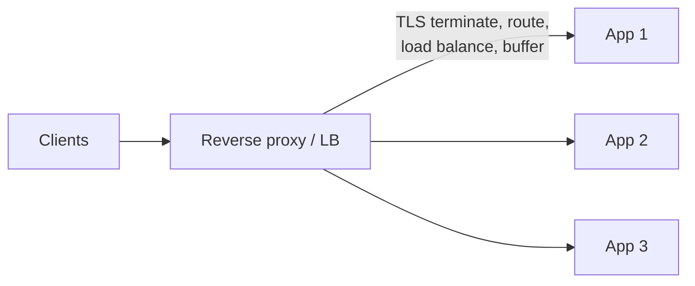

# Reverse Proxy and Load Balancers

> Prerequisites: [01-networking-and-api-design/api-gateway-and-load-balancing](../01-networking-and-api-design/api-gateway-and-load-balancing.md)
> Related: [stateless-vs-stateful-services](./stateless-vs-stateful-services.md) · [autoscaling-and-capacity-planning](./autoscaling-and-capacity-planning.md)

This chapter complements the API-layer treatment of load balancing with the compute-tier perspective: what a reverse proxy adds, where these sit, and how they enable zero-downtime operations.

---

## A. Problem and motivation

The [API-layer chapter](../01-networking-and-api-design/api-gateway-and-load-balancing.md) covered L4/L7 and health checks. Here we focus on the *reverse proxy* role and the operational capabilities these components unlock: TLS termination, zero-downtime deploys, connection management, and protecting the backend. A candidate who only knows "LB distributes traffic" misses half the value.

---

## B. Forward proxy vs reverse proxy

- **Forward proxy:** sits in front of *clients*, representing them to the internet (corporate egress proxy, VPN). Clients know about it.
- **Reverse proxy:** sits in front of *servers*, representing them to clients. Clients think they're talking to the server; the proxy is invisible. This is what nginx/Envoy/HAProxy/managed LBs do.

A load balancer is a specialized reverse proxy whose main job is distributing load. In practice one component (reverse proxy) does load balancing *and* TLS termination, compression, request routing, caching, and buffering.



---

## C. What a reverse proxy adds (beyond distribution)

- **TLS termination** — offload crypto from app servers (see [dns-tcp-tls-http](../01-networking-and-api-design/dns-tcp-tls-http.md)).
- **Slow-client buffering** — the proxy absorbs a slow client's byte-by-byte upload and hands the app a complete request, so app threads aren't tied up waiting (protects against "slowloris"-style resource exhaustion).
- **Compression / static caching** — gzip responses, cache static assets.
- **Request routing** — path/host-based (L7).
- **Centralized access logs / metrics** — one place to observe traffic.
- **Backend protection** — rate limiting, connection limits, request-size limits before traffic reaches the app.

---

## D. Enabling zero-downtime deploys

The reverse proxy + health checks are what make rolling deploys possible:

```mermaid
sequenceDiagram
    participant LB as Reverse proxy
    participant Old as Old instance
    participant New as New instance
    Note over LB,New: Rolling deploy
    LB->>New: readiness check -> ready
    LB->>LB: add New to pool
    LB->>Old: stop sending new requests (drain)
    Old->>Old: finish in-flight requests
    LB->>LB: remove Old; repeat per instance
```

The proxy drains connections from an instance (stops new requests, lets in-flight ones finish) before it's removed — this is **connection draining / graceful shutdown**. See [graceful-shutdown-and-draining](../07-reliability-and-resilience/graceful-shutdown-and-draining.md). Combined with readiness checks, you deploy with no dropped requests.

---

## E. Example — DMS

An L7 reverse proxy fronts the DMS app tier: terminates TLS, routes `/api/documents` and `/api/search`, buffers slow uploads so app threads stay free, gzips JSON responses, and uses readiness checks to add/drain instances during deploys and autoscaling. A crashed instance is ejected within a couple of failed health checks, so users see at most a brief blip.

---

## F. Trade-offs

| Capability | Advantages | Disadvantages | Best use | Warning signs |
|---|---|---|---|---|
| TLS termination at proxy | Offloads app crypto, enables L7 | Internal hop plaintext unless re-encrypted | Most systems | Sensitive internal traffic unencrypted |
| Slow-client buffering | Protects app threads | Proxy memory use | Public endpoints | App threads blocked on slow clients |
| Static caching at proxy | Fewer app hits | Cache invalidation | Static-heavy sites | Caching dynamic/private data |
| Reverse proxy itself | Centralizes cross-cutting concerns | Must be redundant; adds a hop | Any multi-instance system | Single, non-redundant proxy |

---

## G. Failure scenarios

1. **Proxy is a SPOF.** Trigger: single proxy dies. Users: full outage. Fix: redundant proxies (active-active) behind DNS/anycast. Prevent: never one proxy in production.
2. **Draining skipped on deploy.** Trigger: instance killed with in-flight requests. Users: errors mid-request. Fix: connection draining + graceful shutdown with readiness gating.
3. **Health check too shallow.** Trigger: `/health` returns 200 even when the DB is down. Users: errors from "healthy" instances. Fix: readiness checks that verify critical dependencies (but beware cascading failure — see note). 

> Note: a readiness check that fails when a shared DB is down can eject *all* instances at once (self-inflicted outage). Design health checks to distinguish "this instance is broken" from "a shared dependency is down." See [redundancy-and-failover](../07-reliability-and-resilience/redundancy-and-failover.md).

---

## H. Scaling implications

The proxy/LB tier must itself scale and be redundant (managed LBs handle this; self-hosted needs active-active + a VIP/anycast). It's the enabler for autoscaling (adds/removes instances live) and zero-downtime deploys. Keep it thin: heavy per-request work at the proxy becomes a shared bottleneck.

---

## I. Interview preparation

**Basic**
- Q: Forward vs reverse proxy? → *A: Forward proxies represent clients to the internet; reverse proxies represent servers to clients and do load balancing, TLS termination, routing.*

**Intermediate**
- Q: How does a reverse proxy enable zero-downtime deploys? → *A: Readiness checks gate new instances in; connection draining lets old instances finish in-flight requests before removal, so no requests drop.*
- Q: Why buffer slow clients at the proxy? → *A: So a slow client doesn't tie up an app thread/connection; the proxy hands the app a complete request.*

**SDE-2 / scenario**
- Q: "Deploys cause brief 5xx spikes. Why?" → *A: Likely no connection draining/readiness gating — instances are removed/added before draining in-flight requests or warming up. Add graceful shutdown + readiness checks.*
- Q: "Your health check killed the whole fleet." → *A: The readiness check failed on a shared dependency (DB) outage, ejecting all instances. I'd make instance health distinct from shared-dependency health to avoid self-inflicted total outage.*

**Common wrong answers:** single non-redundant proxy; shallow health checks; no draining on deploy.

---

## J. Hands-on exercise

Design the proxy tier for the DMS to achieve zero-downtime deploys and fast failover. Specify: redundancy, where TLS terminates, liveness vs readiness check contents, and the drain behavior. Note one way your readiness check could cause a self-inflicted outage and how you'd prevent it.

---

## K. Revision summary

**Key takeaways**
- A reverse proxy fronts servers: load balancing + TLS termination + buffering + routing + backend protection.
- Readiness checks + connection draining = zero-downtime deploys and clean autoscaling.
- The proxy tier must be redundant; keep it thin.
- Beware health checks that eject the whole fleet on a shared-dependency outage.

**Rapid-fire**
1. Reverse proxy fronts clients or servers? → Servers.
2. What enables zero-downtime deploys? → Readiness checks + connection draining.
3. Why buffer slow clients? → Free app threads.
4. Proxy redundancy requirement? → Active-active, no SPOF.
5. Risk of DB-dependent readiness checks? → Whole fleet ejected on DB outage.

**Next:** [service-discovery](./service-discovery.md)
