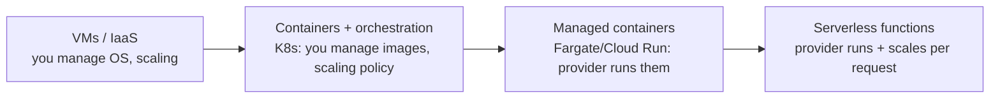

# Serverless and Managed Compute

> Prerequisites: [horizontal-vs-vertical-scaling](./horizontal-vs-vertical-scaling.md), [stateless-vs-stateful-services](./stateless-vs-stateful-services.md)
> Related: [autoscaling-and-capacity-planning](./autoscaling-and-capacity-planning.md) · [synchronous-vs-asynchronous-processing](./synchronous-vs-asynchronous-processing.md)

Serverless (FaaS) is a tempting default that interviewers like to probe. Know the spectrum (VMs → containers → serverless), what serverless is genuinely good at, and its sharp edges (cold starts, state, connection limits).

---

## A. Problem and motivation

Running servers means capacity planning, patching, scaling, and paying for idle time. Managed compute moves these burdens to the cloud provider in exchange for control and some new constraints. The spectrum ranges from "you manage the OS" (VMs) to "you just write a function" (serverless). Each trades control for operational simplicity differently. Picking serverless for a steady, high-throughput, stateful workload is as wrong as hand-managing VMs for a tiny spiky event handler.

---

## B. The compute spectrum

| | VMs | Containers (K8s) | Managed containers | Serverless (FaaS) |
|---|---|---|---|---|
| You manage | OS, scaling, deploys | Images, orchestration config | Images only | Function code only |
| Scaling | Manual/autoscaler | Autoscaler (you tune) | Provider | Automatic, per-request |
| Idle cost | Pay for running VMs | Pay for nodes | Pay for running tasks | **Pay per invocation (near-zero idle)** |
| Cold start | None (always on) | None (pods running) | Minimal | **Yes (first request latency)** |
| Long-running | Fine | Fine | Fine | Limited (execution timeouts) |
| State/connections | Full control | Full control | Full control | **Constrained** (ephemeral, connection limits) |

---

## C. What serverless is genuinely good at

- **Spiky / unpredictable traffic** — scales to zero and up automatically; you pay only for use.
- **Event-driven glue** — react to a file upload, a queue message, a schedule (cron). Great for the DMS's "on upload → kick off processing" trigger.
- **Low/variable volume** — a rarely-called endpoint costs almost nothing idle.
- **Short, stateless tasks** — image thumbnailing, webhook handlers, lightweight APIs.

## D. The sharp edges (interview gold)

1. **Cold starts:** the first request after idle pays initialization latency (runtime + your init). Hurts latency-sensitive, bursty-after-idle workloads. Mitigations: provisioned concurrency (pre-warmed, but you pay for it — eroding the cost benefit), lighter runtimes.
2. **Database connections:** each concurrent function instance may open its own DB connection. A spike to 1,000 concurrent functions = 1,000 DB connections → **connection exhaustion**. This is a famous serverless+RDBMS pitfall. Mitigation: a connection pooler/proxy between functions and the DB, or use a serverless-friendly data store. See [database-capacity-and-connection-pools](../11-estimation-and-bottleneck-analysis/database-capacity-and-connection-pools.md).
3. **Statelessness enforced:** no reliable local state between invocations; everything in a shared store. (Usually fine — matches the stateless principle.)
4. **Execution limits:** max duration/memory; long jobs don't fit (use workers/containers instead).
5. **Vendor lock-in & cost at scale:** per-invocation pricing is cheap at low volume but can exceed always-on servers at sustained high volume. Re-estimate.

---

## E. Example — DMS use of serverless

Good fit: a serverless function triggered when a file lands in object storage, which enqueues/kicks off the processing pipeline, and a scheduled function that runs nightly cleanup/retention. Poor fit: the core document API at steady high RPS with a relational DB — cold starts hurt p99 and function fan-out risks DB connection exhaustion; a container-based always-on service with a connection pool is better there. So the DMS uses serverless for *event glue and scheduled tasks*, containers for the *core API and heavy workers*.

---

## F. Trade-offs

| Approach | Advantages | Disadvantages | Best use | Warning signs |
|---|---|---|---|---|
| VMs | Full control | You own ops/scaling, idle cost | Legacy, special needs | Reinventing orchestration |
| Containers (K8s) | Portable, flexible, powerful | Operational complexity | Steady, varied workloads at scale | Over-complex for a tiny app |
| Managed containers | Less ops, always-on | Some lock-in | Steady services, teams avoiding K8s ops | — |
| Serverless | Auto-scale, near-zero idle cost, event-driven | Cold starts, connection limits, duration caps, cost at high volume | Spiky/event-driven/low-volume | Steady high-RPS + RDBMS |

---

## G. Failure scenarios

1. **Connection exhaustion from fan-out.** Trigger: traffic spike → thousands of concurrent functions each opening a DB connection. Users: DB rejects connections, errors everywhere. Detect: DB connection count maxed during spikes. Fix: connection pooler/proxy; cap concurrency; serverless-friendly DB.
2. **Cold-start latency.** Trigger: idle function hit by a latency-sensitive request. Users: slow first response. Fix: provisioned concurrency (costs more), lighter runtime, or move hot paths to always-on compute.
3. **Cost surprise at scale.** Trigger: a function that started cheap now runs billions of times. Fix: re-estimate; migrate sustained high-volume paths to always-on compute.

---

## H. Scaling implications

Serverless scales effortlessly on the *compute* axis but can overwhelm *downstream stateful dependencies* (DBs) because it removes the natural concurrency cap that a fixed pool of app instances provided. This is a concrete instance of the recurring lesson: scaling one tier (compute) stresses the shared stateful tier (DB). You must add a connection pooler or cap concurrency. For steady high-throughput work, always-on containers with bounded pools are often simpler and cheaper.

---

## I. Interview preparation

**Basic**
- Q: What is serverless good for? → *A: Spiky/event-driven/low-volume, short stateless tasks; it auto-scales and costs near-zero when idle.*

**Intermediate**
- Q: Biggest gotcha with serverless + a relational DB? → *A: Connection exhaustion — each concurrent function may open a DB connection, so a spike can blow past the DB's limit. Fix with a connection pooler/proxy or a serverless-friendly store.*
- Q: What's a cold start and how to mitigate? → *A: Init latency on the first request after idle; mitigate with provisioned concurrency (at extra cost) or lighter runtimes, or keep hot paths always-on.*

**SDE-2 / scenario**
- Q: "Would you build the DMS core API serverless?" → *A: No for the steady high-RPS core API on a relational DB (cold starts + connection fan-out); yes for event glue (on-upload trigger) and scheduled retention jobs. Mixed, by fit.*
- Q: "Serverless costs exploded at scale — why?" → *A: Per-invocation pricing beats idle servers at low volume but can exceed always-on at sustained high volume; I'd re-estimate and migrate hot paths to containers.*

**Common wrong answers:** serverless for everything; ignoring DB connection fan-out; forgetting cold starts for latency-sensitive paths.

---

## J. Hands-on exercise

Classify these DMS workloads as serverless vs always-on container and justify: (a) the document CRUD API, (b) a thumbnail generator triggered per upload, (c) heavy OCR workers, (d) a nightly retention/cleanup job, (e) a webhook receiver. Note where DB connection fan-out would bite.

---

## K. Revision summary

**Key takeaways**
- Spectrum: VMs → containers → managed containers → serverless, trading control for ops simplicity.
- Serverless wins for spiky/event-driven/low-volume/short-stateless; loses for steady high-RPS, stateful, long-running, and (sometimes) cost at scale.
- Key gotchas: cold starts, DB connection exhaustion from fan-out, duration limits.
- Scaling compute can overwhelm the shared DB — add a connection pooler/cap concurrency.

**Rapid-fire**
1. Serverless's best use case? → Spiky/event-driven short tasks.
2. Serverless + RDBMS classic failure? → Connection exhaustion from fan-out.
3. Cold start mitigation? → Provisioned concurrency / lighter runtime / always-on hot path.
4. When does serverless get expensive? → Sustained high invocation volume.
5. Core steady high-RPS API — serverless? → Usually no; prefer always-on containers.

**Next:** [autoscaling-and-capacity-planning](./autoscaling-and-capacity-planning.md)
