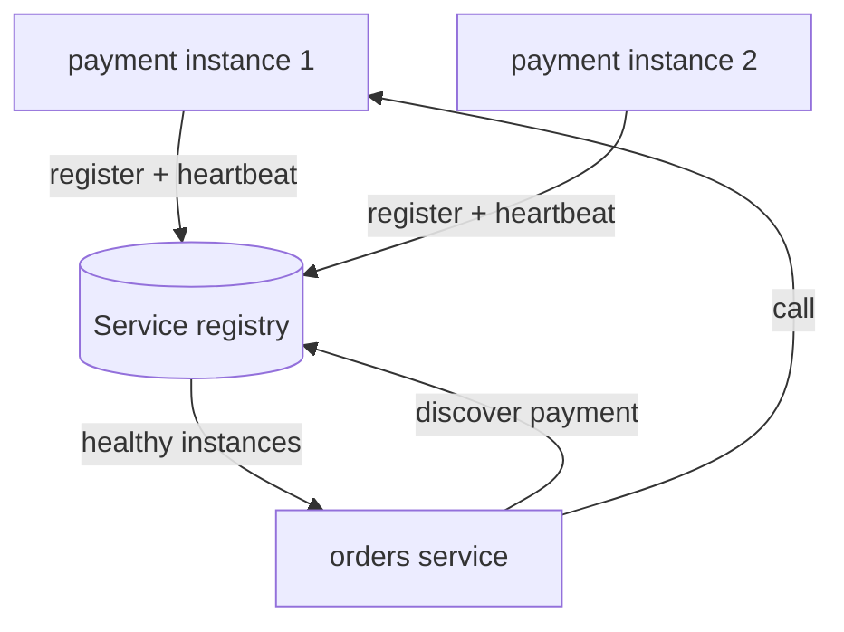

# Service Discovery

> Prerequisites: [reverse-proxy-and-load-balancers](./reverse-proxy-and-load-balancers.md), [monolith-vs-modular-monolith-vs-microservices](./monolith-vs-modular-monolith-vs-microservices.md)
> Related: [api-gateway](./api-gateway.md) · [multi-region-architecture](../06-distributed-systems/multi-region-architecture.md)

Service discovery is only relevant once you have multiple services with instances coming and going. At SDE-2, know what problem it solves and the two main patterns — don't over-rotate on it.

---

## A. Problem and motivation

In a static world you'd hardcode `payment-service = 10.0.0.5:8080`. But in a dynamic world — autoscaling, deploys, crashes, containers rescheduled by an orchestrator — instance IPs change constantly. How does the orders service find a *currently healthy* instance of the payment service? That's service discovery: a dynamic directory of "what's running where, and is it healthy."

What happens without it: hardcoded addresses break on every deploy/scale event; you can't add capacity without reconfiguring callers.

---

## B. The registry model

A **service registry** is a database of service → healthy instances. Instances **register** on startup (and deregister/expire on shutdown or health-check failure); callers **look up** instances to call.

Health is maintained via heartbeats/TTL: an instance that stops heartbeating is removed, so callers only get live instances.

---

## C. Client-side vs server-side discovery

| | Client-side discovery | Server-side discovery |
|---|---|---|
| Who picks the instance | The calling service (queries registry, load-balances itself) | A load balancer / proxy in front of the target service |
| Example | Service queries registry, uses a client LB library | Call a stable LB/DNS name; LB routes to a healthy instance |
| Pros | Fewer hops, client controls LB policy | Simpler clients, centralized policy |
| Cons | Discovery logic in every client/language | Extra hop; LB must be HA |

Modern platforms (Kubernetes) lean toward **server-side**: you call a stable service name (DNS), and the platform's service abstraction + kube-proxy/ingress routes to a healthy pod. You rarely implement discovery by hand — the orchestrator provides it. See [serverless-and-managed-compute](./serverless-and-managed-compute.md).

---

## D. Example — DMS after decomposition

After extracting the search and notification services, the documents service needs to call them. On Kubernetes it just calls `http://search-service/...` — a stable DNS name backed by the platform's registry; kube handles routing to healthy pods and removing crashed ones. No hardcoded IPs, works across deploys and autoscaling. If running on raw VMs, you'd use a registry (Consul/Eureka-style) with heartbeats and either client- or server-side lookup.

---

## E. Trade-offs

| Approach | Advantages | Disadvantages | Best use | Warning signs |
|---|---|---|---|---|
| DNS-based (platform) | Simple, language-agnostic, built-in | DNS caching can delay updates | Kubernetes/managed platforms | Long DNS TTLs delaying failover |
| Dedicated registry (Consul/Eureka) | Rich health/metadata, flexible | Operate the registry (HA needed) | VM fleets, hybrid | Registry as a SPOF |
| Hardcoded config | Trivial | Breaks on any change | Fixed, tiny setups | Dynamic environments |

---

## F. Failure scenarios

1. **Registry is a SPOF.** Trigger: registry down → nobody can discover anyone. Fix: run it HA (clustered, odd number of nodes); cache last-known-good instances on clients so a brief registry outage doesn't halt calls.
2. **Stale entries (dead instance still listed).** Trigger: heartbeat/TTL too long. Callers: send traffic to a dead instance. Fix: shorter TTLs + active health checks; callers retry another instance on failure.
3. **Thundering herd on registry.** Trigger: all clients query per request. Fix: clients cache the instance list and refresh periodically, not per call.

---

## G. Scaling implications

Service discovery is a prerequisite for elastic microservices — without it, autoscaling and rolling deploys can't work (callers wouldn't find new instances). It's irrelevant for a monolith (in-process calls need no discovery), which is another reason the modular monolith is simpler. At multi-region scale, discovery gains a locality dimension (prefer same-region instances to avoid cross-region latency). See [multi-region-architecture](../06-distributed-systems/multi-region-architecture.md).

---

## H. Interview preparation

**Basic**
- Q: What problem does service discovery solve? → *A: Finding currently-healthy instances of a service whose IPs change due to scaling/deploys/crashes.*

**Intermediate**
- Q: Client-side vs server-side discovery? → *A: Client-side: the caller queries a registry and load-balances itself (fewer hops, logic in every client). Server-side: call a stable LB/DNS name and a proxy routes (simpler clients, extra hop).*
- Q: How does the registry know an instance is dead? → *A: Heartbeats/TTL plus health checks; missed heartbeats remove it.*

**SDE-2 / scenario**
- Q: "How do your services find each other on Kubernetes?" → *A: Via stable DNS service names backed by the platform's registry; kube routes to healthy pods and removes crashed ones. I don't implement discovery by hand.*
- Q: "Registry briefly went down — did all calls fail?" → *A: Not if clients cache last-known-good instances and the registry is HA; a short outage shouldn't halt traffic.*

**Common wrong answers:** hardcoding IPs; treating the registry as needing no HA; discovery for a monolith.

---

## I. Hands-on exercise

Your DMS runs on raw VMs (no orchestrator). Design service discovery for the documents→search and documents→notification calls: registry choice, how instances register/heartbeat, client- or server-side lookup, and how a registry outage is tolerated.

---

## J. Revision summary

**Key takeaways**
- Service discovery = a dynamic, health-aware directory of service instances; needed because IPs change with scaling/deploys.
- Client-side (caller load-balances) vs server-side (proxy/DNS routes); platforms favor server-side DNS.
- Registry must be HA; clients cache instances and retry on failure.
- Monoliths don't need it; it's a prerequisite for elastic microservices.

**Rapid-fire**
1. Why not hardcode service IPs? → They change with scaling/deploys/crashes.
2. How does Kubernetes do discovery? → Stable DNS service names + platform routing.
3. Client-side vs server-side difference? → Who selects the instance (caller vs proxy).
4. How is a dead instance detected? → Missed heartbeats / failed health checks.
5. Does a monolith need discovery? → No (in-process calls).

**Next:** [api-gateway](./api-gateway.md)
