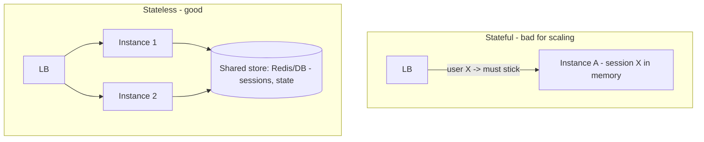

# Stateless vs Stateful Services

> Prerequisites: [horizontal-vs-vertical-scaling](./horizontal-vs-vertical-scaling.md)
> Related: [reverse-proxy-and-load-balancers](./reverse-proxy-and-load-balancers.md) · [authentication-and-authorization](../01-networking-and-api-design/authentication-and-authorization.md)

Statelessness is the single property that makes horizontal scaling clean. If you understand *why* and *where state goes instead*, you understand most of what enables elastic app tiers.

---

## A. Problem and motivation

To scale horizontally, any instance must be able to serve any request. If instance A holds a user's session in memory and the load balancer routes the next request to instance B, the user is logged out or loses data. State pinned to a specific instance breaks load balancing, failover, and autoscaling. The solution is to make services **stateless** by moving state to a shared store.

---

## B. Definitions

- **Stateless service:** keeps no client-specific state locally between requests. Everything needed to handle a request comes from the request itself (token, params) or a shared store (DB, cache). Any instance handles any request.
- **Stateful service:** retains client state locally (in-memory session, local file, in-memory connection state). A given client must keep talking to the same instance.

**Important nuance:** "stateless" means *no local client state* — the system as a whole still has state (in the DB/cache). You've *externalized* the state, not eliminated it.

---

## C. What to do with the state

| State | Stateless solution |
|---|---|
| User session | JWT (state in the token) or session in Redis/DB. See [auth](../01-networking-and-api-design/authentication-and-authorization.md) |
| Uploaded files | Object storage (not local disk) |
| In-progress multi-step workflow | Persist in DB/queue, not instance memory |
| Caches | Distributed cache (Redis) or local cache that's just an optimization (safe to lose) |
| WebSocket connections | Inherently stateful — handled specially (below) |

---

## D. Sticky sessions — the escape hatch and its cost

If you *must* keep local state, load balancers offer **sticky sessions** (route a client to the same instance via a cookie or IP hash). This works but reintroduces the problems statelessness solved:
- If that instance dies, the client's state is lost (failover breaks).
- Load becomes uneven (a heavy client stuck to one node).
- Scaling down/replacing an instance disrupts its stuck clients.

So sticky sessions are a last resort. Prefer stateless + shared store. *Interview point:* "I'd keep the app tier stateless with sessions in Redis or JWTs, avoiding sticky sessions so failover and autoscaling stay clean."

---

## E. Genuinely stateful services (and how they're handled)

Some things are inherently stateful: WebSocket/real-time connections (chat presence), in-memory game servers, stateful stream processors, databases themselves. These are handled with:
- **Connection affinity** at a dedicated gateway layer (e.g., a chat connection layer that holds sockets, backed by a shared pub/sub to route messages between nodes). See [chat-messaging-system](../12-system-design-problems/chat-messaging-system.md).
- **Partitioning** state by key (e.g., a user always handled by the node owning their partition), with careful failover.
- Keeping the stateful layer **thin** and pushing durable state to a backing store.

The pattern: isolate unavoidable statefulness into a specialized layer; keep the bulk of the system stateless.

---

## F. Example — DMS

The DMS app tier is stateless: JWT carries identity, files go to object storage, in-progress OCR jobs live in the queue + DB (not instance memory), and any caching is in Redis. So the load balancer round-robins freely, a crashed instance loses nothing, and autoscaling adds/removes instances without disruption. The only stateful components are the DB, Redis, and object storage — the intended places for state.

---

## G. Trade-offs

| Approach | Advantages | Disadvantages | Best use | Warning signs |
|---|---|---|---|---|
| Stateless + shared store | Clean horizontal scaling, failover, autoscale | Shared-store lookup per request (latency); externalization work | **Default for app tiers** | — |
| Sticky sessions | No externalization work | Breaks failover, uneven load, scaling pain | Legacy/quick fixes | Using it as a scaling strategy |
| Dedicated stateful layer | Supports real-time/connections | Complex failover, partitioning | WebSockets, stream processors | Spreading statefulness everywhere |

---

## H. Failure scenarios

1. **In-memory session + horizontal scaling.** Trigger: user routed to a new instance. User: logged out / lost cart. Detect: errors correlate with LB rerouting or scale events. Fix: externalize sessions (Redis/JWT).
2. **Local disk for uploads behind an LB.** Trigger: file saved on instance A, download routed to B → 404. Fix: object storage.
3. **Sticky-session instance dies.** Trigger: node crash. Users on it: lost state. Fix: externalize state so stickiness is unnecessary.

---

## I. Scaling implications

Statelessness is the enabler for the entire Stage 3+ scaling journey: load balancing, autoscaling, zero-downtime deploys (rolling restarts), and fast failover all depend on it. The remaining state (DB, cache, object storage, real-time layer) is where the hard scaling work concentrates — which is exactly why those get dedicated chapters. A stateless app tier is "easy" to scale precisely because the hard part was moved elsewhere.

---

## J. Interview preparation

**Basic**
- Q: Why must app servers be stateless to scale horizontally? → *A: So any instance can serve any request; otherwise the LB can't route freely and failover/autoscaling break.*
- Q: Where do sessions go in a stateless design? → *A: In a JWT (in the token) or a shared store (Redis/DB).*

**Intermediate**
- Q: What are sticky sessions and why avoid them? → *A: LB routing a client to the same instance; they break failover, cause uneven load, and complicate scaling. Prefer stateless + shared store.*

**SDE-2 / scenario**
- Q: "Users get logged out randomly after you autoscaled." → *A: Sessions are in instance memory; scaling/rerouting loses them. Move sessions to Redis or use JWTs so the tier is stateless.*
- Q: "How do you handle WebSocket connections, which are stateful, at scale?" → *A: A dedicated connection layer holds sockets with affinity, backed by shared pub/sub to route messages across nodes; durable state stays in the DB. Keep the rest of the system stateless.*

**Common wrong answers:** sticky sessions as the scaling plan; local disk for shared files; claiming "stateless means no state anywhere."

---

## K. Hands-on exercise

Audit a service for statefulness: it stores login sessions in memory, writes uploaded avatars to local disk, and keeps a per-user rate-limit counter in a local map. For each, state why it breaks horizontal scaling and the stateless fix.

---

## L. Revision summary

**Key takeaways**
- Stateless = no local client state; any instance serves any request → clean horizontal scaling/failover/autoscale.
- Externalize state: JWT/Redis sessions, object storage for files, queue/DB for workflows.
- Avoid sticky sessions; isolate unavoidable statefulness (WebSockets) into a specialized layer.
- Statelessness enables the whole Stage 3+ scaling journey; hard scaling moves to the stateful layers.

**Must explain without notes:** why statelessness enables horizontal scaling; where each kind of state goes; sticky-session downsides.

**Rapid-fire**
1. Property enabling clean horizontal scaling? → Statelessness.
2. Where do uploaded files go? → Object storage.
3. Sticky session downside? → Breaks failover + uneven load.
4. Does stateless mean no state anywhere? → No, state is externalized.
5. How to scale WebSockets? → Dedicated connection layer + shared pub/sub + affinity.

**Next:** [reverse-proxy-and-load-balancers](./reverse-proxy-and-load-balancers.md)
