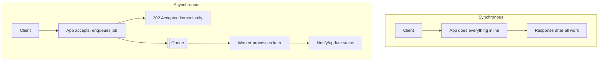

# Synchronous vs Asynchronous Processing

> Prerequisites: [00-foundations/architecture-fundamentals](../00-foundations/architecture-fundamentals.md)
> Related: [05-messaging/queues-vs-pub-sub-vs-event-streams](../05-messaging-and-event-driven-systems/queues-vs-pub-sub-vs-event-streams.md) · [05-messaging/idempotency-and-deduplication](../05-messaging-and-event-driven-systems/idempotency-and-deduplication.md)

Deciding what runs on the request path versus in the background is one of the most consequential architectural choices. It determines latency, reliability, and complexity. The master-prompt warning applies both ways: don't make everything synchronous, and don't make everything asynchronous.

---

## A. Problem and motivation

A user uploads a document. Should the virus scan + OCR + thumbnail happen *before* you return 201 (synchronous), or should you return immediately and process in the background (asynchronous)? Synchronous is simple and gives immediate results but couples the user's latency to slow/unreliable work. Asynchronous decouples them but introduces eventual completion, duplicate processing, and new infrastructure. Choosing wrong gives you either slow, fragile endpoints or needless complexity.

---

## B. The two models

| | Synchronous | Asynchronous |
|---|---|---|
| Response timing | After work completes | Immediately (202 Accepted / job id) |
| User latency | = work duration | = enqueue time (fast) |
| Coupling | Caller tied to downstream | Decoupled |
| Failure | Caller sees it directly | Must track + retry + notify |
| Complexity | Low | Queue, workers, status, idempotency |
| Result delivery | In the response | Poll / webhook / push |

---

## C. When to use which

**Keep synchronous when:**
- The caller needs the result to proceed (e.g., a validation, a price calculation, reading data).
- The work is fast and reliable (a few ms, in-DB).
- Strong immediate consistency is required.

**Go asynchronous when:**
- The work is slow (OCR, video transcoding, sending email) or CPU/IO-heavy.
- The caller doesn't need the result immediately.
- The downstream is unreliable or rate-limited (external APIs) — a queue absorbs bursts and enables retries.
- You need to smooth spikes (the queue is a buffer).

**Interview-ready:** "I return 201 quickly after persisting metadata and *enqueue* the OCR job, because OCR is slow and the user doesn't need it to finish before seeing their document. The user polls status or gets a push/webhook when it completes."

---

## D. The hidden costs of async (don't gloss over these)

Making something async is not free. You now must handle:
- **Eventual completion** — the user needs a way to learn the result (status endpoint, webhook, push).
- **Duplicate processing** — queues are at-least-once; a worker crash after doing the work but before acking causes a redelivery → **idempotency** required. See [idempotency-and-deduplication](../05-messaging-and-event-driven-systems/idempotency-and-deduplication.md).
- **Ordering** — if order matters, you need partitioned/ordered queues. See [ordering-and-consumer-groups](../05-messaging-and-event-driven-systems/ordering-and-consumer-groups.md).
- **Backpressure / lag** — producers can outpace consumers; the queue grows. See [backpressure-and-consumer-lag](../05-messaging-and-event-driven-systems/backpressure-and-consumer-lag.md).
- **Failure handling** — retries, DLQ for poison messages. See [dead-letter-queues](../05-messaging-and-event-driven-systems/dead-letter-queues.md).

This is why "just make it async" is only half an answer — a strong candidate names the costs they're taking on.

---

## E. Example — DMS upload, both ways

**Synchronous (naive):** `POST /documents` → store file → run OCR (3s) → thumbnail (1s) → virus scan (2s) → return 201. Upload takes 6+ seconds, ties up a request thread the whole time, and if OCR's dependency is down, the upload fails entirely.

**Asynchronous (correct):** `POST /documents` → store file + metadata (status=PROCESSING) → enqueue a `process-document` job → return 201 in ~50ms. A worker consumes the job, does scan/OCR/thumbnail, updates status=READY (idempotently, keyed by document+revision), and triggers a notification. The user polls `GET /documents/{id}` or receives a webhook. Uploads are fast and resilient to OCR-dependency outages (jobs wait in the queue).

---

## F. Trade-offs

| Approach | Advantages | Disadvantages | Best use | Warning signs |
|---|---|---|---|---|
| Synchronous | Simple, immediate result, strong consistency | Latency coupled to slow work; cascading failure | Fast reads/validations, needed-now results | Slow external calls on the request path |
| Asynchronous | Fast response, decoupled, absorbs spikes, retryable | Eventual result, duplicates, ordering, backpressure, infra | Slow/heavy/unreliable work | Everything async "for scalability" |

---

## G. Failure scenarios

1. **Slow synchronous dependency cascades.** Trigger: an inline external call hangs; threads pile up (Little's Law). Users: everything slows. Fix: move it async behind a queue, or add timeout + circuit breaker. See [circuit-breakers-and-bulkheads](../06-distributed-systems/circuit-breakers-and-bulkheads.md).
2. **Async duplicate side effect.** Trigger: worker crash after doing work, before ack → redelivery. User: double notification/charge. Fix: idempotent processing keyed by a stable id.
3. **Over-async complexity.** Trigger: a fast, needed-now read made async "for scale." Result: needless polling, status tracking, latency. Fix: keep it synchronous.

---

## H. Scaling implications

Async decouples the producer's rate from the consumer's, so the queue absorbs spikes and workers scale on backlog — the backbone of the Stage-4 scaling move. But it shifts the bottleneck to consumer throughput and introduces lag as a thing to monitor. Synchronous paths keep latency and consistency tight but limit throughput to the slowest dependency and risk cascading overload. Most real systems are a deliberate mix: synchronous for the critical, needed-now path; asynchronous for slow/heavy/side-effect work.

---

## I. Interview preparation

**Basic**
- Q: When do you process asynchronously? → *A: When work is slow/heavy/unreliable and the caller doesn't need the result immediately; return 202 and process in the background.*

**Intermediate**
- Q: What costs does going async introduce? → *A: Eventual completion (need status/webhook), at-least-once duplicates (need idempotency), ordering, backpressure/lag, and retry/DLQ handling.*
- Q: Why not make everything async? → *A: Needed-now reads/validations get needless latency, polling, and complexity; async only pays off for slow/heavy/unreliable work.*

**SDE-2 / scenario**
- Q: "Uploads are slow because of OCR. Fix it." → *A: Persist metadata and return 201 immediately, enqueue the OCR job, process in a worker with idempotency, and surface completion via status endpoint or webhook. Uploads become fast and resilient to OCR outages.*
- Q: "An inline call to a flaky partner API is causing outages." → *A: Move it async behind a queue with retries/DLQ, or at minimum add timeout + circuit breaker + fallback so it can't cascade.*

**Common wrong answers:** everything synchronous (fragile, slow); everything async (needless complexity); async without idempotency.

---

## J. Hands-on exercise

For a food-delivery "place order" flow (validate items → charge payment → notify restaurant → assign courier), classify each step as synchronous or asynchronous and justify. Identify which async step most needs idempotency and why.

---

## K. Revision summary

**Key takeaways**
- Synchronous = simple, immediate, strong consistency, but couples latency to slow work and can cascade.
- Asynchronous = fast response, decoupled, spike-absorbing, retryable — at the cost of eventual completion, duplicates (idempotency), ordering, backpressure.
- Default: synchronous for needed-now/fast; asynchronous for slow/heavy/unreliable. Deliberate mix, not all-or-nothing.
- "Make it async" must come with naming the costs you take on.

**Must explain without notes:** when to go async; the hidden costs; the DMS upload example both ways.

**Rapid-fire**
1. Status code for an accepted async request? → 202.
2. Async guarantee that forces idempotency? → At-least-once (duplicates).
3. One reason NOT to make a read async? → Needless latency/polling for a needed-now result.
4. What does a queue absorb? → Traffic spikes (buffer between producer and consumer).
5. How does a user learn an async result? → Status poll, webhook, or push.

**Next:** [serverless-and-managed-compute](./serverless-and-managed-compute.md)
