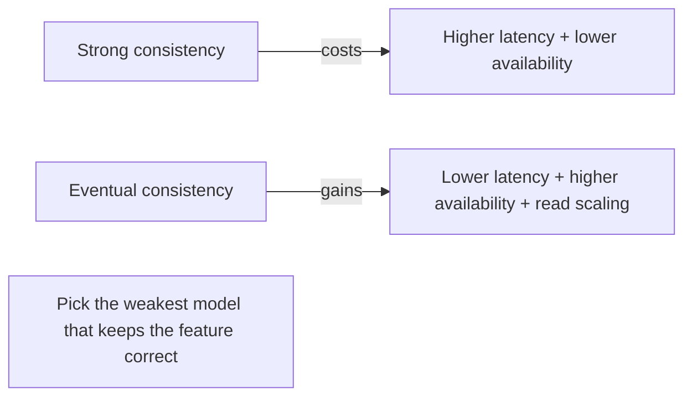

# Consistency Models

> Prerequisites: [replication-and-read-replicas](./replication-and-read-replicas.md)
> Related: [consistency-and-cap-theorem](../06-distributed-systems/consistency-and-cap-theorem.md) · [quorum-reads-and-writes](../06-distributed-systems/quorum-reads-and-writes.md)

"What consistency does this system need?" is one of the most revealing SDE-2 questions. The weak answer is "strong consistency everywhere." The strong answer picks the *weakest consistency that's still correct* for each part of the system, because stronger consistency costs latency and availability.

---

## A. Problem and motivation

In a replicated/distributed system, different nodes can hold different versions of data at the same instant. A consistency model defines what guarantees readers get about seeing recent writes. Choosing stronger-than-needed consistency wastes latency and availability; choosing weaker-than-needed causes correctness bugs (double-spend, lost updates). The skill is matching the model to the requirement, per data path.

---

## B. The spectrum (strong → weak)

| Model | Guarantee | Cost | Example use |
|---|---|---|---|
| **Strong / linearizable** | Every read sees the latest committed write; system behaves like one copy | Highest latency, lowest availability under partition | Account balance, inventory, locks |
| **Read-your-writes** | A user always sees their own writes (others may lag) | Moderate (route recent reads to primary) | "See my just-posted comment" |
| **Monotonic reads** | Once you've seen a value, you won't later see an older one | Moderate | Avoiding "time going backwards" |
| **Causal** | Causally related writes seen in order (reply after its parent) | Moderate | Comment threads, chat |
| **Eventual** | Replicas converge *eventually* if writes stop; reads may be stale | Lowest latency, highest availability | Likes count, feeds, caches, metrics |

**Key framing:** these are not "good vs bad" — they're a dial. Each step toward strong costs latency/availability (per [CAP](../06-distributed-systems/consistency-and-cap-theorem.md)). Pick the weakest that keeps the feature correct.

---

## C. Why not always strong?

Strong consistency requires coordination (reading from the primary or a quorum, synchronous replication, consensus). That means:
- Higher latency (wait for the authoritative copy / majority).
- Lower availability under network partition (you must reject writes/reads rather than serve stale, per CAP).
- Doesn't scale reads as well (can't freely use lagging replicas).

So you reserve strong consistency for the handful of invariants that truly need it (money, inventory, uniqueness) and use weaker models elsewhere to get speed and availability.

---

## D. Example — per-path consistency in a system

**Social feed:**
- **Like count:** eventual — nobody is harmed if the count is off by one for a second.
- **Posting then seeing your own post:** read-your-writes — route the author's read to the primary briefly.
- **Comment ordering within a thread:** causal — a reply must not appear before its parent.

**DMS:**
- **"Did my upload succeed?":** read-your-writes (read from primary after write).
- **Search results:** eventual — a few seconds' index lag is fine.
- **Permission/share revocation:** should be strong-ish / promptly consistent — a revoked user shouldn't keep reading from a stale cache. See [cache-invalidation-and-consistency](../04-caching/cache-invalidation-and-consistency.md).

**Payments:** strong — the ledger must be linearizable; a stale balance read enabling a double-spend is unacceptable.

Stating consistency *per path* like this is a strong SDE-2 signal.

---

## E. Trade-offs

| Model | Advantages | Disadvantages | Best use | Warning signs |
|---|---|---|---|---|
| Strong | Correct, simple reasoning | Latency, availability loss under partition, less read scaling | Money, inventory, locks, uniqueness | Using it for likes/feeds (needless cost) |
| Read-your-writes | Good UX for the author | Needs routing/LSN logic | User-visible writes | Expecting it to help other users |
| Eventual | Fast, available, scales reads | Stale reads; must handle conflicts | Counters, feeds, caches, metrics | Using it for money/inventory |

---

## F. Failure scenarios

1. **Eventual where strong was needed.** Trigger: using a lagging replica/cache for a balance or inventory check. Users: double-spend, oversell. Detect: reconciliation finds impossible states. Fix: strong read (primary/quorum) for that invariant. Prevent: classify each path's needs.
2. **Strong everywhere → latency/availability pain.** Trigger: linearizable reads for feeds/likes. Users: slow, outages under partition. Fix: downgrade non-critical paths to eventual.
3. **Stale permission after revocation.** Trigger: cached authz with no prompt invalidation. Users: revoked user still has access. Fix: promptly invalidate/short-TTL authz caches. See [authentication-and-authorization](../01-networking-and-api-design/authentication-and-authorization.md).

---

## G. Scaling implications

Consistency is the knob that trades off against the read-scaling and availability gains of replication and caching. Eventual consistency is what *lets* you use replicas and caches freely (they can lag); strong consistency forces reads to the authoritative copy, limiting those gains. As you add replicas, caches, and regions, you're implicitly choosing eventual consistency for most paths — so you must consciously carve out the few strong-consistency paths and pay for them (primary/quorum reads). Multi-region sharpens this (cross-region strong consistency is very expensive). See [multi-region-architecture](../06-distributed-systems/multi-region-architecture.md).

---

## H. Interview preparation

**Basic**
- Q: Strong vs eventual consistency? → *A: Strong = every read sees the latest write (costly, less available under partition); eventual = replicas converge over time, reads may be stale (fast, available, scales).*

**Intermediate**
- Q: Why not use strong consistency everywhere? → *A: It costs latency and availability (CAP) and limits read scaling via replicas/caches; most features (likes, feeds) are correct under weaker models, so I reserve strong for true invariants.*
- Q: What's read-your-writes and when do you need it? → *A: A user always sees their own writes; needed for "see my just-posted content," implemented by routing recent reads to the primary.*

**SDE-2 / scenario**
- Q: "What consistency does your design need?" → *A: Per path: strong for money/inventory/locks, read-your-writes for user-visible writes, causal for threaded replies, eventual for counts/feeds/search. Weakest model that's still correct, to preserve latency and availability.*
- Q: "You cached permissions and a revoked user still has access." → *A: Authz needs prompt consistency — short TTL or explicit invalidation on permission change; stale authz is a security bug, not just a UX one.*

**Common wrong answers:** "strong consistency everywhere"; using eventual consistency for money/inventory; not distinguishing paths.

---

## I. Hands-on exercise

For a ride-hailing app, assign a consistency model to each: driver's current location, a rider's trip fare (final), surge-pricing multiplier shown before booking, and the trip's payment record. Justify each and name the cost of the strongest one. Compare with [ride-hailing-system](../12-system-design-problems/ride-hailing-system.md).

---

## J. Revision summary

**Key takeaways**
- Consistency is a spectrum (strong → read-your-writes → monotonic → causal → eventual); each step toward strong costs latency/availability.
- Pick the weakest model that keeps each feature correct, per data path.
- Strong for money/inventory/locks/uniqueness; eventual for counts/feeds/caches/metrics; read-your-writes for user-visible writes.
- Eventual consistency is what enables free use of replicas/caches; strong consistency limits those gains.

**Must explain without notes:** the spectrum; why not strong everywhere; per-path consistency with concrete examples.

**Rapid-fire**
1. Weakest model that's still correct — why aim for it? → Preserves latency + availability + read scaling.
2. Consistency for a like count? → Eventual.
3. Consistency for an account balance? → Strong.
4. "See my own post immediately" model? → Read-your-writes.
5. What does strong consistency cost under partition? → Availability (CAP).

**Next:** [sql-vs-document-vs-key-value-vs-wide-column](./sql-vs-document-vs-key-value-vs-wide-column.md)
