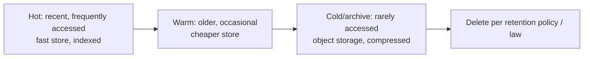

# Data Archival and Retention

> Prerequisites: [partitioning-and-sharding](./partitioning-and-sharding.md)
> Related: [storage-and-retention-calculations](../11-estimation-and-bottleneck-analysis/storage-and-retention-calculations.md) · [backups-and-point-in-time-recovery](../07-reliability-and-resilience/backups-and-point-in-time-recovery.md)

Data grows forever unless you manage it. Retention/archival is often overlooked by candidates but comes up as a cost, performance, and compliance concern — and it's a quick way to show operational maturity.

---

## A. Problem and motivation

Every system accumulates data: documents, events, logs, messages. If you never remove or tier it, the hot database grows unbounded — indexes bloat, queries slow, backups take longer, and storage cost rises. Meanwhile, most reads target *recent* data. Retention and archival keep the hot store small and fast while preserving older data cheaply (or deleting it per policy/law). Ignoring this is why some systems degrade purely from data accumulation, not traffic.

---

## B. The data-lifecycle idea (hot → warm → cold → deleted)

- **Hot:** recent data in the primary DB, fully indexed, low-latency.
- **Warm/cold:** older data moved to cheaper storage (object storage, a separate archive DB, compressed), slower to access.
- **Delete:** data past its retention period is removed (compliance, cost, privacy).

The goal: keep the hot store sized to the *working set*, not all history.

---

## C. Mechanisms

- **Time-based partitioning:** partition tables by time (monthly). Dropping old data is a cheap partition drop, not a slow `DELETE` of millions of rows. Archiving = detach a partition and move it. This is the clean way to do retention on large tables.
- **TTL / auto-expiry:** some stores (Redis, DynamoDB, TSDBs) auto-delete expired items. Great for ephemeral/short-lived data.
- **Archival jobs:** scheduled jobs move cold rows to object storage (as compressed files/Parquet) and delete from the hot DB.
- **Soft delete vs hard delete:** mark `deleted_at` (recoverable, still occupies space, must be filtered) vs physically remove (reclaims space, unrecoverable). Many systems soft-delete then hard-delete/purge after a grace period.

---

## D. Compliance and privacy (don't forget this)

Retention is often legally mandated in both directions:
- **Minimum retention:** financial/audit records must be kept for years.
- **Maximum retention / right to deletion:** privacy laws (e.g., GDPR-style "right to be forgotten") may *require* deleting personal data on request or after a period.

So retention policy is a *requirement*, not just an optimization. Candidates who mention "and we'd define retention per data type for compliance" signal maturity. Note: deleting data that's also in backups/replicas/caches/search indexes is non-trivial — deletion must propagate everywhere. See [security-threat-modeling](../08-security/security-threat-modeling.md).

---

## E. Example — DMS

- **Document files:** kept per the tenant's retention policy (e.g., 7 years for legal docs). Files live in object storage with lifecycle rules: after N days without access, transition to a cheaper/colder storage class; delete at policy end.
- **Metadata:** time-partitioned by month; soft-delete on user delete (30-day recovery grace), then hard-delete + purge from search index.
- **Audit log of access events:** high-volume, time-partitioned; raw kept 90 days, then dropped (partition drop), with aggregates retained longer.
- **Processing-job records:** TTL'd after completion + a short retention for debugging.

This keeps the hot metadata DB small (working set), moves bulk file data to cost-tiered object storage, and satisfies compliance.

---

## F. Trade-offs

| Approach | Advantages | Disadvantages | Best use | Warning signs |
|---|---|---|---|---|
| Time-partitioning + partition drop | Cheap retention, no slow DELETEs | Requires time-based access pattern | Large time-ordered tables | `DELETE` of millions of rows nightly |
| TTL / auto-expiry | Hands-off | Only for stores that support it | Ephemeral data (sessions, cache) | Relying on it for compliance deletion across copies |
| Cold archival to object storage | Cheap long-term storage | Slow retrieval, extra pipeline | Rarely accessed history | Keeping cold data in the hot DB |
| Soft delete | Recoverable | Space + must filter everywhere | User-recoverable deletes | Never purging (unbounded growth) |

---

## G. Failure scenarios

1. **Unbounded hot-store growth.** Trigger: no retention. Users: queries slow over time, backups balloon, cost rises. Detect: table/index size trending up, slow-query creep. Fix: introduce time-partitioning + archival. Prevent: define retention per data type up front.
2. **Slow bulk DELETE locks the table.** Trigger: nightly `DELETE WHERE created_at < ...` of millions of rows. Users: locking, bloat, replication lag. Fix: time-partitioning (drop a partition instead); or batched deletes. 
3. **Incomplete deletion for compliance.** Trigger: delete from the DB but not from backups/search index/caches. Risk: legal exposure. Fix: deletion must propagate to all copies, or use crypto-shredding (delete the key for encrypted data). 

---

## H. Scaling implications

Retention is a primary lever for keeping a store's performance flat as the business ages — without it, even steady traffic degrades as data accumulates. Time-partitioning makes retention O(drop a partition) instead of O(delete millions of rows). At scale, tiering (hot/warm/cold) is a major cost optimization: cold object storage is far cheaper than hot DB storage, and most reads are recent. It also interacts with sharding (partition + shard by time/tenant) and backups (smaller hot store = faster backup/restore). See [storage-and-retention-calculations](../11-estimation-and-bottleneck-analysis/storage-and-retention-calculations.md).

---

## I. Interview preparation

**Basic**
- Q: Why have a retention policy? → *A: To keep the hot store small/fast, control cost, and meet compliance (minimum retention and deletion requirements).*

**Intermediate**
- Q: Why time-partition instead of nightly DELETEs? → *A: Dropping an old partition is O(1)-ish and avoids the locking, bloat, and replication lag of deleting millions of rows.*
- Q: Soft vs hard delete? → *A: Soft marks deleted_at (recoverable, still occupies space, must be filtered); hard physically removes (reclaims space, unrecoverable). Often soft-delete then purge after a grace period.*

**SDE-2 / scenario**
- Q: "The DB is slowing down but traffic is flat. Why?" → *A: Likely data accumulation — bloated tables/indexes and growing backups. I'd add time-partitioning, archive cold data to object storage, and set retention per data type.*
- Q: "A user invokes 'delete my data.' What's hard about it?" → *A: The data exists in the DB, replicas, backups, caches, and search indexes; deletion must propagate to all, or use crypto-shredding (destroy the encryption key) for data in immutable backups.*

**Common wrong answers:** no retention plan; nightly bulk DELETEs on huge tables; assuming deleting from the DB satisfies compliance.

---

## J. Hands-on exercise

Define a retention/archival plan for the DMS covering: document files, metadata, access-audit events, and processing-job records. For each, specify hot/warm/cold tiering, the retention period rationale (including any compliance angle), and the mechanism (partition drop, TTL, archival job, soft/hard delete).

---

## K. Revision summary

**Key takeaways**
- Manage the data lifecycle: hot → warm → cold → delete; keep the hot store at the working-set size.
- Time-partitioning makes retention cheap (drop a partition) vs slow bulk DELETEs.
- TTL for ephemeral data; cold archival to object storage for cost; soft-then-hard delete for recoverability.
- Retention is a compliance requirement (min retention + right to deletion); deletion must propagate to all copies.

**Rapid-fire**
1. Cheap way to drop old data from a huge table? → Time-partition + drop partition.
2. Why does a flat-traffic DB slow over time? → Data accumulation (bloat).
3. Hot/warm/cold goal? → Keep hot store at working-set size; cheap long-term storage.
4. Hard part of "delete my data"? → Propagating deletion to backups/replicas/caches/indexes.
5. Soft delete cost? → Still occupies space + must filter everywhere.

**Next:** [schema-migrations-and-data-evolution](./schema-migrations-and-data-evolution.md)
