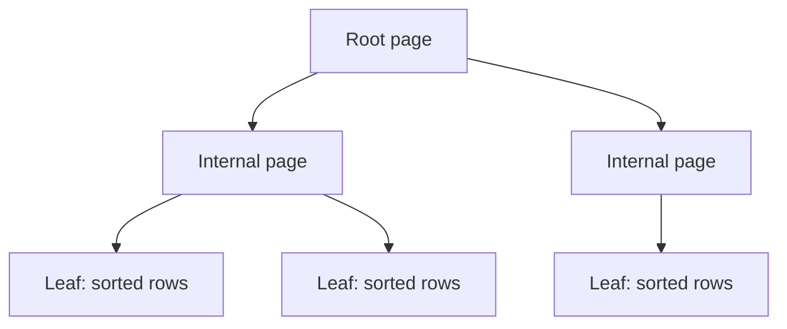
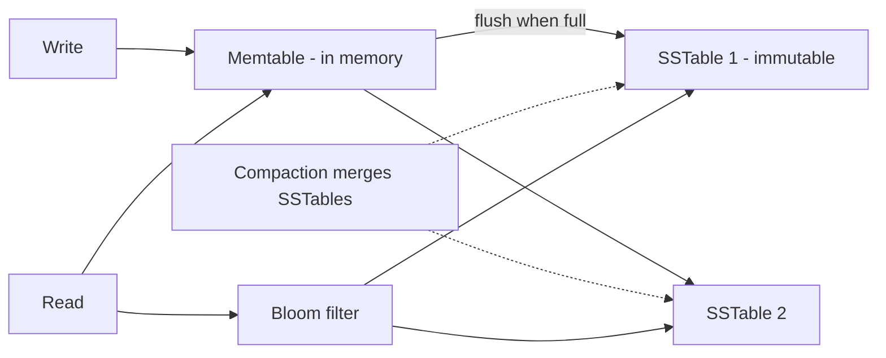

# Database Internals for System Design

> Prerequisites: [relational-vs-nosql](./relational-vs-nosql.md)
> Related: [indexing-and-query-optimization](./indexing-and-query-optimization.md) · [replication-and-read-replicas](./replication-and-read-replicas.md)

You don't need to implement a database, but understanding B-trees vs LSM trees and the write-ahead log explains *why* relational and wide-column stores have the performance characteristics they do — which is exactly the kind of "reason from mechanism" signal interviewers reward.

---

## A. Problem and motivation

"Why is Cassandra write-optimized but has slower reads? Why does Postgres read fast but writes cost more?" You can't answer these from the outside — the answer is in the storage engine. Knowing the two dominant engine designs (B-tree and LSM-tree) and the WAL lets you reason about read/write trade-offs instead of memorizing vendor claims.

---

## B. The write-ahead log (WAL) — the foundation of durability

Before applying any change to the main data files, databases append it to a **write-ahead log** on disk and fsync it. If the server crashes, recovery replays the WAL to restore committed changes. This gives the **D** in ACID (durability) cheaply: appending to a log is a fast sequential write, far cheaper than random writes to data files.

The WAL is also the basis of:
- **Replication** — ship the WAL to replicas, which replay it. See [replication-and-read-replicas](./replication-and-read-replicas.md).
- **Change Data Capture (CDC)** — stream the WAL to other systems. See [transactional-outbox-and-cdc](../05-messaging-and-event-driven-systems/transactional-outbox-and-cdc.md).
- **Point-in-time recovery** — replay the WAL to a chosen moment. See [backups-and-point-in-time-recovery](../07-reliability-and-resilience/backups-and-point-in-time-recovery.md).

**Interview point:** the WAL is why a single mechanism underpins durability, replication, CDC, and PITR.

---

## C. B-tree storage (read-optimized) — Postgres, MySQL/InnoDB, most RDBMS

A **B-tree** (actually B+tree) keeps data sorted in a balanced tree of pages. Lookups and range scans are `O(log n)` with few disk seeks. Reads are efficient and predictable.

**Writes** must find the right page and update in place, which can require random I/O and page splits. Updates are "in place," so write amplification is moderate but reads are fast and consistent.

**Characteristic:** great reads/range queries, moderate writes. Fits relational workloads with ad-hoc queries.

---

## D. LSM-tree storage (write-optimized) — Cassandra, RocksDB, HBase, LevelDB

A **Log-Structured Merge tree** buffers writes in memory (a **memtable**), then flushes them as immutable sorted files (**SSTables**) to disk sequentially. Writes are fast (append to memory + sequential flush, no in-place random I/O).

**Cost:** a read may have to check the memtable plus several SSTables (newest to oldest), so reads can touch multiple files. **Compaction** periodically merges SSTables to keep reads fast and reclaim space — background work that causes write amplification and I/O spikes. **Bloom filters** per SSTable let reads skip files that definitely don't contain the key.

**Characteristic:** excellent write throughput, reads need extra work (mitigated by bloom filters + compaction). Fits write-heavy workloads (time-series, event logs, chat).

---

## E. B-tree vs LSM — the trade-off that explains store choices

| | B-tree (RDBMS) | LSM-tree (Cassandra/RocksDB) |
|---|---|---|
| Writes | In-place, moderate cost | Sequential append, very fast |
| Reads | Fast, predictable | May touch multiple SSTables (bloom filters help) |
| Write amplification | Lower | Higher (compaction) |
| Space | Compact | Temporary bloat before compaction |
| Fits | Read-heavy, ad-hoc queries, transactions | Write-heavy, append-mostly, known patterns |

This is *why* [relational-vs-nosql](./relational-vs-nosql.md) says "wide-column for write-heavy": LSM engines are built for write throughput. You can now justify it from mechanism, not hearsay.

---

## F. Example — DMS and chat

The DMS metadata (read-heavy, 20:1, ad-hoc queries, transactions) sits on a B-tree RDBMS (Postgres) — reads are the pressure, and B-trees serve them well. If we added a high-volume audit/event log (append-only, write-heavy), an LSM store would fit it better. A chat system's message write storm (from [estimation](../00-foundations/back-of-the-envelope-estimation.md): ~70K peak write RPS) is exactly the LSM sweet spot — Cassandra's write path is sequential appends to memtables.

---

## G. Trade-offs / failure scenarios

1. **Compaction I/O storms (LSM).** Trigger: heavy writes trigger large compactions. Users: latency spikes during compaction. Detect: periodic read/write latency bumps correlated with compaction. Mitigate: tune compaction strategy, provision I/O headroom. Prevent: capacity-plan for compaction overhead.
2. **Write amplification surprise.** Trigger: assuming LSM writes are "free." Reality: compaction rewrites data multiple times. Mitigate: account for it in storage/IO estimates.
3. **B-tree write bottleneck under write-heavy load.** Trigger: forcing a write-heavy workload onto a B-tree RDBMS. Users: write latency, lock contention. Fix: batching, or move the write-heavy pattern to an LSM store.

---

## H. Scaling implications

The engine sets the per-node write ceiling and read characteristics that your scaling plan must respect. LSM stores push the single-node write ceiling much higher (hence their use at write-heavy scale), while B-tree RDBMS hit write limits sooner and lean on vertical scaling → replicas → sharding. Understanding this prevents the mistake of trying to scale a B-tree RDBMS into an LSM-appropriate workload.

---

## I. Interview preparation

**Basic**
- Q: What's a WAL and why does it exist? → *A: A durable append-only log written before applying changes; gives crash recovery (durability) cheaply via sequential writes, and underpins replication/CDC/PITR.*

**Intermediate**
- Q: Why is an LSM store write-optimized? → *A: Writes append to an in-memory memtable then flush sequentially as immutable SSTables — no in-place random I/O. Reads pay by checking multiple SSTables, mitigated by bloom filters and compaction.*
- Q: Why do B-tree databases read well? → *A: Sorted balanced tree → O(log n) lookups and efficient range scans with few seeks.*

**SDE-2 / scenario**
- Q: "Why is Cassandra a good fit for write-heavy data but Postgres isn't?" → *A: Cassandra's LSM engine turns writes into sequential appends (high throughput); Postgres's B-tree does in-place updates that cap write throughput sooner. For a write storm, LSM wins; for ad-hoc reads/transactions, B-tree wins.*
- Q: "What's the cost of LSM you must plan for?" → *A: Compaction — background merging causes write amplification and periodic I/O/latency spikes; provision I/O headroom.*

**Common wrong answers:** "NoSQL is just faster" (ignores the engine trade-off); assuming LSM writes have no hidden cost; not knowing the WAL.

---

## J. Hands-on exercise

Given two workloads — (1) a financial transactions table with frequent range queries by date and multi-row updates, (2) an IoT sensor stream at 500K writes/sec rarely read except by recent time range — map each to B-tree or LSM and justify from the engine mechanism. Note the main operational cost of the LSM choice.

---

## K. Revision summary

**Key takeaways**
- WAL = durable append-only log → crash recovery, replication, CDC, PITR all from one mechanism.
- B-tree = read-optimized (sorted tree, fast lookups/ranges, moderate writes) → RDBMS.
- LSM-tree = write-optimized (memtable + immutable SSTables + compaction + bloom filters) → wide-column/KV at write-heavy scale.
- The engine explains and justifies store choices from first principles.

**Rapid-fire**
1. What underpins durability + replication + CDC? → The WAL.
2. Which engine is write-optimized? → LSM-tree.
3. What keeps LSM reads fast? → Bloom filters + compaction.
4. Main LSM operational cost? → Compaction (write amplification, I/O spikes).
5. Why do B-trees read well? → Sorted balanced tree, O(log n), range-scan friendly.

**Next:** [indexing-and-query-optimization](./indexing-and-query-optimization.md)
