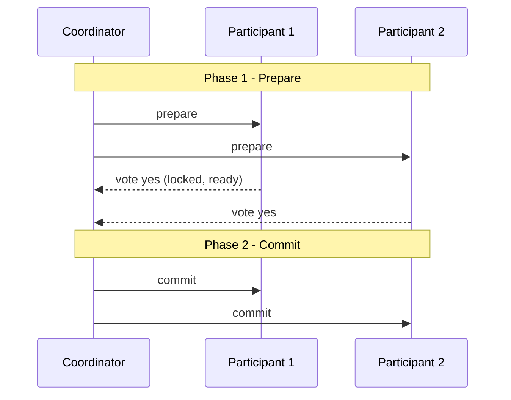

# Distributed Transactions

> Prerequisites: [transactions-and-isolation](./transactions-and-isolation.md), [partitioning-and-sharding](./partitioning-and-sharding.md)
> Related: [saga-pattern](../05-messaging-and-event-driven-systems/saga-pattern.md) · [transactional-outbox-and-cdc](../05-messaging-and-event-driven-systems/transactional-outbox-and-cdc.md) · [exactly-once-processing](../06-distributed-systems/exactly-once-processing.md)

Once an operation spans multiple databases or services, you lose single-node ACID. This chapter covers the two classical answers — 2PC (usually avoided) and sagas (usually preferred) — and why the honest SDE-2 answer is "avoid needing them."

---

## A. Problem and motivation

A single DB transaction makes multi-row changes atomic. But "charge the customer AND reserve inventory AND create the order" might span a payment service, an inventory DB shard, and an order DB. There's no single transaction across them. If the charge succeeds but inventory reservation fails, you've taken money without an order. Distributed transactions are the mechanisms to keep such multi-party operations consistent — and they're hard, which is why avoiding the need is often the best design.

---

## B. Two-phase commit (2PC)

A coordinator drives an atomic commit across participants in two phases:

Phase 1 (prepare): each participant does the work, locks resources, and votes yes/no (durably). Phase 2 (commit/abort): if all voted yes, coordinator tells all to commit; otherwise all abort.

**Why 2PC is usually avoided:**
- **Blocking:** participants hold locks between prepare and commit; if the coordinator crashes after prepare, participants are stuck holding locks (uncertain), reducing availability.
- **Coordinator is a SPOF.**
- **Latency + reduced throughput** from the extra round trips and locking.
- Poor fit for high-scale, loosely-coupled services.

2PC exists and gives strict atomicity, but its availability/latency cost makes it a last resort — fine within a single tightly-coupled datastore cluster, poor across microservices.

---

## C. Sagas (the usual answer)

A **saga** replaces one distributed transaction with a sequence of **local** transactions, each with a **compensating action** to undo it if a later step fails. No global locks; eventual consistency.

- **Orchestration:** a central coordinator (saga orchestrator) tells each service what to do and triggers compensations on failure. Clearer control flow; the orchestrator is a component to run.
- **Choreography:** services react to each other's events (no central brain). More decoupled; harder to follow and debug.

**Trade-off vs 2PC:** sagas keep services available and loosely coupled, but give **eventual consistency** and require you to design compensations (which may be imperfect — you can refund a charge, but you can't un-send an email). Full treatment: [saga-pattern](../05-messaging-and-event-driven-systems/saga-pattern.md).

---

## D. The honest best answer: avoid needing distributed transactions

The strongest SDE-2 move is often to **not need** a cross-service transaction:
- **Keep transactionally-coupled data together** (same service / same shard) so one local transaction suffices.
- **Transactional outbox** for the "update DB + publish event" dual-write problem: write the event to an outbox table in the *same* local transaction as the business change, then relay it — no distributed transaction needed. See [transactional-outbox-and-cdc](../05-messaging-and-event-driven-systems/transactional-outbox-and-cdc.md).
- **Idempotency + reconciliation** to tolerate the partial failures that remain. See [exactly-once-processing](../06-distributed-systems/exactly-once-processing.md).

"I'd design to keep this operation within one service/shard so it's a single local transaction; if it genuinely must span services, I'd use a saga with compensations rather than 2PC, accepting eventual consistency" is a top-tier answer.

---

## E. Example — e-commerce checkout

Checkout spans order, inventory, payment. Options:
- **Keep together:** if order + inventory are in one service/DB, that part is one local transaction; only payment is external → a saga of two steps.
- **Saga:** create order (pending) → reserve inventory → charge payment → confirm order; on payment failure, compensate by releasing inventory and canceling the order. The user sees "order pending" briefly (eventual consistency).
- **Why not 2PC:** payment provider is external and can't participate in your 2PC; locking inventory across the whole flow would kill throughput during flash sales.

See [e-commerce-platform](../12-system-design-problems/e-commerce-platform.md) and [payment-system](../12-system-design-problems/payment-system.md).

---

## F. Trade-offs

| Approach | Advantages | Disadvantages | Best use | Warning signs |
|---|---|---|---|---|
| 2PC | Strict atomicity | Blocking, coordinator SPOF, latency, poor availability | Single tightly-coupled cluster | Across microservices / external providers |
| Saga | Available, loosely coupled, scalable | Eventual consistency, must design compensations | Cross-service business workflows | Operations needing instant global atomicity |
| Avoid (co-locate + outbox) | Simplest, local ACID | Requires fitting data boundaries | Whenever possible | Splitting across a transactional boundary |

---

## G. Failure scenarios

1. **2PC coordinator crash after prepare.** Trigger: coordinator dies mid-protocol. Participants: stuck holding locks (in-doubt). Users: operations block. Mitigate: coordinator recovery log, timeouts, participant resolution — complex. Prevent: avoid 2PC across services.
2. **Saga compensation can't fully undo.** Trigger: a step had an irreversible side effect (email sent, external API committed). Effect: partial inconsistency. Mitigate: order steps so irreversible ones are last; use idempotency; semantic compensation (apology/credit). Prevent: design for compensability.
3. **Dual-write inconsistency.** Trigger: update DB then publish event as two separate operations; crash in between. Effect: DB changed but event lost (or vice versa). Fix: transactional outbox (one local transaction). 

---

## H. Scaling implications

Distributed transactions appear exactly when you shard or decompose — the costs that make [sharding](./partitioning-and-sharding.md) and [microservices](../02-compute-and-architecture/monolith-vs-modular-monolith-vs-microservices.md) expensive. This is a core argument for a modular monolith / keeping coupled data together: you retain cheap local ACID. 2PC doesn't scale (locking + coordinator). Sagas scale but shift complexity to compensation logic and eventual consistency, which must be surfaced to users (pending states) and handled operationally (reconciliation). At scale, "design to avoid distributed transactions" is the winning principle.

---

## I. Interview preparation

**Basic**
- Q: Why can't you use a normal transaction across services? → *A: A transaction is single-datastore; multiple services/DBs/shards have no shared transaction, so you need 2PC or a saga.*

**Intermediate**
- Q: 2PC vs saga? → *A: 2PC gives strict atomicity but is blocking, has a coordinator SPOF, and hurts availability/latency; a saga uses local transactions + compensations, staying available and loosely coupled at the cost of eventual consistency.*
- Q: What's the dual-write problem and its fix? → *A: Updating a DB and publishing an event as two operations can leave them inconsistent on crash; the transactional outbox writes the event in the same local transaction, then relays it.*

**SDE-2 / scenario**
- Q: "Checkout spans order, inventory, payment — how do you keep it consistent?" → *A: Prefer co-locating order+inventory for a local transaction; use a saga for the external payment with compensation (release inventory, cancel order) on failure. I avoid 2PC because the payment provider can't join it and locking across the flow kills throughput.*
- Q: "Why avoid 2PC?" → *A: Blocking on coordinator failure (in-doubt locks), SPOF, and latency — it trades availability for atomicity, which rarely fits scaled services.*

**Common wrong answers:** reaching for 2PC across microservices; dual-writing without an outbox; assuming saga compensations are always perfect.

---

## J. Hands-on exercise

Design the consistency approach for "transfer money from account A to account B" when A and B may live on different shards. Compare: keeping both on one shard, 2PC, and a saga (debit → credit with compensation). State the user-visible consistency and the main failure to handle for each.

---

## K. Revision summary

**Key takeaways**
- Cross-service/shard operations lose single-node ACID.
- 2PC = strict atomicity but blocking/SPOF/latency → avoid across services.
- Saga = local transactions + compensations; available + scalable, eventually consistent; must design (and order) compensations.
- Best: avoid needing them — co-locate coupled data; use the transactional outbox for dual-writes; idempotency + reconciliation for the rest.

**Must explain without notes:** why 2PC is avoided; saga + compensation; the dual-write/outbox fix; "co-locate to keep local ACID."

**Rapid-fire**
1. Main 2PC drawback? → Blocking on coordinator failure (in-doubt locks) + SPOF.
2. Saga's consistency model? → Eventual.
3. Dual-write fix? → Transactional outbox.
4. Best way to handle a cross-shard transaction? → Avoid it (co-locate) if possible.
5. Can every saga step be perfectly compensated? → No (irreversible side effects) — order and design for it.

**Next:** [consistency-models](./consistency-models.md)
