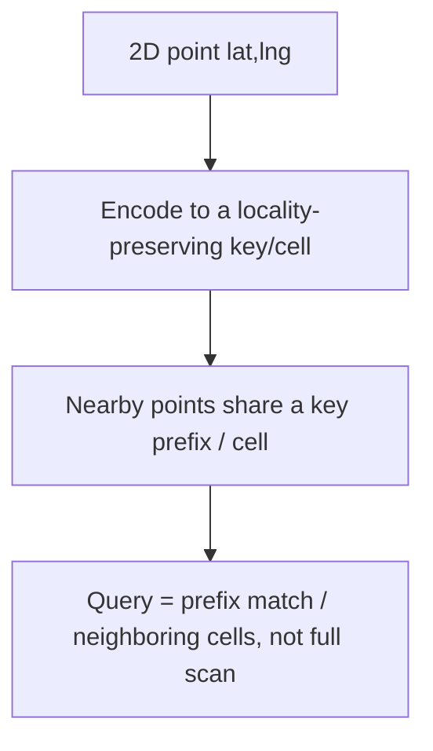

# Geospatial Indexing

> Prerequisites: [indexing-and-query-optimization](./indexing-and-query-optimization.md), [partitioning-and-sharding](./partitioning-and-sharding.md)
> Related: [12-system-design-problems/ride-hailing-system](../12-system-design-problems/ride-hailing-system.md) · [food-delivery-platform](../12-system-design-problems/food-delivery-platform.md)

How to answer "find things near a location, fast" at scale. Comes up in ride-hailing, food delivery, store locators, geo-fencing, and "nearby" features. A standard B-tree index can't do it; you need a spatial index. (Track B / situational — know it when the problem is location-based.)

---

## A. Problem and motivation

"Find the 10 nearest drivers to (lat, lng)" or "all restaurants within 5 km" is a 2-dimensional range query. A normal B-tree index is **one-dimensional** — it can index `lat` OR `lng`, but a range on both still forces scanning a large candidate set (a box on one axis contains far too many points). Naively computing distance to *every* point is O(n) — hopeless at millions of points updated continuously. Spatial indexing maps 2D proximity onto a structure you can query efficiently.

---

## B. The core idea: turn 2D proximity into a 1D/prefix key

All practical approaches share one trick: **encode a 2D location so that points near each other in space are near each other in the key** (or share a cell). Then a proximity query becomes a prefix/range lookup or a small set of cell lookups.

---

## C. The main techniques

### Geohash (the one to know)
Interleave the bits of latitude and longitude and base32-encode them into a short string. Key property: **nearby points share a longer common prefix**. `9q8yy` and `9q8yz` are adjacent; the longer the shared prefix, the closer. A proximity query = find points whose geohash shares a prefix (plus check the 8 neighboring cells, because two close points can straddle a cell boundary and *not* share a prefix — the "edge" caveat).
- **Pros:** simple, string-prefix queries work in any DB/KV store (even a plain index on the geohash string); Redis `GEO` commands use geohashes under the hood.
- **Cons:** boundary problem (must query neighbor cells); fixed grid, so density varies by cell.

### Quadtree
Recursively subdivide space into 4 quadrants; subdivide a quadrant further only where points are dense. A node holds up to K points; exceed K → split into 4 children. Query = descend to the region's node(s) and collect points.
- **Pros:** adapts to density (dense cities = deep subdivision, sparse areas = shallow) → balanced query cost.
- **Cons:** a tree structure to maintain in memory; rebalancing on heavy updates.

### S2 / H3 (hierarchical cell systems)
Google **S2** maps the sphere to a space-filling (Hilbert) curve → each cell is a 64-bit id with hierarchical levels; Uber **H3** uses hexagonal cells. Both give locality-preserving cell ids at chosen resolutions, with better boundary behavior than a flat geohash grid. Used by large location systems.
- **Pros:** hierarchical (query at a resolution), good locality, library support.
- **Cons:** more machinery; usually a library, not hand-rolled.

### Database-native spatial indexes
PostGIS (PostgreSQL) uses **R-trees** (via GiST) for true spatial indexing — `ST_DWithin`, `ST_Distance`, nearest-neighbor operators. Redis has `GEOADD`/`GEOSEARCH` (geohash-based). For many systems, a native spatial index is the simplest correct answer — don't hand-roll a quadtree if PostGIS does it.

---

## D. Nearest-neighbor and "within radius" queries

- **Within radius:** compute the covering cells/geohash prefixes that overlap the radius circle, fetch candidates from those cells (+ neighbors for the boundary), then **refine** by computing actual distance and filtering/sorting. Two-phase: coarse cell filter → precise distance.
- **K nearest:** start at the point's cell, expand outward ring by ring until you have K candidates, then sort by true distance.

The index gives you a *small candidate set* cheaply; you still do exact distance math on that small set (not on everything).

---

## E. Example — ride-hailing driver matching

Millions of drivers emit location every few seconds. Store the latest location in an in-memory geospatial index (Redis `GEO`, or a geohash/quadtree) **partitioned by region/city** (a natural shard key — see [partitioning-and-sharding](./partitioning-and-sharding.md)). A ride request at (lat, lng): query the driver's cell + neighbors for available drivers → refine by true distance → atomically assign the nearest available one. Location writes are high-volume and loss-tolerant (eventual, slightly stale is fine); the *assignment* is strongly consistent. See [ride-hailing-system](../12-system-design-problems/ride-hailing-system.md).

---

## F. Trade-offs

| Technique | Advantages | Disadvantages | Best use |
|---|---|---|---|
| Geohash | Simple, prefix queries in any store, Redis GEO | Boundary problem (query neighbors), fixed grid | General "nearby", KV/Redis stores |
| Quadtree | Adapts to density | In-memory tree, rebalancing | Highly uneven density, in-memory |
| S2 / H3 | Hierarchical, good locality, libraries | More machinery | Large-scale location platforms |
| PostGIS (R-tree) | True spatial queries, native | A spatial DB extension | When your data is already in Postgres |

---

## G. Failure/scaling scenarios

1. **Boundary misses (geohash).** Two nearby points straddle a cell edge and don't share a prefix. Fix: always query the 8 neighboring cells too; refine by distance.
2. **Hot region / cell.** A dense area (airport, concert, downtown) → one cell/shard overloaded (a geospatial hot partition). Fix: finer resolution in dense areas (quadtree adapts naturally), cache, or dedicated capacity (same shape as [hot shards](./partitioning-and-sharding.md)).
3. **High-frequency location updates.** Millions of writes/sec → keep the index in memory (Redis), eventual/loss-tolerant; don't durably persist every ping. Partition by region so updates spread.
4. **Query returns too many candidates.** Choose a resolution matching the typical query radius; too coarse = huge candidate sets, too fine = many cells to scan.

---

## H. Interview preparation

**Basic**
- Q: Why can't a B-tree index answer "find nearby points"? → *A: It's 1-dimensional; a 2D proximity query on lat+lng can't be served by indexing one axis — you'd scan a huge candidate set. You need a spatial index that maps 2D proximity to a prefix/cell.*

**Intermediate**
- Q: How does a geohash enable proximity queries? → *A: It interleaves lat/lng bits into a string so nearby points share a longer prefix; a "nearby" query is a prefix match plus the 8 neighbor cells (for the boundary case), then refine by true distance.*
- Q: Geohash vs quadtree? → *A: Geohash is a simple fixed grid with prefix queries (great in Redis/KV, boundary caveat); a quadtree adapts to density (deep where dense) but is an in-memory tree needing rebalancing.*

**SDE-2 / scenario**
- Q: "Design 'find the nearest available drivers' for a ride-hailing app." → *A: A geospatial index (Redis GEO / geohash / quadtree) of driver locations, partitioned by region; query the request's cell + neighbors for available drivers, refine by true distance, assign the nearest atomically (no double-assign). Location writes are in-memory, eventual, loss-tolerant; assignment is strongly consistent.*
- Q: "A downtown cell is overloaded." → *A: Geospatial hot partition — use finer resolution there (quadtree adapts), cache, or dedicated capacity; it's the hot-shard problem in space.*

**Common wrong answers:** computing distance to every point (O(n)); a B-tree on lat or lng alone; ignoring the geohash boundary problem; durably persisting every location ping.

---

## I. Hands-on exercise

Design the "restaurants within 5 km, sorted by distance" query for a food-delivery app with 100K restaurants. Pick an index (geohash/quadtree/PostGIS), describe the coarse-cell-filter → refine-by-distance two-phase query, how you partition, and how you handle a dense-city hot cell. Compare with [food-delivery-platform](../12-system-design-problems/food-delivery-platform.md).

---

## J. Revision summary

**Key takeaways**
- A B-tree can't do 2D proximity; spatial indexes map 2D nearness to a locality-preserving key/cell.
- Geohash (prefix-shareable string, boundary caveat), quadtree (density-adaptive, in-memory), S2/H3 (hierarchical cells), PostGIS R-tree (native).
- Query = coarse cell/prefix filter → refine by true distance (small candidate set, not full scan).
- Partition by region; dense areas create geospatial hot partitions; location writes are high-volume + loss-tolerant.

**Rapid-fire**
1. Why not a B-tree for "nearby"? → It's 1D; 2D proximity needs a spatial index.
2. Geohash locality property? → Nearby points share a longer key prefix.
3. Geohash's main caveat? → Boundary (query neighbor cells too).
4. Density-adaptive structure? → Quadtree.
5. Native Postgres spatial index? → PostGIS (R-tree via GiST).

**Next:** [probabilistic-data-structures](./probabilistic-data-structures.md)
