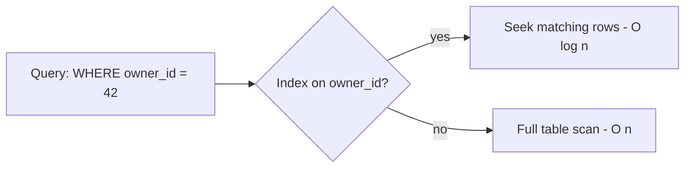
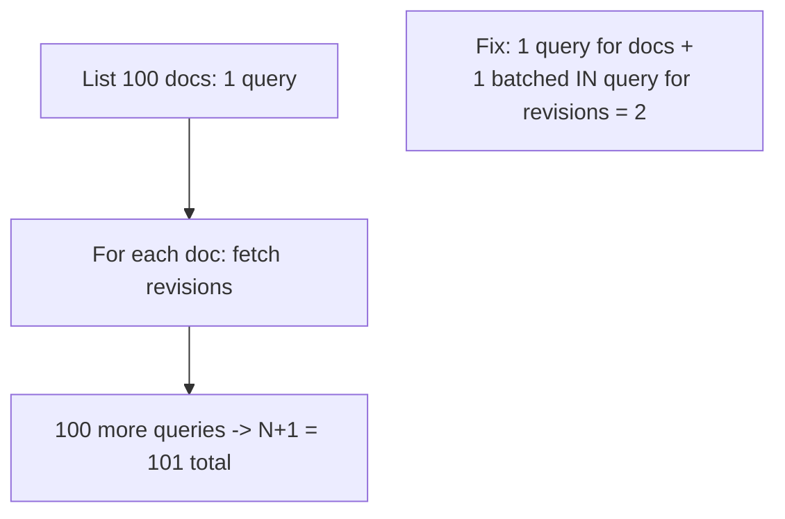

# Indexing and Query Optimization

> Prerequisites: [database-internals-for-system-design](./database-internals-for-system-design.md)
> Related: [pagination-filtering-and-sorting](../01-networking-and-api-design/pagination-filtering-and-sorting.md) · [scaling-bottleneck-diagnosis](../11-estimation-and-bottleneck-analysis/scaling-bottleneck-diagnosis.md)

Most "the database is slow" problems are a missing index or a bad query, not a need for more hardware or sharding. This is the cheapest, highest-leverage scaling fix, and knowing it signals that you diagnose before you scale.

---

## A. Problem and motivation

A query without a supporting index forces a **full table scan** — the DB reads every row. On a 10M-row table that's millions of reads per query; latency grows with the table. An index turns that into an `O(log n)` seek. The recurring lesson from the [scaling journey](../00-foundations/architecture-fundamentals.md): before adding replicas or sharding, check whether an index fixes it. Candidates who jump straight to "shard the DB" when an index would do lose points.

---

## B. What an index is

An index is an auxiliary B-tree (see [internals](./database-internals-for-system-design.md)) keyed on one or more columns, pointing to rows. It lets the DB *seek* to matching rows instead of scanning. Analogy: a book's index — find "caching" instantly instead of reading every page — but technically it's a sorted structure the query planner traverses.

**Cost of an index:** every write must also update the index (slower writes, more storage). So indexes trade write/storage cost for read speed. Over-indexing a write-heavy table hurts.

---

## C. Index types and the composite-index rule

- **Single-column index:** speeds predicates on that column.
- **Composite (multi-column) index:** on `(a, b, c)`. Crucial rule: it supports predicates on a **left-to-right prefix** — `(a)`, `(a,b)`, `(a,b,c)` — but **not** `(b)` or `(c)` alone. Order matters: put the most selective / most-filtered column first, and match the index to your query's filter + sort.
- **Covering index:** includes all columns a query needs, so the DB answers from the index alone without touching the table (an "index-only scan") — very fast.
- **Unique index:** enforces uniqueness and speeds lookups.
- **Partial index:** indexes only rows matching a condition (e.g., `WHERE status='ACTIVE'`), smaller and cheaper.

The composite-prefix rule is a favorite interview detail — know it cold.

---

## D. Reading a query plan (EXPLAIN)

`EXPLAIN ANALYZE` shows how the DB executes a query. The signals you want to recognize:
- **Seq Scan** on a large table in a selective query → missing/unused index (bad).
- **Index Scan / Index Only Scan** → using an index (good).
- **Nested Loop with high row estimates** or a join without indexes on join keys → potential blow-up.
- Big gaps between estimated and actual rows → stale statistics (run `ANALYZE`).

**Interview point:** "I'd `EXPLAIN ANALYZE` the slow query first — most 'DB is slow' issues are a missing index or an N+1, not insufficient hardware."

---

## E. The N+1 query problem (extremely common)

Listing N documents and then firing one query per document to fetch its revisions = 1 + N queries. At N=100, that's 101 round trips. Fix with a **join** or a **batch fetch** (`WHERE document_id IN (...)`) to make it 1–2 queries. ORMs cause this silently (lazy loading in a loop). Diagnose by counting queries per request (ORM logging / tracing).

---

## F. Example — DMS document list

`GET /documents?owner=42&status=READY` sorted by `created_at desc`, paginated with a cursor. The supporting index: composite `(owner_id, status, created_at, id)`. This serves the filter (`owner_id`, `status`), the sort (`created_at`), and the cursor tiebreaker (`id`) — an index-only or tight index scan, constant-cost per page. Without it: a seq scan over all of an owner's documents, degrading as data grows. This single index is the difference between a fast and a dying list endpoint.

---

## G. Trade-offs

| Technique | Advantages | Disadvantages | Best use | Warning signs |
|---|---|---|---|---|
| Add index | Fast reads/filters/sorts | Slower writes, more storage | Hot query predicates | Indexing every column on a write-heavy table |
| Composite index | Serves multi-column filter+sort | Must match query prefix | Known multi-column queries | Wrong column order (prefix unused) |
| Covering index | Index-only scans | Larger index | Hot read-only queries | Over-including columns |
| Denormalize (precompute) | Avoids expensive joins | Write complexity, consistency | Read-heavy aggregates | Premature denormalization |

---

## H. Failure scenarios

1. **Missing index → full scan at scale.** Trigger: table grows to millions of rows. Users: slow endpoint, rising DB CPU/IO. Detect: `EXPLAIN` shows Seq Scan; slow-query log. Fix: add the matching index. Prevent: index hot query paths from the start.
2. **N+1 explosion.** Trigger: ORM lazy loading in a loop. Users: slow lists; DB flooded with tiny queries. Detect: query count per request spikes. Fix: join / batch fetch.
3. **Index not used (type/function mismatch).** Trigger: `WHERE lower(email) = ...` with an index on `email`, or a type cast. Effect: index ignored, seq scan. Fix: match the index to the query (functional index on `lower(email)`), avoid wrapping indexed columns in functions.
4. **Over-indexing a write-heavy table.** Trigger: 10 indexes on a high-write table. Users: slow writes. Fix: drop unused indexes.

---

## I. Scaling implications

Indexing and query fixes are the *first* response to a DB bottleneck — cheapest, no architectural change, often buys 10–100× headroom. Only after queries are optimized do caching, replicas, and sharding make sense. The decision ladder: **index/query fix → cache → read replica → shard.** Reaching for the later rungs when an index would do is the classic over-engineering mistake. See [scaling-bottleneck-diagnosis](../11-estimation-and-bottleneck-analysis/scaling-bottleneck-diagnosis.md).

---

## J. Interview preparation

**Basic**
- Q: What does an index do, and what's its cost? → *A: Turns a full scan into an O(log n) seek; costs slower writes and extra storage because writes must update it.*

**Intermediate**
- Q: Composite index on `(a,b,c)` — which queries benefit? → *A: Those filtering on a left prefix: `(a)`, `(a,b)`, `(a,b,c)`; not `(b)` or `(c)` alone. Column order matters.*
- Q: What's the N+1 problem and the fix? → *A: One query per item in a loop (1+N queries); fix with a join or a single batched `IN` query.*

**SDE-2 / scenario**
- Q: "An endpoint got slow as data grew. First step?" → *A: `EXPLAIN ANALYZE` it — likely a missing index or N+1, not a hardware/sharding problem. Add the matching index or batch the query before considering caching/replicas.*
- Q: "You added an index but the query is still slow." → *A: Check whether the planner uses it (seq scan in EXPLAIN?). Common causes: wrong column order for the prefix, a function/type mismatch disabling it, or stale statistics — fix the query/index to match, run ANALYZE.*

**Common wrong answers:** "shard it" for a missing-index problem; indexing everything; not knowing the composite-prefix rule.

---

## K. Hands-on exercise

For a query `WHERE tenant_id = ? AND status = ? ORDER BY updated_at DESC LIMIT 20` on a 50M-row table, design the index (column order + why), state whether it can be index-only, and describe what `EXPLAIN` output would confirm it's working. Then identify an N+1 risk if you also load each row's tags.

---

## L. Revision summary

**Key takeaways**
- Index turns O(n) scans into O(log n) seeks; costs write/storage overhead.
- Composite indexes serve a left-to-right prefix; column order and query/sort matching matter.
- `EXPLAIN ANALYZE` first; Seq Scan on a big selective query = missing/unused index.
- Fix N+1 with joins/batch fetches.
- Decision ladder: index/query fix → cache → replica → shard. Don't skip rungs.

**Must explain without notes:** the composite-prefix rule; N+1 and its fix; the index→cache→replica→shard ladder.

**Rapid-fire**
1. Index on `(a,b,c)` — does a query on `b` alone use it? → No.
2. First tool for a slow query? → EXPLAIN ANALYZE.
3. N+1 fix? → Join or batched IN.
4. Cost of an index? → Slower writes + storage.
5. Cheapest DB bottleneck fix? → Index/query optimization.

**Next:** [transactions-and-isolation](./transactions-and-isolation.md)
