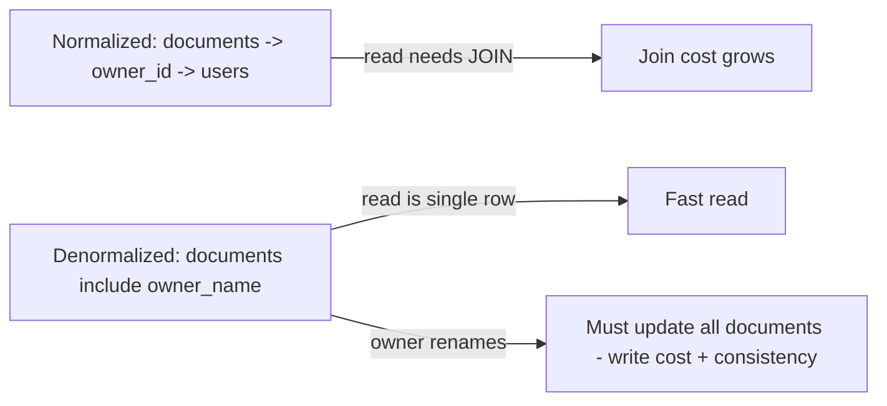

# Normalization and Denormalization

> Prerequisites: [relational-vs-nosql](./relational-vs-nosql.md), [indexing-and-query-optimization](./indexing-and-query-optimization.md)
> Related: [consistency-models](./consistency-models.md) · [event-sourcing-and-cqrs](../05-messaging-and-event-driven-systems/event-sourcing-and-cqrs.md)

Normalization vs denormalization is a read-vs-write and consistency-vs-speed trade-off. The strong answer: normalize by default for correctness; denormalize deliberately for specific read-heavy hot paths, accepting the write/consistency cost.

---

## A. Problem and motivation

Normalized schemas avoid duplication (each fact stored once), keeping writes simple and data consistent — but reads need joins, which get expensive at scale. Denormalized schemas duplicate/precompute data to make reads cheap (no joins) — but writes must update multiple copies, risking inconsistency. Choosing badly means either slow reads (over-normalized hot path) or inconsistent data and painful writes (over-denormalized).

---

## B. Normalization

Normalization organizes data to eliminate redundancy: each piece of information lives in exactly one place, referenced by keys. E.g., a document references its owner by `owner_id`, not by copying the owner's name into every document row.

**Benefits:** no update anomalies (change the owner's name once), smaller storage, simple consistent writes.
**Cost:** reads that need related data require **joins**, which cost more as tables grow and span shards.

---

## C. Denormalization

Denormalization deliberately duplicates or precomputes data to avoid joins/aggregations on read:
- **Duplicate a field** (store `owner_name` on the document row to avoid joining users).
- **Precompute an aggregate** (store `revision_count` instead of `COUNT(*)` each time).
- **Materialized view / read model** (a precomputed table shaped exactly for a query).

**Benefit:** fast reads (single-row/single-partition fetch, no join).
**Cost:** writes must update all copies; data can drift out of sync (consistency burden); more storage.

---

## D. The decision — and why it ties to consistency

Denormalization creates **two copies of a truth** that must be kept in sync. If the source changes (owner renamed), the copies are stale until updated. So denormalization is fundamentally a **consistency trade-off**: you accept eventual/managed consistency on the duplicated data for read speed. This is exactly the CQRS idea — a separate read model updated asynchronously from writes. See [event-sourcing-and-cqrs](../05-messaging-and-event-driven-systems/event-sourcing-and-cqrs.md) and [consistency-models](./consistency-models.md).

**Rule of thumb:** normalize until a *measured* read hot path demands denormalization; then denormalize that path and own the sync/consistency explicitly (triggers, application logic, or async propagation).

---

## E. Example — DMS

- **Normalized core:** documents, revisions, users, shares as separate tables with foreign keys. Correct, simple writes.
- **Denormalized read model (introduced at Stage 5):** a "document summary" table/view holding `document_id, name, owner_name, latest_revision_no, thumbnail_url, status` — everything the dashboard list needs in one row, avoiding 3 joins per document across millions of rows. Updated when the underlying data changes (via application logic or CDC). The dashboard read goes from a multi-join query to a single-table scan — but now a rename must propagate to the summary (eventual consistency, acceptable for a dashboard).

NoSQL stores often *force* denormalization: with no joins, you model data pre-joined around your access pattern (e.g., store the whole document-with-recent-revisions as one document/partition).

---

## F. Trade-offs

| Approach | Advantages | Disadvantages | Best use | Warning signs |
|---|---|---|---|---|
| Normalized | Consistent, simple writes, no duplication | Join cost on read, worse at scale/shards | Default; write-heavy; evolving queries | Slow critical read path from heavy joins |
| Denormalized | Fast reads, avoids joins | Write amplification, stale copies, more storage | Measured read hot paths, NoSQL access-pattern modeling | Premature; unmanaged consistency |

---

## G. Failure scenarios

1. **Stale duplicated data.** Trigger: source updated, copy not. Users: dashboard shows old owner name. Detect: reconciliation checks, user reports. Mitigate: reliable propagation (CDC/outbox), periodic reconciliation. Prevent: own the sync explicitly; keep denormalization minimal.
2. **Write amplification / fan-out.** Trigger: a user renames; 1M document summaries must update. Users: slow writes / backlog. Fix: async propagation, batch updates, or denormalize less. 
3. **Premature denormalization.** Trigger: duplicating data before any read is slow. Result: write complexity and consistency bugs for no benefit. Fix: normalize; denormalize only measured hot paths.

---

## H. Scaling implications

As data grows and especially after sharding, joins across shards become expensive or impossible — pushing you toward denormalized, pre-joined read models (CQRS). This is why high-scale read-heavy systems (feeds, dashboards) precompute read models updated asynchronously from the normalized write store. The write store stays normalized (correct, source of truth); read models are denormalized projections. Recognizing when a read hot path justifies this — and owning the consistency it introduces — is the SDE-2 skill.

---

## I. Interview preparation

**Basic**
- Q: Normalization vs denormalization? → *A: Normalized stores each fact once (consistent, simple writes, join-heavy reads); denormalized duplicates/precomputes to make reads cheap at the cost of write complexity and consistency.*

**Intermediate**
- Q: Why is denormalization a consistency trade-off? → *A: It creates multiple copies of the same truth that must be kept in sync; between updates, copies are stale — you accept managed/eventual consistency for read speed.*
- Q: When do you denormalize? → *A: When a measured read hot path is dominated by joins/aggregations; I denormalize that path and own the propagation (CDC/outbox/app logic), keeping the write store normalized.*

**SDE-2 / scenario**
- Q: "The dashboard list does 3 joins per row over millions of rows and is slow." → *A: Build a denormalized summary read model with the fields the dashboard needs, updated asynchronously from the normalized source; the read becomes a single-row fetch. I accept brief staleness on things like a renamed owner.*
- Q: "A rename must update a million denormalized rows." → *A: Propagate asynchronously (CDC/queue), batch the updates, and reconcile periodically; or reconsider whether that field needed denormalizing.*

**Common wrong answers:** denormalizing before measuring; ignoring the consistency burden; claiming NoSQL "doesn't need" data modeling (it forces access-pattern-driven denormalization).

---

## J. Hands-on exercise

For a news feed, decide what to normalize (users, posts, follows) and what to denormalize (precomputed per-user timelines). Explain the write fan-out cost of the denormalized timeline and when you'd choose it over computing the feed on read. Compare with [news-feed](../12-system-design-problems/news-feed.md).

---

## K. Revision summary

**Key takeaways**
- Normalize by default (one copy, consistent, simple writes, join-heavy reads).
- Denormalize deliberately for measured read hot paths; it trades write cost + consistency for read speed.
- Denormalization = managed/eventual consistency on duplicated data; own the propagation (CDC/outbox).
- At scale/after sharding, joins get costly → denormalized read models (CQRS); write store stays normalized.

**Must explain without notes:** why denormalization is a consistency trade-off; when to introduce a read model; the write fan-out cost.

**Rapid-fire**
1. Default: normalize or denormalize? → Normalize.
2. Denormalization trades what for read speed? → Write complexity + consistency.
3. What keeps denormalized copies in sync? → Propagation (CDC/outbox/app logic) + reconciliation.
4. Why does sharding push toward denormalization? → Cross-shard joins are costly/impossible.
5. CQRS write store state? → Normalized source of truth; read models are denormalized projections.

**Next:** [replication-and-read-replicas](./replication-and-read-replicas.md)
