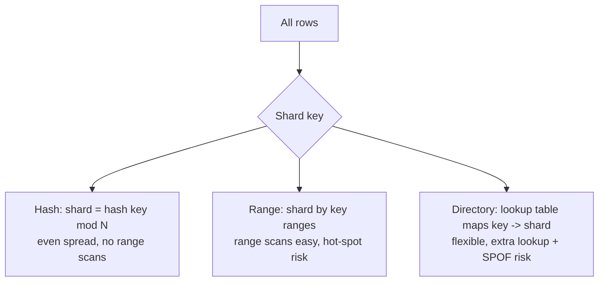

# Partitioning and Sharding

> Prerequisites: [replication-and-read-replicas](./replication-and-read-replicas.md)
> Related: [distributed-transactions](./distributed-transactions.md) · [consistency-models](./consistency-models.md) · [id-generation-and-sequences](../06-distributed-systems/id-generation-and-sequences.md)

Sharding is the heavy artillery of database scaling — the way you scale **writes** and **data size** beyond one node. It's powerful but introduces cross-shard queries, rebalancing, and hot partitions. The SDE-2 stance: shard last, after exhausting indexing, caching, and replicas, and choose the shard key carefully.

---

## A. Problem and motivation

Read replicas scale reads but not writes; a single primary caps write throughput and dataset size. When those are the ceiling (Stage 6), you **shard**: split data across multiple independent databases (shards), each owning a subset of the data and taking its own writes. This scales writes and storage horizontally — but joins, transactions, and uniqueness across shards become hard, and a bad shard key creates hot partitions that defeat the purpose.

**Terminology:** *partitioning* splits a table into pieces (can be within one DB); *sharding* spreads those pieces across separate database instances. In interviews they're often used interchangeably for horizontal data splitting.

---

## B. Sharding strategies

| Strategy | How | Pros | Cons |
|---|---|---|---|
| **Hash** | `shard = hash(key) % N` | Even distribution | No efficient range scans; resharding on N change (fixed by [consistent hashing](../GLOSSARY.md)) |
| **Range** | partition key ranges (A–F, G–M…) | Range queries easy | Hot spots (e.g., recent-time ranges, sequential IDs) |
| **Directory** | explicit key→shard map | Flexible rebalancing | Lookup overhead; the map is a SPOF/bottleneck |

**Consistent hashing** minimizes how many keys move when you add/remove a shard (only ~1/N keys remap instead of nearly all), which is why distributed caches and sharded stores use it.

---

## C. Choosing the shard key (the decision that makes or breaks it)

The shard key determines distribution, hot spots, and which queries stay single-shard. Criteria:
1. **High cardinality + even distribution** — avoid few values that concentrate data.
2. **Aligns with the common query** — so hot queries hit one shard (no scatter-gather).
3. **Avoids hot spots** — don't shard by something monotonically increasing (timestamp, auto-increment ID) if writes concentrate on the newest shard.

**DMS:** shard metadata by `tenant_id` — a tenant's documents live together, so per-tenant queries (the common case) are single-shard, and tenants spread across shards. Risk: one giant enterprise tenant becomes a **hot shard** (uneven distribution). Mitigation: sub-shard that tenant, or isolate it.

**Chat:** shard by `conversation_id` — a conversation's messages co-locate; fetching recent messages is single-shard.

---

## D. The costs sharding introduces

- **Cross-shard queries (scatter-gather):** a query not scoped to the shard key must hit all shards and merge results — slow and hard to paginate. Design access patterns around the shard key to avoid this.
- **Cross-shard transactions:** single-node ACID doesn't span shards → you need [distributed transactions](./distributed-transactions.md) (2PC, avoid) or [sagas](../05-messaging-and-event-driven-systems/saga-pattern.md). Keep transactionally-coupled data on the same shard.
- **Cross-shard joins:** generally avoided; denormalize or do app-side joins. See [normalization-and-denormalization](./normalization-and-denormalization.md).
- **Unique IDs:** auto-increment doesn't work across shards; use UUIDs/Snowflake-style IDs. See [id-generation-and-sequences](../06-distributed-systems/id-generation-and-sequences.md).
- **Rebalancing:** adding a shard means moving data; consistent hashing + careful migration minimize disruption.
- **Operational complexity:** more databases to monitor, back up, and fail over.

---

## E. Hot partitions / hot shards

Even with a decent key, traffic can concentrate: a celebrity's data, one enterprise tenant, the "today" range. One shard saturates while others idle — you've scaled the hardware but not the hot workload. Mitigations: better/compound shard keys, splitting the hot key (e.g., `celebrity_id + bucket`), caching the hot data, or dedicated capacity for the hot entity. Detecting hot shards (per-shard metrics) is a key diagnosis skill. See [stampedes-hot-keys-and-penetration](../04-caching/stampedes-hot-keys-and-penetration.md).

---

## F. Example — DMS sharding at Stage 6

When metadata outgrows one primary (writes + size), shard by `tenant_id` via consistent hashing. Per-tenant document lists, searches, and uploads stay single-shard (fast). Cross-tenant admin reports become scatter-gather (rare, run async/offline). A huge tenant triggers a hot-shard mitigation: isolate it onto its own shard or sub-partition by `(tenant_id, folder_id)`. IDs become Snowflake-style so they're unique and roughly time-sortable across shards. Transactions stay within a tenant (same shard), so no cross-shard 2PC in the common path.

---

## G. Trade-offs

| Aspect | Advantages | Disadvantages | Best use | Warning signs |
|---|---|---|---|---|
| Sharding | Scales writes + storage horizontally | Cross-shard queries/txns/joins, rebalancing, ops | Write/size beyond one node | Sharding before exhausting index/cache/replica |
| Hash key | Even spread | No range scans; resharding (use consistent hashing) | Point lookups | Range-query needs |
| Range key | Easy range scans | Hot spots on sequential/time keys | Time-bounded data w/ care | Monotonic key → hot newest shard |

---

## H. Failure scenarios

1. **Bad shard key → hot shard.** Trigger: sharding by low-cardinality or monotonic key. Users: one shard overloaded, others idle; no throughput gain. Detect: skewed per-shard load. Fix: reshard on a better/compound key; split the hot key. Prevent: choose high-cardinality, query-aligned keys.
2. **Accidental scatter-gather.** Trigger: a common query not scoped to the shard key. Users: slow queries hitting all shards. Fix: redesign the access pattern around the shard key, or maintain a secondary index/read model keyed appropriately.
3. **Cross-shard transaction needed.** Trigger: an operation spans two tenants/shards. Effect: no atomicity. Fix: saga with compensation, or redesign to keep it single-shard. Prevent: don't shard across a transactional boundary.

---

## I. Scaling implications

Sharding is the end of the "simple" scaling road and the start of distributed-data problems: everything (queries, transactions, IDs, uniqueness) now must respect the shard boundary. This is why the entire [distributed-systems section](../06-distributed-systems/) becomes relevant once you shard. The right scaling order — index/query → cache → replica → **shard last** — exists precisely because sharding is costly and irreversible-ish. Interviewers reward candidates who say "I'd shard only after measuring that writes/size exceed a single primary, and I'd pick the key to keep common queries single-shard."

---

## J. Interview preparation

**Basic**
- Q: What does sharding scale that replicas don't? → *A: Writes and total data size (replicas only scale reads).*

**Intermediate**
- Q: How do you choose a shard key? → *A: High cardinality + even distribution, aligned with the common query (so hot queries are single-shard), avoiding monotonic/low-cardinality keys that create hot spots.*
- Q: What breaks when you shard? → *A: Cross-shard queries (scatter-gather), cross-shard transactions/joins, auto-increment IDs, and you take on rebalancing + ops complexity.*

**SDE-2 / scenario**
- Q: "A single partition is hot. Why and what do you do?" → *A: Traffic concentrates on one key/range (celebrity, big tenant, 'today'). I'd use a compound key or split the hot key into buckets, cache the hot data, or give it dedicated capacity — and verify with per-shard metrics.*
- Q: "When would you shard the DMS?" → *A: Only when a single primary's write throughput or dataset size is the measured ceiling (after indexing, caching, replicas). I'd shard by tenant_id so per-tenant operations stay single-shard, and handle a giant tenant as a hot-shard exception.*

**Common wrong answers:** sharding first; sharding by a monotonic key; ignoring cross-shard transaction/query costs; auto-increment IDs across shards.

---

## K. Hands-on exercise

Design sharding for a social media posts table (billions of posts). Pick a shard key for the common access pattern "a user's posts" and explain how a celebrity with 100M followers creates a hot partition and two mitigations. Then identify one query that becomes scatter-gather under your key.

---

## L. Revision summary

**Key takeaways**
- Sharding scales writes + data size horizontally; it's the last and costliest scaling step.
- Shard key = high cardinality, even, query-aligned, non-monotonic; it decides hot spots and single-shard queries.
- Costs: cross-shard queries/transactions/joins, ID generation, rebalancing, ops; keep coupled data on one shard.
- Hot shards defeat sharding — detect via per-shard metrics; mitigate with compound/split keys, caching, isolation.

**Must explain without notes:** shard key selection; what sharding scales vs replicas; the costs it introduces; hot shards + mitigations.

**Rapid-fire**
1. Replicas vs sharding — what does each scale? → Replicas: reads; sharding: writes + size.
2. Bad shard-key symptom? → Hot shard / skew.
3. Query not scoped to the shard key? → Scatter-gather (slow).
4. IDs across shards? → UUID/Snowflake, not auto-increment.
5. Where does sharding sit in the scaling ladder? → Last (after index → cache → replica).

**Next:** [distributed-transactions](./distributed-transactions.md)
