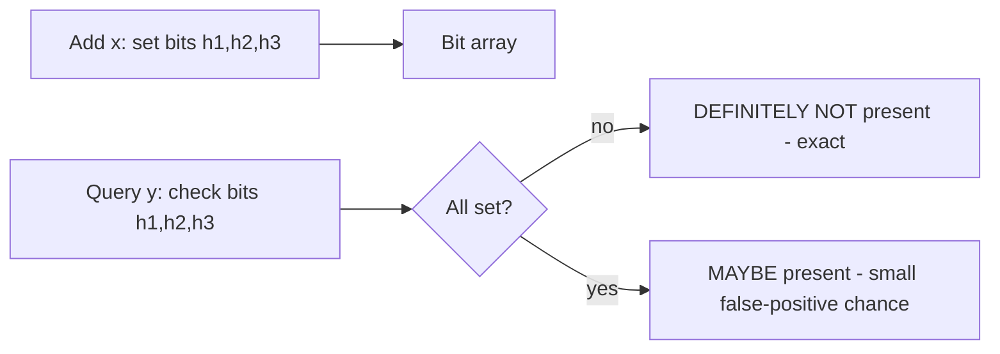

# Probabilistic Data Structures

> Prerequisites: [database-internals-for-system-design](./database-internals-for-system-design.md)
> Related: [04-caching/stampedes-hot-keys-and-penetration](../04-caching/stampedes-hot-keys-and-penetration.md) · [12-system-design-problems/web-crawler](../12-system-design-problems/web-crawler.md) · [metrics-monitoring-platform](../12-system-design-problems/metrics-monitoring-platform.md)

How to answer "membership / cardinality / frequency at massive scale with tiny memory" when exact answers are too expensive. These trade a little accuracy for enormous space savings. Know Bloom filters cold; the others at a "what/when" level. (Track B / situational.)

---

## A. Problem and motivation

Some questions are expensive to answer exactly at scale: "have I seen this URL before?" (dedup over billions), "how many unique visitors today?" (exact needs storing every id), "how often does this item appear in a stream?" (exact needs a per-key counter for millions of keys). Exact answers cost memory proportional to the data. **Probabilistic structures give approximate answers in sub-linear, often constant, memory** by accepting a bounded error — a great trade when approximate is good enough (and it usually is for dedup/analytics).

---

## B. Bloom filter — "is X *possibly* in the set?" (the one to know)

A bit array + k hash functions. **Add**: hash the item k ways, set those k bits. **Query**: hash k ways; if *any* bit is 0 → **definitely not present**; if *all* are 1 → **possibly present** (could be a false positive from other items' bits).

- **No false negatives, only false positives** — "definitely not present" is exact. This asymmetry is the whole value.
- **Tiny memory** (bits, not items) for a tunable false-positive rate; can't delete (basic version) — use a counting Bloom filter if you must delete.
- **Classic uses:** skip an expensive lookup when "definitely not present" — e.g., **cache penetration** (is this key worth hitting the DB for? — see [stampedes-hot-keys-and-penetration](../04-caching/stampedes-hot-keys-and-penetration.md)), **crawler URL dedup** (seen this URL? — see [web-crawler](../12-system-design-problems/web-crawler.md)), LSM-tree per-SSTable filters (skip SSTables that definitely lack the key — see [database-internals-for-system-design](./database-internals-for-system-design.md)).

**The pattern:** use the Bloom filter as a cheap *negative* check in front of an expensive store; on "maybe," do the real lookup. False positives cost an occasional wasted lookup; false negatives can't happen, so you never *miss* real data.

---

## C. HyperLogLog — "how many *unique* items?" (cardinality)

Estimates the count of distinct elements in **~kilobytes regardless of cardinality** (vs storing every id for an exact count). Works on the statistics of hash values (leading-zero patterns). Error is a small percent, tunable.
- **Uses:** unique visitors/day, distinct search terms, cardinality dashboards — anywhere you need "roughly how many unique" over huge streams.
- Redis implements it (`PFADD`/`PFCOUNT`). Mergeable: combine HLLs from multiple shards to get a global unique count.
- **Trade-off:** approximate count (±~2%), can't enumerate the items (only count them).

---

## D. Count-Min Sketch — "how *often* does X appear?" (frequency)

A small 2D array of counters + several hash functions; estimates per-item frequency in sub-linear memory. It *over*-estimates (never under), bounded by the array size.
- **Uses:** heavy-hitters / "top-K frequent items" in a stream (trending, hot keys), frequency-based rate decisions, approximate analytics.
- **Trade-off:** over-estimates frequencies (collisions add counts); can't list all items, only query a given item's approximate count.

---

## E. The common thread (and when NOT to use them)

All three trade a **bounded, known error for massive memory savings**. Use them when:
- The data is huge (billions of items / unbounded streams).
- Exact answers are too expensive in memory.
- **Approximate is acceptable** for the use case (dedup, analytics, cache gating).

**Do NOT use them when correctness is required** — never gate a *financial* or *security* decision on a Bloom filter's "maybe," never bill on a HyperLogLog estimate. They're for scale-driven approximation, not correctness-critical paths.

---

## F. Example — the DMS / crawler / metrics

- **Cache penetration (DMS):** a Bloom filter of existing document ids lets a lookup for a non-existent id be rejected instantly ("definitely not present") without hitting the DB — defusing penetration attacks (see [stampedes-hot-keys-and-penetration](../04-caching/stampedes-hot-keys-and-penetration.md)).
- **Crawler dedup:** a Bloom filter of seen URLs over billions of URLs in a few GB; "maybe seen" → do the exact check, "definitely not" → crawl it. A rare false positive just skips a URL (acceptable) — and there are no false negatives, so nothing is crawled twice erroneously beyond the FP rate (see [web-crawler](../12-system-design-problems/web-crawler.md)).
- **Metrics (unique counts):** HyperLogLog for "unique active users today" across sharded ingest, merged for a global estimate — kilobytes instead of storing every user id (see [metrics-monitoring-platform](../12-system-design-problems/metrics-monitoring-platform.md)).

---

## G. Trade-offs

| Structure | Answers | Error type | Memory | Can't do |
|---|---|---|---|---|
| Bloom filter | Membership (maybe/no) | False positives only (no false negatives) | Bits per item (tiny) | Delete (basic), enumerate |
| HyperLogLog | Distinct count | ±~small % | ~KB regardless of N | Enumerate items |
| Count-Min Sketch | Item frequency | Over-estimate only | Sub-linear | Enumerate, exact counts |

---

## H. Interview preparation

**Basic**
- Q: What does a Bloom filter guarantee? → *A: "Definitely not present" (exact — no false negatives) or "possibly present" (small false-positive chance). You use the exact "no" to skip expensive lookups.*

**Intermediate**
- Q: Where would you use a Bloom filter in a system? → *A: As a cheap negative check in front of an expensive store — cache penetration (skip the DB for keys that definitely don't exist), crawler URL dedup, LSM per-SSTable filters. False positives cost a wasted lookup; false negatives can't happen.*
- Q: How do you count unique visitors over billions of events cheaply? → *A: HyperLogLog — estimates distinct cardinality in ~KB regardless of count, mergeable across shards; approximate (±~2%), can't enumerate.*

**SDE-2 / scenario**
- Q: "A scanner probes random non-existent IDs, hammering your DB (cache penetration). Fix?" → *A: A Bloom filter of existing IDs: 'definitely not present' rejects the probe instantly without a DB hit; plus negative caching. False positives occasionally hit the DB (fine); no false negatives means real IDs are never wrongly rejected.*
- Q: "Would you use a Bloom filter to check if a payment was already processed?" → *A: No — it can false-positive ('maybe') and you'd need the exact check anyway for a correctness-critical path. Use an exact idempotency key with a unique constraint (see [idempotency-and-deduplication](../05-messaging-and-event-driven-systems/idempotency-and-deduplication.md)).*

**Common wrong answers:** using a Bloom filter where correctness is required (money/security); thinking Bloom filters have false *negatives* (they don't); storing every id for an exact unique count at huge scale (use HLL).

---

## I. Hands-on exercise

Design the URL-dedup for a web crawler handling 10B URLs. Size a Bloom filter for a ~1% false-positive rate, explain what a false positive costs (a skipped URL) and why false negatives can't happen, and describe the backing exact store for "maybe" hits. Then pick a structure for "count unique domains crawled today."

---

## J. Revision summary

**Key takeaways**
- Probabilistic structures trade bounded error for huge memory savings; use when data is massive and approximate is acceptable.
- **Bloom filter:** membership; "definitely not" is exact (no false negatives), "maybe" is a false positive; front an expensive store with it (penetration, dedup, LSM).
- **HyperLogLog:** approximate distinct count in ~KB regardless of N; mergeable.
- **Count-Min Sketch:** approximate frequency / heavy hitters (over-estimates).
- Never use them on correctness-critical paths (money/security).

**Rapid-fire**
1. Bloom filter false negatives? → None (only false positives).
2. Count unique visitors cheaply? → HyperLogLog.
3. Approximate item frequency / top-K? → Count-Min Sketch.
4. Bloom filter in front of a DB prevents? → Cache penetration / wasted lookups.
5. Use a Bloom filter for payment dedup? → No (needs exact; use an idempotency key).

**Next:** [data-archival-and-retention](./data-archival-and-retention.md)
