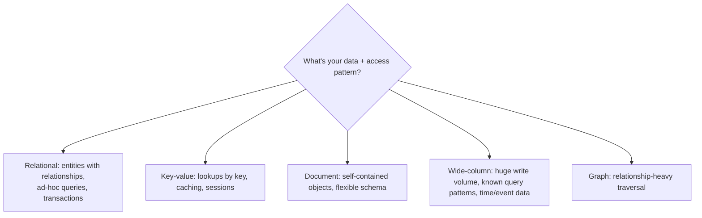

# Relational vs NoSQL

> Prerequisites: [00-foundations/requirements-and-constraints](../00-foundations/requirements-and-constraints.md)
> Related: [sql-vs-document-vs-key-value-vs-wide-column](./sql-vs-document-vs-key-value-vs-wide-column.md) · [consistency-models](./consistency-models.md) · [partitioning-and-sharding](./partitioning-and-sharding.md)

Database choice is the decision interviewers probe hardest, because it reveals whether you reason from *access patterns and requirements* or from hype. The winning stance: **relational by default; NoSQL when a specific access pattern, scale, or data shape justifies it.**

---

## A. Problem and motivation

Your data store determines your consistency guarantees, query flexibility, scaling path, and operational burden. Pick wrong and you fight the database forever: a relational DB forced into a key-value access pattern at massive scale, or a document store asked for multi-entity transactions it can't do well. The master-prompt mandate is to answer *why this store, why not the alternatives, what workload it fits, and how you'd migrate away.*

---

## B. The core distinction

**Relational (SQL):** data in tables with a fixed schema; relationships via foreign keys; rich queries via SQL (joins, aggregations); strong transactions (ACID). Examples: PostgreSQL, MySQL, Oracle.

**NoSQL:** an umbrella for non-relational stores, each optimized for a shape/access pattern:
- **Key-value** (Redis, DynamoDB-as-KV): get/put by key, blazing fast, no rich queries.
- **Document** (MongoDB): JSON-like documents, flexible schema, query within documents.
- **Wide-column** (Cassandra, HBase, DynamoDB): rows with dynamic columns, partitioned, write-optimized, massive scale.
- **Graph** (Neo4j): nodes/edges, relationship traversal.
- Plus **search** (Elasticsearch) and **time-series** (covered in [time-series-and-search-databases](./time-series-and-search-databases.md)).

---

## C. The real trade-offs (not "SQL slow, NoSQL fast")

That framing is wrong. The actual trade-offs:

| Dimension | Relational | NoSQL (typical) |
|---|---|---|
| Schema | Fixed, enforced | Flexible (schema-on-read) |
| Queries | Rich, ad-hoc, joins | Limited to designed access patterns |
| Transactions | Strong multi-row ACID | Often limited (single-item or weaker) |
| Consistency | Strong by default | Often tunable/eventual |
| Horizontal scale | Harder (sharding is manual work) | Often built-in (partitioned by design) |
| Best when | Relationships + transactions + evolving queries | One known access pattern at massive scale |

**The key insight:** NoSQL isn't "faster" — it's *designed for a specific access pattern* and trades away query flexibility and (often) strong transactions to get horizontal scale and performance for *that* pattern. If you don't know your access pattern precisely, relational's flexibility is safer.

---

## D. Decision framework

Ask these, in order:
1. **Do I have relationships and need multi-entity transactions?** → Relational.
2. **Do I need ad-hoc / evolving queries?** → Relational (NoSQL locks you into designed patterns).
3. **Is this a single, well-known access pattern at a scale a single relational node can't take?** → NoSQL matching that pattern (KV for lookups, wide-column for write-heavy time/event data).
4. **Is the data self-contained objects with varying fields?** → Document.
5. **Is it relationship-traversal-heavy (social graph, recommendations)?** → Graph.

Default to relational unless a question above clearly points elsewhere. You can start relational and add a specialized store for one hot pattern later (polyglot persistence).

---

## E. Example — picking stores for several systems

| System | Primary store | Why |
|---|---|---|
| **DMS metadata** | PostgreSQL | Relationships (docs↔revisions↔shares↔users), transactions, evolving queries; ~90GB fits one node for years |
| **DMS files** | Object storage | Not a DB problem — large blobs, cheap durable storage |
| **Payments ledger** | PostgreSQL | Strong ACID, correctness over everything; money cannot be eventually consistent |
| **Chat messages** | Wide-column (Cassandra) | Enormous write volume, append-only, partition by conversation; known access pattern (recent messages per conversation) |
| **Session store / rate limits** | Redis (KV) | Ephemeral, lookup by key, in-memory speed |
| **Product catalog with varied attributes** | Document (MongoDB) or SQL+JSONB | Flexible per-category fields |
| **News feed timeline** | Depends — often KV/wide-column for precomputed feeds | High-read, precomputed fan-out |

Notice: the choice follows *access pattern + scale + transaction needs*, and systems often use multiple stores. See the full designs in [12-system-design-problems](../12-system-design-problems/).

---

## F. Trade-offs table

| Store | Advantages | Disadvantages | Best use | Warning signs |
|---|---|---|---|---|
| Relational | ACID, joins, flexible queries, mature | Harder to shard; vertical limits | Entities + transactions + evolving queries | Forcing it into a huge single-key-lookup pattern at extreme scale |
| Key-value | Fast, simple, scalable | No rich queries | Caching, sessions, lookups | Needing queries beyond the key |
| Document | Flexible schema, object-shaped | Weak cross-document transactions, denormalization risk | Self-contained varied objects | Highly relational data |
| Wide-column | Massive write scale, tunable consistency | Rigid access patterns, no joins, modeling is hard | Write-heavy, time/event, known queries | Ad-hoc queries, strong multi-row txns |
| Graph | Fast relationship traversal | Niche, scaling specialized | Social graphs, recommendations | Simple tabular data |

---

## G. Failure scenarios

1. **NoSQL chosen without knowing access patterns.** Trigger: "we'll use MongoDB for flexibility," then needing joins/transactions. Result: application-side joins, data anomalies, pain. Fix: model access patterns first; often relational was right. Prevent: step 1 of the decision framework.
2. **Relational pushed past a single node for a KV workload.** Trigger: billions of simple lookups on one Postgres. Result: it can't keep up; sharding is manual and painful. Fix: move that pattern to a KV/wide-column store. Prevent: estimate scale early.
3. **Lost transactions in a document store.** Trigger: a business operation spanning multiple documents assumed atomic. Result: partial writes, inconsistency. Fix: redesign to single-document atomicity or use a store with the needed transactions.

---

## H. Scaling implications

Relational scales vertically → read replicas → (manual) sharding; writes stay single-primary until you shard, which brings cross-shard query pain. NoSQL stores built on partitioning scale writes horizontally *by design* — that's their main advantage — but only for access patterns aligned to the partition key; off-pattern queries (scatter-gather across partitions) are slow or impossible. So "scales horizontally" is true only *for the designed access pattern*. This is why you must know the access pattern before choosing. See [partitioning-and-sharding](./partitioning-and-sharding.md).

---

## I. Migrating away (the "how would you leave" question)

Interviewers ask this to test depth. General approach: dual-write to old and new stores (or CDC-stream from old to new), backfill historical data, verify with shadow reads/comparison, cut reads over gradually behind a flag, then stop writing to the old store. It's a multi-step, reversible migration — never a big-bang switch. See [schema-migrations-and-data-evolution](./schema-migrations-and-data-evolution.md).

---

## J. Interview preparation

**Basic**
- Q: SQL vs NoSQL in one sentence? → *A: Relational gives rich queries + ACID with a fixed schema; NoSQL trades query flexibility/transactions for horizontal scale and performance on a specific access pattern.*

**Intermediate**
- Q: When would you pick NoSQL over relational? → *A: When I have a single, well-known access pattern at a scale a relational node can't handle (e.g., write-heavy time/event data → wide-column), or truly schema-flexible self-contained objects.*
- Q: Why not NoSQL for everything? → *A: It locks you into designed access patterns and usually weakens transactions and ad-hoc queries; most apps have relationships and evolving queries that relational serves better.*

**SDE-2 / scenario**
- Q: "Why PostgreSQL for the DMS metadata instead of MongoDB?" → *A: The data is relational (docs, revisions, shares, users) and needs multi-entity transactions and evolving queries; it's ~90GB, well within one node. Mongo would push joins into the app and weaken transactions for no scale benefit I need.*
- Q: "Why Cassandra for chat messages?" → *A: Writes are enormous and append-only with a known access pattern (recent messages per conversation); partition by conversation gives linear write scale, which a single relational primary can't match. I accept limited ad-hoc querying.*

**Common wrong answers:** "NoSQL because it's faster/scales"; choosing NoSQL without stating the access pattern; forcing relational into a massive single-key-lookup workload.

---

## K. Hands-on exercise

For a metrics/monitoring platform ingesting millions of data points per second and queried by "metric + time range," choose a store and justify why relational would struggle. Then for its *alerting rules* (a few thousand, relational, transactional), choose a store. Note why one system uses two stores. Compare with [metrics-monitoring-platform](../12-system-design-problems/metrics-monitoring-platform.md).

---

## L. Revision summary

**Key takeaways**
- Relational by default (relationships, transactions, ad-hoc queries); NoSQL when a specific access pattern/scale/shape justifies it.
- NoSQL isn't "faster" — it's optimized for one access pattern, trading query flexibility and transactions for horizontal scale.
- Decide from access patterns + scale + transaction needs; polyglot persistence is normal.
- "Scales horizontally" holds only for the partition-key-aligned access pattern.

**Must explain without notes:** the decision framework; why "NoSQL is faster" is wrong; a concrete relational vs wide-column choice.

**Rapid-fire**
1. Default store choice? → Relational.
2. NoSQL's real trade for scale? → Query flexibility + transactions.
3. Store for chat messages at scale? → Wide-column (Cassandra), partitioned by conversation.
4. Store for sessions/rate limits? → Key-value (Redis).
5. First question in the decision framework? → Do I need relationships + multi-entity transactions?

**Next:** [database-internals-for-system-design](./database-internals-for-system-design.md)
