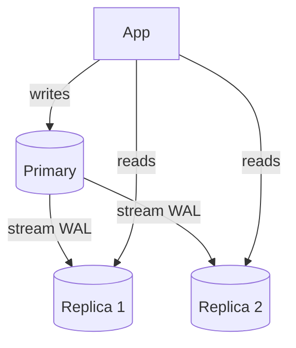

# Replication and Read Replicas

> Prerequisites: [database-internals-for-system-design](./database-internals-for-system-design.md)
> Related: [consistency-models](./consistency-models.md) · [partitioning-and-sharding](./partitioning-and-sharding.md) · [00-foundations/architecture-fundamentals](../00-foundations/architecture-fundamentals.md)

Replication is the Stage-4 move for read-heavy systems and the first database scaling step after vertical scaling. The must-know consequence is **replication lag** and the read-your-write problem it causes.

---

## A. Problem and motivation

A single primary database becomes the read bottleneck for a read-heavy system (DMS is 20:1). You can't scale reads by adding app servers (they all hit the one DB). The fix: **read replicas** — copies of the DB that serve reads, offloading the primary, which handles writes. But replicas lag behind the primary, creating stale reads and the "I just wrote it but can't see it" problem.

---

## B. How replication works

The primary ships its [WAL](./database-internals-for-system-design.md) (change log) to replicas, which replay it to stay in sync.

**Synchronous vs asynchronous replication:**
- **Asynchronous (default):** primary commits and acks the client *before* replicas confirm. Fast writes, but replicas lag; a primary crash can lose the last un-replicated writes (data loss window). 
- **Synchronous:** primary waits for replica(s) to confirm before acking. No lag / no loss to that replica, but slower writes and the primary stalls if the replica is slow/down.
- **Semi-sync / quorum:** wait for *some* replicas — a middle ground. See [quorum-reads-and-writes](../06-distributed-systems/quorum-reads-and-writes.md).

Most systems use async replication for performance and accept bounded lag.

---

## C. Replication lag and read-your-write

With async replication, a replica is milliseconds-to-seconds behind. If a user writes to the primary then immediately reads from a lagging replica, they don't see their own write — a confusing bug ("I uploaded a document but it's not there").

**Fixes for read-your-write:**
- **Read from primary for recent writes:** after a user writes, route *their* reads to the primary for a short window.
- **Sticky/session consistency:** track the write position (LSN) and read from a replica only once it's caught up past that position.
- **Read from primary for critical paths** (e.g., immediately after upload), replicas for everything else.

**Interview-ready:** "I'd serve most reads from replicas, but route a user's reads to the primary briefly after they write, to guarantee read-your-write without giving up the replica offload."

---

## D. Topologies and failover

- **Single-primary (leader-follower):** one writable primary, N read replicas. Simplest; writes don't scale (still one primary). Default.
- **Multi-primary (multi-leader):** multiple writable nodes — write scaling + geo, but **write conflicts** need resolution (last-write-wins, CRDTs, app logic). Complex; used in multi-region. See [multi-region-architecture](../06-distributed-systems/multi-region-architecture.md).
- **Failover:** if the primary dies, promote a replica. Must handle: how far behind was it (data loss = replication lag at crash), split-brain (two primaries), and client reconnection. See [redundancy-and-failover](../07-reliability-and-resilience/redundancy-and-failover.md) and [leader-election-and-split-brain](../06-distributed-systems/leader-election-and-split-brain.md).

---

## E. Example — DMS

Stage 4: add 2 read replicas. The document *list* and *search-metadata* reads (the bulk of 20:1 traffic) go to replicas; writes and the just-uploaded document's read go to the primary. This offloads ~95% of read load from the primary. Replication lag is typically sub-second; acceptable for lists but not for "did my upload succeed?" — so that specific read hits the primary. If the primary fails, a replica is promoted; any writes not yet replicated at crash time are the data-loss window (bounded by lag), which is why files (durability-critical) are in object storage, not dependent on this.

---

## F. Trade-offs

| Approach | Advantages | Disadvantages | Best use | Warning signs |
|---|---|---|---|---|
| Async replication | Fast writes, read scaling | Lag → stale reads; data-loss window on crash | Read-heavy, lag-tolerant reads | Reading your own writes from a replica |
| Sync replication | No lag/loss to that replica | Slower writes; primary stalls if replica down | Strict no-loss needs | Latency-sensitive writes |
| Single-primary | Simple, no write conflicts | Writes don't scale | Most systems | Write throughput ceiling reached |
| Multi-primary | Write scaling + geo | Conflict resolution complexity | Multi-region active-active | Underestimating conflict handling |

---

## G. Failure scenarios

1. **Read-your-write violation.** Trigger: read from lagging replica right after a write. Users: "my change vanished." Detect: reports after writes; monitor replica lag. Fix: route recent-write reads to primary / track LSN. 
2. **Replica falls far behind.** Trigger: write spike or slow replica; lag grows to minutes. Users: very stale reads. Detect: replication-lag metric alarm. Mitigate: throttle writes, add replica capacity, temporarily read from primary. Prevent: monitor and alarm on lag.
3. **Failover data loss / split-brain.** Trigger: primary crashes with un-replicated writes; or network partition promotes a second primary. Effect: lost writes / conflicting writes. Mitigate: sync/semi-sync for critical data; fencing + consensus for promotion. See [leader-election-and-split-brain](../06-distributed-systems/leader-election-and-split-brain.md).

---

## H. Scaling implications

Read replicas scale **reads** (and add some availability) but **not writes** — all writes still funnel to one primary. When the single-primary **write** throughput or dataset size becomes the ceiling, replicas can't help; you must **shard** (partition writes across primaries) — the harder Stage-6 step. So the scaling order for a read-heavy relational system is: vertical → read replicas (+cache) → sharding. Replicas also don't reduce *write* contention on hot rows. Know exactly what replicas do and don't solve.

---

## I. Interview preparation

**Basic**
- Q: What do read replicas solve? → *A: Read scaling (and some availability) by offloading reads from the primary; writes still go to the primary only.*

**Intermediate**
- Q: What's replication lag and what does it cause? → *A: The delay before a write appears on a replica (async). It causes stale reads and read-your-write violations.*
- Q: How do you guarantee read-your-write with replicas? → *A: Route a user's reads to the primary briefly after they write, or track the write LSN and only read from a caught-up replica.*

**SDE-2 / scenario**
- Q: "Users say their uploaded document disappears, then reappears." → *A: Classic replica lag — the post-upload read hit a lagging replica. I'd route reads immediately after a write to the primary (or until the replica catches up to the write's LSN).*
- Q: "Reads are offloaded to replicas but writes are still the bottleneck. Now what?" → *A: Replicas don't scale writes. If the single primary's write throughput/dataset is the ceiling, I'd shard to partition writes across primaries, accepting cross-shard query complexity.*

**Common wrong answers:** "add replicas" to a write-bound problem; ignoring lag/read-your-write; assuming async replication never loses data on failover.

---

## J. Hands-on exercise

A read-heavy service added 3 replicas; most reads are fine, but a "post comment then see it" flow intermittently fails. Diagnose the cause and give two fixes with their trade-offs. Then state what you'd do when writes themselves become the bottleneck.

---

## K. Revision summary

**Key takeaways**
- Replicas replay the primary's WAL; async (fast, lagging) vs sync (no lag/loss, slower).
- Replication lag → stale reads + read-your-write bugs; fix by reading recent writes from the primary / tracking LSN.
- Single-primary: replicas scale reads, not writes; failover has a data-loss window = lag.
- Scaling order (read-heavy relational): vertical → replicas (+cache) → sharding (for writes/size).

**Must explain without notes:** replication lag and read-your-write + its fix; what replicas do/don't scale.

**Rapid-fire**
1. Do replicas scale writes? → No, only reads.
2. Cause of "my write vanished then reappeared"? → Replica lag.
3. Read-your-write fix? → Read recent writes from primary / LSN tracking.
4. Async replication crash risk? → Data-loss window = un-replicated writes.
5. Next step when writes are the ceiling? → Shard.

**Next:** [partitioning-and-sharding](./partitioning-and-sharding.md)
