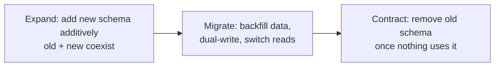

# Schema Migrations and Data Evolution

> Prerequisites: [transactions-and-isolation](./transactions-and-isolation.md), [replication-and-read-replicas](./replication-and-read-replicas.md)
> Related: [deployment-strategies](../09-observability-and-operations/deployment-strategies.md) · [relational-vs-nosql](./relational-vs-nosql.md)

Changing a schema on a running system with zero downtime is a real operational skill interviewers probe ("how would you add a NOT NULL column to a billion-row table without downtime?"). The key idea is **backward-compatible, multi-step migrations** coordinated with deploys.

---

## A. Problem and motivation

Schemas must evolve, but the database is live and the application is deployed in a rolling fashion (old and new code run simultaneously during a deploy). A naive migration — e.g., renaming a column, or adding a `NOT NULL` column with a table rewrite — locks the table or breaks the old code still running. The result is downtime or errors. Safe evolution means every change is backward-compatible and applied in careful steps.

---

## B. The core principle: expand → migrate → contract

Never make a breaking change in one step. Decompose it:

This guarantees that at every moment, both the currently-deployed code and the next version work against the schema.

---

## C. Example — renaming a column `name` → `title` (zero downtime)

A direct rename breaks old code mid-deploy. The safe sequence:

1. **Expand:** add new column `title` (nullable). Old code still uses `name`.
2. **Dual-write:** deploy code that writes **both** `name` and `title`. Reads still use `name`.
3. **Backfill:** batch-copy `name` → `title` for existing rows (in chunks to avoid locking/replication lag).
4. **Switch reads:** deploy code that reads `title`. Both columns still populated.
5. **Stop writing `name`:** deploy code that only uses `title`.
6. **Contract:** drop `name` once no code references it (and after a safety window).

Six steps, each backward-compatible, no downtime. The same expand/migrate/contract pattern handles splitting tables, changing types, and adding constraints.

---

## D. The dangerous operations and how to do them safely

| Operation | Naive danger | Safe approach |
|---|---|---|
| Add column | Adding `NOT NULL DEFAULT` can rewrite the whole table (lock) | Add nullable (or with a safe default per DB behavior), backfill in batches, then add the constraint |
| Add `NOT NULL` | Table rewrite / validation lock | Add column nullable → backfill → add a validated-not-valid constraint, then validate (depends on DB) |
| Add index | Index build locks writes | Build **concurrently** (e.g., `CREATE INDEX CONCURRENTLY`) — slower but non-blocking |
| Rename/drop column | Breaks old code mid-deploy | Expand/migrate/contract (above) |
| Change type | Rewrite + old code breaks | New column + dual-write + backfill + switch + drop |
| Big backfill | One huge `UPDATE` locks + lags replicas | Batch in small chunks with pauses; monitor replication lag |

**The replication-lag trap:** a giant `UPDATE`/backfill generates massive WAL, which replicas must replay — causing [replication lag](./replication-and-read-replicas.md) and stale reads. Always batch backfills.

---

## E. Coordinating with deploys

Migrations and code deploys are interleaved. The rule: **the schema change must be deployed before the code that depends on it, and must remain compatible with the code already running.** This is why expand comes first (additive, old code unaffected) and contract comes last (after all old code is gone). It pairs naturally with rolling/blue-green/canary deploys — see [deployment-strategies](../09-observability-and-operations/deployment-strategies.md). A failed deploy must be able to roll back *without* a schema that the old code can't handle — another reason changes are backward-compatible.

---

## F. NoSQL / schema-on-read evolution

Schemaless stores (document, KV) don't enforce a schema, so you can add fields freely — but you've just moved the problem to **read time**: old documents lack the new field, so code must handle both shapes (default/migrate-on-read) or run a backfill. "No migrations" is a myth; you still version document shapes and handle old versions in code or via lazy migration on access.

---

## G. Failure scenarios

1. **Table-rewrite lock on a huge table.** Trigger: `ADD COLUMN ... NOT NULL DEFAULT` or `ALTER TYPE` on a billion rows. Users: table locked, requests time out. Fix: additive add → batched backfill → constraint. Prevent: know which DDL rewrites/locks.
2. **Rename breaks mid-deploy.** Trigger: renaming a column in one step during a rolling deploy. Users: errors from old pods. Fix: expand/migrate/contract. 
3. **Backfill causes replication lag.** Trigger: one giant UPDATE. Users: stale replica reads during the backfill. Fix: batch with pauses; watch lag.
4. **Can't roll back.** Trigger: contract (dropped old column) too early; a bad deploy can't be reverted. Fix: keep the old schema until the new code is proven; delay contract.

---

## H. Scaling implications

The bigger the table and the higher the write rate, the more these precautions matter — a migration that's instant on 10K rows locks for minutes on 1B rows. At scale, backfills must be chunked and lag-aware, indexes built concurrently, and the expand/contract windows planned around deploy cycles. Online schema-change tools (e.g., gh-ost, pt-online-schema-change style) exist precisely to do big table changes without locking by building a shadow table and swapping. The principle stays constant: never a breaking change in one step; always backward-compatible, incremental, reversible.

---

## I. Interview preparation

**Basic**
- Q: Why can't you just rename a column on a live system? → *A: During a rolling deploy, old code still references the old name; a one-step rename breaks it. Use expand/migrate/contract.*

**Intermediate**
- Q: How do you add a NOT NULL column to a huge table without downtime? → *A: Add it nullable, backfill in batches, then add the not-null constraint (validated separately where supported) — avoiding a full-table-rewrite lock.*
- Q: Why batch a backfill? → *A: A single huge UPDATE locks rows, bloats, and generates massive WAL that lags replicas; batching keeps the system responsive.*

**SDE-2 / scenario**
- Q: "Walk me through renaming `status` to `state` with zero downtime." → *A: Expand (add `state` nullable) → dual-write both → backfill in batches → switch reads to `state` → stop writing `status` → contract (drop `status`) after a safety window. Each step is backward-compatible with the code already running.*
- Q: "Does NoSQL avoid migrations?" → *A: No — it defers the problem to read time; old documents lack new fields, so code handles multiple shapes or you backfill. You still version shapes.*

**Common wrong answers:** one-step rename/type-change; `ADD COLUMN NOT NULL DEFAULT` on a huge table; one giant backfill; "NoSQL means no migrations."

---

## J. Hands-on exercise

You must split a `full_name` column into `first_name` + `last_name` on a 500M-row users table with zero downtime, during rolling deploys. Write the ordered expand/migrate/contract steps, note where you'd batch, and state how you'd keep rollback possible at each step.

---

## K. Revision summary

**Key takeaways**
- Never make a breaking schema change in one step; use expand → migrate → contract, each backward-compatible.
- Dangerous ops (NOT NULL add, type change, rename, big backfill, index build) have safe multi-step equivalents; build indexes concurrently; batch backfills (watch replication lag).
- Coordinate with rolling deploys: schema before dependent code; keep old schema until new code is proven (rollback safety).
- NoSQL defers schema evolution to read time; it's not migration-free.

**Must explain without notes:** expand/migrate/contract; the zero-downtime column rename; why you batch backfills.

**Rapid-fire**
1. Zero-downtime change pattern? → Expand → migrate → contract.
2. Add an index without blocking writes? → Build it concurrently.
3. Why batch a backfill? → Avoid locks + replication lag from huge WAL.
4. When do you drop the old column? → Last (contract), after new code is proven.
5. Does NoSQL avoid migrations? → No, it defers them to read time.

**Section complete.** Next section: [04-caching](../04-caching/caching-fundamentals.md)
