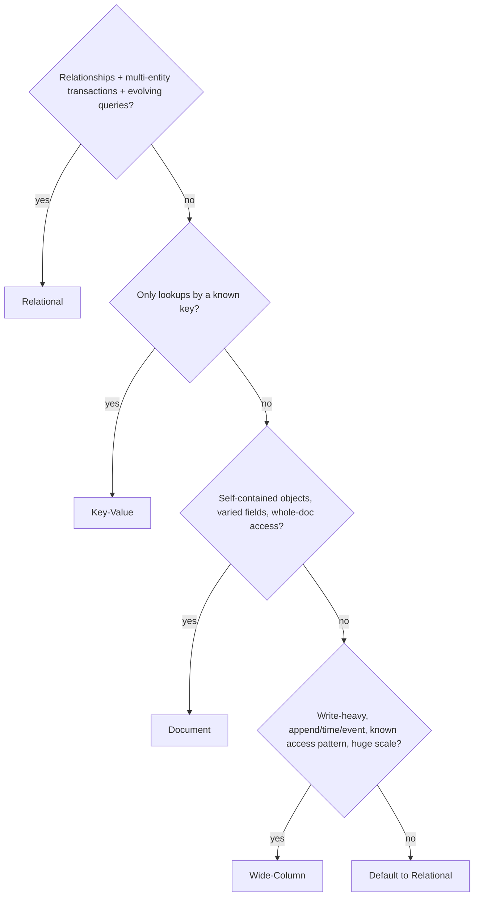

# SQL vs Document vs Key-Value vs Wide-Column

> Prerequisites: [relational-vs-nosql](./relational-vs-nosql.md), [database-internals-for-system-design](./database-internals-for-system-design.md)
> Related: [time-series-and-search-databases](./time-series-and-search-databases.md) · [partitioning-and-sharding](./partitioning-and-sharding.md)

This chapter is the practical "pick a data model" reference. It expands [relational-vs-nosql](./relational-vs-nosql.md) into a concrete selection matrix you can apply in any design.

---

## A. Problem and motivation

"NoSQL" lumps together very different stores. Saying "I'll use NoSQL" is meaningless; saying "I'll use a wide-column store partitioned by conversation_id because writes are append-heavy and I query recent messages per conversation" is a strong answer. This chapter gives you the model-by-model reasoning to make the specific choice.

---

## B. The four models side by side

| | SQL / Relational | Key-Value | Document | Wide-Column |
|---|---|---|---|---|
| Data shape | Tables + relations | key → opaque value | JSON-like docs | Rows with dynamic columns, partitioned |
| Query | Rich SQL, joins, ad-hoc | Get/put by key only | Query within doc fields | By partition key + clustering, no joins |
| Transactions | Strong multi-row ACID | Single-key | Single-doc (often) | Single-partition (tunable) |
| Scale model | Vertical → replicas → manual sharding | Horizontal (partitioned) | Horizontal (partitioned) | Horizontal (partitioned by design) |
| Engine (typical) | B-tree | Varies (often in-memory/LSM) | B-tree/LSM | LSM (write-optimized) |
| Examples | PostgreSQL, MySQL, Oracle | Redis, DynamoDB(KV), Memcached | MongoDB | Cassandra, HBase, DynamoDB |
| Sweet spot | Relationships, transactions, evolving queries | Lookups, caching, sessions | Self-contained varied objects | Write-heavy, time/event, known patterns, huge scale |

---

## C. Model-by-model reasoning

**SQL / Relational.** Choose when data has relationships, you need multi-entity transactions, and queries evolve. Downsides at scale: joins get costly, writes are single-primary until you shard. Default for most business systems. (DMS metadata, payments, orders.)

**Key-Value.** Choose for pure lookups by a known key at high speed/scale: sessions, rate-limit counters, caches, feature flags, user-preference blobs. No querying beyond the key — if you need "find all X where Y," KV is wrong. Often in-memory (Redis) for speed. See [caching](../04-caching/caching-fundamentals.md).

**Document.** Choose when entities are self-contained objects whose fields vary (product catalogs with per-category attributes, content with flexible structure) and you mostly read/write whole documents. You can query within a document, but cross-document joins/transactions are weak — model data to live in one document. Risk: people pick it for "flexibility" then need relational features.

**Wide-Column.** Choose for massive write throughput with known query patterns, especially time/event/append data: chat messages, activity logs, IoT, metrics. You design the table around the query (partition key + clustering columns define what's efficient); no ad-hoc queries or joins. LSM engine gives the write scale. Modeling is query-first and rigid — changing access patterns means redesigning tables.

---

## D. The selection matrix (apply in interviews)

Many systems use several: SQL for core entities, KV (Redis) for caching/sessions, wide-column for high-volume event data, search engine for text. That's **polyglot persistence** and it's normal.

---

## E. Example — a chat product's stores

- **Users, contacts, settings:** relational (relationships, transactions).
- **Messages:** wide-column (Cassandra), partition by `conversation_id`, clustered by time → append-heavy writes scale, recent-messages-per-conversation reads are single-partition.
- **Presence / typing / online status:** key-value in-memory (Redis), ephemeral.
- **Message search:** search engine (Elasticsearch), fed asynchronously.
Four stores, each matched to an access pattern. See [chat-messaging-system](../12-system-design-problems/chat-messaging-system.md).

---

## F. Trade-offs / failure scenarios

1. **Document store for relational data.** Trigger: picking Mongo for "flexibility," then needing joins/transactions. Fix: relational, or redesign to single-document aggregates. 
2. **Wide-column with ad-hoc query needs.** Trigger: needing a query the partition/clustering keys don't support. Effect: full scan / impossible. Fix: model a new table for that query (duplicate data) or add a search index.
3. **KV when you need to query by value.** Trigger: "find all sessions for user X" with a KV keyed by session id. Fix: add a secondary index store or restructure keys.

---

## G. Scaling implications

KV, document, and wide-column stores are partitioned by design, so they scale writes horizontally — but *only* for access patterns aligned to the partition key (off-pattern = scatter-gather or impossible). Relational scales reads via replicas and requires manual sharding for writes. The scaling behavior you get is a direct consequence of the model + engine ([internals](./database-internals-for-system-design.md)): LSM-backed wide-column for write scale, B-tree relational for query flexibility. Match the model to the dominant access pattern and expected scale.

---

## H. Interview preparation

**Basic**
- Q: When key-value? → *A: Pure lookups by a known key at high speed/scale (sessions, caches, counters); no querying beyond the key.*

**Intermediate**
- Q: Document vs wide-column? → *A: Document for self-contained varied objects accessed whole, with within-doc queries; wide-column for write-heavy append/time/event data with known partition-key access patterns at huge scale and no joins.*
- Q: What's polyglot persistence? → *A: Using multiple stores, each matched to an access pattern (SQL core + Redis cache + wide-column events + search index).*

**SDE-2 / scenario**
- Q: "Design the stores for a chat app." → *A: Relational for users/settings, wide-column (partition by conversation) for messages, Redis for presence, search engine for message search — each by access pattern.*
- Q: "Why not one store for everything?" → *A: No single model serves relationships + high-volume appends + ephemeral lookups + text search well; forcing one creates scatter-gather, weak transactions, or scaling walls.*

**Common wrong answers:** "use NoSQL" unspecified; document store for relational data; wide-column with ad-hoc query expectations.

---

## I. Hands-on exercise

For an e-commerce platform, assign a store to each: product catalog (varied attributes), order records (transactional), shopping-cart sessions, order-event/audit stream (high write), and product text search. Justify each from the selection matrix and note which access pattern drives it.

---

## J. Revision summary

**Key takeaways**
- SQL: relationships/transactions/evolving queries. KV: key lookups/caching. Document: self-contained varied objects. Wide-column: write-heavy append/time/event with known access patterns at huge scale.
- Choose from the access pattern + scale + transaction needs via the selection matrix.
- Polyglot persistence (multiple stores) is normal; each store is matched to one pattern.
- Horizontal scale holds only for partition-key-aligned access patterns.

**Rapid-fire**
1. Store for sessions? → Key-value.
2. Store for chat messages at scale? → Wide-column (partition by conversation).
3. Store for a product catalog with varied fields? → Document (or SQL+JSONB).
4. Store for money/orders? → Relational.
5. Using several stores by access pattern is called? → Polyglot persistence.

**Next:** [time-series-and-search-databases](./time-series-and-search-databases.md)
