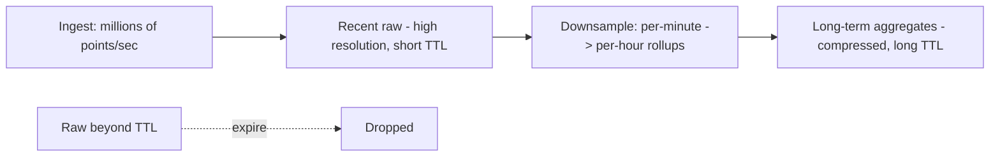
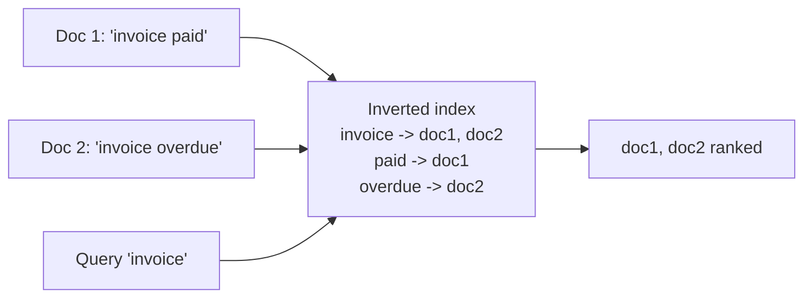

# Time-Series and Search Databases

> Prerequisites: [sql-vs-document-vs-key-value-vs-wide-column](./sql-vs-document-vs-key-value-vs-wide-column.md)
> Related: [10-storage-and-content-delivery/full-text-search-vs-database-search](../10-storage-and-content-delivery/full-text-search-vs-database-search.md) · [12-system-design-problems/metrics-monitoring-platform](../12-system-design-problems/metrics-monitoring-platform.md)

Two specialized stores that come up in specific designs (monitoring, logging, search features). Know what problem each solves and why a general-purpose DB struggles with it. (Track B depth.)

---

## A. Problem and motivation

Some workloads defeat general-purpose databases:
- **Time-series** (metrics, IoT, events): enormous append rate, queried by time range + aggregation, old data compressed/dropped. A relational DB chokes on the write volume and stores it inefficiently.
- **Full-text search** (search box, log search): "find documents containing these words, ranked by relevance." SQL `LIKE '%term%'` can't use an index and scans everything; it has no relevance ranking, stemming, or fuzzy matching.

Specialized stores exist because these access patterns need purpose-built data structures.

---

## B. Time-series databases (TSDB)

Examples: Prometheus, InfluxDB, TimescaleDB (Postgres extension), or wide-column stores adapted for it.

**What makes them special:**
- **Write-optimized** for high-rate appends (LSM-style), partitioned/bucketed by time.
- **Time-based retention & downsampling:** keep raw data for days, rolled-up aggregates (per-minute → per-hour) for longer, drop the rest. Old data auto-expires.
- **Compression:** time-series data (slowly changing numbers + timestamps) compresses extremely well with specialized encodings.
- **Query model:** range + aggregation over time (avg CPU over last hour), not arbitrary joins.

**Why not a relational DB:** the write rate and storage cost would overwhelm it, and it has no built-in downsampling/retention/compression for this shape. (You *can* use TimescaleDB to get TSDB behavior on Postgres.)

---

## C. Search engines (inverted index)

Examples: Elasticsearch, OpenSearch, Solr (all Lucene-based).

**The core data structure — the inverted index:** instead of mapping document → words, it maps **word → list of documents** containing it. So "find docs with 'invoice'" is a direct lookup of the posting list, not a scan. Plus:
- **Analysis:** tokenization, stemming ("running"→"run"), stop-word removal, lowercasing.
- **Relevance ranking** (e.g., TF-IDF/BM25): results ordered by how well they match.
- **Fuzzy/typo tolerance, phrase, faceted search, autocomplete.**

**Why not SQL `LIKE`:** `LIKE '%term%'` can't use a B-tree index (leading wildcard), scans every row, and offers no ranking/stemming/fuzzy matching. Relational full-text extensions exist and are fine at small scale; a search engine wins at large scale and rich relevance needs. See [full-text-search-vs-database-search](../10-storage-and-content-delivery/full-text-search-vs-database-search.md).

**The consistency catch:** the search index is a *secondary* copy of your source-of-truth data, updated asynchronously → it lags and can drift. You keep it in sync via the [transactional outbox / CDC](../05-messaging-and-event-driven-systems/transactional-outbox-and-cdc.md), accept eventual consistency on search results, and reconcile/reindex periodically.

---

## D. Example — DMS

- **Document search** (by name, content, tags): an Elasticsearch index fed asynchronously from the metadata DB via CDC/outbox. Users search with relevance ranking and typo tolerance; results lag the DB by seconds (acceptable). The DB remains the source of truth; the index is rebuildable.
- **Operational metrics** (upload rate, OCR latency, queue depth): a TSDB (Prometheus-style) with per-minute raw retained for days and hourly rollups for months, powering dashboards and alerts. See [metrics-monitoring-platform](../12-system-design-problems/metrics-monitoring-platform.md).

---

## E. Trade-offs

| Store | Advantages | Disadvantages | Best use | Warning signs |
|---|---|---|---|---|
| TSDB | Massive append scale, retention/downsampling, compression | Narrow query model (time + aggregates) | Metrics, IoT, events | Needing relational queries on it |
| Search engine | Fast relevance/full-text/fuzzy at scale | Secondary store (sync + consistency), ops cost, not source of truth | Search features, log search | Treating it as primary DB; expecting strong consistency |

---

## F. Failure scenarios

1. **Search index drift / out of sync.** Trigger: async updates fail silently; index diverges from DB. Users: search misses or shows deleted docs. Detect: periodic DB↔index reconciliation counts. Mitigate: reliable CDC/outbox, retries, periodic full reindex. Prevent: never treat the index as source of truth.
2. **TSDB cardinality explosion.** Trigger: too many label/tag combinations (high-cardinality dimensions) create millions of series. Effect: memory/storage blowup, slow queries. Fix: limit label cardinality; aggregate. (A classic Prometheus pitfall.)
3. **SQL LIKE search at scale.** Trigger: `LIKE '%term%'` on millions of rows. Users: slow/timeout search. Fix: move to a search engine with an inverted index.

---

## G. Scaling implications

Both are purpose-built to scale their specific pattern: TSDBs ingest millions of points/sec and manage storage via retention/downsampling; search engines serve high query volume via the inverted index and shard the index across nodes. Both are typically **secondary** stores fed from a primary — so they add a sync pipeline and eventual consistency, and must be rebuildable (reindex) because they're not the source of truth. At scale you shard the index/series and manage retention aggressively to control cost.

---

## H. Interview preparation

**Basic**
- Q: Why not use SQL `LIKE` for search? → *A: Leading-wildcard LIKE can't use an index (full scan) and has no relevance ranking/stemming/fuzzy matching; a search engine uses an inverted index for all of that.*

**Intermediate**
- Q: What's an inverted index? → *A: A map from word → documents containing it, so a term query is a direct posting-list lookup rather than a scan; plus analysis and relevance ranking.*
- Q: How do you keep a search index in sync? → *A: Feed it asynchronously via CDC/transactional outbox from the source-of-truth DB; accept eventual consistency and reconcile/reindex periodically.*

**SDE-2 / scenario**
- Q: "Document search is slow with LIKE. Fix it." → *A: Introduce a search engine (Elasticsearch) with an inverted index, fed via CDC from the metadata DB; the DB stays source of truth, search results lag by seconds (acceptable), and I reconcile/reindex to prevent drift.*
- Q: "Why a TSDB for metrics instead of Postgres?" → *A: Metrics are append-heavy at millions/sec, queried by time range + aggregation, with retention/downsampling and heavy compression — a TSDB is built for exactly that, where a relational DB would be overwhelmed and inefficient.*

**Common wrong answers:** search engine as primary store; expecting strong consistency from the index; SQL LIKE at scale; ignoring TSDB cardinality.

---

## I. Hands-on exercise

Design the search subsystem for the DMS: source of truth, how the index is kept in sync, the consistency users experience, and how you'd recover if the index was corrupted. Then size a TSDB for 100K metrics series at 1 point/10s with 7-day raw + 1-year hourly retention (order of magnitude).

---

## J. Revision summary

**Key takeaways**
- TSDB: write-optimized, time-partitioned, retention/downsampling/compression; for metrics/IoT/events; narrow time+aggregate query model.
- Search engine: inverted index + analysis + relevance ranking; for full-text/fuzzy search at scale; SQL LIKE can't compete at scale.
- Both are usually **secondary** stores fed async from a primary → eventual consistency + a sync pipeline + rebuildable.
- Watch TSDB cardinality and search-index drift.

**Rapid-fire**
1. Core search data structure? → Inverted index.
2. Why not SQL LIKE at scale? → Full scan, no ranking/stemming/fuzzy.
3. Is a search engine the source of truth? → No (secondary, rebuildable).
4. How is a search index kept current? → Async CDC/outbox, eventual consistency.
5. TSDB storage-control techniques? → Retention, downsampling, compression.

**Next:** [data-archival-and-retention](./data-archival-and-retention.md)
