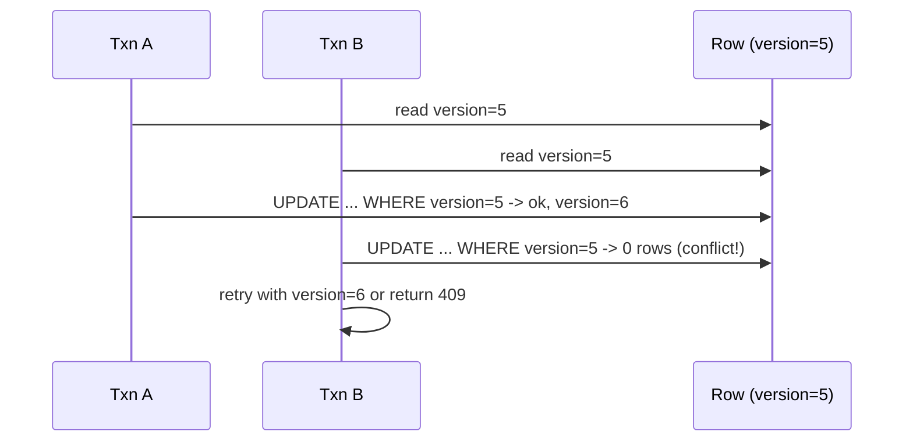

# Transactions and Isolation Levels

> Prerequisites: [relational-vs-nosql](./relational-vs-nosql.md)
> Related: [consistency-models](./consistency-models.md) · [distributed-transactions](./distributed-transactions.md) · [06-distributed-systems/retries-and-duplicate-execution](../06-distributed-systems/retries-and-duplicate-execution.md)

Isolation levels are a reliable SDE-2 discriminator. Many candidates can say "ACID" but can't explain what Read Committed vs Serializable actually prevent, or how optimistic locking stops lost updates. This chapter makes those concrete with the anomalies they prevent.

---

## A. Problem and motivation

Concurrent transactions can corrupt each other's data: two users editing the same document, two orders buying the last item. Without isolation you get lost updates, dirty reads, and inconsistent totals. Isolation levels define *how much* concurrent transactions can interfere — trading correctness for concurrency/performance. Picking the wrong level causes subtle, hard-to-reproduce data bugs (e.g., overselling inventory).

---

## B. ACID (precisely)

- **Atomicity:** all-or-nothing; a transaction fully commits or fully rolls back.
- **Consistency:** the transaction moves the DB from one valid state to another (constraints hold).
- **Isolation:** concurrent transactions don't improperly see each other's partial state.
- **Durability:** once committed, it survives crashes (via the [WAL](./database-internals-for-system-design.md)).

Isolation is the subtle one, controlled by **isolation levels**.

---

## C. The anomalies and the levels that prevent them

| Anomaly | What it is |
|---|---|
| **Dirty read** | Reading another transaction's *uncommitted* changes |
| **Non-repeatable read** | Re-reading a row gives a different value (another txn committed an update in between) |
| **Phantom read** | Re-running a range query returns new rows (another txn inserted matching rows) |
| **Lost update** | Two txns read-modify-write the same row; one overwrites the other |

| Isolation level | Prevents dirty read | Prevents non-repeatable read | Prevents phantom | Notes |
|---|---|---|---|---|
| Read Uncommitted | ❌ | ❌ | ❌ | Rarely used |
| **Read Committed** | ✅ | ❌ | ❌ | Common default (Postgres default) |
| **Repeatable Read** | ✅ | ✅ | ❌ (SQL std) / mostly ✅ in some engines | |
| **Serializable** | ✅ | ✅ | ✅ | As if transactions ran one at a time |

Higher isolation = fewer anomalies but more locking/aborts and lower concurrency. **Read Committed** is the pragmatic default; escalate to **Serializable** only for the specific transactions that need it (e.g., financial invariants).

---

## D. Preventing lost updates: pessimistic vs optimistic locking

The "last item in stock" / "concurrent document edit" problem is a **lost update**. Two safe strategies:

**Pessimistic locking** — lock the row while you work: `SELECT ... FOR UPDATE`. Other transactions wait. Safe but holds locks (contention, deadlock risk, lower throughput). Good when conflicts are frequent.

**Optimistic locking** — don't lock; detect conflict at write time via a **version column**:
```sql
UPDATE documents SET name = ?, version = version + 1
WHERE id = ? AND version = :expectedVersion;
-- if 0 rows updated, someone else changed it -> 409 Conflict, client retries
```
No locks held; cheap when conflicts are rare (the common case). On conflict, the app retries or returns `409`. This is the typical web-app choice.



---

## E. Example — DMS and inventory

- **DMS document edit:** optimistic locking with a `version` column; concurrent edits produce a `409 Conflict`, the client reloads and retries. Conflicts are rare (two people rarely edit the same doc simultaneously), so optimistic is ideal.
- **Inventory decrement (e-commerce):** `UPDATE inventory SET qty = qty - 1 WHERE sku = ? AND qty > 0` — an atomic conditional update that prevents overselling without reading-then-writing. Or `SELECT ... FOR UPDATE` under high contention. For reservations (ticket booking), stronger isolation or explicit locking plus a reservation record. See [ticket-booking-system](../12-system-design-problems/ticket-booking-system.md).

---

## F. Trade-offs

| Approach | Advantages | Disadvantages | Best use | Warning signs |
|---|---|---|---|---|
| Read Committed | High concurrency, default | Non-repeatable/phantom reads possible | Most workloads | Needing strict invariants |
| Serializable | Strongest correctness | Lower concurrency, more aborts/retries | Financial invariants | Using it everywhere by default |
| Optimistic lock | No held locks, scales when conflicts rare | Wasted work + retries when conflicts frequent | Web edits, rare conflicts | High-contention rows |
| Pessimistic lock | Safe under contention | Lock contention, deadlocks, lower throughput | Frequent conflicts | Long-held locks |

---

## G. Failure scenarios

1. **Lost update under read-modify-write.** Trigger: two concurrent edits read then write. Users: one edit silently lost. Detect: data mismatches, user complaints. Fix: optimistic (version column) or pessimistic locking, or an atomic conditional update.
2. **Oversold inventory.** Trigger: concurrent decrements with a check-then-write. Users: sold more than existed. Fix: atomic conditional update (`WHERE qty > 0`) or `SELECT ... FOR UPDATE`; stronger isolation for complex invariants.
3. **Deadlocks (pessimistic).** Trigger: two txns lock rows in opposite order. Effect: one is aborted. Fix: consistent lock ordering, short transactions, retry on deadlock. 
4. **Serializable abort storms.** Trigger: Serializable under high contention → many serialization failures. Fix: reduce the transactions needing it; retry with backoff; redesign hot rows.

---

## H. Scaling implications

Isolation and locking are *single-node* mechanisms — they don't extend across shards or services. Once data is sharded or an operation spans services, you lose cross-partition ACID and must use [distributed-transactions](./distributed-transactions.md) (2PC) or [sagas](../05-messaging-and-event-driven-systems/saga-pattern.md). This is a major reason to keep entities that must be transactionally consistent **on the same shard / in the same service**. High-contention hot rows (a popular counter, the last ticket) are a scaling bottleneck even on one node — mitigate with sharded counters, queuing writes, or reservation patterns.

---

## I. Interview preparation

**Basic**
- Q: What does ACID stand for and which letter is subtle? → *A: Atomicity, Consistency, Isolation, Durability; Isolation is the subtle one (controlled by isolation levels).*

**Intermediate**
- Q: Read Committed vs Serializable? → *A: Read Committed prevents dirty reads but allows non-repeatable/phantom reads; Serializable prevents all three, behaving as if transactions ran sequentially, at the cost of concurrency and more aborts.*
- Q: Optimistic vs pessimistic locking? → *A: Optimistic uses a version column to detect conflicts at write time (no locks, great when conflicts are rare); pessimistic locks the row up front (safe under frequent conflicts, but contention/deadlocks).*

**SDE-2 / scenario**
- Q: "How do you stop two users' edits from clobbering each other?" → *A: Optimistic locking: a version column; the update is conditional on the expected version; on mismatch return 409 and have the client reload+retry. Conflicts are rare so no locks are held.*
- Q: "How do you prevent overselling the last item?" → *A: An atomic conditional update `SET qty = qty-1 WHERE qty > 0` (or SELECT FOR UPDATE under contention); never read-check-then-write, which races.*
- Q: "What happens to transactions once you shard?" → *A: Single-node ACID no longer spans shards; I keep transactionally-coupled entities on the same shard, or use sagas with compensation for cross-shard/service operations.*

**Common wrong answers:** "ACID" with no isolation detail; read-check-then-write for inventory; Serializable everywhere; assuming transactions work across shards.

---

## J. Hands-on exercise

Design the concurrency control for: (a) editing a document's name, (b) decrementing ticket inventory for a popular event, (c) transferring money between two accounts. For each, choose optimistic/pessimistic/atomic-update and the isolation level, and name the anomaly you're preventing.

---

## K. Revision summary

**Key takeaways**
- ACID; isolation levels prevent dirty / non-repeatable / phantom reads at increasing cost.
- Read Committed = pragmatic default; Serializable for specific strict invariants only.
- Lost updates: optimistic locking (version column, 409 + retry) when conflicts rare; pessimistic (SELECT FOR UPDATE) when frequent; atomic conditional updates for counters/inventory.
- Isolation/locking are single-node; sharding/cross-service needs sagas/2PC; keep coupled entities together.

**Must explain without notes:** the four anomalies and which level prevents them; optimistic vs pessimistic locking; preventing oversell.

**Rapid-fire**
1. Default isolation level in Postgres? → Read Committed.
2. Level that prevents phantoms? → Serializable.
3. Lost-update fix with no locks? → Optimistic (version column).
4. Prevent oversell? → Atomic conditional update (`WHERE qty > 0`).
5. Do isolation levels work across shards? → No (need sagas/2PC).

**Next:** [normalization-and-denormalization](./normalization-and-denormalization.md)
