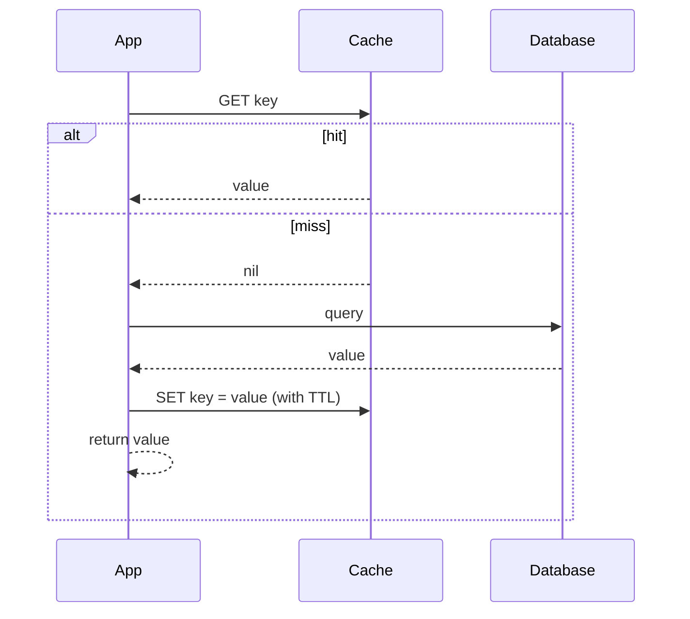
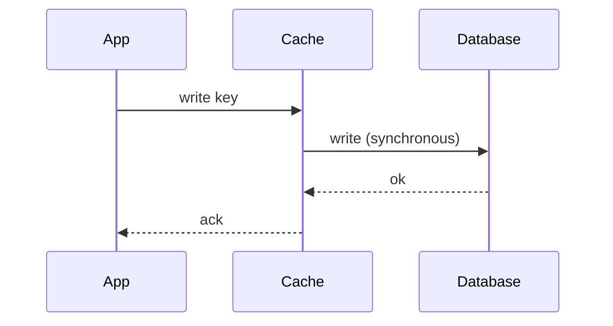

# Cache-Aside, Read-Through, Write-Through

> Prerequisites: [caching-fundamentals](./caching-fundamentals.md)
> Related: [write-behind-and-write-around](./write-behind-and-write-around.md) · [cache-invalidation-and-consistency](./cache-invalidation-and-consistency.md)

The caching *patterns* define who reads/writes the cache and when. Cache-aside is the one you'll use and must be able to draw. Read-through and write-through are variations. Know the data flow and failure behavior of each.

---

## A. Problem and motivation

A cache sits between the app and the DB. The pattern you pick decides: who populates the cache (app or cache library), when writes update the cache, and what happens on a miss or a cache failure. Picking the wrong pattern causes stale data, lost writes, or a cache that collapses the system when it fails.

---

## B. Cache-aside (lazy loading) — the default

The application manages the cache explicitly.

**Read:**


**Write:** update the DB, then **invalidate** (delete) the cache key. The next read repopulates it (lazy).

```
write(x): DB.update(x); cache.delete(key)
```

**Why delete, not update, the cache on write?** Deleting is simpler and avoids a race: if two writers both *update* the cache, they can interleave and leave a wrong value; deleting means the next read reloads the authoritative DB value. (A subtle race still exists — covered in [cache-invalidation-and-consistency](./cache-invalidation-and-consistency.md).)

**Properties:** only requested data is cached (lazy, memory-efficient); the app controls everything; on a cache miss or cache-down, the app falls back to the DB naturally (resilient). This resilience is why cache-aside is the common default.

---

## C. Read-through

The cache library (not the app) loads from the DB on a miss. The app only talks to the cache; the cache fetches from the DB behind the scenes on a miss and returns it.

- **Pro:** app code is simpler (no explicit miss handling); loading logic centralized.
- **Con:** needs a cache that supports it (loader configured); first request for a key still pays the miss latency; if the cache is down, the app can't trivially fall back to the DB (it only knows the cache). Tighter coupling to the cache.

Functionally similar to cache-aside on reads, but the *cache* owns the DB-load, not the app.

---

## D. Write-through

On a write, the app writes to the cache **and** the cache synchronously writes to the DB (or the app writes both) before acking.



- **Pro:** cache and DB stay consistent on write (no stale cache after a write); reads after writes hit a warm cache.
- **Con:** every write pays cache + DB latency; you cache data that may never be read (wasteful); the DB is still the write bottleneck.

Often paired with read-through. Good when you read what you just wrote and want it warm.

---

## E. Comparison

| Pattern | Who loads on miss | Write path | Cache-down resilience | Best use |
|---|---|---|---|---|
| **Cache-aside** | App | DB write + cache delete | Good (app falls back to DB) | **Default**, read-heavy |
| Read-through | Cache | (usually paired w/ write-through) | Weaker (app only knows cache) | Simpler app code, centralized load |
| Write-through | — | Cache + DB sync on write | — | Read-after-write warmth, consistency on write |
| Write-around | App | DB write only (skip cache) | Good | Write-heavy, rarely-read-after-write (see next doc) |
| Write-behind | — | Cache now, DB async later | Risky (ack before durable) | Very write-heavy, loss-tolerant (see next doc) |

---

## F. Example — DMS

Document metadata uses **cache-aside**: reads check Redis, miss → load from Postgres → populate with a TTL; writes update Postgres then delete the Redis key. This gives a high hit ratio on the hot set, memory efficiency (only accessed docs cached), and clean fallback if Redis is down (reads just go to Postgres). Permission data: cache-aside with short TTL + explicit delete on permission change. The DMS does *not* use write-through for metadata (writes are relatively rare; no need to pay cache+DB on every write and cache data that may not be re-read soon).

---

## G. Failure scenarios

1. **Cache-down with read-through.** Trigger: cache outage. App: can only talk to the cache → errors. Fix: prefer cache-aside (natural DB fallback) or add explicit fallback logic. See [redis-design-and-failure-modes](./redis-design-and-failure-modes.md).
2. **Stale cache after write (update-on-write race).** Trigger: concurrent writers update the cache. Fix: delete-on-write (cache-aside) instead of update-on-write; even then a subtle race remains (next doc).
3. **Write-through latency hit.** Trigger: every write pays cache+DB sync. Users: slower writes. Fix: use cache-aside/write-around if read-after-write warmth isn't needed.

---

## H. Scaling implications

Cache-aside scales reads with excellent resilience (DB fallback) and memory efficiency, which is why it's the default distributed-cache pattern. Write-through keeps the cache consistent on writes but doesn't relieve the DB write bottleneck and wastes memory on unread data. The pattern choice follows the read/write profile: read-heavy → cache-aside; read-after-write-heavy → read-through + write-through; write-heavy → write-around/write-behind (next doc). None of these scale *writes* — for that you need DB-level work (sharding) or write-behind's risky async batching.

---

## I. Interview preparation

**Basic**
- Q: Draw cache-aside read. → *A: Check cache; hit → return; miss → query DB, populate cache with TTL, return.*
- Q: On a write in cache-aside, update or delete the cache? → *A: Delete (invalidate); next read reloads from DB — simpler and avoids update races.*

**Intermediate**
- Q: Cache-aside vs read-through? → *A: In cache-aside the app loads the DB on a miss (natural DB fallback if cache is down); in read-through the cache loads it (simpler app, but weaker cache-down resilience).*
- Q: When write-through? → *A: When you read what you just wrote and want the cache warm/consistent on write — at the cost of per-write cache+DB latency and caching possibly-unread data.*

**SDE-2 / scenario**
- Q: "Why delete rather than update the cache on write?" → *A: Deleting avoids concurrent-writer races that could leave a wrong value, and lets the next read pull the authoritative DB value. Updating the cache invites stale/incorrect values under concurrency.*
- Q: "Cache is down — which pattern degrades best?" → *A: Cache-aside, because the app already talks to the DB on misses, so a cache outage just means every read falls back to the DB (slower, add a concurrency cap to avoid stampeding it).*

**Common wrong answers:** update-on-write causing races; read-through without a cache-down fallback; write-through for write-heavy, rarely-read data.

---

## J. Hands-on exercise

Write pseudocode for cache-aside read and write for DMS document metadata, including TTL and the Redis-down fallback. Then explain in two sentences why you chose delete-on-write and what race still remains (previewing the invalidation chapter).

---

## K. Revision summary

**Key takeaways**
- Cache-aside (lazy): app checks cache, loads DB on miss + populates; writes = DB update + cache **delete**. Default; memory-efficient; resilient (DB fallback).
- Read-through: cache loads on miss (simpler app, weaker cache-down resilience).
- Write-through: cache+DB written synchronously (consistent on write, per-write latency, wastes memory).
- Delete (don't update) the cache on write to avoid races.

**Must explain without notes:** cache-aside read + write flow; delete-vs-update rationale; cache-down resilience of cache-aside.

**Rapid-fire**
1. Default caching pattern? → Cache-aside.
2. Cache-aside write = ? → DB update + cache delete.
3. Who loads on a miss in read-through? → The cache.
4. Which pattern degrades best when the cache is down? → Cache-aside.
5. Why delete not update the cache? → Avoids concurrent-writer races; next read reloads authoritative value.

**Next:** [write-behind-and-write-around](./write-behind-and-write-around.md)
