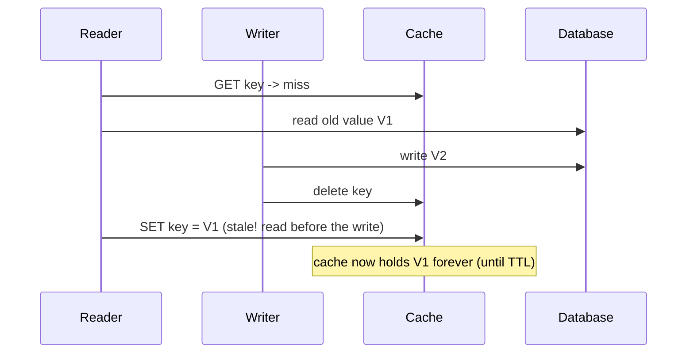

# Cache Invalidation and Consistency

> Prerequisites: [cache-aside-read-through-write-through](./cache-aside-read-through-write-through.md)
> Related: [consistency-models](../03-databases-and-data-modeling/consistency-models.md) · [ttl-eviction-and-memory-management](./ttl-eviction-and-memory-management.md)

"There are only two hard things in computer science: cache invalidation and naming things." Invalidation is where caching bugs live. The SDE-2 skill is knowing the strategies, the race that persists even with delete-on-write, and how to bound staleness per data type.

---

## A. Problem and motivation

A cache holds a copy of the source data. When the source changes, the copy is stale. Invalidation keeps the cache from serving outdated data. Done wrong, users see stale balances, revoked users keep access, or deleted documents still appear. The difficulty: writes and reads happen concurrently across many instances, so "just delete the key on write" has subtle races.

---

## B. The three invalidation strategies

| Strategy | How | Pros | Cons |
|---|---|---|---|
| **TTL (expiry)** | Entry auto-expires after N seconds | Simple, self-healing, bounds staleness | Stale for up to the TTL; thundering herd on expiry |
| **Explicit (write-triggered)** | Delete/update the key on every write to the source | Fresh quickly | Must find all affected keys; races; easy to miss a write path |
| **Event-driven (CDC)** | A change stream (DB WAL/CDC) invalidates keys | Reliable, decoupled, catches all writes | Infra (CDC pipeline); small propagation lag |

Most systems combine **TTL (as a safety net) + explicit delete on known writes**. TTL ensures that even if an explicit invalidation is missed, the entry self-corrects within the TTL. Event-driven (CDC) is the most robust for catching every write, used when correctness matters and writes come from many paths. See [transactional-outbox-and-cdc](../05-messaging-and-event-driven-systems/transactional-outbox-and-cdc.md).

---

## C. The race that persists even with delete-on-write

Cache-aside with delete-on-write still has a classic race:

A reader loads V1 (old), then a writer commits V2 and deletes the key, then the slow reader populates the cache with the stale V1. The cache is now wrong until TTL. **Mitigations:** short TTL (bounds the damage), delete-after-write with a short delay (double-delete), versioned keys, or read-through with proper locking. The honest interview answer: "delete-on-write reduces but doesn't fully eliminate staleness; I bound it with a TTL and, for correctness-critical data, use versioning or CDC." Knowing this race is a strong signal.

---

## D. Invalidating related/derived data

A single write may invalidate *many* cache entries: updating a document might invalidate its metadata key, its owner's "document list" cache, a search-result cache, and a denormalized summary (see [normalization-and-denormalization](../03-databases-and-data-modeling/normalization-and-denormalization.md)). Tracking all affected keys is hard and error-prone. Strategies:
- **Key naming conventions** so you can target/delete related keys.
- **Short TTLs on derived/aggregate caches** (accept brief staleness rather than track every dependency).
- **Event-driven invalidation** that knows the dependency graph.
- **Cache the right granularity:** caching whole lists invalidates on any member change; caching per-item lets you invalidate precisely.

---

## E. Consistency per data type (bound the staleness)

Invalidation strategy follows the data's consistency need (see [consistency-models](../03-databases-and-data-modeling/consistency-models.md)):
- **Must be fresh (permissions, balances):** explicit delete + short TTL, or don't cache / strong read. Stale authz is a *security* bug.
- **Tolerates seconds of staleness (metadata, profiles):** TTL + explicit delete.
- **Tolerates more (counts, feeds):** longer TTL, eventual consistency, maybe no explicit invalidation.

**Interview-ready:** "I set the TTL and invalidation aggressiveness per data type based on its staleness tolerance — short TTL + explicit delete for permissions, longer TTL for display counts."

---

## F. Example — DMS

- **Document metadata:** cache-aside, TTL ~5 min, explicit delete on update. The delete-on-write race is bounded by the 5-min TTL (acceptable for metadata).
- **Permissions/shares:** short TTL (~30s) + explicit delete on any permission change, because a revoked user must lose access promptly (security). For high assurance, invalidate via CDC on the shares table.
- **Owner's document-list cache:** short TTL; invalidated when a document is added/removed; or cache per-item instead of per-list to invalidate precisely.
- **Search results:** eventual — short TTL, no attempt to track every dependency.

---

## G. Failure scenarios

1. **Stale value from the delete-on-write race.** Trigger: slow reader repopulates after a writer's delete. Users: see old data until TTL. Detect: hard to catch; reconciliation/diffs. Mitigate: short TTL, versioned keys, double-delete, or CDC. 
2. **Missed invalidation (forgotten write path).** Trigger: a new code path updates the DB but not the cache. Users: persistent stale data. Fix: TTL safety net + CDC-based invalidation that catches *all* DB writes regardless of code path.
3. **Stale permissions after revocation.** Trigger: cached authz with a long TTL and a missed delete. Users: revoked user retains access (security hole). Fix: short TTL + explicit delete + CDC; treat authz staleness as a security incident.
4. **Over-invalidation / thrash.** Trigger: invalidating a huge list cache on every tiny change. Users: low hit ratio, DB load. Fix: finer cache granularity or short TTL instead of aggressive invalidation.

---

## H. Scaling implications

Invalidation complexity grows with the number of write paths, derived caches, and instances. TTLs are the scalable safety net (self-healing, no coordination), while explicit/CDC invalidation gives freshness at the cost of infra and the dependency-tracking problem. At scale, the robust pattern is **CDC-driven invalidation + TTL backstop**, because it catches every write regardless of which service/code path made it, and self-corrects on misses. The granularity of what you cache directly affects invalidation cost — a lesson that ties back to data modeling.

---

## I. Interview preparation

**Basic**
- Q: Name the invalidation strategies. → *A: TTL (expiry), explicit (delete on write), event-driven (CDC). Usually TTL + explicit together.*

**Intermediate**
- Q: Why is cache invalidation hard? → *A: Concurrent reads/writes race (stale repopulation), a single write may invalidate many derived keys, and any missed write path leaves stale data; TTL + CDC mitigate.*
- Q: Does delete-on-write guarantee freshness? → *A: No — a slow reader can repopulate the deleted key with a value read before the write; bound this with short TTL, versioned keys, or CDC.*

**SDE-2 / scenario**
- Q: "How do you keep cached permissions correct after a revoke?" → *A: Short TTL plus explicit delete on permission change, ideally backed by CDC so the invalidation can't be missed; stale authz is a security bug, so I bias toward freshness even at some hit-ratio cost.*
- Q: "A new feature caused stale data in the cache." → *A: Likely a new write path that updates the DB but not the cache. The durable fix is CDC-driven invalidation (catches every DB write) with a TTL backstop, rather than relying on every code path remembering to invalidate.*

**Common wrong answers:** "just delete the key" (ignores the race and missed paths); long TTL on permissions; invalidating huge lists on every change.

---

## J. Hands-on exercise

Design invalidation for the DMS document-list cache. Decide: cache per-list or per-item? TTL value? Explicit, CDC, or both? Then walk through the delete-on-write race for a single metadata key and state your mitigation and the resulting max staleness.

---

## K. Revision summary

**Key takeaways**
- Three strategies: TTL (self-healing safety net), explicit delete-on-write (fresh but misses paths/races), event-driven CDC (robust, catches all writes).
- Delete-on-write still races (slow reader repopulates stale) → bound with short TTL / versioned keys / CDC.
- A write can invalidate many derived keys; manage with granularity, short TTLs, or CDC.
- Tune TTL/invalidation per data type's staleness tolerance; stale authz is a security bug.

**Must explain without notes:** the three strategies; the delete-on-write race + mitigation; why CDC-based invalidation is robust.

**Rapid-fire**
1. Self-healing invalidation? → TTL.
2. Most robust (catches all writes)? → Event-driven/CDC.
3. Does delete-on-write fully prevent staleness? → No (reader-repopulate race).
4. TTL for permissions vs display counts? → Short vs long.
5. Why is stale authz especially bad? → It's a security bug (revoked access persists).

**Next:** [ttl-eviction-and-memory-management](./ttl-eviction-and-memory-management.md)
