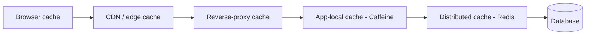

# Caching Fundamentals

> Prerequisites: [00-foundations/latency-throughput-and-capacity](../00-foundations/latency-throughput-and-capacity.md)
> Related: [cache-aside-read-through-write-through](./cache-aside-read-through-write-through.md) · [redis-design-and-failure-modes](./redis-design-and-failure-modes.md)

Caching is the highest-leverage read-scaling tool and one of the most tested topics. The depth that separates SDE-2 candidates is not "Redis is fast" — it's invalidation, failure behavior, stampedes, and knowing *when caching is a bad idea*.

---

## A. Problem and motivation

Repeated reads of the same data from the database are expensive: each query costs a network round trip, a connection, and DB CPU/IO. At scale (DMS is 20:1 read-heavy), the DB becomes the bottleneck. A cache stores frequently-read data in fast memory close to the application, so most reads never touch the DB.

**Concretely, why DB reads are expensive:** from the [latency table](../00-foundations/latency-throughput-and-capacity.md), RAM is ~100× faster than SSD and the DB adds a network hop + query planning + lock/MVCC overhead. Serving from an in-memory cache (~sub-ms) instead of the DB (~several ms + load) cuts latency *and* removes load from the scarce, hard-to-scale DB.

**What happens without caching at scale:** DB CPU/connections saturate, read latency climbs, and you're forced to the expensive fixes (replicas, sharding) sooner. Caching often buys 10–100× read headroom for a fraction of the cost.

---

## B. The layers of caching (there are many)

Caching happens at every level between the user and the data:

| Layer | Caches | Scope | Example |
|---|---|---|---|
| Browser | Static assets, API responses | One user | `Cache-Control` headers |
| CDN / edge | Static + edge content | Global | Images, JS/CSS, cacheable API responses. See [cdn-and-edge-caching](../10-storage-and-content-delivery/cdn-and-edge-caching.md) |
| Reverse proxy | Responses | Datacenter | nginx cache |
| App-local (in-process) | Objects | One instance | Caffeine (Java). See [local-vs-distributed-cache](./local-vs-distributed-cache.md) |
| Distributed | Objects/results | All instances | Redis / Memcached |
| Database | Query/buffer pool | DB | internal |

**Interview point:** "cache" isn't one thing. The cheapest cache is the one closest to the user (browser/CDN) because it avoids the most work. Push caching outward as far as correctness allows.

---

## C. The fundamental trade-off: speed vs freshness

A cache holds a *copy* of data. The moment the source changes, the copy is **stale**. Every caching decision is a trade between read speed (serve from cache) and freshness/correctness (data may be out of date). This is why **cache invalidation** is famously hard and gets its own [chapter](./cache-invalidation-and-consistency.md). The right staleness tolerance is a per-data decision (see [consistency-models](../03-databases-and-data-modeling/consistency-models.md)): a like-count can be stale for seconds; a user's permissions should not be.

**Cache hit ratio** is the key metric: fraction of reads served from cache. A 95% hit ratio means the DB sees only 5% of reads — a 20× reduction. Sizing the cache to hold the *working set* (the hot data) is how you get a high hit ratio without caching everything. See [cache-sizing-and-hit-ratio](../11-estimation-and-bottleneck-analysis/cache-sizing-and-hit-ratio.md).

---

## D. When caching is a BAD idea (interviewers love this)

Caching isn't free; don't cache reflexively:
- **Write-heavy, rarely-read data:** you'd invalidate constantly; low hit ratio; the cache adds overhead and staleness risk for little gain.
- **Data that must always be fresh/strongly consistent** (e.g., account balance for a transfer decision): a stale read is a correctness bug.
- **Low-traffic or non-repeated reads:** nothing to amortize; the cache just adds a layer and a dependency.
- **When it hides a fixable root cause:** if a missing index is the real problem, caching masks it instead of fixing it (see [indexing-and-query-optimization](../03-databases-and-data-modeling/indexing-and-query-optimization.md)). Fix the query first.

**Interview-ready:** "I'd cache read-heavy, repeatedly-accessed, change-tolerant data with a clear invalidation strategy. I would not cache strongly-consistent or write-heavy data, and I'd confirm a missing index isn't the real issue before adding a cache."

---

## E. Example — DMS

Document *metadata* (name, owner, status) is read ~20× per write and changes rarely → excellent cache candidate (cache-aside in Redis, invalidate on update). Permission/share data is read on nearly every request → cache it, but with prompt invalidation on permission change (stale authz is a security bug). The document *file bytes* are served via CDN (edge cache). A user's "last modified timestamp" that updates on every view → poor cache candidate (write-heavy). This per-datum reasoning is the signal.

---

## F. Trade-offs

| Aspect | Advantages | Disadvantages | Best use | Warning signs |
|---|---|---|---|---|
| Caching | Lower latency, big DB offload, cheap read scaling | Staleness, invalidation complexity, extra dependency, memory cost | Read-heavy, change-tolerant, repeated reads | Caching write-heavy or strongly-consistent data |

(Pattern-level trade-offs are in [cache-aside-read-through-write-through](./cache-aside-read-through-write-through.md).)

---

## G. Failure scenarios (overview; details in later chapters)

1. **Stale data served after a write** — see [cache-invalidation-and-consistency](./cache-invalidation-and-consistency.md).
2. **Cache stampede** — many requests miss a hot expired key and flood the DB — see [stampedes-hot-keys-and-penetration](./stampedes-hot-keys-and-penetration.md).
3. **Cache down** — the system must degrade (fall back to DB with a concurrency cap), not collapse — see [redis-design-and-failure-modes](./redis-design-and-failure-modes.md).

---

## H. Scaling implications

Caching is the Stage-4 read-scaling move and often the single biggest DB-offload lever. It converts a DB-read bottleneck into a cheap in-memory lookup for the hot set. But it introduces a new dependency (the cache) with its own failure modes, a staleness window you must bound, and the invalidation/stampede/hot-key problems the rest of this section covers. The order of fixes remains: **index/query → cache → replica → shard** — cache before replicas because it's cheaper and removes load entirely rather than spreading it.

---

## I. Interview preparation

**Basic**
- Q: Why cache? → *A: Repeated DB reads are expensive (network + CPU + load); a cache serves them from fast memory, cutting latency and offloading the scarce DB.*
- Q: What's cache hit ratio? → *A: Fraction of reads served from cache; higher = less DB load. 95% hit = DB sees 5% of reads.*

**Intermediate**
- Q: What's the fundamental caching trade-off? → *A: Speed vs freshness — a cache holds a copy that goes stale when the source changes; invalidation manages this.*
- Q: When is caching a bad idea? → *A: Write-heavy or rarely-repeated data (low hit ratio, constant invalidation), strongly-consistent data (stale = bug), or when it masks a fixable issue like a missing index.*

**SDE-2 / scenario**
- Q: "Would you cache a user's account balance?" → *A: No for the authoritative balance used in a transfer decision — it must be strongly consistent; a stale read risks a double-spend. I might cache a display-only balance with clear staleness, but not the one driving money movement.*
- Q: "Reads are slow; add Redis?" → *A: First check it's not a missing index or N+1 (cheaper fix). If it's genuinely read volume on change-tolerant data, cache-aside in Redis with a defined invalidation strategy and a Redis-down fallback.*

**Common wrong answers:** "add a cache" reflexively; caching strongly-consistent data; no invalidation plan; caching to hide a missing index.

---

## J. Hands-on exercise

Classify these DMS data items as good/poor cache candidates and justify: document metadata, document file bytes, user permissions, "last viewed at" timestamp (updates each view), and the authoritative storage-quota remaining used to allow/deny uploads. For the good ones, note the invalidation trigger.

---

## K. Revision summary

**Key takeaways**
- Caching serves repeated reads from fast memory, offloading the scarce DB — biggest cheap read-scaling lever.
- Many layers (browser → CDN → proxy → app-local → distributed → DB); cache as close to the user as correctness allows.
- Fundamental trade-off: speed vs freshness; hit ratio is the key metric; size to the working set.
- Don't cache write-heavy/strongly-consistent/rarely-read data, and don't let caching mask a missing index.

**Must explain without notes:** why DB reads are expensive; the speed/freshness trade-off; when NOT to cache.

**Rapid-fire**
1. Key cache metric? → Hit ratio.
2. Fundamental trade-off? → Speed vs freshness.
3. Cheapest cache layer (least work)? → Closest to the user (browser/CDN).
4. One case NOT to cache? → Strongly-consistent data (e.g., balance for a transfer).
5. Fix order with caching in it? → Index/query → cache → replica → shard.

**Next:** [cache-aside-read-through-write-through](./cache-aside-read-through-write-through.md)
