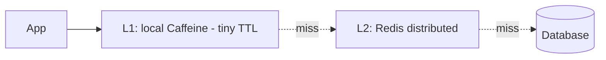

# Local vs Distributed Cache

> Prerequisites: [caching-fundamentals](./caching-fundamentals.md)
> Related: [redis-design-and-failure-modes](./redis-design-and-failure-modes.md) · [stampedes-hot-keys-and-penetration](./stampedes-hot-keys-and-penetration.md)

Local (in-process) and distributed caches solve *different* problems. The strong answer explains that they're complementary — often layered — not competitors. The master prompt specifically wants Caffeine vs Redis reasoning.

---

## A. Problem and motivation

Where should the cache live? Inside the application process (local, e.g., Caffeine) or in a separate shared service (distributed, e.g., Redis)? A local cache is blazing fast (same memory, no network) but each instance has its own copy — inconsistent and lost on restart. A distributed cache is shared and consistent across instances but adds a network hop and a dependency. Picking only one, or treating them as the same, misses that each solves a different problem.

---

## B. Local (in-process) cache — e.g., Caffeine

Lives in the app's heap. A `GET` is a map lookup in local memory — nanoseconds, no network.

- **Pros:** fastest possible (no network), no external dependency, trivial to add.
- **Cons:** **not shared** — each instance has its own copy, so they can disagree (stale/inconsistent across instances); **lost on restart/deploy** (cold); **can't be large** (bounded by the app's heap); invalidation across instances is hard (you'd need to broadcast).
- **Best for:** small, read-mostly, change-tolerant data where cross-instance inconsistency is acceptable: config/feature flags (short TTL), reference data, and *fronting* a distributed cache for hot keys.

---

## C. Distributed cache — e.g., Redis

A separate service all app instances share over the network.

- **Pros:** **shared & consistent** across instances (one copy of the truth), survives app restarts, can be large (dedicated memory, cluster), supports atomic ops (rate limiting, locks).
- **Cons:** network hop (~sub-ms in-region, still slower than local), an external dependency with its own failure modes (see [redis-design-and-failure-modes](./redis-design-and-failure-modes.md)), operational cost, and hot-key risk (one node).
- **Best for:** data shared across instances, larger datasets, data needing consistency across the fleet, cross-instance coordination (locks, counters, sessions).

---

## D. The key insight: they solve different problems (layer them)

| | Local (Caffeine) | Distributed (Redis) |
|---|---|---|
| Speed | Fastest (in-heap) | Fast (network hop) |
| Shared across instances? | No (per-instance copies) | Yes |
| Consistency across fleet | Weak (can diverge) | Strong (one copy) |
| Survives restart? | No | Yes |
| Size | Small (heap) | Large (dedicated/cluster) |
| Dependency/failure surface | None | External service |
| Solves | Latency on hot, change-tolerant data | Sharing + consistency + coordination |

They're **complementary**. A common layered pattern (**near cache / multi-level**):

The local L1 absorbs the hottest keys (killing hot-key load on Redis and cutting latency to ~0), while Redis L2 provides the shared, larger, consistent cache. The cost: the L1 copies can be briefly stale (bounded by a short local TTL) — acceptable for change-tolerant data.

---

## E. Example — DMS

- **Feature flags / global config** (read on every request, tiny, change-tolerant): **local Caffeine** with a 10–30s TTL. Reads never leave the process; a short TTL bounds cross-instance staleness. This also defuses the hot-key problem (every request would otherwise hammer one Redis key).
- **Document metadata / permissions** (shared, must be reasonably consistent across instances, larger): **Redis** cache-aside. All instances see the same cached value; invalidation on write affects everyone.
- **Layered:** the hottest documents could get a tiny local L1 in front of Redis to shave latency and offload the hot Redis node — accepting a few seconds of local staleness.

---

## F. Trade-offs

| Approach | Advantages | Disadvantages | Best use | Warning signs |
|---|---|---|---|---|
| Local only | Fastest, no dependency | Inconsistent across instances, cold on restart, small | Tiny change-tolerant data, hot-key fronting | Using it for data needing cross-instance consistency |
| Distributed only | Shared, consistent, large, coordination | Network hop, external dependency, hot-key risk | Shared state, sessions, locks, large sets | Treating it as always-available (no fallback) |
| Layered (L1 local + L2 distributed) | Best latency + sharing; defuses hot keys | Local staleness window; complexity | Hot, change-tolerant shared data | Layering strongly-consistent data (local staleness) |

---

## G. Failure scenarios

1. **Cross-instance inconsistency with local cache.** Trigger: data cached locally diverges between instances (one updated, others stale). Users: inconsistent responses depending on which instance served them. Fix: short TTL, or use a distributed cache for data needing consistency; broadcast invalidation if required.
2. **Cold local cache after deploy.** Trigger: rolling deploy restarts instances; local caches empty. Users: latency spike + DB load until warm. Fix: this is why hot shared data belongs in the surviving distributed cache; warm local caches lazily.
3. **Local caching of strongly-consistent data.** Trigger: caching permissions locally with a long TTL. Users: a revoked user keeps access on some instances. Fix: don't local-cache security-critical data with meaningful staleness; use short TTL or distributed with prompt invalidation.

---

## H. Scaling implications

Local caches scale perfectly (each instance caches independently, no shared bottleneck) but trade consistency and persistence; distributed caches provide consistency/sharing at the cost of a network hop and a shared dependency that can itself become a bottleneck (hot keys, single node). The layered L1/L2 pattern is how high-scale systems get both: local caches absorb the hottest, most-read keys (removing hot-key pressure from Redis and cutting latency), while Redis handles the shared, larger, consistent working set. Match the layer to the data's consistency need and size.

---

## I. Interview preparation

**Basic**
- Q: Local vs distributed cache? → *A: Local (Caffeine) is in-process, fastest, but per-instance (inconsistent, lost on restart, small); distributed (Redis) is shared/consistent/large but adds a network hop and an external dependency.*

**Intermediate**
- Q: Why not just use a local cache everywhere? → *A: Each instance has its own copy that can diverge and is lost on restart; data needing cross-instance consistency (or that must survive deploys) needs a distributed cache.*
- Q: When would you layer them? → *A: For hot, change-tolerant shared data: a tiny local L1 absorbs the hottest keys (latency ~0, offloads the Redis hot node) over a Redis L2 that provides sharing/consistency; accept a short local staleness window.*

**SDE-2 / scenario**
- Q: "A global config key is a hot key hammering Redis." → *A: Put it in a local (Caffeine) cache with a short TTL so each instance reads it from its own heap; this removes the hot-key load from Redis entirely, trading a few seconds of cross-instance staleness.*
- Q: "Can you local-cache user permissions?" → *A: Only with a very short TTL and awareness that a revoke may lag on some instances; for security correctness I'd prefer distributed with prompt invalidation, since stale authz across instances is a security bug.*

**Common wrong answers:** treating local and distributed as interchangeable; local-caching strongly-consistent data; assuming the distributed cache is always up (no fallback).

---

## J. Hands-on exercise

For the DMS, decide local vs distributed vs layered for: feature flags, document metadata, user sessions, user permissions, and the hottest 10 documents' metadata. Justify each by consistency need, size, and hot-key risk, and note the staleness you accept where you choose local.

---

## K. Revision summary

**Key takeaways**
- Local (Caffeine): fastest, in-process, but per-instance (inconsistent, cold on restart, small, no dependency).
- Distributed (Redis): shared, consistent, large, supports coordination — at a network hop + external dependency.
- They solve different problems; layer them (local L1 + distributed L2) for hot, change-tolerant shared data and to defuse hot keys.
- Don't local-cache strongly-consistent/security data with meaningful staleness.

**Must explain without notes:** the different problems each solves; the layered L1/L2 pattern; local-cache inconsistency.

**Rapid-fire**
1. Fastest cache? → Local (in-process).
2. Which is shared/consistent across instances? → Distributed.
3. Local cache after a deploy? → Cold (empty).
4. Fix a Redis hot key with a local cache? → Yes (L1 absorbs it; accept short staleness).
5. Local-cache permissions? → Only with very short TTL; prefer distributed + prompt invalidation.

**Next:** [redis-design-and-failure-modes](./redis-design-and-failure-modes.md)
