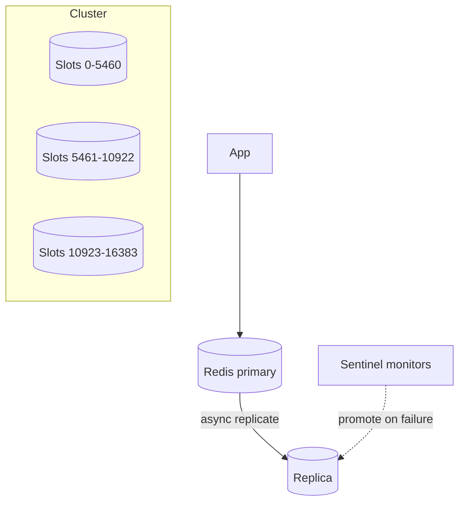
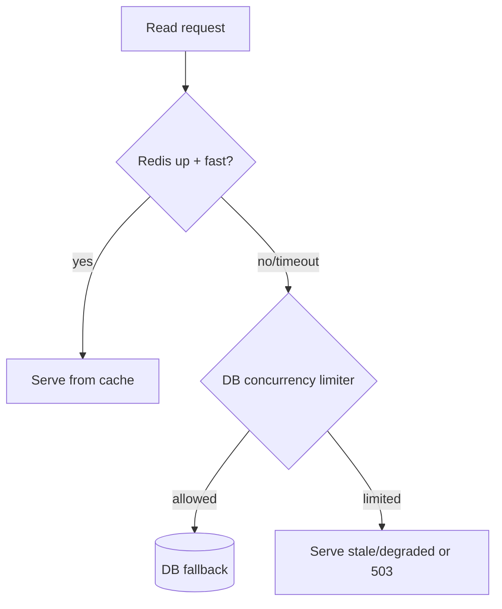

# Redis Design and Failure Modes

> Prerequisites: [caching-fundamentals](./caching-fundamentals.md), [local-vs-distributed-cache](./local-vs-distributed-cache.md), [stampedes-hot-keys-and-penetration](./stampedes-hot-keys-and-penetration.md)
> Related: [rate-limiting](../01-networking-and-api-design/rate-limiting.md) · [distributed-locks](../06-distributed-systems/distributed-locks.md)

Redis shows up in almost every design. You don't need deep Redis internals, but you must handle the question interviewers *always* ask: **"What happens when Redis goes down?"** The strong answer is a graceful-degradation plan, not "the system fails."

---

## A. Problem and motivation

Once you add Redis (cache, sessions, rate limiting, locks), it becomes a dependency on your critical path. If you treat it as always-available, a Redis outage takes down your whole system — the cache was supposed to *help* availability, not become a new single point of failure. The SDE-2 skill is designing for Redis being unavailable, slow, or partially failed, and knowing its persistence/replication/clustering model at an interview level.

---

## B. What Redis is (interview level)

An in-memory, single-threaded (per shard) key-value store with rich data types (strings, hashes, lists, sets, sorted sets) and atomic operations (`INCR`, Lua scripts) — which is why it's used for caching, rate limiting, leaderboards, sessions, and (carefully) locks. In-memory = ~100K+ ops/sec/node and sub-ms latency; single-threaded = commands are atomic but a slow command blocks others.

**Persistence (durability spectrum):**
- **RDB snapshots:** periodic point-in-time dumps — compact, fast restart, but loses writes since the last snapshot on crash.
- **AOF (append-only file):** logs every write — more durable (configurable fsync), slower, larger.
- **None:** pure cache — lose everything on restart (fine if the DB is the source of truth).

Choose based on whether Redis holds a cache (persistence optional) or authoritative-ish data (persistence needed).

**Replication & clustering:**
- **Replicas:** async-replicated copies for read scaling and failover.
- **Sentinel:** monitors + automates failover (promote a replica) for a single primary.
- **Cluster:** shards keys across nodes via hash slots (consistent-hashing-like), scaling memory/throughput; each slot has a primary + replicas.

---

## C. "What happens when Redis goes down?" — the graceful-degradation plan

This is the question. A strong answer covers *each use* of Redis:

**As a cache (cache-aside):** fall back to the DB. But a cold fallback can stampede the DB (every read now misses) — so add a **concurrency limiter / circuit breaker** on DB access and request coalescing, so the DB isn't overwhelmed. The system is *slower but still serving*. Set tight Redis timeouts so a slow/unreachable Redis doesn't hang request threads (Little's Law — see [latency](../00-foundations/latency-throughput-and-capacity.md)).

**As a rate limiter:** decide **fail-open** (allow traffic, risk overload) vs **fail-closed** (reject, protect backend) explicitly, with a local fallback cap. See [rate-limiting](../01-networking-and-api-design/rate-limiting.md).

**As a session store:** if sessions are only in Redis, an outage logs everyone out — mitigate with Redis replication/persistence, or use JWTs so sessions don't depend on Redis.

**As a distributed lock:** a Redis outage/failover can break lock safety (two holders) — never rely on a Redis lock alone for correctness; use **fencing tokens**. See [distributed-locks](../06-distributed-systems/distributed-locks.md).

**Interview-ready:** "If Redis is down, cache reads fall back to the DB behind a concurrency limiter and tight timeouts so we don't stampede or hang; rate limiting fails open with a local cap; sessions use JWTs so they survive a Redis outage; and I never trust a Redis lock for correctness without fencing."

---

## D. Example — DMS Redis uses and their degradation

| Redis use | On Redis down |
|---|---|
| Metadata cache (cache-aside) | Fall back to Postgres with a DB concurrency limiter + coalescing; slower but serving |
| Rate limiting | Fail open with a per-instance local cap (user-facing availability) |
| Sessions | Use JWTs → no dependency; or Redis replicated so failover is quick |
| View counters (write-behind) | Lose a few recent increments (acceptable, loss-tolerant) |

Each use has an explicit degradation. That completeness is the signal.

---

## E. Trade-offs

| Decision | Advantages | Disadvantages | Best use | Warning signs |
|---|---|---|---|---|
| No persistence (pure cache) | Fast, simple, DB is truth | Cold restart (avalanche risk) | Cache-only | Treating cache data as durable |
| AOF persistence | More durable | Slower, larger | Redis holding semi-authoritative data | Expecting zero loss from async fsync |
| Replicas + Sentinel | Read scaling + auto failover | Async lag → failover data loss window | HA cache/session store | Assuming failover is lossless/instant |
| Cluster | Scales memory/throughput | Hot keys still hit one node; multi-key ops limited to a slot | Large/high-throughput | Multi-key ops across slots |

---

## F. Failure scenarios

1. **Redis down → DB stampede (avalanche).** Trigger: Redis outage; every read misses and hits the DB. Users: DB overload, cascading slowness. Detect: Redis error rate + DB load spike. Mitigate: DB concurrency limiter + circuit breaker + coalescing + serve-stale. Prevent: design the fallback; replicate Redis.
2. **Slow Redis hangs threads.** Trigger: a slow command or network blip; app threads block on Redis. Users: latency spikes everywhere (Little's Law). Detect: rising in-flight requests, Redis latency. Mitigate: tight Redis timeouts + circuit breaker so Redis can't hang the app.
3. **Failover data loss.** Trigger: primary crashes before async-replicating recent writes; replica promoted. Effect: lost recent cache/session writes. Mitigate: AOF for semi-durable data; accept loss for pure cache. 
4. **Hot key overloads one node.** Trigger: one key gets most traffic (see [stampedes-hot-keys](./stampedes-hot-keys-and-penetration.md)). Fix: local cache in front / replicate / split the key.
5. **Big key / slow command blocks everything.** Trigger: a huge value or `KEYS *` on a big dataset (single-threaded!). Users: all commands stall. Fix: avoid big keys and O(N) commands in production; use `SCAN`.

---

## G. Scaling implications

Redis scales reads via replicas and memory/throughput via Cluster, but its single-threaded-per-shard model means one slow command or hot key degrades a whole node — so you avoid O(N) commands and big keys, and front hot keys with local caches. Crucially, as Redis becomes central (cache + sessions + limiter + locks), its availability bounds the system's — so you must engineer degradation for each use and often add replication/persistence. The recurring theme: a cache that helps availability must not *become* the single point of failure.

---

## H. Interview preparation

**Basic**
- Q: What is Redis good at? → *A: In-memory KV with rich types and atomic ops → caching, rate limiting, leaderboards, sessions, locks (carefully); ~sub-ms, high throughput.*
- Q: Redis persistence options? → *A: RDB snapshots (compact, lose since last snapshot), AOF (per-write log, more durable, slower), or none (pure cache).*

**Intermediate**
- Q: What happens when Redis goes down? → *A: Depends on use — cache reads fall back to the DB behind a concurrency limiter + tight timeouts (slower, not down); rate limiting fails open with a local cap; sessions use JWTs or replicated Redis; locks need fencing. The system degrades, not collapses.*
- Q: Why can one key or command take down a Redis node? → *A: Redis is single-threaded per shard; a hot key or an O(N) command (big value, `KEYS *`) blocks all other commands on that node.*

**SDE-2 / scenario**
- Q: "Redis just died in production. Walk me through impact and mitigation." → *A: Reads fall back to Postgres; without protection that stampedes the DB (avalanche), so I rely on a DB concurrency limiter, request coalescing, and serve-stale where possible, plus tight Redis timeouts so threads don't hang. Rate limiting fails open with a local cap. Sessions survive because they're JWTs. I'd fail over to a replica (Sentinel) and warm hot keys before resuming full cache reliance.*
- Q: "How do you avoid Redis being a SPOF?" → *A: Replication + automated failover (Sentinel/Cluster), persistence if data is semi-durable, graceful degradation per use (DB fallback, fail-open limiter, JWT sessions), and never trusting a Redis lock for correctness without fencing tokens.*

**Common wrong answers:** "the system fails if Redis is down"; no DB-stampede protection on fallback; relying on a Redis lock for correctness; running `KEYS *` in prod.

---

## I. Hands-on exercise

Your service uses Redis for cache-aside, rate limiting, and sessions. Write the degradation plan for a full Redis outage covering each use (fallback behavior, how you protect the DB, what users experience). Then explain why a slow Redis can be *worse* than a down Redis and how timeouts fix it.

---

## J. Revision summary

**Key takeaways**
- Redis: in-memory KV, atomic ops, single-threaded per shard; persistence = RDB/AOF/none; HA via replicas + Sentinel/Cluster.
- Always have a "Redis down" plan per use: cache → DB fallback behind a concurrency limiter + tight timeouts; limiter → fail-open with local cap; sessions → JWT or replicated; locks → fencing tokens.
- A slow Redis hangs threads (Little's Law) — tight timeouts + circuit breaker.
- Hot keys and O(N)/big-key commands overload a single-threaded node; avoid them.

**Must explain without notes:** the full "Redis down" degradation plan; why a slow Redis is dangerous; persistence options.

**Rapid-fire**
1. Redis down, cache use → ? → DB fallback behind a concurrency limiter + timeouts.
2. Why is a slow Redis dangerous? → It hangs app threads (Little's Law); use timeouts.
3. Lossless failover? → No — async replication has a loss window.
4. Why avoid `KEYS *` in prod? → Single-threaded; it blocks all commands.
5. Trust a Redis lock for correctness? → No, add fencing tokens.

**Section complete.** Next section: [05-messaging-and-event-driven-systems](../05-messaging-and-event-driven-systems/queues-vs-pub-sub-vs-event-streams.md)
