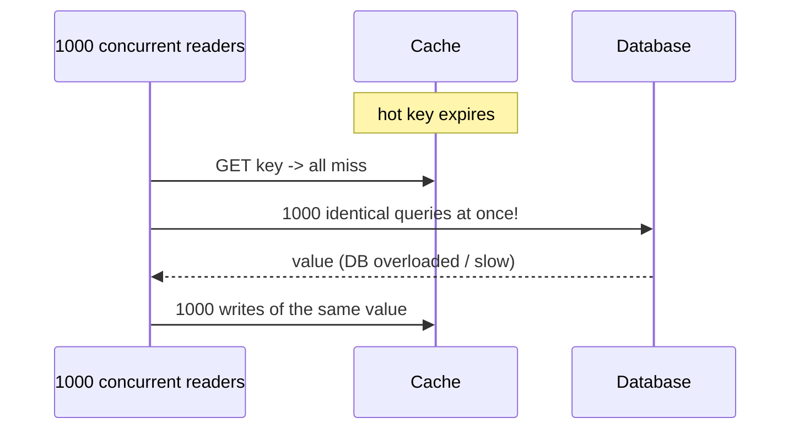

# Cache Stampedes, Hot Keys, Penetration, and Avalanche

> Prerequisites: [cache-aside-read-through-write-through](./cache-aside-read-through-write-through.md), [ttl-eviction-and-memory-management](./ttl-eviction-and-memory-management.md)
> Related: [redis-design-and-failure-modes](./redis-design-and-failure-modes.md) · [partitioning-and-sharding](../03-databases-and-data-modeling/partitioning-and-sharding.md)

These are the four failure modes interviewers probe when they ask "what goes wrong with caching at scale?" Know each by name, the trigger, and at least one fix. This is prime SDE-2 depth.

---

## A. Problem and motivation

A cache that works fine normally can *cause* an outage under specific conditions: a hot key expires and thousands of requests flood the DB, or lookups for non-existent keys bypass the cache entirely. These aren't exotic — they're routine at scale and a favorite follow-up. The master prompt specifically calls out stampedes, hot keys, penetration, and avalanche.

---

## B. Cache stampede (a.k.a. dog-piling / thundering herd)

**Trigger:** a hot key expires (or is evicted). Suddenly many concurrent requests all miss, all query the DB for the same value simultaneously, and all try to repopulate the cache.

**Fixes:**
1. **Request coalescing / single-flight:** only the *first* request fetches from the DB; others wait for that result and share it. One DB query instead of a thousand. (The most direct fix.)
2. **Early/probabilistic recomputation:** refresh the key *before* it expires (while still serving the cached value), so it never fully expires under load.
3. **Locking:** the first miss acquires a short lock to repopulate; others briefly serve stale or wait. 
4. **Don't let hot keys expire:** keep hot keys fresh via background refresh.

**Interview-ready:** "I'd prevent stampedes with request coalescing — the first miss fetches from the DB and concurrent requests wait for and share that single result — plus TTL jitter so hot keys don't all expire together."

---

## C. Hot key

**Trigger:** one key gets a disproportionate share of traffic (a celebrity's profile, a viral post, a global config value). Even if cached, in a distributed cache that key lives on *one node* ([consistent hashing](../GLOSSARY.md)), so that node is overwhelmed while others idle — a hot shard for the cache.

**Fixes:**
- **Replicate the hot key** across multiple cache nodes / add local (in-process) caching in front of the distributed cache for the hottest keys (so most reads never hit the single node). See [local-vs-distributed-cache](./local-vs-distributed-cache.md).
- **Split the key** into variants (e.g., `config:v1:shard0..N`) spread across nodes.
- **Client-side caching** of the hot value with a short TTL.

This mirrors the hot-partition problem in [sharding](../03-databases-and-data-modeling/partitioning-and-sharding.md) — same cause, same shape of fix.

---

## D. Cache penetration

**Trigger:** requests for keys that **don't exist** in the cache *or* the DB (e.g., queries for non-existent IDs, or a malicious scan of random IDs). Every such request misses the cache *and* misses the DB — the cache provides no protection, and the DB takes the full load.

**Fixes:**
- **Negative caching:** cache the "not found" result (with a short TTL) so repeated lookups for the same missing key don't hit the DB.
- **Bloom filter:** a space-efficient probabilistic set of existing keys; "definitely not present" lets you skip the DB entirely. See [GLOSSARY: bloom filter](../GLOSSARY.md).
- **Input validation:** reject obviously invalid keys before any lookup.

---

## E. Cache avalanche

**Trigger:** a large portion of the cache expires or is lost at once — synchronized TTLs expiring together, or the cache restarting empty. The DB is suddenly hit with the full read load it was shielded from.

**Fixes:**
- **TTL jitter** so keys don't expire simultaneously (see [ttl-eviction](./ttl-eviction-and-memory-management.md)).
- **Cache warming:** pre-populate hot keys after a restart before taking full traffic.
- **Gradual ramp / circuit breaker** on the DB so a cold cache doesn't instantly overload it.
- **Replication/persistence** so a cache node restart doesn't lose everything (see [redis-design-and-failure-modes](./redis-design-and-failure-modes.md)).

---

## F. Summary table

| Problem | Trigger | User impact | Primary fix |
|---|---|---|---|
| **Stampede** | Hot key expires; many concurrent misses | Latency spike, DB overload | Request coalescing (single-flight) + early refresh |
| **Hot key** | One key gets most traffic | One cache node overloaded | Replicate/split key; local cache in front |
| **Penetration** | Keys absent in cache AND DB | DB hit by every miss | Negative caching; bloom filter; validation |
| **Avalanche** | Many keys expire / cache restarts cold | DB flooded all at once | TTL jitter; cache warming; gradual ramp |

---

## G. Example — DMS

- **Stampede:** a widely-shared document's metadata expires at peak → request coalescing ensures one DB read repopulates it; TTL jitter prevents many docs expiring together.
- **Hot key:** a global "feature flags" key read on every request → cached locally (Caffeine) with a short TTL in front of Redis, so the Redis node holding it isn't overwhelmed.
- **Penetration:** scanners probing random document IDs → negative-cache 404s briefly + validate ID format; a bloom filter of existing document IDs lets us skip the DB for non-existent ones.
- **Avalanche:** after a Redis restart, warm the hot document set and ramp traffic, with a DB concurrency limiter so the cold cache doesn't overload Postgres.

---

## H. Failure scenarios (these ARE the failure scenarios)

Already enumerated above with trigger → impact → fix. The meta-lesson: a cache is a *dependency with its own failure modes*, and these four are the ones that turn a cache into an outage amplifier. A strong candidate proactively mentions coalescing + jitter + negative caching when adding a cache, rather than waiting to be asked.

---

## I. Scaling implications

All four get worse with scale: more concurrency makes stampedes bigger, more traffic concentrates on hot keys, more exposure invites penetration scans, and a bigger cache means a colder restart (avalanche). The fixes (coalescing, local caching of hot keys, bloom filters, TTL jitter, warming) are standard at scale. Crucially, these show that **adding a cache is not free** — it introduces failure modes you must design for, reinforcing "don't cache reflexively." At extreme scale, hot keys and stampedes are the main reasons a correctly-sized cache still causes incidents.

---

## J. Interview preparation

**Basic**
- Q: What is a cache stampede? → *A: A hot key expires and many concurrent requests all miss and hit the DB at once, overloading it.*

**Intermediate**
- Q: How do you prevent a stampede? → *A: Request coalescing (first request fetches, others wait and share the result), early/probabilistic refresh before expiry, and TTL jitter.*
- Q: Penetration vs stampede? → *A: Stampede = many requests for a key that exists but expired; penetration = requests for keys absent in both cache and DB (every one hits the DB). Fix penetration with negative caching / bloom filters.*

**SDE-2 / scenario**
- Q: "One key gets most of the traffic and overloads a cache node." → *A: Hot key — in a distributed cache it lives on one node. I'd put a short-TTL local (in-process) cache in front for that key, and/or replicate/split the key across nodes so reads spread out.*
- Q: "After a cache restart the DB fell over." → *A: Cache avalanche from a cold cache — the DB took the full load it was shielded from. I'd warm hot keys before full traffic, ramp gradually with a DB concurrency limiter/circuit breaker, and use TTL jitter + persistence/replication to avoid total cold starts.*

**Common wrong answers:** not knowing the terms; "just add a cache" without coalescing/jitter; no negative-caching for missing-key floods.

---

## K. Hands-on exercise

Your product has a global config value read on every request and cached in Redis. Walk through: (a) what happens when it expires at peak (name it), (b) why it's also a hot-key risk, (c) two fixes that address both, and (d) how a Redis restart could cause avalanche and your mitigation.

---

## L. Revision summary

**Key takeaways**
- **Stampede:** hot key expires → concurrent miss flood → DB overload. Fix: request coalescing + early refresh + jitter.
- **Hot key:** one key, one cache node overloaded. Fix: local cache in front / replicate / split key.
- **Penetration:** absent-everywhere keys hit the DB every time. Fix: negative caching + bloom filter + validation.
- **Avalanche:** mass expiry / cold restart floods the DB. Fix: TTL jitter + warming + gradual ramp + persistence.
- A cache is a dependency with failure modes — design for these proactively.

**Must explain without notes:** all four by name, trigger, and fix; stampede vs penetration distinction.

**Rapid-fire**
1. Fix for a stampede? → Request coalescing (single-flight) + TTL jitter.
2. Keys absent in cache AND DB? → Penetration (use negative caching / bloom filter).
3. One cache node overloaded by one key? → Hot key.
4. Cold cache floods DB? → Avalanche (warm + ramp + jitter).
5. Bloom filter helps which problem? → Penetration.

**Next:** [local-vs-distributed-cache](./local-vs-distributed-cache.md)
