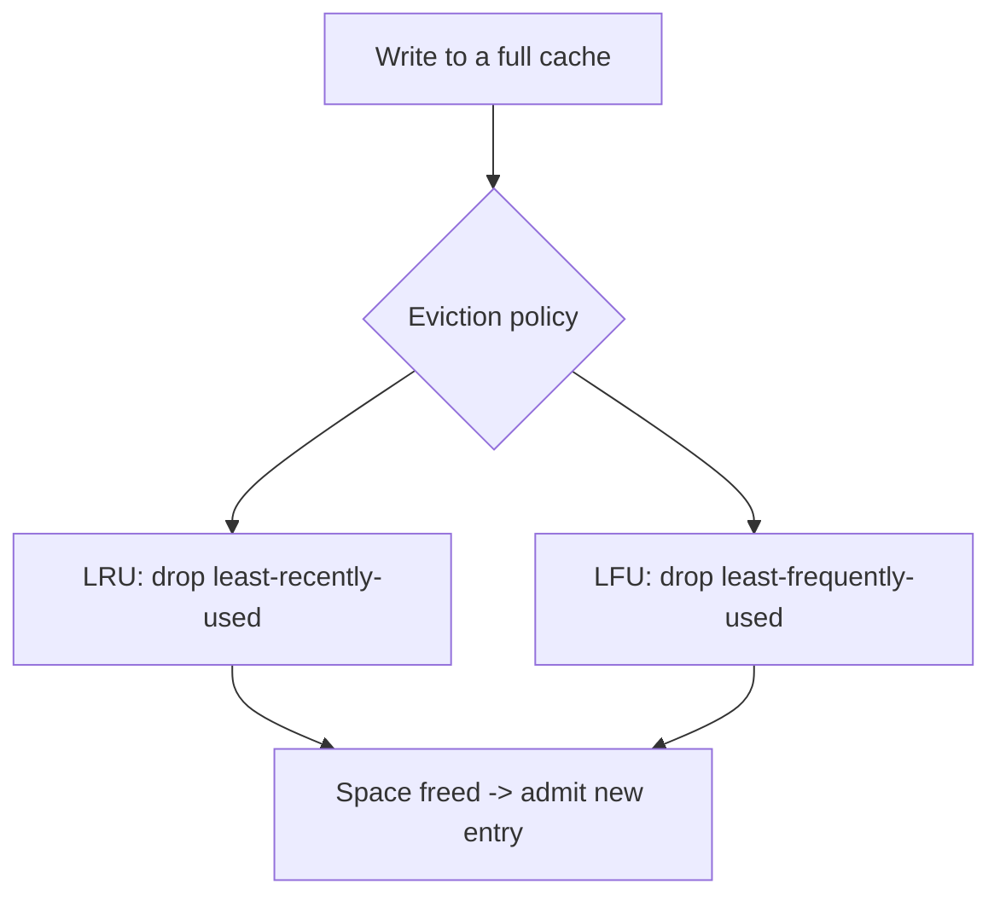

# TTL, Eviction, and Memory Management

> Prerequisites: [caching-fundamentals](./caching-fundamentals.md), [cache-invalidation-and-consistency](./cache-invalidation-and-consistency.md)
> Related: [cache-sizing-and-hit-ratio](../11-estimation-and-bottleneck-analysis/cache-sizing-and-hit-ratio.md) · [redis-design-and-failure-modes](./redis-design-and-failure-modes.md)

A cache has finite memory. TTL and eviction policies decide what stays and what goes. Getting these wrong causes low hit ratios, memory exhaustion, or synchronized expiry storms (avalanche).

---

## A. Problem and motivation

You can't cache everything — memory is limited and expensive. Two mechanisms manage what the cache holds: **TTL** (time-based expiry — remove entries after N seconds) and **eviction** (space-based removal — when memory is full, remove something to make room). Mismanage them and you either run out of memory (crashes/rejected writes) or evict the hot data you most needed (hit ratio collapses).

---

## B. TTL (time to live)

Each entry can carry an expiry. After it, the entry is gone (lazily on access and/or by a background sweeper). TTL does double duty:
- **Freshness/invalidation safety net** (see [cache-invalidation](./cache-invalidation-and-consistency.md)) — bounds staleness even if explicit invalidation is missed.
- **Memory hygiene** — stale/unused entries don't live forever.

Choosing TTL: too short → low hit ratio + more DB load (constant reloading); too long → stale data + memory held by cold entries. Set it to the data's staleness tolerance and access recency.

**TTL jitter (important):** if many keys are created together with the same TTL (e.g., a nightly warm-up), they *all expire at the same instant*, causing a synchronized miss storm (**cache avalanche**) that floods the DB. Fix: add random jitter to TTLs (e.g., `TTL ± 10%`) so expirations spread out. See [stampedes-hot-keys-and-penetration](./stampedes-hot-keys-and-penetration.md).

---

## C. Eviction policies (when memory is full)

When the cache hits its memory limit, it must evict to admit new entries. Common policies:

| Policy | Evicts | Good for | Weakness |
|---|---|---|---|
| **LRU** (Least Recently Used) | The entry not accessed for longest | General-purpose; recency-correlated access | A big one-time scan can evict the hot set |
| **LFU** (Least Frequently Used) | The least-accessed entry | Stable popularity (hot keys stay) | Slow to adapt to changing popularity; needs counters |
| **FIFO** | Oldest inserted | Simple | Ignores access patterns |
| **Random** | A random entry | Cheap, surprisingly okay | No pattern awareness |
| **TTL-only** | Only expired entries | — | May run out of memory if nothing expires |

**LRU is the common default** (recent access predicts future access). Redis offers variants like `allkeys-lru`, `allkeys-lfu`, `volatile-ttl` (evict soonest-to-expire among keys with a TTL), etc.

---

## D. Memory management and the maxmemory decision

A distributed cache (Redis) is configured with a memory limit (`maxmemory`) and a policy for what happens at the limit:
- **Evict** (per the policy above) — the cache acts as a cache (lossy), dropping cold data. Right for a pure cache.
- **Reject writes** (`noeviction`) — the cache refuses new writes when full. Right when the cache holds data you can't lose (but then it's not really "just a cache").

For a cache-aside Redis, you want an eviction policy (lossy is fine — the DB is the source of truth). For Redis-as-a-datastore, you'd avoid eviction and manage memory carefully. Sizing to the working set keeps the hit ratio high without over-provisioning memory. See [cache-sizing-and-hit-ratio](../11-estimation-and-bottleneck-analysis/cache-sizing-and-hit-ratio.md).

---

## E. Example — DMS

Document metadata cache: TTL ~5 min **with ±10% jitter** (avoid synchronized expiry), eviction `allkeys-lru` (recently-viewed docs stay hot; cold docs get evicted), `maxmemory` sized to hold the working set (~hot 20% of documents, estimated from access logs). This yields a high hit ratio, bounded staleness, and no memory exhaustion. The permission cache uses a shorter TTL (freshness) and the same LRU eviction.

---

## F. Trade-offs

| Decision | Advantages | Disadvantages | Best use | Warning signs |
|---|---|---|---|---|
| Short TTL | Fresh, memory-light | Low hit ratio, more DB load | Fast-changing / correctness-sensitive | Constant reloading, DB load |
| Long TTL | High hit ratio | Stale data, cold entries linger | Slow-changing data | Serving very stale data |
| LRU eviction | Simple, recency-aware | Scan can evict hot set | General | Big one-off scans |
| LFU eviction | Keeps stable hot keys | Slow to adapt, counter overhead | Stable popularity | Shifting popularity |
| TTL jitter | Prevents avalanche | Slightly less predictable expiry | Bulk-loaded keys | Synchronized expiry storms |

---

## G. Failure scenarios

1. **Cache avalanche (synchronized expiry).** Trigger: many keys with identical TTL expire together. Users: latency spike as all miss and hit the DB at once. Detect: periodic DB load spikes aligned with TTL boundaries. Fix: TTL jitter; staggered warm-up. 
2. **Memory exhaustion.** Trigger: no eviction policy or `noeviction` with growing data. Users: writes rejected / cache OOM. Fix: set `maxmemory` + an eviction policy; size to the working set. 
3. **Hot set evicted by a scan.** Trigger: a bulk/analytical read pulls cold data through the cache (LRU), evicting the hot set. Users: hit ratio collapses, DB load spikes. Fix: bypass the cache for scans, or use LFU/segmented LRU. 
4. **TTL too short → thundering reload.** Trigger: aggressive TTL on a hot key. Users: constant DB reloads. Fix: longer TTL + explicit invalidation; request coalescing (next doc).

---

## H. Scaling implications

Memory is the cache's scaling limit. Sizing to the *working set* (hot data) rather than the full dataset is what makes caching cost-effective — per the [80/20 estimation](../00-foundations/back-of-the-envelope-estimation.md), a small cache can capture most reads. Eviction keeps the cache focused on hot data automatically; TTL + jitter keeps it fresh and avoids expiry storms. At scale across a Redis cluster, memory is partitioned by key (consistent hashing), so sizing and eviction are per-node, and hot keys can still overload one node (see [redis-design-and-failure-modes](./redis-design-and-failure-modes.md)).

---

## I. Interview preparation

**Basic**
- Q: TTL vs eviction? → *A: TTL removes entries after a time (freshness + hygiene); eviction removes entries when memory is full (space management).*
- Q: Default eviction policy? → *A: LRU — recent access predicts future access.*

**Intermediate**
- Q: What's cache avalanche and how do you prevent it? → *A: Many keys expiring simultaneously flood the DB with misses; prevent with TTL jitter and staggered warm-up.*
- Q: LRU vs LFU? → *A: LRU evicts least-recently-used (adapts to recency, but a scan can evict the hot set); LFU evicts least-frequently-used (keeps stable hot keys, but adapts slowly and needs counters).*

**SDE-2 / scenario**
- Q: "Your cache keeps running out of memory." → *A: Set maxmemory + an eviction policy (LRU for a cache-aside Redis), and size to the working set; also check for unbounded key growth or missing TTLs.*
- Q: "A nightly batch job tanks your hit ratio." → *A: The scan pulls cold data through the LRU cache, evicting the hot set. I'd bypass the cache for the batch read (don't populate), or use an LFU/segmented policy so one-off scans don't evict hot keys.*

**Common wrong answers:** no eviction policy; identical TTLs on bulk keys (avalanche); sizing the cache for the full dataset; TTL too short causing reload storms.

---

## J. Hands-on exercise

Configure the DMS metadata cache: pick a TTL (with/without jitter and why), an eviction policy and why, and a maxmemory sizing approach from access patterns. Then explain what happens if a reporting job scans all documents through this cache and how you'd protect the hot set.

---

## K. Revision summary

**Key takeaways**
- TTL = time-based removal (freshness + hygiene); eviction = space-based removal when memory is full.
- Add TTL jitter to avoid cache avalanche (synchronized expiry storms).
- LRU default; LFU for stable popularity; set maxmemory + eviction (lossy is fine for cache-aside; DB is source of truth).
- Size to the working set, not the full dataset; beware scans evicting the hot set.

**Must explain without notes:** TTL vs eviction; cache avalanche + jitter fix; LRU vs LFU; working-set sizing.

**Rapid-fire**
1. Prevent synchronized expiry storms? → TTL jitter.
2. Default eviction policy? → LRU.
3. What does `maxmemory` + eviction prevent? → Memory exhaustion.
4. Risk of LRU during a big scan? → Hot set evicted.
5. Size the cache to? → The working set (hot data).

**Next:** [stampedes-hot-keys-and-penetration](./stampedes-hot-keys-and-penetration.md)
