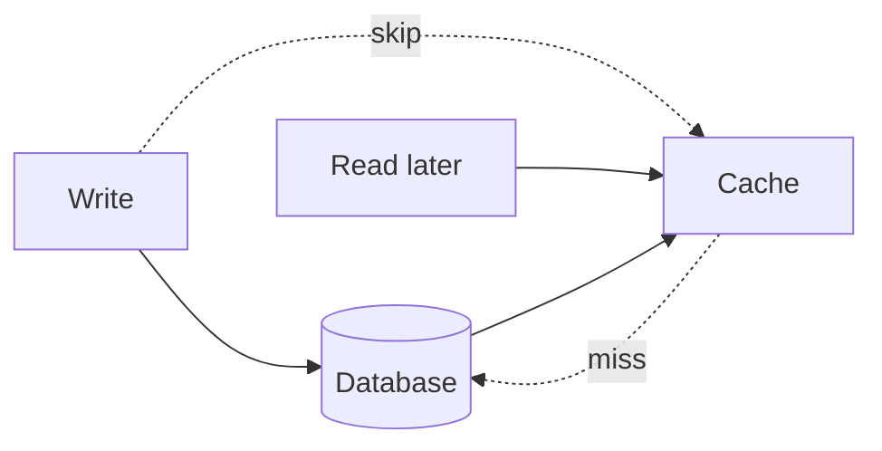
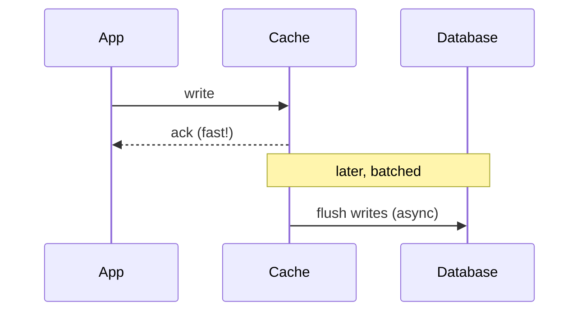

# Write-Behind and Write-Around

> Prerequisites: [cache-aside-read-through-write-through](./cache-aside-read-through-write-through.md)
> Related: [cache-invalidation-and-consistency](./cache-invalidation-and-consistency.md) · [message-delivery-semantics](../05-messaging-and-event-driven-systems/message-delivery-semantics.md)

Two more write strategies that complete the picture. Write-around optimizes write-heavy data that isn't read right after writing; write-behind trades durability for write throughput and is riskier. Know their trade-offs and when each is appropriate.

---

## A. Problem and motivation

The patterns in the [previous chapter](./cache-aside-read-through-write-through.md) handle read-heavy cases well. But some workloads are write-heavy, or write data that won't be read back soon. Write-through would then cache data nobody reads (wasteful) or make every write slow. Write-around and write-behind address these — each with distinct costs you must articulate.

---

## B. Write-around

On a write: write to the **DB only**, bypassing the cache. The cache is populated lazily on the next *read* (cache-aside style). So recently-written data isn't in the cache until someone reads it.

- **Pro:** avoids filling the cache with write-heavy data that may never be read (keeps the cache for actually-hot read data); good hit ratio for reads.
- **Con:** a read immediately after a write is a guaranteed miss (first-read latency); if you often read-after-write, this is worse than write-through.
- **Best use:** write-heavy data that's rarely read right after writing (e.g., audit logs, bulk imports) combined with cache-aside reads.

---

## C. Write-behind (write-back)

On a write: write to the **cache** and ack immediately; the cache **asynchronously** flushes to the DB later (batched).

- **Pro:** very fast writes (ack before DB); batching coalesces many writes into fewer DB ops (great for write-heavy counters/metrics).
- **Con (the big one):** **durability risk** — you acked before the data was durable in the DB. If the cache crashes before flushing, those writes are **lost**. Also adds complexity (flush ordering, failure handling) and the cache now holds authoritative un-flushed state.
- **Best use:** very write-heavy, loss-tolerant data where throughput matters more than every write surviving (e.g., view counts, non-critical metrics, aggregations). **Never** for data that can't be lost (money, orders).

---

## D. The durability spectrum

The write patterns form a durability/throughput spectrum:

| Pattern | Write latency | Durability on ack | Throughput | DB load |
|---|---|---|---|---|
| Write-through | High (cache+DB sync) | Durable | Low | High (every write) |
| Write-around | Medium (DB only) | Durable | Medium | High (every write) |
| Write-behind | Low (cache only) | **Not durable until flush** | High (batched) | Low (batched) |

**Interview framing:** "Write-behind buys write throughput by sacrificing durability-on-ack — only acceptable for loss-tolerant data. Write-around keeps the cache clean for read-heavy workloads at the cost of read-after-write misses."

---

## E. Example — DMS and metrics

- **DMS audit-event writes** (write-heavy, rarely read back immediately): **write-around** — write to the DB, don't pollute the Redis cache with audit rows; the rare read populates lazily.
- **Document view counters** (very high write rate, loss-tolerant, read approximately): **write-behind** — increment in Redis, flush aggregated counts to the DB periodically. If Redis dies, we lose a few recent view increments — acceptable for a view count. We would **never** use write-behind for the storage-quota ledger that gates uploads (must be durable/consistent).

---

## F. Trade-offs

| Pattern | Advantages | Disadvantages | Best use | Warning signs |
|---|---|---|---|---|
| Write-around | Clean cache for read-heavy; durable | Read-after-write misses | Write-heavy, rarely-read-after-write | Frequent read-after-write |
| Write-behind | Fast writes, batched DB load | Data loss on cache crash; complexity | Loss-tolerant high-write (counters/metrics) | Using it for money/orders/critical data |

---

## G. Failure scenarios

1. **Write-behind data loss.** Trigger: cache crashes before flushing acked writes. Users: recent writes vanish. Detect: reconciliation gaps between cache and DB. Mitigate: replicate the cache / persist the write-behind buffer (reduces but doesn't eliminate the risk); only use for loss-tolerant data. Prevent: don't write-behind critical data.
2. **Write-behind flush backlog.** Trigger: writes outpace the flush rate; buffer grows. Users: memory pressure, bigger loss window. Fix: backpressure, bound the buffer, scale flush. 
3. **Write-around read-after-write latency.** Trigger: user reads data they just wrote. Users: slower first read (miss). Fix: if read-after-write is common, use write-through instead.

---

## H. Scaling implications

Write-behind is one of the few cache patterns that *reduces DB write load* (via batching), which is why it's used for extreme write volumes like counters — but it moves authoritative state into the cache temporarily, trading durability for throughput. Write-around optimizes the hit ratio for mixed read/write workloads by keeping write-heavy data out of the cache. Neither replaces DB-level write scaling (sharding) for durable data; they're targeted optimizations for specific data classes. Classifying each data item by its read/write profile and loss tolerance is the skill.

---

## I. Interview preparation

**Basic**
- Q: Write-around vs write-behind in one line each? → *A: Write-around writes to the DB only (cache populated lazily on read); write-behind writes to the cache and flushes to the DB asynchronously (fast but risks loss).*

**Intermediate**
- Q: What's the main risk of write-behind? → *A: Durability — the write is acked before it's in the DB, so a cache crash before flush loses it; only for loss-tolerant data.*
- Q: When write-around over write-through? → *A: For write-heavy data rarely read right after writing — avoids filling the cache with data nobody reads soon.*

**SDE-2 / scenario**
- Q: "How do you handle a very hot view counter at huge write volume?" → *A: Write-behind in Redis — increment in memory, flush batched aggregates to the DB periodically. It's loss-tolerant (losing a few recent increments on a crash is acceptable), and batching slashes DB write load.*
- Q: "Can you write-behind the account ledger?" → *A: No — ledger writes must be durable on ack; write-behind's loss window is unacceptable for money. Use durable writes (write-through/direct DB with transactions).*

**Common wrong answers:** write-behind for critical/durable data; write-around when read-after-write is common; ignoring the write-behind loss window.

---

## J. Hands-on exercise

For a social app, assign a write strategy to each and justify: posting a new photo (read soon by the author), incrementing a post's like count (huge volume, loss-tolerant), and writing an immutable payment receipt. Note the durability/throughput trade-off for each.

---

## K. Revision summary

**Key takeaways**
- Write-around: DB-only write, cache populated lazily on read; keeps the cache clean for read-heavy data; read-after-write is a miss.
- Write-behind: cache write + async batched DB flush; fast + low DB write load, but loses un-flushed writes on cache crash → loss-tolerant data only.
- Durability/throughput spectrum: write-through (durable, slow) → write-around → write-behind (fast, not durable on ack).
- Classify each datum by read/write profile + loss tolerance to choose.

**Rapid-fire**
1. Which pattern risks data loss? → Write-behind.
2. Which skips the cache on write? → Write-around.
3. Write-behind's benefit for the DB? → Fewer, batched writes (lower load).
4. Can you write-behind money? → No (durability).
5. Write-around's downside? → Read-after-write cache miss.

**Next:** [cache-invalidation-and-consistency](./cache-invalidation-and-consistency.md)
